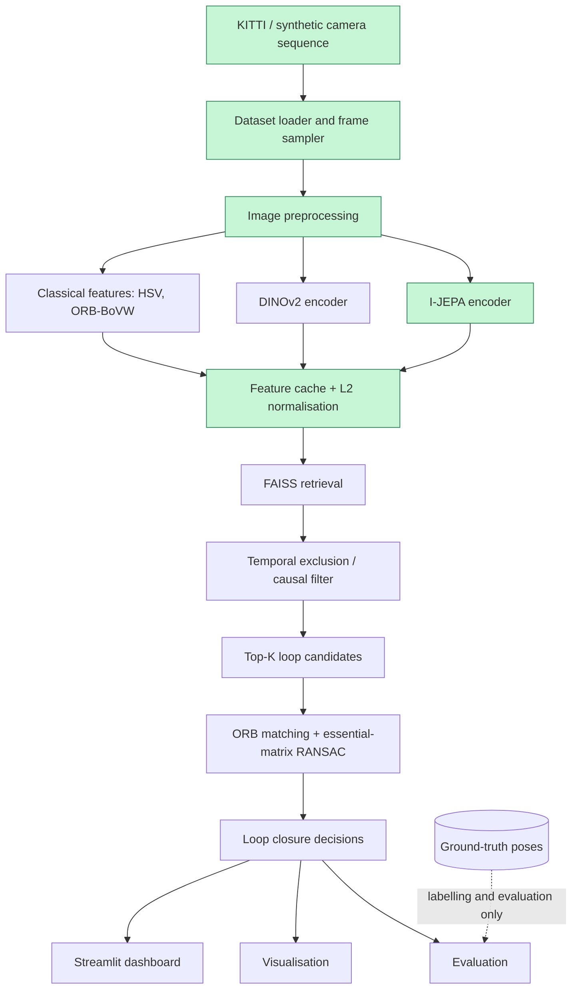
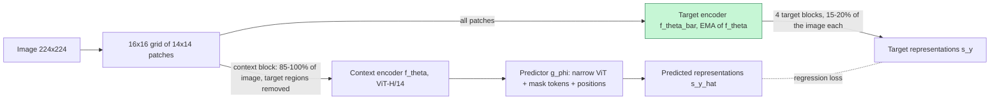

# Latent-Loop

**Self-Supervised Visual Place Recognition and Loop Closure Detection Using Joint Embedding Predictive Architectures**

Self-supervised visual place recognition and loop closure detection using JEPA representations, geometric verification, and reproducible SLAM benchmarks.

> **Status: Phase 2 of 8 complete** (dataset infrastructure and frozen I-JEPA feature
> extraction). No retrieval or loop-closure *detection* results exist yet; Phase 2 reports
> descriptor-space diagnostics only. Figures are labelled **SYNTHETIC** (procedurally rendered
> city, see [Synthetic dataset](#synthetic-dataset-with-known-revisits)) or **KITTI** (real
> KITTI Odometry imagery, downloaded as described in [Dataset preparation](#dataset-preparation)).

---

## Contents

1. [Research motivation](#research-motivation)
2. [Architecture](#architecture)
3. [Progress](#progress)
4. [Installation](#installation)
5. [Dataset preparation](#dataset-preparation)
6. [Phase 1: dataset infrastructure](#phase-1-environment-and-dataset-infrastructure)
7. [Steps to run Phase 1](#steps-to-run-phase-1)
8. [Phase 1 results](#phase-1-results)
9. [Phase 2: I-JEPA feature extraction](#phase-2-i-jepa-feature-extraction)
10. [Steps to run Phase 2](#steps-to-run-phase-2)
11. [Phase 2 results](#phase-2-results)
12. [Troubleshooting](#troubleshooting)
13. [References](#references)

---

## Research motivation

A SLAM system accumulates drift. **Loop closure detection** recognises that the vehicle has
returned to a previously visited place, so a back-end can correct that drift. The perception
problem underneath it is **visual place recognition (VPR)**: given the current image, retrieve
earlier images of the same place despite changes in viewpoint, lighting and dynamic objects.

Joint Embedding Predictive Architectures (JEPA, e.g. I-JEPA) learn image representations by
predicting the *representations* of masked image regions from visible context, rather than
reconstructing pixels or contrasting augmented views. This project asks:

> **Can pretrained JEPA representations provide competitive visual place recognition and loop
> closure detection performance compared with DINOv2 and classical computer vision approaches?**

Scope: frozen pretrained encoders are evaluated. No JEPA model is trained from scratch, and no
full SLAM back-end or pose-graph optimisation is built in the initial release. No claim about
JEPA versus other methods will be made without measured results.

## Architecture



Green boxes are implemented (Phases 1–2). Ground-truth poses are only ever used for labelling,
evaluation and visualisation, never to select retrieval candidates. See
[docs/architecture.md](docs/architecture.md) for the module map.

## Progress

| Phase | Scope | Implementation | Tests | Visualization | GIF | Documentation | Status |
|---|---|---|---|---|---|---|---|
| 1 | Environment and dataset infrastructure | ✅ | ✅ 51 passed | ✅ | ✅ | ✅ | **Complete** (synthetic data; real KITTI not downloaded) |
| 2 | I-JEPA feature extraction | ✅ | ✅ 90 passed (all phases; 39 new) | ✅ | ✅ | ✅ | **Complete** (official checkpoint verified against Meta's code; synthetic + KITTI 00) |
| 3 | Visual place retrieval | ⬜ | ⬜ | ⬜ | ⬜ | ⬜ | Not started |
| 4 | Geometric verification | ⬜ | ⬜ | ⬜ | ⬜ | ⬜ | Not started |
| 5 | Baseline comparison | ⬜ | ⬜ | ⬜ | ⬜ | ⬜ | Not started |
| 6 | Benchmarking and evaluation | ⬜ | ⬜ | ⬜ | ⬜ | ⬜ | Not started |
| 7 | Streamlit dashboard | ⬜ | ⬜ | ⬜ | ⬜ | ⬜ | Not started |
| 8 | Final integration and release | ⬜ | ⬜ | ⬜ | ⬜ | ⬜ | Not started |

## Installation

### Hardware used for development

Measured with `scripts/check_environment.py` (the report is saved to `results/metrics/environment.json`):

| Item | Value |
|---|---|
| Host | Lenovo Legion, Windows 11 + WSL2 Ubuntu 22.04 (kernel 6.6.87.2-microsoft-standard-WSL2) |
| CPU | AMD Ryzen 7 4800H, 8 cores / 16 threads |
| RAM (visible to WSL) | 7.4 GiB + 2 GiB swap |
| GPU | NVIDIA GeForce GTX 1650 Ti, 4 GiB VRAM, compute capability 7.5, driver 591.74 (CUDA 13.1) |
| Python | 3.12.13 (3.11 is not installed on this machine; the package requires >= 3.11) |

Measured implications:
- **Precision.** The GTX 1650 Ti (TU117, no Tensor Cores) is *slower* in FP16 than in FP32: 0.36 vs 1.62 TFLOPS on a 4096² matmul, and 943 vs 237 ms/image for ViT-H/14. It also has no native BF16. Inference therefore runs in FP32, selected automatically by a micro-benchmark (see [Phase 2](#gpu-optimisation-and-robustness)).
- **VRAM.** 4 GiB holds the 2.5 GB FP32 ViT-H/14 weights plus batch-8 activations (peak 2.68 GB reserved). Models are loaded one at a time.
- **RAM.** 7.4 GiB of RAM means memory-mapped checkpoint loading and disk-cached embeddings.

### Environment setup

The repository and its virtual environment `.env/` live together on the Windows data drive
(`/home/ubuntu_22/harish_ws/hdd_ws/jepa_slam` → `/mnt/e/project_ws/jepa_slam`).

```bash
cd /home/ubuntu_22/harish_ws/hdd_ws/jepa_slam   # repository root
unset PYTHONPATH                                # see Troubleshooting: ROS 2 leaks into PYTHONPATH
python3.12 -m venv .env                         # any Python >= 3.11; .env/ is git-ignored
source .env/bin/activate
pip install --upgrade pip
pip install -e ".[dev,ml]"                      # ml = PyTorch (Phase 2+)
```

On this machine `pip install` of PyTorch 2.15.0 (CUDA 13.2 wheels, about 3 GB unpacked) took
about 25 minutes on `/mnt/e`. File I/O over the WSL–Windows bridge (DrvFs/9P) is slow, so a
venv on the Linux filesystem (e.g. `~/.venvs/latent-loop`) is several times faster if speed
matters more than keeping everything on one drive. `requirements.txt` lists the same pinned
dependencies for non-editable installs.

In VS Code, choose **Python: Select Interpreter** → `.env/bin/python` so that diagnostics see
the installed packages.

### Repository layout (Phases 1–2)

```text
configs/            default.yaml (synthetic), kitti.yaml, ijepa.yaml (each extends default)
src/latent_loop/
  datasets/         base.py, kitti.py, kitti_download.py, synthetic.py, ground_truth.py
  encoders/         base.py (VisualEncoder), vit.py, ijepa.py
  features/         extraction.py, pooling.py, cache.py
  evaluation/       metrics.py, profiling.py
  utils/            config.py, logging.py, device.py
  visualization/    plots.py, trajectory.py, animations.py, embeddings.py, phase2.py
scripts/            check_environment.py, prepare_dataset.py, download_kitti.py,
                    download_checkpoints.py, extract_embeddings.py, verify_ijepa.py,
                    generate_visualizations.py
tests/              conftest.py + test_{datasets,ground_truth,config,visualization,kitti_download,
                    encoders,features,metrics,embedding_plots}.py
assets/phase_01_dataset/, assets/phase_02_ijepa/   committed figures and GIFs
data/ checkpoints/ results/ .env/                  git-ignored (datasets, weights, caches, venv)
```

## Dataset preparation

### KITTI Odometry (selective download, done)

The official colour archive (`data_odometry_color.zip`, 69.0 GB) contains all 22 sequences
and both colour cameras. Loop-closure experiments need only the sequences that revisit
places, from one camera, so `scripts/download_kitti.py` fetches **individual files** from the
official archives using HTTP range requests:
1. Read the zip index (central directory).
2. Stream each selected byte span once.
3. Verify every file against its CRC-32.
4. Write files atomically, resuming if interrupted.

```bash
python scripts/download_kitti.py --list-only   # sizes only, nothing written
python scripts/download_kitti.py               # default: sequences 00 02 05 06 08 09, camera 2
```

Downloaded on this machine (24 min 21 s at about 10.5 MB/s; every file CRC-verified):

| Archive | Selected | Size |
|---|---|---|
| `data_odometry_color.zip` (69.0 GB) | `image_2` of sequences 00, 02, 05, 06, 08, 09: 18,726 PNGs | 15.35 GB |
| `data_odometry_calib.zip` | `calib.txt` + `times.txt` of all 22 sequences | 0.6 MB |
| `data_odometry_poses.zip` | ground-truth poses of sequences 00–10 | 1.3 MB |

Layout (what `configs/kitti.yaml` expects):

```text
data/raw/kitti/dataset/
├── sequences/00/
│   ├── image_2/000000.png ...   # left colour camera
│   ├── calib.txt                # P0..P3 (3x4 rectified projections), Tr (velodyne -> cam0)
│   └── times.txt                # one timestamp [s] per frame
└── poses/00.txt                 # ground truth, sequences 00-10 only
```

Validated with the Phase 1 loader (`python scripts/prepare_dataset.py kitti --sequence <SS>`):

| Seq | Frames | Image size | Trajectory | fx [px] | Revisit frames | same dir. / opposite / crossing |
|---|---|---|---|---|---|---|
| 00 | 4541 | 1241 × 376 | 3.72 km | 718.86 | 804 (17.7 %) | 744 / 2 / 58 |
| 02 | 4661 | 1241 × 376 | 5.07 km | 718.86 | 315 (6.8 %) | 246 / 44 / 25 |
| 05 | 2761 | 1226 × 370 | 2.21 km | 707.09 | 448 (16.2 %) | 390 / 0 / 58 |
| 06 | 1101 | 1226 × 370 | 1.23 km | 707.09 | 270 (24.5 %) | 268 / 0 / 2 |
| 08 | 4071 | 1226 × 370 | 3.22 km | 707.09 | 345 (8.5 %) | 0 / 287 / 58 |
| 09 | 1591 | 1226 × 370 | 1.71 km | 707.09 | 19 (1.2 %) | 19 / 0 / 0 |

*Revisit frames* are measured from the ground-truth poses (CPU): frames within 5 m of a frame at
least 100 frames older, classified by the heading difference to the nearest such frame as same
direction (< 30°), opposite (> 150°) or crossing (30–150°). KITTI 08 has no same-direction
revisits at all, and KITTI 09 has only 19 revisit frames.

KITTI is licensed CC BY-NC-SA 3.0 (non-commercial use; see
<https://www.cvlibs.net/datasets/kitti/>). Other sequences or the grayscale archive can be
fetched with `--sequences` and `--gray --cameras 0`.

### Synthetic dataset (no download)

```bash
python scripts/prepare_dataset.py synthetic --out data/processed/synthetic_kitti
```

This writes the synthetic sequence in KITTI layout: 599 PNGs, `calib.txt`, `times.txt`,
`poses/00.txt` and `revisit_pairs.txt`, 46 MB in total. The in-memory synthetic dataset does
not need this export. The export exists so the KITTI loader can be exercised end to end.

---

## Phase 1: environment and dataset infrastructure

### Objective

Provide a reliable, tested data layer. Later phases receive camera frames together with
**original frame IDs**, **timestamps**, **calibration** and (for evaluation only)
**ground-truth poses**, all correctly aligned and independent of any frame sampling.

### Dataset interface

`src/latent_loop/datasets/base.py` defines `VisualSequenceDataset`:

```python
class VisualSequenceDataset:
    def __len__(self) -> int: ...                          # frames in the sampled view
    def get_frame(self, index) -> Frame: ...               # image + frame_id + timestamp + pose
    def get_pose(self, index) -> np.ndarray | None: ...    # 4x4 T_world_camera
    def get_timestamp(self, index) -> float: ...           # seconds
    def get_calibration(self) -> CameraCalibration: ...    # K, P, image size, T_cam0_cam
    def frame_id(self, index) -> int: ...                  # original frame number
    frame_ids: np.ndarray                                   # original IDs of the view
```

`index` addresses the sampled view (`0..len-1`). `frame_id(index)` is the frame number in the
source sequence. **Temporal reasoning in later phases (temporal exclusion, causal replay) must
use `frame_id` or timestamps, never `index`**, because a strided view with missing frames does
not map indices to time uniformly.

| Output | Type | Notes |
|---|---|---|
| `Frame.image` | `uint8`, `H×W×3` RGB or `H×W` grayscale | loaded lazily from disk on every call |
| `Frame.pose` | `float64 (4,4)` or `None` | `None` when the sequence has no ground truth |
| `Frame.timestamp` | `float` seconds | from `times.txt`, or estimated at 10 Hz if it is missing |
| `CameraCalibration.K` | `(3,3)` | intrinsics of the camera that produced the images |

Implementations are `KittiOdometryDataset` (`kitti.py`) and `SyntheticLoopDataset`
(`synthetic.py`). `build_dataset(config)` builds either from YAML.

### Pose coordinate conventions

KITTI poses (`poses/XX.txt`) store one row-major 3×4 matrix per line: the homogeneous transform
from the camera-0 frame at time *k* into the world frame. The world frame is camera 0 at the
first frame:

$$
T_{wc_k} = \begin{bmatrix} R_k & t_k \\ 0^\top & 1 \end{bmatrix},\qquad
p_w = R_k\,p_{c} + t_k .
$$

Camera axes: **x right, y down, z forward**. The vehicle moves in the x–z plane, so trajectory
plots are top-down (x, z). Heading (yaw) is the direction of the camera's forward axis
$f = R_k e_z$:

$$\psi_k = \operatorname{atan2}(f_x, f_z) = \operatorname{atan2}(R_{k,13}, R_{k,33}),$$

so $\psi=0$ looks along world +z and $\psi=+\pi/2$ along +x (a right turn).

**Cameras other than camera 0.** The rectified projection matrices are
$P_i = K\,[\,I \mid b_i\,]$, so a point in camera-0 coordinates maps to camera *i* as
$X_{c_i} = X_{c_0} + b_i$ with $b_i = K^{-1}P_i[:,3]$. The loader therefore returns

$$
T_{w c_i} = T_{w c_0}\,T_{c_0 c_i},\qquad T_{c_0 c_i} = \begin{bmatrix} I & -K^{-1}P_i[:,3] \\ 0^\top & 1\end{bmatrix}.
$$

For camera 2 on KITTI this is about a 6 cm shift to the left (−x). The test
`test_kitti_calibration_parsing` checks this. Calibration validity (`fx, fy > 0`, principal
point inside the image, finite values) is checked by `CameraCalibration.is_valid()`.

Other utilities in `ground_truth.py`: SE(3) inverse $T^{-1} = [R^\top \mid -R^\top t]$, relative
pose $T_{ab} = T_{wa}^{-1}T_{wb}$, arc length $s_k = \sum_{j<k}\lVert t_{j+1}-t_j\rVert$, and
rotation validity ($R^\top R = I$, $\det R = 1$).

### KITTI loading algorithm

1. List `image_i/NNNNNN.png`; the integer `NNNNNN` is the frame ID.
2. Read `times.txt`. Line *k* is frame *k*, and timestamps must be strictly increasing. If the
   file is missing, timestamps are estimated as $k/10\,\text{Hz}$ and flagged
   (`timestamps_estimated=True`).
3. Frames listed in `times.txt` without an image go into `missing_frame_ids` and are skipped
   with a warning. They do **not** shift the alignment, because every lookup goes through the
   frame ID.
4. Read `poses/XX.txt` if it exists. Its line count must equal the number of frames in
   `times.txt`, otherwise a `ValueError("Pose/frame misalignment")` is raised. If the file is
   absent (sequences 11–21), `has_poses=False` and `get_pose` returns `None`.
5. Parse `calib.txt` and build `CameraCalibration` for the selected camera. The image size is
   taken from the first available image.
6. Apply frame sampling (below). Images are decoded only when requested (lazy loading).

### Frame sampling algorithm

Given the available frame IDs $A$ (images present) and `start`, `end`, `stride` $k$ and
`max_frames` $M$:

$$
S = \operatorname{first}_M\Big(\{\, f \in A \;:\; \text{start} \le f < \text{end},\;\; (f-\text{start}) \bmod k = 0 \,\}\Big)
$$

Selection is on the **frame-ID grid**, not on positions in the list of available frames. With
frame 3 missing and stride 2, the result is `0, 2, 4, 6, 8`, still evenly spaced in time;
slicing the list would give `0, 2, 5, 7`. This is tested in
`test_sampling_uses_frame_id_grid_not_list_positions`. Sampling never changes frame IDs, so
image, pose and timestamp stay aligned (`test_kitti_sampling_preserves_original_ids`).

Configuration (`configs/default.yaml`):

```yaml
dataset:
  sampling:
    start: 0          # first original frame ID (inclusive)
    end: null         # last original frame ID (exclusive)
    stride: 1         # keep frame IDs f with (f - start) % stride == 0
    max_frames: null  # cap on the number of sampled frames
```

Any value can be overridden from the command line, e.g. `--set dataset.sampling.stride=5`.

### Synthetic dataset with known revisits

`SyntheticLoopDataset` exists so that every later phase can be tested against **exact** loop
closure ground truth before running on KITTI. All of it is deterministic given `seed`.

**Route.** A rounded rectangle, $W \times L = 80 \times 120$ m with corner radius $r = 15$ m,
has perimeter

$$P = 2(W+L) - 8r + 2\pi r = 374.25\ \text{m}.$$

The vehicle starts halfway along the left straight, heading +z, and drives `laps = 1.6` laps
with frame spacing $\Delta = 1$ m at 10 Hz (10 m/s). That gives 599 frames and 596 m. Frame
*k* sits at arc length $s_k = k\Delta$. Positions are interpolated on a dense polyline, and the
heading is the central-difference tangent.

**Second-lap offset.** To avoid pixel-identical revisits, frames with $s_k \ge P$ drift
smoothly to a lateral offset of $d_0 = 0.5$ m to the right:

$$d(s) = d_0\,\sigma\!\left(\tfrac{s-P}{20\,\text{m}}\right),\qquad \sigma(x)=3x^2-2x^3 \text{ on } [0,1].$$

**Constructed revisit pairs.** Every frame *k* with $s_k \ge P$ revisits first-lap frame
$j = \operatorname{round}((s_k - P)/\Delta)$. The sequence has 224 pairs, all exactly 374 frames
(37.4 s) apart and at most 0.56 m apart in space. These pairs come from the construction, not
from a distance threshold, and Phase 3 will compare its threshold-based labels against them.

**World and rendering.** 66 buildings (seeded width 4–11 m, height 4–20 m, HSV colour, window
grid) stand 9–15 m to either side of the road, never closer than 7 m to the route. Each frame
is rendered with a pinhole camera, $f_x = f_y = 0.55\,W_{img}$ (about 85° horizontal FOV),
416×128 px:

$$u = f_x \frac{x_c}{z_c} + c_x,\qquad v = f_y \frac{y_c}{z_c} + c_y,\qquad p_c = R^\top (p_w - t).$$

Buildings are drawn far to near (painter's algorithm) with depth haze
$\alpha = 1 - e^{-z_c/70\,\text{m}}$ plus seeded Gaussian pixel noise ($\sigma = 2$). The ground
plane is $y_w = 1.65$ m (camera height).

**Limitations.** The images are flat billboards with no texture variation, lighting change,
occlusion by dynamic objects or perspective distortion of facades. Revisits are easy by design:
`test_synthetic_revisits_look_more_similar_than_other_places` checks that revisit pairs differ
less than half as much in pixels as unrelated places. Results on this data are pipeline sanity
checks, **not** evidence about real-world place recognition.

### Configuration and logging

- `utils/config.py`: YAML with `extends:` inheritance (deep merge; cycles are detected), dotted
  CLI overrides parsed as YAML scalars, and `resolve_path` (relative to the repository root).
- `utils/logging.py`: console format `HH:MM:SS LEVEL logger: message key=value` and an optional
  JSON-lines file (`logging.file` in the config). Fields passed through `extra={...}` become
  structured keys.
- `utils/device.py`: CPU, RAM, disk, GPU (`nvidia-smi`) and PyTorch/CUDA status. Every probe
  fails gracefully, so it works before PyTorch is installed.

### Computational considerations

Measured on the hardware above. Phase 1 uses no GPU: everything runs on the **CPU**.

| Operation | Device | Cost |
|---|---|---|
| Construct the synthetic dataset (poses + 66 buildings) | CPU | 49 ms |
| Render one 416×128 synthetic frame | CPU | 5.5 ms |
| Load one 416×128 PNG in KITTI layout from `/mnt/e` | CPU | 16.6 ms |
| Full Phase 1 visualization run (2 PNG + 120-frame GIF) | CPU | 15 s as originally recorded in Phase 1; 1 min 43 s re-measured during Phase 2 verification with the venv in `.env/` on `/mnt/e` (Python start-up and imports over 9P dominate) |

Images are decoded lazily, so memory use does not grow with sequence length (a full KITTI
sequence 00 holds 4,541 frames).

### Failure cases handled

| Situation | Behaviour |
|---|---|
| Image directory or `calib.txt` missing | `FileNotFoundError` with the path; the CLI prints download instructions |
| Some frames lack images | skipped, listed in `missing_frame_ids`, alignment preserved |
| `poses/XX.txt` missing (test sequences) | `has_poses=False`, `get_pose → None`, `poses()` raises |
| Pose count ≠ frame count | `ValueError("Pose/frame misalignment")` |
| `times.txt` missing | 10 Hz timestamps, `timestamps_estimated=True`, warning logged |
| Non-monotonic timestamps, malformed pose/calibration lines | `ValueError` with file and line number |
| Invalid sampling (`stride<1`, `end<=start`, unknown keys) | `ValueError` |

---

## Steps to run Phase 1

All commands run from the repository root with the virtual environment active and `PYTHONPATH`
unset (see [Installation](#environment-setup)). Each has been run on the machine described above.

```bash
# 1. Inspect the environment (writes results/metrics/environment.json)
python scripts/check_environment.py

# 2. Run the tests (Phase 1: 51 tests; whole suite after Phase 2: 90 tests, ~4 min on /mnt/e)
python -m pytest

# 3. Lint and format check
ruff check . && ruff format --check .

# 4. Generate the Phase 1 figures and GIF from the synthetic dataset
python scripts/generate_visualizations.py --phase 1
#    options: --stride N  --max-frames N  --gif-fps F  --gif-width PX  --output-dir DIR
#             --config configs/kitti.yaml  --sequence 05  --set key.path=value ...

# 5. (Optional) export the synthetic sequence in KITTI layout and validate it with the KITTI loader
python scripts/prepare_dataset.py synthetic --out data/processed/synthetic_kitti
python scripts/prepare_dataset.py kitti --root data/processed/synthetic_kitti --sequence 00

# 6. Once real KITTI is unpacked under data/raw/kitti/dataset
python scripts/prepare_dataset.py kitti --sequence 00
python scripts/generate_visualizations.py --phase 1 --config configs/kitti.yaml --sequence 00
```

Outputs are written to `assets/phase_01_dataset/` with a dataset tag prefix: `synthetic_*` or
`kitti_<seq>_cam<camera>_*`. Each run also writes `<tag>_phase1_summary.json` with the dataset
summary, GIF size and render time. To view them, open the PNG/GIF in VS Code or run
`explorer.exe assets/phase_01_dataset` from WSL.

Step 6 is the only command not yet run against real KITTI data. The same code path was run on
the KITTI-layout export from step 5.

## Phase 1 results

All panels below show the **synthetic** dataset (seed 7).

**Ground-truth trajectory, frame sampling and constructed revisits**
(`synthetic_trajectory.png`). (a) The 596 m trajectory coloured by time; orange circles mark
the 224 second-lap frames that revisit first-lap places. (b) The sampled view with stride 10
(60 frames) and original frame IDs; labels from the two laps appear side by side where the
route repeats (for example #0 and #360). (c) Query frame ID against reference frame ID for every
constructed revisit pair: a straight line with a constant 374-frame gap, coloured by camera
distance (≤ 0.56 m, from the lap-2 lateral offset).


**Camera image sequence** (`synthetic_camera_sequence.png`): eight evenly spaced sampled
frames with frame ID, timestamp and ground-truth position. The last three frames are revisits
and name the first-lap frame they correspond to.


**Trajectory and synchronised camera GIF** (`synthetic_trajectory_camera.gif`: 120 frames,
10 fps, 900×686 px, 9.0 MB). Top: the rendered camera image with frame ID, time and position.
Bottom: the top-down trajectory, with the travelled path in blue, revisiting frames in orange,
and the current pose with a heading arrow. During the second lap the overlay names the
first-lap frame of the same place (ground truth by construction, **not** a detection).


## Phase 2: I-JEPA feature extraction

### Objective

Turn every camera frame into a fixed-length global descriptor $d \in \mathbb{R}^{1280}$ with $\lVert d \rVert_2 = 1$, using the **frozen, pretrained** I-JEPA ViT-H/14 encoder. Later phases compare descriptors with cosine similarity to find revisited places.

This project does **not** train I-JEPA, its predictor or any other network. The official weights are used unchanged, under `torch.inference_mode()`.

### JEPA learning principles

A Joint-Embedding Predictive Architecture learns by **predicting representations, not pixels**:
- Pixel-reconstruction methods (MAE) must reproduce every texture detail.
- Invariance methods (SimCLR, DINO) rely on hand-designed augmentations to decide what to ignore.

A JEPA instead predicts the *embedding* of a hidden part of the input from the embedding of a visible part. Because the target is an abstract representation, the network can discard unpredictable low-level detail and keep structural and semantic content.

### I-JEPA architecture (pretraining, shown for context)



* **Context encoder** $f_\theta$: a ViT that sees only the visible context patches.
* **Target encoder** $f_{\bar\theta}$: the same architecture with weights updated as an exponential moving average, $\bar\theta \leftarrow m\,\bar\theta + (1-m)\,\theta$. It encodes the *full* image, and the target blocks are read from its output.
* **Predictor** $g_\phi$: from the context representations plus learnable mask tokens (carrying each target patch's position embedding), it predicts the target patch representations.
* **Loss.** The paper writes it as an L2 distance averaged over the $M = 4$ target blocks $B_i$:

$$\mathcal{L} = \frac{1}{M}\sum_{i=1}^{M}\sum_{j \in B_i}\left\lVert \hat{s}_{y_j} - s_{y_j}\right\rVert_2^2 .$$

  The official training code (`src/train.py`) instead applies `F.layer_norm` to the target features and uses `F.smooth_l1_loss`. Gradients reach only $\theta$ and $\phi$. The EMA target and multi-block masking (large, semantic target blocks plus an informative context) prevent representational collapse without negative pairs or hand-crafted augmentations.

Pretraining settings of the checkpoint used here, read from the official `configs/in1k_vith14_ep300.yaml`:

| Setting | Value |
|---|---|
| Data augmentation | `RandomResizedCrop(224, scale=(0.3, 1.0))` only; no flips, colour jitter or blur |
| Context block | 1 block covering 85–100 % of the image, with target regions removed |
| Target blocks | 4 blocks of 15–20 % of the image each, aspect ratio 0.75–1.5 |
| Predictor | 12-layer ViT, width 384 |
| EMA momentum $m$ | 0.996 → 1.0 over training |
| Schedule | 300 epochs, batch 2048, lr 1e-3, weight decay 0.04 → 0.4, BF16 |

**What this project uses:** only the **target encoder** (green above), which is the network the I-JEPA paper evaluates. The context encoder, predictor and optimiser state stored in the official checkpoint are discarded.

### Why pretrained I-JEPA embeddings may support place recognition

To predict the representation of a missing region from its surroundings, the encoder has to model spatial layout and object structure, such as facades, road edges and skyline shape, rather than exact pixel values. Place recognition needs the same invariance: a revisited place keeps its layout, while illumination, small viewpoint changes and sensor noise vary.

Whether this transfers from ImageNet object images to driving scenes is an **open empirical question** that this project measures; it is not assumed. Phase 2 reports separability diagnostics only. Retrieval and detection metrics follow in Phases 3 and 6.

### Encoder as used here

| Property | Value | How it was verified |
|---|---|---|
| Checkpoint | `IN1K-vit.h.14-300e.pth.tar` (ImageNet-1K, 300 epochs; stored epoch index 299) | official URL; size 10,358,004,345 B; SHA-256 `0382013c…aae22`, recorded in `checkpoints/ijepa/vith14_in1k_target_encoder.json` |
| Network | ViT-H/14: 32 blocks, width 1280, 16 heads, MLP ratio 4, LayerNorm eps 1e-6, qkv bias | official `src/models/vision_transformer.py::vit_huge` |
| Parameters | **630,434,560** (excluding the fixed position embedding) | counted after a `strict=True` load of all 389 tensors |
| Class token | **none**; the output is the 256 patch tokens after the final LayerNorm | official `VisionTransformer.forward` |
| Position embedding | fixed 2-D sine-cosine: first half of the channels encodes the column, second half the row | our generator equals the official function exactly; the loaded tensor is checked against it |
| Input | 224 × 224 RGB, ImageNet mean (0.485, 0.456, 0.406) / std (0.229, 0.224, 0.225) | official `make_transforms` |

`src/latent_loop/encoders/vit.py` is an independent implementation. Meta's code is CC BY-NC 4.0 and is not vendored, but parameter names match so the official target encoder loads with `strict=True`.

**Equivalence with the official implementation** (`scripts/verify_ijepa.py`, 4 synthetic frames, identical weights and inputs; reference comparison on **CPU, FP32** for both models, then **GPU FP16** vs **CPU FP32** for our encoder):

| Check | Result |
|---|---|
| Patch tokens (4 × 256 × 1280), mean absolute difference | 1.0 × 10⁻⁶ |
| Patch tokens, maximum absolute difference | 1.1 × 10⁻³ on values up to 19.9 (5.6 × 10⁻⁵ relative) |
| Minimum per-token cosine similarity | 0.9999997 |
| Global descriptor cosine, ours vs official | 1.000000 |
| GPU FP16 vs CPU FP32 descriptors (GTX 1650 Ti) | cosine ≥ 0.99999, max abs diff 1.7 × 10⁻³ |

The small token differences come from fused attention (`scaled_dot_product_attention`) summing in a different order across 32 layers.

**Position-embedding drift (finding).** The *target* encoder's stored `pos_embed` differs from the exact sin-cos values by up to 1.44 × 10⁻⁴, while the *context* encoder's copy in the same file matches to 3 × 10⁻⁸. The EMA update $p \leftarrow m p + (1-m) q$ is applied to every parameter, including this fixed one, and FP32 rounding accumulates over ~187k updates.

The loader therefore accepts drift up to 10⁻³ (a wrong layout differs by about 2), records the measured drift and **uses the stored values unchanged**. For non-square grids (`aspect` mode) the exact sin-cos values are generated.

### Descriptor extraction algorithm

For an image $I$ (KITTI colour; KITTI grayscale replicated to 3 channels; or synthetic):

1. **Resize** according to `ijepa.resize_mode`. The official repository defines only *training* transforms, so deterministic inference geometry is a project choice:
   * `squash` (default): resize the full frame to 224 × 224. This keeps the entire field of view of wide driving images (KITTI is 3.3 : 1), at the cost of anisotropic scaling.
   * `center_crop`: short side to 224, then a 224 × 224 centre crop (ImageNet evaluation style). This discards about 70 % of a KITTI frame.
   * `aspect`: height 224, width rounded to a multiple of 14 (728 for synthetic, 742 for KITTI). Sin-cos position embeddings are generated for the wider grid; columns beyond the 16 seen in pretraining are extrapolated.
2. **Normalise**: $x = (I/255 - \mu)/\sigma$ per channel.
3. **Encode**: $Z = f_{\bar\theta}(x) \in \mathbb{R}^{N \times 1280}$, with $N = 256$ patch tokens for 224 × 224 input.
4. **Mean-pool** (no class token exists): $g = \frac{1}{N}\sum_{i=1}^{N} z_i$, computed in FP32.
5. **L2-normalise**: $d = g / \max(\lVert g\rVert_2, \epsilon)$. Then $d_a^\top d_b = \cos\angle(d_a, d_b)$, so Phase 3's inner-product FAISS index performs cosine retrieval.

Inputs and outputs:
- `encode_batch(list of uint8 H×W or H×W×3 images)` returns `float32 (B, 1280)` with unit-norm rows.
- `encode_tokens(...)` returns the `(B, N, 1280)` patch tokens and the patch grid, which the patch-similarity figure uses.

### GPU optimisation and robustness

| Mechanism | Implementation |
|---|---|
| Frozen encoder | `requires_grad_(False)` and `eval()`; every forward pass runs under `torch.inference_mode()` |
| Precision selection | `ijepa.precision: auto` picks BF16 on GPUs with native BF16. Otherwise it **measures** FP16 vs FP32 matrix-multiply speed once per process and picks the faster; CPU always uses FP32. Weights are cast to the chosen dtype; pooling and normalisation run in FP32 |
| Why measured, not assumed | GPUs without Tensor Cores can be slower in FP16. On this GTX 1650 Ti (TU117), a 4096² matmul ran at 0.36 TFLOPS in FP16 vs 1.62 TFLOPS in FP32, and ViT-H/14 took **943 ms/image in FP16 vs 237 ms/image in FP32** (batch 8). `auto` therefore selects FP32 here. FP16 and BF16 remain available explicitly |
| Efficient attention | `F.scaled_dot_product_attention` (fused kernels, no materialised attention matrix) |
| Configurable batch size | `extraction.batch_size` (default 8) |
| CUDA OOM recovery | on `torch.cuda.OutOfMemoryError`: free cached blocks, halve the batch and retry the same frames; at batch size 1, move the model to the CPU in FP32 (`cpu_fallback: true`). Every fallback is recorded in the cache metadata |
| CPU fallback | `device: auto` uses the CPU when CUDA is unavailable; `--device cpu` forces it |
| Lazy loading with overlap | images are decoded or rendered only when needed, in a background thread that prepares batch *k+1* while batch *k* is encoded |
| Incremental disk cache | `data/cache/embeddings/<dataset>/<encoder>-<fingerprint>/{embeddings.npy, frame_ids.npy, meta.json}`. Rows are keyed by **original frame ID**, so different strides share entries and only missing frames are encoded. Writes are atomic and flushed every 256 frames, so interrupted runs resume |
| Cache invalidation | the fingerprint hashes the checkpoint SHA-256, architecture, input size, resize mode, normalisation and pooling. Device and precision are recorded but not hashed, so a CPU fallback does not invalidate the cache (FP16 and FP32 descriptors agree to cosine ≥ 0.99999) |
| Sequential model loading | `unload()` drops the model and calls `torch.cuda.empty_cache()` before another model is loaded |
| Shared memory-mapped loading | `torch.load(..., mmap=True)` under `MAP_SHARED`. PyTorch's default private (copy-on-write) mapping is charged against RAM + swap and failed with `ENOMEM` for the 10.4 GB checkpoint on this 7.4 GiB machine; a shared mapping is file-backed and is not charged |
| Profiling | per-stage wall-clock time with `torch.cuda.synchronize()`, peak GPU memory (allocated and reserved) and peak process RSS, written to the cache metadata and `results/metrics/` |

### Configuration (`configs/ijepa.yaml`, extends `default.yaml`)

| Key | Default | Meaning |
|---|---|---|
| `device` | `auto` | `auto` / `cuda` / `cpu` |
| `encoder` | `ijepa` | encoder registry name |
| `ijepa.checkpoint` | `vith14_in1k` | `vith14_in1k`, `vith16_448_in1k`, `vith14_in22k`, `vitg16_in22k` (only the first is downloaded) |
| `ijepa.precision` | `auto` | `auto` / `fp32` / `fp16` / `bf16` |
| `ijepa.resize_mode` | `squash` | `squash` / `center_crop` / `aspect` |
| `ijepa.image_size` | `null` | `null` = pre-training resolution (224) |
| `ijepa.pooling` | `mean` | mean of patch tokens |
| `extraction.batch_size` | `8` | images per forward pass |
| `extraction.cpu_fallback` | `true` | CPU FP32 after OOM at batch size 1 |
| `extraction.flush_every` | `256` | frames between cache writes |
| `extraction.cache_root` | `data/cache/embeddings` | cache location |

### Implementation map

| File | Contents |
|---|---|
| `src/latent_loop/encoders/base.py` | `VisualEncoder` interface (`load_model`, `preprocess`, `encode_batch`, `embedding_dim`, `info`, `fingerprint`, `unload`, `to_device`) |
| `src/latent_loop/encoders/vit.py` | `ViTConfig`, `sincos_pos_embed_2d`, `VisionTransformer`, `build_vit` |
| `src/latent_loop/encoders/ijepa.py` | `CHECKPOINTS` registry, `extract_target_encoder`, `load_mmap`, `resize_image`, `IJEPAEncoder` |
| `src/latent_loop/features/pooling.py` | `pool_tokens`, `l2_normalize` |
| `src/latent_loop/features/cache.py` | `EmbeddingCache`, `CachedEmbeddings` |
| `src/latent_loop/features/extraction.py` | `extract_embeddings` (batching, prefetch, OOM recovery, CPU fallback), `dataset_cache_key` |
| `src/latent_loop/evaluation/profiling.py` | `Profiler`, `peak_rss_mb` |
| `src/latent_loop/evaluation/metrics.py` | `roc_auc` (Mann–Whitney U) |
| `src/latent_loop/datasets/ground_truth.py` | `pair_labels` (positive / negative / ignored pairs for evaluation) |
| `src/latent_loop/utils/device.py` | `resolve_device`, `resolve_precision`, `fp16_faster_than_fp32`, `torch_dtype` |
| `src/latent_loop/visualization/embeddings.py`, `phase2.py` | Phase 2 figures and GIF |
| `scripts/download_checkpoints.py`, `extract_embeddings.py`, `verify_ijepa.py` | checkpoint setup, extraction CLI, official-equivalence check |

### Diagnostic labels and metric

To judge descriptors before retrieval exists, every pair (query $i$, earlier frame $j$) is labelled from ground truth, for **evaluation only**. With ground-plane distance $d_{ij}$ and gap $g_{ij} = \text{frame\_id}_i - \text{frame\_id}_j$ in *original* frame IDs:

* **positive**: $g_{ij} \ge 100$ and $d_{ij} \le 5$ m
* **negative**: $g_{ij} \ge 100$ and $d_{ij} > 25$ m
* **ignored**: $g_{ij} < 100$, $j \ge i$, or the ambiguous band 5–25 m

The separability score is the ROC AUC of cosine similarity for positives vs negatives:

$$\mathrm{AUC} = P(s_{\text{pos}} > s_{\text{neg}}) + \tfrac12 P(s_{\text{pos}} = s_{\text{neg}}),$$

computed with the Mann–Whitney U statistic. 0.5 is chance. This is a property of the descriptor space, **not** a retrieval or loop-detection result.

### Assumptions, failure cases and limitations

* **ImageNet → driving domain gap.** The checkpoint was pretrained on object-centric ImageNet images; how well it transfers to street scenes is measured here, not assumed.
* **Anisotropic descriptor space.** All pairwise cosines fall in a narrow high band (synthetic: 0.85–1.0), and the first principal component explains about half of the variance. Mean pooling preserves a large shared component, so absolute similarity thresholds will be fragile. Mean-centring or whitening is a candidate improvement to evaluate on development data in later phases.
* **Perceptual aliasing.** In the synthetic city, repeated facades produce negatives (different places 88 m apart) with cosine 0.993, about as high as a typical true revisit (median 0.994). Phase 4 geometric verification targets exactly this case.
* **Preprocessing choice is data-dependent.** `squash` separates best on the synthetic sequence (AUC 0.985), but `aspect` does on KITTI 00 (0.882 vs 0.834). The default stays `squash` because KITTI 00 is a likely held-out test sequence: choosing the mode there would leak test data. The resize mode must be selected on development sequences in Phase 6.
* **Speed on this laptop.** 237 ms/image in FP32 (ViT-H/14 is a 630 M-parameter model). Images and the venv on the Windows drive (`/mnt/e`) add I/O latency.
* **Revisits a forward camera cannot see.** The distance-only labels count crossing revisits (passing the same spot at a different heading, e.g. through an intersection) as positives. On KITTI 00 these 60 crossing pairs have median cosine 0.548, which pulls the overall AUC down to 0.834, versus 0.919 for the 465 same-direction revisits. Phase 3 reports retrieval under both label definitions. KITTI 08 (driven largely in reverse) is expected to be hardest.
* **Checkpoint licence.** I-JEPA weights are CC BY-NC 4.0 (non-commercial).

---

## Steps to run Phase 2

All commands run from the repository root with `.env` active and `PYTHONPATH` unset. Each one
was run on the machine above. Device and duration are given where they matter.

```bash
# 1. List the official I-JEPA checkpoints (URLs from the official README)
python scripts/download_checkpoints.py list

# 2. Extract the target encoder (2.5 GB) from the official 10.4 GB checkpoint.
#    Reuses checkpoints/IN1K-vit.h.14-300e.pth.tar if present. CPU, ~9 min on /mnt/e.
python scripts/download_checkpoints.py ijepa --name vith14_in1k --skip-download
#    Without --skip-download the script first downloads the file with curl (resumable).
#    That branch was not exercised here: the checkpoint had already been downloaded.

# 3. Verify against Meta's reference implementation (CPU FP32 + GPU check, ~6 min)
git clone --depth 1 https://github.com/facebookresearch/ijepa /tmp/ijepa_official
python scripts/verify_ijepa.py --official-repo /tmp/ijepa_official
#    -> results/metrics/ijepa_verification.json

# 4. Extract or reload cached descriptors (GPU if available; prints a JSON report and
#    writes results/metrics/extraction_<dataset>_<encoder>-<fingerprint>.json)
python scripts/extract_embeddings.py --config configs/ijepa.yaml --stride 2
#    options: --batch-size N  --max-frames N  --device {auto,cuda,cpu}  --no-cache
#             --set ijepa.resize_mode=aspect  ijepa.precision=fp16  ...

# 5. Force the CPU path (FP32; ~1.8 s/image on the Ryzen 7 4800H)
python scripts/extract_embeddings.py --config configs/ijepa.yaml --device cpu --max-frames 8 --batch-size 4 --no-cache

# 6. Phase 2 figures and GIF, SYNTHETIC (every 2nd frame; 30 min the first time, measured
#    with GPU FP16 before the FP32 default; ~4 min when the embeddings are cached)
python scripts/generate_visualizations.py --phase 2

# 7. Phase 2 figures and GIF, real KITTI 00 (every 5th frame; ~32 min on GPU FP32 incl. 3 resize modes)
python scripts/generate_visualizations.py --phase 2 --stride 5 \
    --set dataset.name=kitti dataset.root=data/raw/kitti/dataset "dataset.sequence='00'"
#    options: --no-preprocessing-comparison (skip center_crop/aspect), --max-frames, --gif-fps,
#             --gif-width, --output-dir, --encoder

# 8. Tests (the real-checkpoint test is skipped automatically if the weights are absent)
python -m pytest tests/test_encoders.py tests/test_features.py tests/test_metrics.py tests/test_embedding_plots.py tests/test_kitti_download.py
python -m pytest tests/test_encoders.py -k real    # strict load + GPU encode of the real ViT-H/14
```

Outputs go to `assets/phase_02_ijepa/<dataset_key>_*.png|gif` plus
`<dataset_key>_phase2_summary.json`. Descriptors are cached under `data/cache/embeddings/`. To
view them, open the files in VS Code or run `explorer.exe assets/phase_02_ijepa` from WSL.

## Phase 2 results

All descriptors use the frozen I-JEPA ViT-H/14 target encoder (`squash`, 224 px, mean pooling) unless a row states otherwise. The device and precision of every measurement are stated explicitly; they are read from the cache metadata, which records them for each extraction run (no OOM fallbacks occurred). Pair labels follow the [diagnostic definition](#diagnostic-labels-and-metric) (positive ≤ 5 m, negative > 25 m, gap ≥ 100 original frames). These are **descriptor-space diagnostics, not retrieval results.**

| | SYNTHETIC (seed 7, every 2nd frame) | KITTI 00 (real, every 5th frame) |
|---|---|---|
| Embeddings computed on | **GPU** (GTX 1650 Ti), **FP16**, batch 8 (computed before `auto` was changed to measure FP16 speed) | **GPU** (GTX 1650 Ti), **FP32**, batch 8 |
| Similarity statistics and AUC computed on | CPU (NumPy, FP32) | CPU (NumPy, FP32) |
| Frames encoded | 300 | 909 |
| Positive / negative pairs | 565 / 28,473 | 527 / 391,867 |
| ROC AUC, all positives | **0.985** | **0.834** |
| ROC AUC, same-direction positives (< 30°) | — | **0.919** (465 pairs) |
| Median cosine: revisit / different place | 0.994 / 0.965 | 0.947 / 0.749 |
| 99th percentile cosine of different places | 0.987 | 0.935 |
| PCs for 50 % / 90 % of descriptor variance | 2 / 18 | 5 / 37 |
| Resize-mode AUC: squash / center_crop / aspect | **0.985** / 0.950 / 0.968 | 0.834 / 0.799 / **0.882** |

**Runtime and memory** (images and venv on the E: drive):

| Measurement | Device / precision | Value |
|---|---|---|
| Encoder forward pass, KITTI 00 (909 frames) | GPU, FP32, batch 8 | **240 ms/image** (batch median 1.85 s) |
| Encoder forward pass, synthetic (300 frames) | GPU, FP16, batch 8 | 872 ms/image (batch median 6.65 s) |
| Encoder forward pass, CPU fallback (`--device cpu`, 8 synthetic frames) | CPU (Ryzen 7 4800H, 16 threads), FP32, batch 4 | 1,778 ms/image (7.4× slower than GPU FP32); peak RSS 4.9 GB |
| Image loading wait, KITTI PNG 1241 × 376 from `/mnt/e` (prefetch thread) | CPU | 267 ms/image, the bottleneck |
| ViT-H/14 batch of 8, FP16 vs FP32 (benchmark) | GPU | 943 vs 237 ms/image, so `auto` → FP32 |
| 4096² matrix multiply, FP16 vs FP32 | GPU | 0.36 vs 1.62 TFLOPS |
| Peak GPU memory (PyTorch allocator), KITTI run | GPU, FP32 | 2.58 GB allocated / 2.68 GB reserved, of 4 GB |
| Peak GPU memory, synthetic run | GPU, FP16 | 1.26 GB allocated / 1.40 GB reserved |
| Peak process RSS, KITTI run | CPU memory | 4.9 GB (includes file-backed mapped weight pages) |
| Descriptor storage | disk | 1280 × 4 B = 5 KB per frame (KITTI 00 at stride 5: 4.65 MB) |
| Target-encoder extraction from the 10.4 GB checkpoint (SHA-256 + copy) | CPU | 8 min 53 s, peak RSS 5.2 GB |

**Embedding similarity matrices.** $s_{ij} = d_i^\top d_j$ for every pair of sampled frames. Right panels overlay ground-truth revisit pairs (blue) and the 100-frame temporal-exclusion boundary. In both datasets the revisits appear as bright stripes parallel to the main diagonal. Dark cross-bands are viewpoint changes, such as corners in the synthetic route and turns or open areas in KITTI.


**Descriptor distributions.** Top left: cosine of revisit pairs vs different-place pairs. Top right: descriptor component values (all norms equal 1). Bottom left: PCA of the global descriptors, coloured by time, with links between revisit pairs. Bottom right: cumulative explained variance. On KITTI the revisit distribution is bimodal; the low mode is the crossing revisits described in the limitations.


**Feature similarity heatmaps.** For each query patch $a$: $h_a = \max_b \cos(q_a, r_b)$ over the reference patches. Rows show a ground-truth revisit, the hardest negative (most similar pair more than 25 m apart) and a random negative. The right column maps the first three PCA components of the patch tokens to RGB.

In KITTI 00, the revisit #3395 ↔ #2445 (0.3 m apart) scores 0.993. The "hardest negative" is 26.9 m away on what appears to be the same street, just outside the 25 m negative radius. In the synthetic city, repeated facades produce a negative 88 m away at 0.993.


**Preprocessing comparison** (same weights and frames; only the resize mode changes):


**Similarity evolution GIFs.** Frames are processed chronologically:
- Top left: the current camera frame.
- Right: the causal similarity matrix filling row by row (references in the future stay grey).
- Bottom left: cosine of the current query to every earlier frame. The last 100 frames are shaded as temporally excluded. Orange dots mark ground-truth revisits, and ▼ marks the most similar eligible frame together with its ground-truth verdict.

This only *visualises* similarities. Retrieval with FAISS, top-K and causal replay is Phase 3.

| SYNTHETIC (120 frames, 3.9 MB) | KITTI 00 (120 frames, 6.8 MB) |
|---|---|
|  |  |

The `synthetic_5cb1448a` prefix is the dataset cache key: a hash of the synthetic configuration, so a changed seed or resolution never reuses stale embeddings. Every run also writes `<key>_phase2_summary.json`, containing all numbers above, the encoder identity and the extraction profile.

## Troubleshooting

| Symptom | Cause and fix |
|---|---|
| Warnings about `launch-ros`/`ament` or odd imports from `ros2_humble` | `~/.bashrc` sources ROS 2 Humble, which adds Python 3.10 packages to `PYTHONPATH`. Run `unset PYTHONPATH` in the shell (or prefix commands with `env -u PYTHONPATH`). |
| VS Code reports `opencv-python-headless`/`imageio` "not installed" | The editor uses a different interpreter. Select `.env/bin/python`. |
| `pip install` or imports are very slow | The venv (`.env/`) is on `/mnt/<drive>`, where file I/O is slow. This is expected; a venv on the Linux filesystem is faster. |
| `ERROR: Image directory not found ... image_2` | KITTI is not unpacked at `data/raw/kitti/dataset`. See [Dataset preparation](#kitti-odometry-manual-download-not-done-yet), or pass `--root`. |
| `Pose/frame misalignment` | `poses/XX.txt` and `times.txt` come from different sequences or an incomplete download. |
| GIF larger than 10 MB | Lower `--max-frames` or `--gif-width`. Noisy images compress poorly in GIF. |
| `unable to mmap ... Cannot allocate memory (12)` when loading a checkpoint | Private memory maps are charged against RAM + swap. The project loads with a shared map (`load_mmap`); call that instead of `torch.load(..., mmap=True)`. |
| I-JEPA inference is slower than expected in FP16 | GPUs without Tensor Cores (e.g. GTX 16xx) can be slower in FP16. Keep `ijepa.precision: auto`, which benchmarks and picks FP32 here. |
| `torch.cuda.OutOfMemoryError` | Handled automatically: the batch is halved, then the CPU is used. Lower `extraction.batch_size` to avoid the retries. |
| `I-JEPA target-encoder weights not found` | Run `python scripts/download_checkpoints.py ijepa --name vith14_in1k` (step 2 above). |
| `import torch` fails with `cannot read file data` | A corrupted PyTorch install (seen after two concurrent `pip install` runs). Run `pip install --force-reinstall --no-deps torch==2.15.0`. |
| Downloads or extraction look stuck in `D` state (`p9_client_rpc`) | `/mnt/<drive>` I/O is slow under concurrent load. Wait, or run one heavy job at a time. |

## References

- M. Assran et al., *Self-Supervised Learning from Images with a Joint-Embedding Predictive
  Architecture*, CVPR 2023. Code: <https://github.com/facebookresearch/ijepa>
- M. Oquab et al., *DINOv2: Learning Robust Visual Features without Supervision*, TMLR 2024.
  Code: <https://github.com/facebookresearch/dinov2>
- J. Johnson, M. Douze, H. Jégou, *Billion-scale similarity search with GPUs* (FAISS).
  Code: <https://github.com/facebookresearch/faiss>
- A. Geiger, P. Lenz, R. Urtasun, *Are we ready for Autonomous Driving? The KITTI Vision
  Benchmark Suite*, CVPR 2012. <https://www.cvlibs.net/datasets/kitti/eval_odometry.php>

## License

MIT. See [LICENSE](LICENSE).
