# Latent-Loop

**Self-Supervised Visual Place Recognition and Loop Closure Detection Using Joint Embedding Predictive Architectures**

Self-supervised visual place recognition and loop closure detection using JEPA representations, geometric verification, and reproducible SLAM benchmarks.

> **Status: Phase 6 of 8 complete** (dataset infrastructure, frozen I-JEPA features, visual
> place retrieval, ORB + essential-matrix geometric verification, DINOv2 / HSV / ORB-bag-of-words
> baselines, and a development/test benchmark). Phases 2–5 report preliminary checks; the
> [Phase 6 results](#phase-6-results) are the held-out evaluation, with every choice made on
> development sequences only. Figures are labelled **SYNTHETIC** (procedurally rendered
> city, see [Synthetic dataset](#synthetic-dataset-with-known-revisits)) or **KITTI** (real
> KITTI Odometry imagery, downloaded as described in [Dataset preparation](#dataset-preparation)).

---

## Contents

1. [Research motivation](#research-motivation)
2. [Architecture](#architecture)
3. [Progress](#progress)
4. [Installation](#installation)
5. [Dataset preparation](#dataset-preparation)
6. [Phase 1: dataset infrastructure](#phase-1-environment-and-dataset-infrastructure)
7. [Steps to run Phase 1](#steps-to-run-phase-1)
8. [Phase 1 results](#phase-1-results)
9. [Phase 2: I-JEPA feature extraction](#phase-2-i-jepa-feature-extraction)
10. [Steps to run Phase 2](#steps-to-run-phase-2)
11. [Phase 2 results](#phase-2-results)
12. [Phase 3: visual place retrieval](#phase-3-visual-place-retrieval)
13. [Steps to run Phase 3](#steps-to-run-phase-3)
14. [Phase 3 results](#phase-3-results)
15. [Phase 4: geometric verification](#phase-4-geometric-verification)
16. [Steps to run Phase 4](#steps-to-run-phase-4)
17. [Phase 4 results](#phase-4-results)
18. [Phase 5: baseline comparison](#phase-5-baseline-comparison)
19. [Steps to run Phase 5](#steps-to-run-phase-5)
20. [Phase 5 results](#phase-5-results)
21. [Phase 6: benchmarking and evaluation](#phase-6-benchmarking-and-evaluation)
22. [Steps to run Phase 6](#steps-to-run-phase-6)
23. [Phase 6 results](#phase-6-results)
24. [Troubleshooting](#troubleshooting)
25. [References](#references)

---

## Research motivation

A SLAM system accumulates drift. **Loop closure detection** recognises that the vehicle has
returned to a previously visited place, so a back-end can correct that drift. The perception
problem underneath it is **visual place recognition (VPR)**: given the current image, retrieve
earlier images of the same place despite changes in viewpoint, lighting and dynamic objects.

Joint Embedding Predictive Architectures (JEPA, e.g. I-JEPA) learn image representations by
predicting the *representations* of masked image regions from visible context, rather than
reconstructing pixels or contrasting augmented views. This project asks:

> **Can pretrained JEPA representations provide competitive visual place recognition and loop
> closure detection performance compared with DINOv2 and classical computer vision approaches?**

Scope: frozen pretrained encoders are evaluated. No JEPA model is trained from scratch, and no
full SLAM back-end or pose-graph optimisation is built in the initial release. No claim about
JEPA versus other methods will be made without measured results.

## Architecture

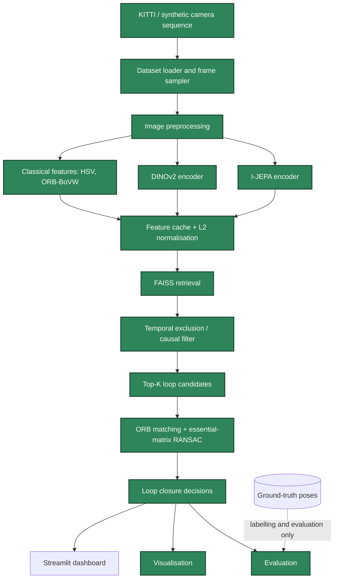

Green boxes are implemented (Phases 1–6). Ground-truth poses are only ever used for labelling,
evaluation and visualisation, never to select retrieval candidates. See
[docs/architecture.md](docs/architecture.md) for the module map.

## Progress

| Phase | Scope | Implementation | Tests | Visualization | GIF | Documentation | Status |
|---|---|---|---|---|---|---|---|
| 1 | Environment and dataset infrastructure | ✅ | ✅ 51 passed | ✅ | ✅ | ✅ | **Complete** (synthetic data + KITTI-layout fixtures; real KITTI 00/02/05/06/08/09 downloaded and validated later) |
| 2 | I-JEPA feature extraction | ✅ | ✅ 90 passed (all phases; 39 new) | ✅ | ✅ | ✅ | **Complete** (official checkpoint verified against Meta's code; synthetic + KITTI 00) |
| 3 | Visual place retrieval | ✅ | ✅ 108 passed (all phases; 18 new) | ✅ | ✅ | ✅ | **Complete** (FAISS exact retrieval, causal replay verified identical; synthetic + KITTI 00) |
| 4 | Geometric verification | ✅ | ✅ 137 passed (all phases; 29 new) | ✅ | ✅ | ✅ | **Complete** (ORB + five-point RANSAC, own eight-point RANSAC cross-checked, degeneracy handling; synthetic + KITTI 00) |
| 5 | Baseline comparison | ✅ | ✅ 151 passed (all phases; 14 new) | ✅ | ✅ | ✅ | **Complete** (DINOv2 ViT-B/14 bitwise-verified against Meta's code, HSV, ORB bag of words with a development-only vocabulary; synthetic + KITTI 00) |
| 6 | Benchmarking and evaluation | ✅ | ✅ 159 passed (all phases; 8 new) | ✅ | ✅ | ✅ | **Complete** (dev 00/05 selection, one held-out evaluation on 02/06/08/09; retrieval, detection and efficiency metrics) |
| 7 | Streamlit dashboard | ⬜ | ⬜ | ⬜ | ⬜ | ⬜ | Not started |
| 8 | Final integration and release | ⬜ | ⬜ | ⬜ | ⬜ | ⬜ | Not started |

## Installation

### Hardware used for development

Measured with `scripts/check_environment.py` (the report is saved to `results/metrics/environment.json`):

| Item | Value |
|---|---|
| Host | Lenovo Legion, Windows 11 + WSL2 Ubuntu 22.04 (kernel 6.6.87.2-microsoft-standard-WSL2) |
| CPU | AMD Ryzen 7 4800H, 8 cores / 16 threads |
| RAM (visible to WSL) | 7.4 GiB + 2 GiB swap |
| GPU | NVIDIA GeForce GTX 1650 Ti, 4 GiB VRAM, compute capability 7.5, driver 591.74 (CUDA 13.1) |
| Python | 3.12.13 (3.11 is not installed on this machine; the package requires >= 3.11) |

Measured implications:
- **Precision.** The GTX 1650 Ti (TU117, no Tensor Cores) is *slower* in FP16 than in FP32: 0.36 vs 1.62 TFLOPS on a 4096² matmul, and 943 vs 237 ms/image for ViT-H/14. It also has no native BF16. Inference therefore runs in FP32, selected automatically by a micro-benchmark (see [Phase 2](#gpu-optimisation-and-robustness)).
- **VRAM.** 4 GiB holds the 2.5 GB FP32 ViT-H/14 weights plus batch-8 activations (peak 2.68 GB reserved). Models are loaded one at a time.
- **RAM.** 7.4 GiB of RAM means memory-mapped checkpoint loading and disk-cached embeddings.

### Environment setup

The repository and its virtual environment `.env/` live together on the Windows data drive
(`/home/ubuntu_22/harish_ws/hdd_ws/jepa_slam` → `/mnt/e/project_ws/jepa_slam`).

```bash
cd /home/ubuntu_22/harish_ws/hdd_ws/jepa_slam   # repository root
unset PYTHONPATH                                # see Troubleshooting: ROS 2 leaks into PYTHONPATH
python3.12 -m venv .env                         # any Python >= 3.11; .env/ is git-ignored
source .env/bin/activate
pip install --upgrade pip
pip install -e ".[dev,ml]"                      # ml = PyTorch (Phase 2+), faiss-cpu (Phase 3+)
```

On this machine `pip install` of PyTorch 2.15.0 (CUDA 13.2 wheels, about 3 GB unpacked) took
about 25 minutes on `/mnt/e`. File I/O over the WSL–Windows bridge (DrvFs/9P) is slow, so a
venv on the Linux filesystem (e.g. `~/.venvs/latent-loop`) is several times faster if speed
matters more than keeping everything on one drive. `requirements.txt` lists the same pinned
dependencies for non-editable installs.

In VS Code, choose **Python: Select Interpreter** → `.env/bin/python` so that diagnostics see
the installed packages.

### Repository layout (Phases 1–6)

```text
configs/            default.yaml (synthetic), kitti.yaml, ijepa.yaml, dinov2.yaml, benchmark.yaml
src/latent_loop/
  datasets/         base.py, kitti.py, kitti_download.py, synthetic.py, ground_truth.py
  encoders/         base.py (VisualEncoder), vit.py, ijepa.py, dinov2.py, classical.py
  features/         extraction.py, pooling.py, cache.py
  retrieval/        index.py (FAISS), temporal_filter.py, detector.py
  verification/     orb.py, geometry.py, pipeline.py, parallel.py
  evaluation/       metrics.py, profiling.py, benchmark.py, runner.py
  utils/            config.py, logging.py, device.py
  visualization/    plots.py, trajectory.py, animations.py, embeddings.py, phase2.py,
                    retrieval.py, phase3.py, matches.py, phase4.py, baselines.py, phase5.py,
                    evaluation.py, phase6.py
scripts/            check_environment.py, prepare_dataset.py, download_kitti.py,
                    download_checkpoints.py, extract_embeddings.py, verify_ijepa.py,
                    verify_dinov2.py, fit_vocabulary.py, profile_encoders.py,
                    run_retrieval.py, run_verification.py, compare_ransac.py, run_benchmark.py,
                    generate_visualizations.py
tests/              conftest.py + test_{datasets,ground_truth,config,visualization,kitti_download,
                    encoders,features,metrics,embedding_plots,retrieval,retrieval_plots,
                    verification,verification_plots,baselines,baseline_plots,benchmark}.py
assets/phase_0{1..6}_*/    committed figures and GIFs
results/            run outputs: retrieval/, verification/, benchmark/ (small, trackable);
                    metrics/, plots/, examples/ are git-ignored
data/ checkpoints/ .env/           git-ignored (datasets, weights, caches, venv)
```

## Dataset preparation

### KITTI Odometry (selective download, done)

The official colour archive (`data_odometry_color.zip`, 69.0 GB) contains all 22 sequences
and both colour cameras. Loop-closure experiments need only the sequences that revisit
places, from one camera, so `scripts/download_kitti.py` fetches **individual files** from the
official archives using HTTP range requests:
1. Read the zip index (central directory).
2. Stream each selected byte span once.
3. Verify every file against its CRC-32.
4. Write files atomically, resuming if interrupted.

```bash
python scripts/download_kitti.py --list-only   # sizes only, nothing written
python scripts/download_kitti.py               # default: sequences 00 02 05 06 08 09, camera 2
```

Downloaded on this machine (24 min 21 s at about 10.5 MB/s; every file CRC-verified):

| Archive | Selected | Size |
|---|---|---|
| `data_odometry_color.zip` (69.0 GB) | `image_2` of sequences 00, 02, 05, 06, 08, 09: 18,726 PNGs | 15.35 GB |
| `data_odometry_calib.zip` | `calib.txt` + `times.txt` of all 22 sequences | 0.6 MB |
| `data_odometry_poses.zip` | ground-truth poses of sequences 00–10 | 1.3 MB |

Layout (what `configs/kitti.yaml` expects):

```text
data/raw/kitti/dataset/
├── sequences/00/
│   ├── image_2/000000.png ...   # left colour camera
│   ├── calib.txt                # P0..P3 (3x4 rectified projections), Tr (velodyne -> cam0)
│   └── times.txt                # one timestamp [s] per frame
└── poses/00.txt                 # ground truth, sequences 00-10 only
```

Validated with the Phase 1 loader (`python scripts/prepare_dataset.py kitti --sequence <SS>`):

| Seq | Frames | Image size | Trajectory | fx [px] | Revisit frames | same dir. / opposite / crossing |
|---|---|---|---|---|---|---|
| 00 | 4541 | 1241 × 376 | 3.72 km | 718.86 | 804 (17.7 %) | 744 / 2 / 58 |
| 02 | 4661 | 1241 × 376 | 5.07 km | 718.86 | 315 (6.8 %) | 246 / 44 / 25 |
| 05 | 2761 | 1226 × 370 | 2.21 km | 707.09 | 448 (16.2 %) | 390 / 0 / 58 |
| 06 | 1101 | 1226 × 370 | 1.23 km | 707.09 | 270 (24.5 %) | 268 / 0 / 2 |
| 08 | 4071 | 1226 × 370 | 3.22 km | 707.09 | 345 (8.5 %) | 0 / 287 / 58 |
| 09 | 1591 | 1226 × 370 | 1.71 km | 707.09 | 19 (1.2 %) | 19 / 0 / 0 |

*Revisit frames* are measured from the ground-truth poses (CPU): frames within 5 m of a frame at
least 100 frames older, classified by the heading difference to the nearest such frame as same
direction (< 30°), opposite (> 150°) or crossing (30–150°). KITTI 08 has no same-direction
revisits at all, and KITTI 09 has only 19 revisit frames.

KITTI is licensed CC BY-NC-SA 3.0 (non-commercial use; see
<https://www.cvlibs.net/datasets/kitti/>). Other sequences or the grayscale archive can be
fetched with `--sequences` and `--gray --cameras 0`.

### Synthetic dataset (no download)

```bash
python scripts/prepare_dataset.py synthetic --out data/processed/synthetic_kitti
```

This writes the synthetic sequence in KITTI layout: 599 PNGs, `calib.txt`, `times.txt`,
`poses/00.txt` and `revisit_pairs.txt`, 46 MB in total. The in-memory synthetic dataset does
not need this export. The export exists so the KITTI loader can be exercised end to end.

---

## Phase 1: environment and dataset infrastructure

### Objective

Provide a reliable, tested data layer. Later phases receive camera frames together with
**original frame IDs**, **timestamps**, **calibration** and (for evaluation only)
**ground-truth poses**, all correctly aligned and independent of any frame sampling.

### Dataset interface

`src/latent_loop/datasets/base.py` defines `VisualSequenceDataset`:

```python
class VisualSequenceDataset:
    def __len__(self) -> int: ...                          # frames in the sampled view
    def get_frame(self, index) -> Frame: ...               # image + frame_id + timestamp + pose
    def get_pose(self, index) -> np.ndarray | None: ...    # 4x4 T_world_camera
    def get_timestamp(self, index) -> float: ...           # seconds
    def get_calibration(self) -> CameraCalibration: ...    # K, P, image size, T_cam0_cam
    def frame_id(self, index) -> int: ...                  # original frame number
    frame_ids: np.ndarray                                   # original IDs of the view
```

`index` addresses the sampled view (`0..len-1`). `frame_id(index)` is the frame number in the
source sequence. **Temporal reasoning in later phases (temporal exclusion, causal replay) must
use `frame_id` or timestamps, never `index`**, because a strided view with missing frames does
not map indices to time uniformly.

| Output | Type | Notes |
|---|---|---|
| `Frame.image` | `uint8`, `H×W×3` RGB or `H×W` grayscale | loaded lazily from disk on every call |
| `Frame.pose` | `float64 (4,4)` or `None` | `None` when the sequence has no ground truth |
| `Frame.timestamp` | `float` seconds | from `times.txt`, or estimated at 10 Hz if it is missing |
| `CameraCalibration.K` | `(3,3)` | intrinsics of the camera that produced the images |

Implementations are `KittiOdometryDataset` (`kitti.py`) and `SyntheticLoopDataset`
(`synthetic.py`). `build_dataset(config)` builds either from YAML.

### Pose coordinate conventions

KITTI poses (`poses/XX.txt`) store one row-major 3×4 matrix per line: the homogeneous transform
from the camera-0 frame at time *k* into the world frame. The world frame is camera 0 at the
first frame:

```math
T_{wc_k} = \begin{bmatrix} R_k & t_k \\ 0^\top & 1 \end{bmatrix},\qquad
p_w = R_k\,p_{c} + t_k .
```

Camera axes: **x right, y down, z forward**. The vehicle moves in the x–z plane, so trajectory
plots are top-down (x, z). Heading (yaw) is the direction of the camera's forward axis
$f = R_k e_z$:

```math
\psi_k = \mathrm{atan2}(f_x, f_z) = \mathrm{atan2}(R_{k,13}, R_{k,33}),
```

so $\psi=0$ looks along world +z and $\psi=+\pi/2$ along +x (a right turn).

**Cameras other than camera 0.** The rectified projection matrices are
$P_i = K\ [\ I \mid b_i\ ]$, so a point in camera-0 coordinates maps to camera *i* as
$X_{c_i} = X_{c_0} + b_i$ with $b_i = K^{-1}P_i[:,3]$. The loader therefore returns

```math
T_{w c_i} = T_{w c_0}\,T_{c_0 c_i},\qquad T_{c_0 c_i} = \begin{bmatrix} I & -K^{-1}P_i[:,3] \\ 0^\top & 1\end{bmatrix}.
```

For camera 2 on KITTI this is about a 6 cm shift to the left (−x). The test
`test_kitti_calibration_parsing` checks this. Calibration validity (`fx, fy > 0`, principal
point inside the image, finite values) is checked by `CameraCalibration.is_valid()`.

Other utilities in `ground_truth.py`: SE(3) inverse $T^{-1} = [R^\top \mid -R^\top t]$, relative
pose $T_{ab} = T_{wa}^{-1}T_{wb}$, arc length $s_k = \sum_{j<k}\lVert t_{j+1}-t_j\rVert$, and
rotation validity ($R^\top R = I$, $\det R = 1$).

### KITTI loading algorithm

1. List `image_i/NNNNNN.png`; the integer `NNNNNN` is the frame ID.
2. Read `times.txt`. Line *k* is frame *k*, and timestamps must be strictly increasing. If the
   file is missing, timestamps are estimated as $k/10\ \text{Hz}$ and flagged
   (`timestamps_estimated=True`).
3. Frames listed in `times.txt` without an image go into `missing_frame_ids` and are skipped
   with a warning. They do **not** shift the alignment, because every lookup goes through the
   frame ID.
4. Read `poses/XX.txt` if it exists. Its line count must equal the number of frames in
   `times.txt`, otherwise a `ValueError("Pose/frame misalignment")` is raised. If the file is
   absent (sequences 11–21), `has_poses=False` and `get_pose` returns `None`.
5. Parse `calib.txt` and build `CameraCalibration` for the selected camera. The image size is
   taken from the first available image.
6. Apply frame sampling (below). Images are decoded only when requested (lazy loading).

### Frame sampling algorithm

Given the available frame IDs $A$ (images present) and `start`, `end`, `stride` $k$ and
`max_frames` $M$:

```math
S = \mathrm{first}_M\Big(\lbrace \, f \in A \ :\  \text{start} \le f < \text{end},\quad  (f-\text{start}) \bmod k = 0 \,\rbrace \Big)
```

Selection is on the **frame-ID grid**, not on positions in the list of available frames. With
frame 3 missing and stride 2, the result is `0, 2, 4, 6, 8`, still evenly spaced in time;
slicing the list would give `0, 2, 5, 7`. This is tested in
`test_sampling_uses_frame_id_grid_not_list_positions`. Sampling never changes frame IDs, so
image, pose and timestamp stay aligned (`test_kitti_sampling_preserves_original_ids`).

Configuration (`configs/default.yaml`):

```yaml
dataset:
  sampling:
    start: 0          # first original frame ID (inclusive)
    end: null         # last original frame ID (exclusive)
    stride: 1         # keep frame IDs f with (f - start) % stride == 0
    max_frames: null  # cap on the number of sampled frames
```

Any value can be overridden from the command line, e.g. `--set dataset.sampling.stride=5`.

### Synthetic dataset with known revisits

`SyntheticLoopDataset` exists so that every later phase can be tested against **exact** loop
closure ground truth before running on KITTI. All of it is deterministic given `seed`.

**Route.** A rounded rectangle, $W \times L = 80 \times 120$ m with corner radius $r = 15$ m,
has perimeter

```math
P = 2(W+L) - 8r + 2\pi r = 374.25\ \text{m}.
```

The vehicle starts halfway along the left straight, heading +z, and drives `laps = 1.6` laps
with frame spacing $\Delta = 1$ m at 10 Hz (10 m/s). That gives 599 frames and 596 m. Frame
*k* sits at arc length $s_k = k\Delta$. Positions are interpolated on a dense polyline, and the
heading is the central-difference tangent.

**Second-lap offset.** To avoid pixel-identical revisits, frames with $s_k \ge P$ drift
smoothly to a lateral offset of $d_0 = 0.5$ m to the right:

```math
d(s) = d_0\,\sigma\left(\tfrac{s-P}{20\,\text{m}}\right),\qquad \sigma(x)=3x^2-2x^3 \text{ on } [0,1].
```

**Constructed revisit pairs.** Every frame *k* with $s_k \ge P$ revisits first-lap frame
$j = \mathrm{round}((s_k - P)/\Delta)$. The sequence has 224 pairs, all exactly 374 frames
(37.4 s) apart and at most 0.56 m apart in space. These pairs come from the construction, not
from a distance threshold, and Phase 3 will compare its threshold-based labels against them.

**World and rendering.** 66 buildings (seeded width 4–11 m, height 4–20 m, HSV colour, window
grid) stand 9–15 m to either side of the road, never closer than 7 m to the route. Each frame
is rendered with a pinhole camera, $f_x = f_y = 0.55\ W_{img}$ (about 85° horizontal FOV),
416×128 px:

```math
u = f_x \frac{x_c}{z_c} + c_x,\qquad v = f_y \frac{y_c}{z_c} + c_y,\qquad p_c = R^\top (p_w - t).
```

Buildings are drawn far to near (painter's algorithm) with depth haze
$\alpha = 1 - e^{-z_c/70\ \text{m}}$ plus seeded Gaussian pixel noise ($\sigma = 2$). The ground
plane is $y_w = 1.65$ m (camera height).

**Limitations.** The images are flat billboards with no texture variation, lighting change,
occlusion by dynamic objects or perspective distortion of facades. Revisits are easy by design:
`test_synthetic_revisits_look_more_similar_than_other_places` checks that revisit pairs differ
less than half as much in pixels as unrelated places. Results on this data are pipeline sanity
checks, **not** evidence about real-world place recognition.

### Configuration and logging

- `utils/config.py`: YAML with `extends:` inheritance (deep merge; cycles are detected), dotted
  CLI overrides parsed as YAML scalars, and `resolve_path` (relative to the repository root).
- `utils/logging.py`: console format `HH:MM:SS LEVEL logger: message key=value` and an optional
  JSON-lines file (`logging.file` in the config). Fields passed through `extra={...}` become
  structured keys.
- `utils/device.py`: CPU, RAM, disk, GPU (`nvidia-smi`) and PyTorch/CUDA status. Every probe
  fails gracefully, so it works before PyTorch is installed.

### Computational considerations

Measured on the hardware above. Phase 1 uses no GPU: everything runs on the **CPU**.

| Operation | Device | Cost |
|---|---|---|
| Construct the synthetic dataset (poses + 66 buildings) | CPU | 49 ms |
| Render one 416×128 synthetic frame | CPU | 5.5 ms |
| Load one 416×128 PNG in KITTI layout from `/mnt/e` | CPU | 16.6 ms |
| Full Phase 1 visualization run (2 PNG + 120-frame GIF) | CPU | 15 s as originally recorded in Phase 1; 1 min 43 s re-measured during Phase 2 verification with the venv in `.env/` on `/mnt/e` (Python start-up and imports over 9P dominate) |

Images are decoded lazily, so memory use does not grow with sequence length (a full KITTI
sequence 00 holds 4,541 frames).

### Failure cases handled

| Situation | Behaviour |
|---|---|
| Image directory or `calib.txt` missing | `FileNotFoundError` with the path; the CLI prints download instructions |
| Some frames lack images | skipped, listed in `missing_frame_ids`, alignment preserved |
| `poses/XX.txt` missing (test sequences) | `has_poses=False`, `get_pose → None`, `poses()` raises |
| Pose count ≠ frame count | `ValueError("Pose/frame misalignment")` |
| `times.txt` missing | 10 Hz timestamps, `timestamps_estimated=True`, warning logged |
| Non-monotonic timestamps, malformed pose/calibration lines | `ValueError` with file and line number |
| Invalid sampling (`stride<1`, `end<=start`, unknown keys) | `ValueError` |

---

## Steps to run Phase 1

All commands run from the repository root with the virtual environment active and `PYTHONPATH`
unset (see [Installation](#environment-setup)). Each has been run on the machine described above.

```bash
# 1. Inspect the environment (writes results/metrics/environment.json)
python scripts/check_environment.py

# 2. Run the tests (Phase 1: 51 tests; whole suite after Phase 6: 159 tests, ~4 min on /mnt/e)
python -m pytest

# 3. Lint and format check
ruff check . && ruff format --check .

# 4. Generate the Phase 1 figures and GIF from the synthetic dataset
python scripts/generate_visualizations.py --phase 1
#    options: --stride N  --max-frames N  --gif-fps F  --gif-width PX  --output-dir DIR
#             --config configs/kitti.yaml  --sequence 05  --set key.path=value ...

# 5. (Optional) export the synthetic sequence in KITTI layout and validate it with the KITTI loader
python scripts/prepare_dataset.py synthetic --out data/processed/synthetic_kitti
python scripts/prepare_dataset.py kitti --root data/processed/synthetic_kitti --sequence 00

# 6. Once real KITTI is unpacked under data/raw/kitti/dataset
python scripts/prepare_dataset.py kitti --sequence 00
python scripts/generate_visualizations.py --phase 1 --config configs/kitti.yaml --sequence 00
```

Outputs are written to `assets/phase_01_dataset/` with a dataset tag prefix: `synthetic_*` or
`kitti_<seq>_cam<camera>_*`. Each run also writes `<tag>_phase1_summary.json` with the dataset
summary, GIF size and render time. To view them, open the PNG/GIF in VS Code or run
`explorer.exe assets/phase_01_dataset` from WSL.

Step 6 is the only command not yet run against real KITTI data. The same code path was run on
the KITTI-layout export from step 5.

## Phase 1 results

All panels below show the **synthetic** dataset (seed 7).

**Ground-truth trajectory, frame sampling and constructed revisits**
(`synthetic_trajectory.png`). (a) The 596 m trajectory coloured by time; orange circles mark
the 224 second-lap frames that revisit first-lap places. (b) The sampled view with stride 10
(60 frames) and original frame IDs; labels from the two laps appear side by side where the
route repeats (for example #0 and #360). (c) Query frame ID against reference frame ID for every
constructed revisit pair: a straight line with a constant 374-frame gap, coloured by camera
distance (≤ 0.56 m, from the lap-2 lateral offset).

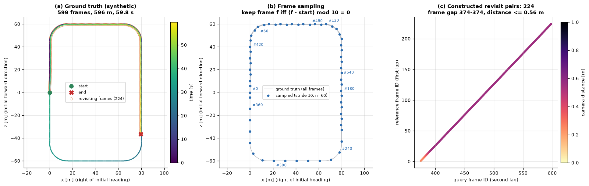

**Camera image sequence** (`synthetic_camera_sequence.png`): eight evenly spaced sampled
frames with frame ID, timestamp and ground-truth position. The last three frames are revisits
and name the first-lap frame they correspond to.

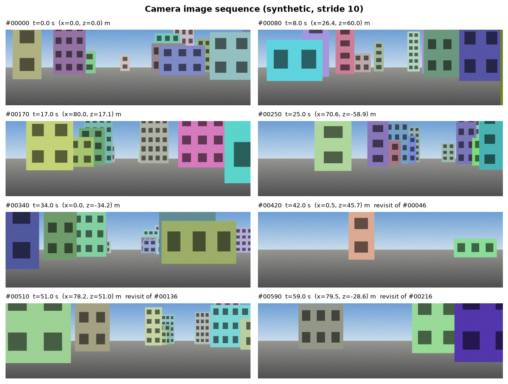

**Trajectory and synchronised camera GIF** (`synthetic_trajectory_camera.gif`: 120 frames,
10 fps, 900×686 px, 9.0 MB). Top: the rendered camera image with frame ID, time and position.
Bottom: the top-down trajectory, with the travelled path in blue, revisiting frames in orange,
and the current pose with a heading arrow. During the second lap the overlay names the
first-lap frame of the same place (ground truth by construction, **not** a detection).

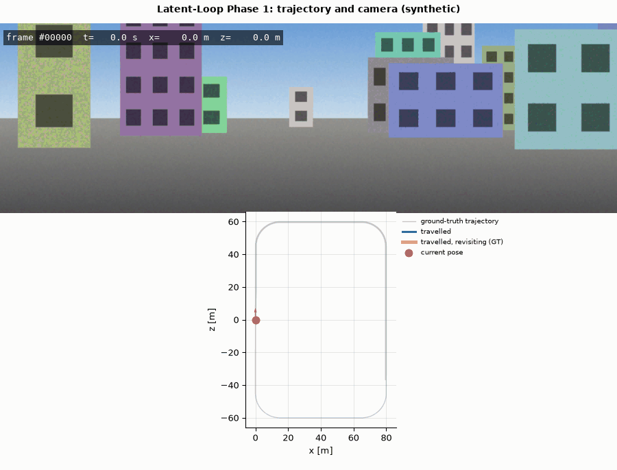

## Phase 2: I-JEPA feature extraction

### Objective

Turn every camera frame into a fixed-length global descriptor $d \in \mathbb{R}^{1280}$ with $\lVert d \rVert_2 = 1$, using the **frozen, pretrained** I-JEPA ViT-H/14 encoder. Later phases compare descriptors with cosine similarity to find revisited places.

This project does **not** train I-JEPA, its predictor or any other network. The official weights are used unchanged, under `torch.inference_mode()`.

### JEPA learning principles

A Joint-Embedding Predictive Architecture learns by **predicting representations, not pixels**:
- Pixel-reconstruction methods (MAE) must reproduce every texture detail.
- Invariance methods (SimCLR, DINO) rely on hand-designed augmentations to decide what to ignore.

A JEPA instead predicts the *embedding* of a hidden part of the input from the embedding of a visible part. Because the target is an abstract representation, the network can discard unpredictable low-level detail and keep structural and semantic content.

### I-JEPA architecture (pretraining, shown for context)

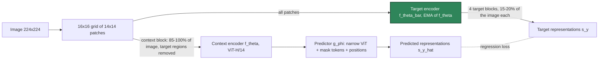

* **Context encoder** $f_\theta$: a ViT that sees only the visible context patches.
* **Target encoder** $f_{\bar\theta}$: the same architecture with weights updated as an exponential moving average, $\bar\theta \leftarrow m\ \bar\theta + (1-m)\ \theta$. It encodes the *full* image, and the target blocks are read from its output.
* **Predictor** $g_\phi$: from the context representations plus learnable mask tokens (carrying each target patch's position embedding), it predicts the target patch representations.
**Loss.** The paper writes it as an L2 distance averaged over the $M = 4$ target blocks $B_i$:

```math
\mathcal{L} = \frac{1}{M}\sum_{i=1}^{M}\sum_{j \in B_i}\left\lVert \hat{s}_{y_j} - s_{y_j}\right\rVert_2^2 .
```

The official training code (`src/train.py`) instead applies `F.layer_norm` to the target features and uses `F.smooth_l1_loss`. Gradients reach only $\theta$ and $\phi$. The EMA target and multi-block masking (large, semantic target blocks plus an informative context) prevent representational collapse without negative pairs or hand-crafted augmentations.

Pretraining settings of the checkpoint used here, read from the official `configs/in1k_vith14_ep300.yaml`:

| Setting | Value |
|---|---|
| Data augmentation | `RandomResizedCrop(224, scale=(0.3, 1.0))` only; no flips, colour jitter or blur |
| Context block | 1 block covering 85–100 % of the image, with target regions removed |
| Target blocks | 4 blocks of 15–20 % of the image each, aspect ratio 0.75–1.5 |
| Predictor | 12-layer ViT, width 384 |
| EMA momentum $m$ | 0.996 → 1.0 over training |
| Schedule | 300 epochs, batch 2048, lr 1e-3, weight decay 0.04 → 0.4, BF16 |

**What this project uses:** only the **target encoder** (green above), which is the network the I-JEPA paper evaluates. The context encoder, predictor and optimiser state stored in the official checkpoint are discarded.

### Why pretrained I-JEPA embeddings may support place recognition

To predict the representation of a missing region from its surroundings, the encoder has to model spatial layout and object structure, such as facades, road edges and skyline shape, rather than exact pixel values. Place recognition needs the same invariance: a revisited place keeps its layout, while illumination, small viewpoint changes and sensor noise vary.

Whether this transfers from ImageNet object images to driving scenes is an **open empirical question** that this project measures; it is not assumed. Phase 2 reports separability diagnostics only. Retrieval and detection metrics follow in Phases 3 and 6.

### Encoder as used here

| Property | Value | How it was verified |
|---|---|---|
| Checkpoint | `IN1K-vit.h.14-300e.pth.tar` (ImageNet-1K, 300 epochs; stored epoch index 299) | official URL; size 10,358,004,345 B; SHA-256 `0382013c…aae22`, recorded in `checkpoints/ijepa/vith14_in1k_target_encoder.json` |
| Network | ViT-H/14: 32 blocks, width 1280, 16 heads, MLP ratio 4, LayerNorm eps 1e-6, qkv bias | official `src/models/vision_transformer.py::vit_huge` |
| Parameters | **630,434,560** (excluding the fixed position embedding) | counted after a `strict=True` load of all 389 tensors |
| Class token | **none**; the output is the 256 patch tokens after the final LayerNorm | official `VisionTransformer.forward` |
| Position embedding | fixed 2-D sine-cosine: first half of the channels encodes the column, second half the row | our generator equals the official function exactly; the loaded tensor is checked against it |
| Input | 224 × 224 RGB, ImageNet mean (0.485, 0.456, 0.406) / std (0.229, 0.224, 0.225) | official `make_transforms` |

`src/latent_loop/encoders/vit.py` is an independent implementation. Meta's code is CC BY-NC 4.0 and is not vendored, but parameter names match so the official target encoder loads with `strict=True`.

**Equivalence with the official implementation** (`scripts/verify_ijepa.py`, 4 synthetic frames, identical weights and inputs; reference comparison on **CPU, FP32** for both models, then **GPU FP16** vs **CPU FP32** for our encoder):

| Check | Result |
|---|---|
| Patch tokens (4 × 256 × 1280), mean absolute difference | 1.0 × 10⁻⁶ |
| Patch tokens, maximum absolute difference | 1.1 × 10⁻³ on values up to 19.9 (5.6 × 10⁻⁵ relative) |
| Minimum per-token cosine similarity | 0.9999997 |
| Global descriptor cosine, ours vs official | 1.000000 |
| GPU FP16 vs CPU FP32 descriptors (GTX 1650 Ti) | cosine ≥ 0.99999, max abs diff 1.7 × 10⁻³ |

The small token differences come from fused attention (`scaled_dot_product_attention`) summing in a different order across 32 layers.

**Position-embedding drift (finding).** The *target* encoder's stored `pos_embed` differs from the exact sin-cos values by up to 1.44 × 10⁻⁴, while the *context* encoder's copy in the same file matches to 3 × 10⁻⁸. The EMA update $p \leftarrow m p + (1-m) q$ is applied to every parameter, including this fixed one, and FP32 rounding accumulates over ~187k updates.

The loader therefore accepts drift up to 10⁻³ (a wrong layout differs by about 2), records the measured drift and **uses the stored values unchanged**. For non-square grids (`aspect` mode) the exact sin-cos values are generated.

### Descriptor extraction algorithm

For an image $I$ (KITTI colour; KITTI grayscale replicated to 3 channels; or synthetic):

1. **Resize** according to `ijepa.resize_mode`. The official repository defines only *training* transforms, so deterministic inference geometry is a project choice:
   * `squash` (default): resize the full frame to 224 × 224. This keeps the entire field of view of wide driving images (KITTI is 3.3 : 1), at the cost of anisotropic scaling.
   * `center_crop`: short side to 224, then a 224 × 224 centre crop (ImageNet evaluation style). This discards about 70 % of a KITTI frame.
   * `aspect`: height 224, width rounded to a multiple of 14 (728 for synthetic, 742 for KITTI). Sin-cos position embeddings are generated for the wider grid; columns beyond the 16 seen in pretraining are extrapolated.
2. **Normalise**: $x = (I/255 - \mu)/\sigma$ per channel.
3. **Encode**: $Z = f_{\bar\theta}(x) \in \mathbb{R}^{N \times 1280}$, with $N = 256$ patch tokens for 224 × 224 input.
4. **Mean-pool** (no class token exists): $g = \frac{1}{N}\sum_{i=1}^{N} z_i$, computed in FP32.
5. **L2-normalise**: $d = g / \max(\lVert g\rVert_2, \epsilon)$. Then $d_a^\top d_b = \cos\angle(d_a, d_b)$, so Phase 3's inner-product FAISS index performs cosine retrieval.

Inputs and outputs:
- `encode_batch(list of uint8 H×W or H×W×3 images)` returns `float32 (B, 1280)` with unit-norm rows.
- `encode_tokens(...)` returns the `(B, N, 1280)` patch tokens and the patch grid, which the patch-similarity figure uses.

### GPU optimisation and robustness

| Mechanism | Implementation |
|---|---|
| Frozen encoder | `requires_grad_(False)` and `eval()`; every forward pass runs under `torch.inference_mode()` |
| Precision selection | `ijepa.precision: auto` picks BF16 on GPUs with native BF16. Otherwise it **measures** FP16 vs FP32 matrix-multiply speed once per process and picks the faster; CPU always uses FP32. Weights are cast to the chosen dtype; pooling and normalisation run in FP32 |
| Why measured, not assumed | GPUs without Tensor Cores can be slower in FP16. On this GTX 1650 Ti (TU117), a 4096² matmul ran at 0.36 TFLOPS in FP16 vs 1.62 TFLOPS in FP32, and ViT-H/14 took **943 ms/image in FP16 vs 237 ms/image in FP32** (batch 8). `auto` therefore selects FP32 here. FP16 and BF16 remain available explicitly |
| Efficient attention | `F.scaled_dot_product_attention` (fused kernels, no materialised attention matrix) |
| Configurable batch size | `extraction.batch_size` (default 8) |
| CUDA OOM recovery | on `torch.cuda.OutOfMemoryError`: free cached blocks, halve the batch and retry the same frames; at batch size 1, move the model to the CPU in FP32 (`cpu_fallback: true`). Every fallback is recorded in the cache metadata |
| CPU fallback | `device: auto` uses the CPU when CUDA is unavailable; `--device cpu` forces it |
| Lazy loading with overlap | images are decoded or rendered only when needed, in a background thread that prepares batch *k+1* while batch *k* is encoded |
| Incremental disk cache | `data/cache/embeddings/<dataset>/<encoder>-<fingerprint>/{embeddings.npy, frame_ids.npy, meta.json}`. Rows are keyed by **original frame ID**, so different strides share entries and only missing frames are encoded. Writes are atomic and flushed every 256 frames, so interrupted runs resume |
| Cache invalidation | the fingerprint hashes the checkpoint SHA-256, architecture, input size, resize mode, normalisation and pooling. Device and precision are recorded but not hashed, so a CPU fallback does not invalidate the cache (FP16 and FP32 descriptors agree to cosine ≥ 0.99999) |
| Sequential model loading | `unload()` drops the model and calls `torch.cuda.empty_cache()` before another model is loaded |
| Shared memory-mapped loading | `torch.load(..., mmap=True)` under `MAP_SHARED`. PyTorch's default private (copy-on-write) mapping is charged against RAM + swap and failed with `ENOMEM` for the 10.4 GB checkpoint on this 7.4 GiB machine; a shared mapping is file-backed and is not charged |
| Profiling | per-stage wall-clock time with `torch.cuda.synchronize()`, peak GPU memory (allocated and reserved) and peak process RSS, written to the cache metadata and `results/metrics/` |

### Configuration (`configs/ijepa.yaml`, extends `default.yaml`)

| Key | Default | Meaning |
|---|---|---|
| `device` | `auto` | `auto` / `cuda` / `cpu` |
| `encoder` | `ijepa` | encoder registry name |
| `ijepa.checkpoint` | `vith14_in1k` | `vith14_in1k`, `vith16_448_in1k`, `vith14_in22k`, `vitg16_in22k` (only the first is downloaded) |
| `ijepa.precision` | `auto` | `auto` / `fp32` / `fp16` / `bf16` |
| `ijepa.resize_mode` | `squash` | `squash` / `center_crop` / `aspect` |
| `ijepa.image_size` | `null` | `null` = pre-training resolution (224) |
| `ijepa.pooling` | `mean` | mean of patch tokens |
| `extraction.batch_size` | `8` | images per forward pass |
| `extraction.cpu_fallback` | `true` | CPU FP32 after OOM at batch size 1 |
| `extraction.flush_every` | `256` | frames between cache writes |
| `extraction.cache_root` | `data/cache/embeddings` | cache location |

### Implementation map

| File | Contents |
|---|---|
| `src/latent_loop/encoders/base.py` | `VisualEncoder` interface (`load_model`, `preprocess`, `encode_batch`, `embedding_dim`, `info`, `fingerprint`, `unload`, `to_device`) |
| `src/latent_loop/encoders/vit.py` | `ViTConfig`, `sincos_pos_embed_2d`, `VisionTransformer`, `build_vit` |
| `src/latent_loop/encoders/ijepa.py` | `CHECKPOINTS` registry, `extract_target_encoder`, `load_mmap`, `resize_image`, `IJEPAEncoder` |
| `src/latent_loop/features/pooling.py` | `pool_tokens`, `l2_normalize` |
| `src/latent_loop/features/cache.py` | `EmbeddingCache`, `CachedEmbeddings` |
| `src/latent_loop/features/extraction.py` | `extract_embeddings` (batching, prefetch, OOM recovery, CPU fallback), `dataset_cache_key` |
| `src/latent_loop/evaluation/profiling.py` | `Profiler`, `peak_rss_mb` |
| `src/latent_loop/evaluation/metrics.py` | `roc_auc` (Mann–Whitney U) |
| `src/latent_loop/datasets/ground_truth.py` | `pair_labels` (positive / negative / ignored pairs for evaluation) |
| `src/latent_loop/utils/device.py` | `resolve_device`, `resolve_precision`, `fp16_faster_than_fp32`, `torch_dtype` |
| `src/latent_loop/visualization/embeddings.py`, `phase2.py` | Phase 2 figures and GIF |
| `scripts/download_checkpoints.py`, `extract_embeddings.py`, `verify_ijepa.py` | checkpoint setup, extraction CLI, official-equivalence check |

### Diagnostic labels and metric

To judge descriptors before retrieval exists, every pair (query $i$, earlier frame $j$) is labelled from ground truth, for **evaluation only**. With ground-plane distance $d_{ij}$ and gap $g_{ij} = f_i - f_j$ (with $f$ the original frame ID) in *original* frame IDs:

* **positive**: $g_{ij} \ge 100$ and $d_{ij} \le 5$ m
* **negative**: $g_{ij} \ge 100$ and $d_{ij} > 25$ m
* **ignored**: $g_{ij} < 100$, $j \ge i$, or the ambiguous band 5–25 m

The separability score is the ROC AUC of cosine similarity for positives vs negatives:

```math
\mathrm{AUC} = P(s_{\text{pos}} > s_{\text{neg}}) + \tfrac12 P(s_{\text{pos}} = s_{\text{neg}}),
```

computed with the Mann–Whitney U statistic. 0.5 is chance. This is a property of the descriptor space, **not** a retrieval or loop-detection result.

### Assumptions, failure cases and limitations

* **ImageNet → driving domain gap.** The checkpoint was pretrained on object-centric ImageNet images; how well it transfers to street scenes is measured here, not assumed.
* **Anisotropic descriptor space.** All pairwise cosines fall in a narrow high band (synthetic: 0.85–1.0), and the first principal component explains about half of the variance. Mean pooling preserves a large shared component, so absolute similarity thresholds will be fragile. Mean-centring or whitening is a candidate improvement to evaluate on development data in later phases.
* **Perceptual aliasing.** In the synthetic city, repeated facades produce negatives (different places 88 m apart) with cosine 0.993, about as high as a typical true revisit (median 0.994). Phase 4 geometric verification targets exactly this case.
* **Preprocessing choice is data-dependent.** `squash` separates best on the synthetic sequence (AUC 0.985), but `aspect` does on KITTI 00 (0.882 vs 0.834). The default stays `squash` because KITTI 00 is a likely held-out test sequence: choosing the mode there would leak test data. The resize mode must be selected on development sequences in Phase 6.
* **Speed on this laptop.** 237 ms/image in FP32 (ViT-H/14 is a 630 M-parameter model). Images and the venv on the Windows drive (`/mnt/e`) add I/O latency.
* **Revisits a forward camera cannot see.** The distance-only labels count crossing revisits (passing the same spot at a different heading, e.g. through an intersection) as positives. On KITTI 00 these 60 crossing pairs have median cosine 0.548, which pulls the overall AUC down to 0.834, versus 0.919 for the 465 same-direction revisits. Phase 3 reports retrieval under both label definitions. KITTI 08 (driven largely in reverse) is expected to be hardest.
* **Checkpoint licence.** I-JEPA weights are CC BY-NC 4.0 (non-commercial).

---

## Steps to run Phase 2

All commands run from the repository root with `.env` active and `PYTHONPATH` unset. Each one
was run on the machine above. Device and duration are given where they matter.

```bash
# 1. List the official I-JEPA checkpoints (URLs from the official README)
python scripts/download_checkpoints.py list

# 2. Extract the target encoder (2.5 GB) from the official 10.4 GB checkpoint.
#    Reuses checkpoints/IN1K-vit.h.14-300e.pth.tar if present. CPU, ~9 min on /mnt/e.
python scripts/download_checkpoints.py ijepa --name vith14_in1k --skip-download
#    Without --skip-download the script first downloads the file with curl (resumable).
#    That branch was not exercised here: the checkpoint had already been downloaded.

# 3. Verify against Meta's reference implementation (CPU FP32 + GPU check, ~6 min)
git clone --depth 1 https://github.com/facebookresearch/ijepa /tmp/ijepa_official
python scripts/verify_ijepa.py --official-repo /tmp/ijepa_official
#    -> results/metrics/ijepa_verification.json

# 4. Extract or reload cached descriptors (GPU if available; prints a JSON report and
#    writes results/metrics/extraction_<dataset>_<encoder>-<fingerprint>.json)
python scripts/extract_embeddings.py --config configs/ijepa.yaml --stride 2
#    options: --batch-size N  --max-frames N  --device {auto,cuda,cpu}  --no-cache
#             --set ijepa.resize_mode=aspect  ijepa.precision=fp16  ...

# 5. Force the CPU path (FP32; ~1.8 s/image on the Ryzen 7 4800H)
python scripts/extract_embeddings.py --config configs/ijepa.yaml --device cpu --max-frames 8 --batch-size 4 --no-cache

# 6. Phase 2 figures and GIF, SYNTHETIC (every 2nd frame; 30 min the first time, measured
#    with GPU FP16 before the FP32 default; ~4 min when the embeddings are cached)
python scripts/generate_visualizations.py --phase 2

# 7. Phase 2 figures and GIF, real KITTI 00 (every 5th frame; ~32 min on GPU FP32 incl. 3 resize modes)
python scripts/generate_visualizations.py --phase 2 --stride 5 \
    --set dataset.name=kitti dataset.root=data/raw/kitti/dataset "dataset.sequence='00'"
#    options: --no-preprocessing-comparison (skip center_crop/aspect), --max-frames, --gif-fps,
#             --gif-width, --output-dir, --encoder

# 8. Tests (the real-checkpoint test is skipped automatically if the weights are absent)
python -m pytest tests/test_encoders.py tests/test_features.py tests/test_metrics.py tests/test_embedding_plots.py tests/test_kitti_download.py
python -m pytest tests/test_encoders.py -k real    # strict load + GPU encode of the real ViT-H/14
```

Outputs go to `assets/phase_02_ijepa/<dataset_key>_*.png|gif` plus
`<dataset_key>_phase2_summary.json`. Descriptors are cached under `data/cache/embeddings/`. To
view them, open the files in VS Code or run `explorer.exe assets/phase_02_ijepa` from WSL.

## Phase 2 results

All descriptors use the frozen I-JEPA ViT-H/14 target encoder (`squash`, 224 px, mean pooling) unless a row states otherwise. The device and precision of every measurement are stated explicitly; they are read from the cache metadata, which records them for each extraction run (no OOM fallbacks occurred). Pair labels follow the [diagnostic definition](#diagnostic-labels-and-metric) (positive ≤ 5 m, negative > 25 m, gap ≥ 100 original frames). These are **descriptor-space diagnostics, not retrieval results.**

| | SYNTHETIC (seed 7, every 2nd frame) | KITTI 00 (real, every 5th frame) |
|---|---|---|
| Embeddings computed on | **GPU** (GTX 1650 Ti), **FP16**, batch 8 (computed before `auto` was changed to measure FP16 speed) | **GPU** (GTX 1650 Ti), **FP32**, batch 8 |
| Similarity statistics and AUC computed on | CPU (NumPy, FP32) | CPU (NumPy, FP32) |
| Frames encoded | 300 | 909 |
| Positive / negative pairs | 565 / 28,473 | 527 / 391,867 |
| ROC AUC, all positives | **0.985** | **0.834** |
| ROC AUC, same-direction positives (< 30°) | — | **0.919** (465 pairs) |
| Median cosine: revisit / different place | 0.994 / 0.965 | 0.947 / 0.749 |
| 99th percentile cosine of different places | 0.987 | 0.935 |
| PCs for 50 % / 90 % of descriptor variance | 2 / 18 | 5 / 37 |
| Resize-mode AUC: squash / center_crop / aspect | **0.985** / 0.950 / 0.968 | 0.834 / 0.799 / **0.882** |

**Runtime and memory** (images and venv on the E: drive):

| Measurement | Device / precision | Value |
|---|---|---|
| Encoder forward pass, KITTI 00 (909 frames) | GPU, FP32, batch 8 | **240 ms/image** (batch median 1.85 s) |
| Encoder forward pass, synthetic (300 frames) | GPU, FP16, batch 8 | 872 ms/image (batch median 6.65 s) |
| Encoder forward pass, CPU fallback (`--device cpu`, 8 synthetic frames) | CPU (Ryzen 7 4800H, 16 threads), FP32, batch 4 | 1,778 ms/image (7.4× slower than GPU FP32); peak RSS 4.9 GB |
| Image loading wait, KITTI PNG 1241 × 376 from `/mnt/e` (prefetch thread) | CPU | 267 ms/image, the bottleneck |
| ViT-H/14 batch of 8, FP16 vs FP32 (benchmark) | GPU | 943 vs 237 ms/image, so `auto` → FP32 |
| 4096² matrix multiply, FP16 vs FP32 | GPU | 0.36 vs 1.62 TFLOPS |
| Peak GPU memory (PyTorch allocator), KITTI run | GPU, FP32 | 2.58 GB allocated / 2.68 GB reserved, of 4 GB |
| Peak GPU memory, synthetic run | GPU, FP16 | 1.26 GB allocated / 1.40 GB reserved |
| Peak process RSS, KITTI run | CPU memory | 4.9 GB (includes file-backed mapped weight pages) |
| Descriptor storage | disk | 1280 × 4 B = 5 KB per frame (KITTI 00 at stride 5: 4.65 MB) |
| Target-encoder extraction from the 10.4 GB checkpoint (SHA-256 + copy) | CPU | 8 min 53 s, peak RSS 5.2 GB |

**Embedding similarity matrices.** $s_{ij} = d_i^\top d_j$ for every pair of sampled frames. Right panels overlay ground-truth revisit pairs (blue) and the 100-frame temporal-exclusion boundary. In both datasets the revisits appear as bright stripes parallel to the main diagonal. Dark cross-bands are viewpoint changes, such as corners in the synthetic route and turns or open areas in KITTI.

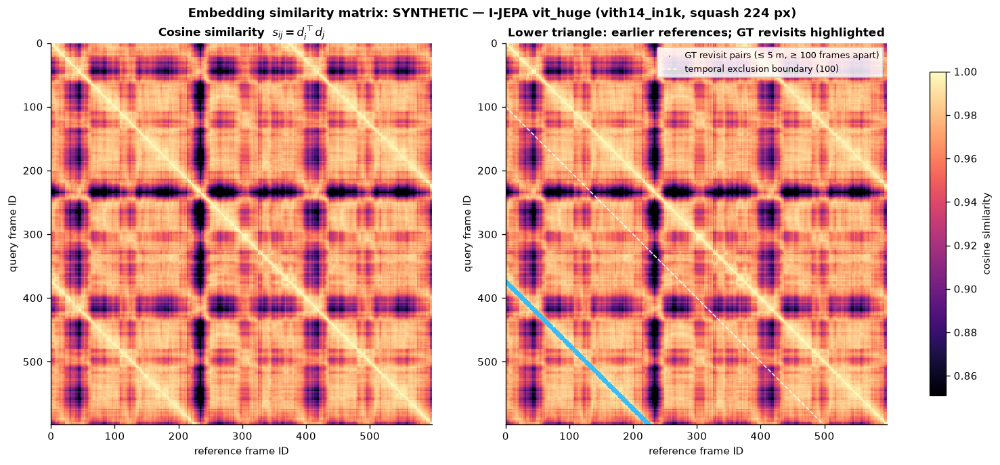
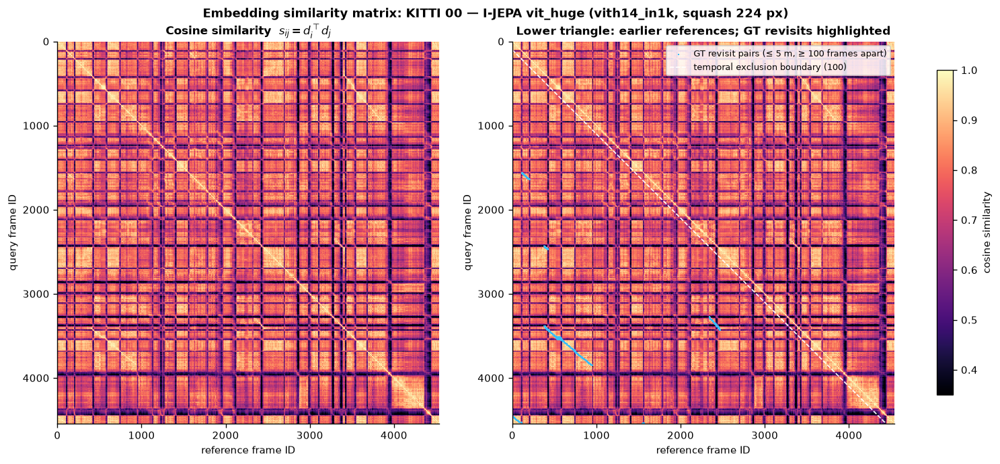

**Descriptor distributions.** Top left: cosine of revisit pairs vs different-place pairs. Top right: descriptor component values (all norms equal 1). Bottom left: PCA of the global descriptors, coloured by time, with links between revisit pairs. Bottom right: cumulative explained variance. On KITTI the revisit distribution is bimodal; the low mode is the crossing revisits described in the limitations.

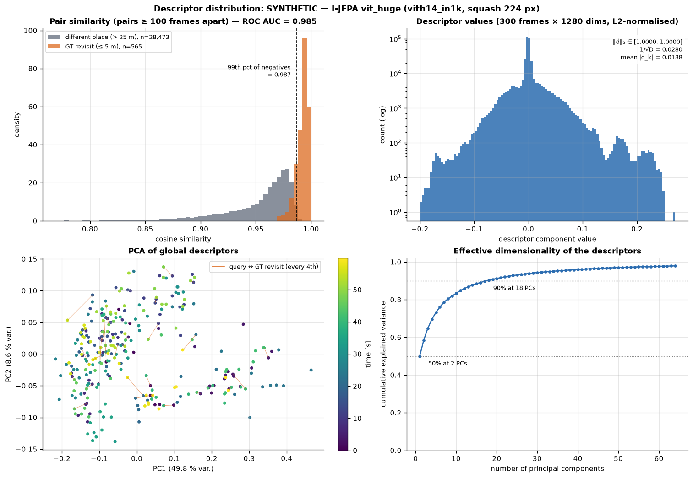
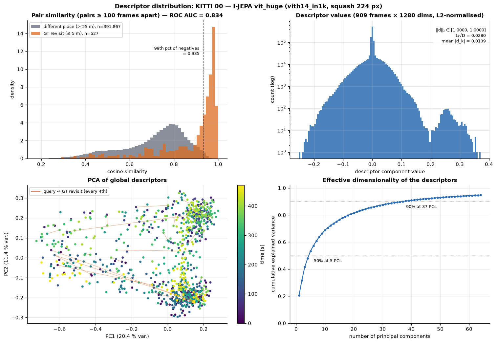

**Feature similarity heatmaps.** For each query patch $a$: $h_a = \max_b \cos(q_a, r_b)$ over the reference patches. Rows show a ground-truth revisit, the hardest negative (most similar pair more than 25 m apart) and a random negative. The right column maps the first three PCA components of the patch tokens to RGB.

In KITTI 00, the revisit #3395 ↔ #2445 (0.3 m apart) scores 0.993. The "hardest negative" is 26.9 m away on what appears to be the same street, just outside the 25 m negative radius. In the synthetic city, repeated facades produce a negative 88 m away at 0.993.

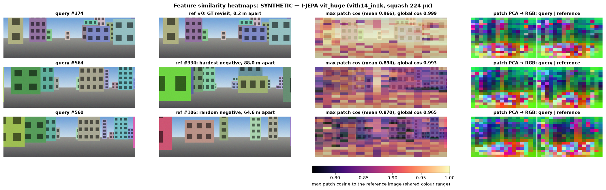
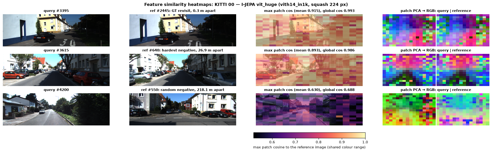

**Preprocessing comparison** (same weights and frames; only the resize mode changes):

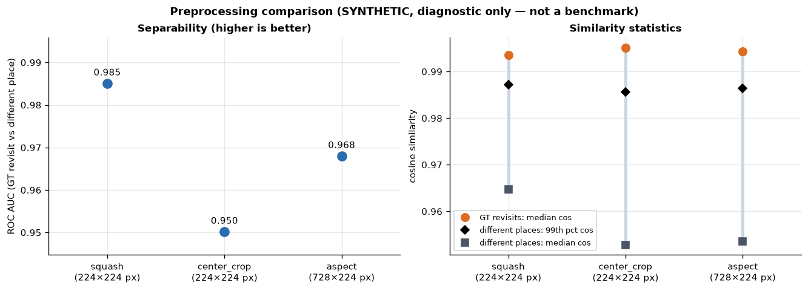
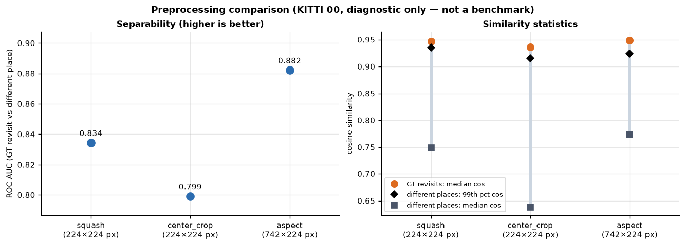

**Similarity evolution GIFs.** Frames are processed chronologically:
- Top left: the current camera frame.
- Right: the causal similarity matrix filling row by row (references in the future stay grey).
- Bottom left: cosine of the current query to every earlier frame. The last 100 frames are shaded as temporally excluded. Orange dots mark ground-truth revisits, and ▼ marks the most similar eligible frame together with its ground-truth verdict.

This only *visualises* similarities. Retrieval with FAISS, top-K and causal replay is Phase 3.

| SYNTHETIC (120 frames, 3.9 MB) | KITTI 00 (120 frames, 6.8 MB) |
|---|---|
| 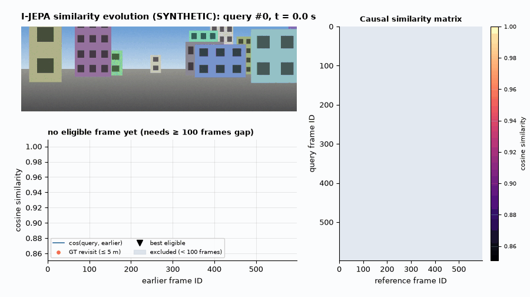 | 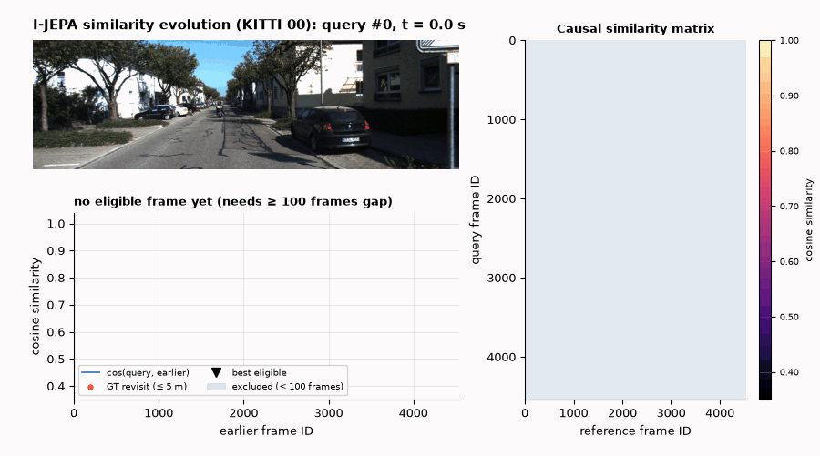 |

The `synthetic_5cb1448a` prefix is the dataset cache key: a hash of the synthetic configuration, so a changed seed or resolution never reuses stale embeddings. Every run also writes `<key>_phase2_summary.json`, containing all numbers above, the encoder identity and the extraction profile.

---

## Phase 3: visual place retrieval

### Objective

For every camera frame, find the earlier frames most likely to show the **same place**, using only the Phase 2 descriptors. These ranked *loop-closure candidates* are what Phase 4 checks geometrically.

Retrieval never sees ground truth. Poses are used only afterwards, to label the results and draw the figures.

### Cosine similarity, L2 normalisation and the FAISS index

Phase 2 descriptors are L2-normalised, $\lVert d \rVert_2 = 1$. For unit vectors the inner product **is** the cosine similarity:

```math
s(q, r) \;=\; d_q^{\top} d_r \;=\; \lVert d_q\rVert\,\lVert d_r\rVert \cos\theta_{qr} \;=\; \cos\theta_{qr} \in [-1, 1].
```

Ranking references by inner product is therefore ranking by cosine similarity. Equivalently, it ranks by Euclidean distance, since $\lVert d_q - d_r \rVert^2 = 2 - 2 s(q,r)$.

`FlatIPIndex` (`src/latent_loop/retrieval/index.py`) wraps FAISS `IndexFlatIP`. This is an **exact**, exhaustive inner-product search with no quantisation or approximation: on N references it costs $O(N D)$ per query, with D = 1280. At KITTI scale (≤ 4,661 frames per sequence) exhaustive search takes well under a millisecond per query on the CPU, so an approximate index would only add error. A test checks the FAISS results against a NumPy brute-force `argsort`.

Descriptors are added in **chronological order**, so index position $p$ is the $p$-th observed frame. Adding out of order, or adding descriptors that aren't unit-norm (tolerance 10⁻³), raises an error.

### Top-K retrieval

For query $q$ with eligible reference set $\mathcal{E}(q)$, the candidates are the $K$ eligible references with the highest similarity:

```math
\mathcal{C}_K(q) \;=\; \mathop{\mathrm{argtop}_K}\limits_{r \in \mathcal{E}(q)} \; s(q, r),
```

returned as original frame IDs with their cosine scores, in descending order. When fewer than $K$ frames are eligible, the remaining slots hold frame ID −1 and score `nan`.

### Temporal exclusion

Consecutive frames look alike because they **are** almost the same place, so they must not count as loop closures. A reference $r$ is eligible for query $q$ only if:

```math
f_r < f_q, \qquad f_r \le f_q - \Delta_f, \qquad \text{and optionally}\quad t_r \le t_q - \Delta_t ,
```

where $f$ is the **original** frame ID (default $\Delta_f = 100$ frames = 10 s at KITTI's 10 Hz) and $t$ the timestamp (optional $\Delta_t$).

The rule is defined on original IDs, never on positions in a subsampled array. With stride 5, a gap of 100 frames is 20 array positions, and the code measures it as 100 frames; a test checks this at stride 10.

Because frame IDs and timestamps increase monotonically, $\mathcal{E}(q)$ is always a **prefix** of the chronologically ordered index, $[0, n_q)$. It is enforced *inside* the search with `faiss.IDSelectorRange(0, n_q)` rather than by over-fetching and filtering afterwards, so the result is exact even when the most similar frames are all excluded.

### Two retrieval modes

| Mode | Index contents when query $q$ is searched | Use |
|---|---|---|
| `offline` | all frames, added once; each query restricted to its eligible prefix | fast evaluation over precomputed descriptors |
| `causal` | only frames observed **before** $q$ (frame $q$ is added after its own search) | replays the sequence as a robot would see it; the future cannot be retrieved by construction |

With the same settings the two modes return **identical** candidates, because the eligible set is the same prefix in both. This is checked in the unit tests and with `run_retrieval.py --check-causal` on real descriptors (identical, maximum score difference 0.0). `assert_causal` independently checks every saved candidate against the exclusion rule.

### Candidate filtering

Applied in this order to each ranked list (ground truth is not consulted):

1. **Similarity threshold** (`min_similarity`, default off): drop candidates with $s < \tau$.
2. **Temporal non-maximum suppression** (`nms_frames`, default 0 = off): walking down the ranking, drop any candidate whose frame ID lies within `nms_frames` of a candidate already kept. Without it, the top-K for a revisit are often K consecutive frames of the *same* earlier pass. With it, they are K distinct places, which gives geometric verification more diverse hypotheses. The search is widened to $K (2 \cdot \text{nms} + 1)$ so that K slots can still be filled.

Phase 3 reports retrieval **without** thresholds or NMS (pure top-K). Choosing $\tau$ and NMS settings is a detection decision; it belongs in Phase 6 and is tuned on development sequences only.

### Ground-truth revisit labels

For evaluation only, `revisit_ground_truth` marks reference $r$ as a **true revisit** of query $q$ iff

```math
f_r \le f_q - \Delta_f \quad\text{and}\quad \lVert p_q - p_r\rVert_2 \le \rho ,
```

with $p$ the camera centre on the ground plane (x-z) and spatial threshold $\rho$ = 5 m by default. A query whose positive set is non-empty is a **positive query**.

Phase 2 showed that some revisits pass the same spot at a different heading, which a forward camera cannot recognise. Results are therefore reported under two definitions:

| Definition | Extra condition | Rationale |
|---|---|---|
| `distance_only` | none | standard KITTI loop-closure labelling |
| `same_direction` | $\lvert \mathrm{wrap}(\psi_q - \psi_r) \rvert \le 30°$ | only revisits a forward-facing camera can recognise |

Both thresholds are configurable (`ground_truth.spatial_threshold_m`, `ground_truth.max_heading_diff_deg`).

### Preliminary metric

Phase 3 reports Recall@K on **positive queries only**, as a sanity check of retrieval. The full metric suite (AP, PR curves, detection precision, recall and F1 with thresholds tuned on development data) comes in Phase 6.

```math
\mathrm{Recall@}K \;=\; \frac{\bigl|\{\, q \in Q^{+} : \mathcal{C}_K(q) \cap P(q) \neq \emptyset \,\}\bigr|}{\lvert Q^{+} \rvert},
```

where $Q^{+}$ is the set of positive queries and $P(q)$ the true revisits of $q$. Queries without a true revisit are excluded from the denominator here, but count as potential false alarms in Phase 6.

### Configuration (`configs/default.yaml`)

| Key | Default | Meaning |
|---|---|---|
| `retrieval.top_k` | 10 | candidates kept per query |
| `retrieval.temporal_exclusion_frames` | 100 | $\Delta_f$ in original frame IDs |
| `retrieval.temporal_exclusion_seconds` | `null` | optional $\Delta_t$ |
| `retrieval.min_similarity` | `null` | optional threshold $\tau$ |
| `retrieval.nms_frames` | 0 | temporal NMS radius (frames) |
| `retrieval.mode` | `offline` | `offline` or `causal` |
| `ground_truth.spatial_threshold_m` | 5.0 | $\rho$ |
| `ground_truth.max_heading_diff_deg` | 30.0 | heading limit of the `same_direction` definition |

### Implementation map

| File | Contents |
|---|---|
| `src/latent_loop/retrieval/index.py` | `FlatIPIndex` (FAISS `IndexFlatIP` + `IDSelectorRange`), `exact_search_numpy` (test reference) |
| `src/latent_loop/retrieval/temporal_filter.py` | `TemporalExclusion` (`eligible_count(s)`, `is_eligible`), `validate_chronological` |
| `src/latent_loop/retrieval/detector.py` | `RetrievalConfig`, `RetrievalResult` (`save`/`load`), `retrieve` (offline / causal), `filter_candidates`, `assert_causal` |
| `src/latent_loop/datasets/ground_truth.py` | `revisit_ground_truth`, `RevisitGroundTruth` |
| `src/latent_loop/evaluation/metrics.py` | `recall_at_k`, `first_hit_rank` |
| `src/latent_loop/visualization/retrieval.py`, `phase3.py` | Phase 3 figures and GIF |
| `scripts/run_retrieval.py` | retrieval CLI; writes `results/retrieval/<dataset>/<encoder>-<fingerprint>/<mode>/` |

**Saved results** per run: `retrieval.npz` holds `query_frame_ids`, `query_timestamps`, `candidate_ids (N, K)`, `scores (N, K)` and `eligible_counts`. `retrieval.json` holds the configuration, timing, causal check and preliminary Recall@K for both ground-truth definitions. `top1.csv` has one row per query: top-1 frame, cosine, number of eligible references and the ground-truth verdicts.

**CPU/GPU:** retrieval runs on the **CPU** (FAISS CPU, float32). Only descriptor extraction (Phase 2) uses the GPU, and the Phase 3 scripts read descriptors from the cache without loading the model.

### Assumptions, failure cases and limitations

* **Perceptual aliasing.** Different places that look alike (repeated facades, similar suburban streets) can outrank the true revisit. Retrieval alone cannot reject them; Phase 4 geometric verification targets this.
* **Viewpoint.** Crossing and opposite-direction revisits are mostly not retrieved by a forward camera; see the gap between the two ground-truth definitions in the results.
* **Fixed exclusion window.** 100 frames assumes motion. A vehicle stopped for more than 10 s will retrieve itself as a "revisit"; `temporal_exclusion_seconds` or a distance-travelled rule (planned) can address this.
* **Exhaustive search** scales linearly with the map size. That's fine for single KITTI sequences; city-scale maps would need an approximate index, at some cost in recall.
* **Recall@K uses positive queries only.** It says nothing about false alarms on queries without a revisit; detection metrics come in Phase 6.
* **Preliminary numbers.** KITTI 00 is subsampled (every 5th frame) and its resize mode was not tuned. The numbers below are sanity checks, not benchmark results.

## Steps to run Phase 3

All commands run from the repository root with `.env` active and `PYTHONPATH` unset. They use the Phase 2 descriptor cache; if a descriptor is missing it is extracted first (GPU if available).

```bash
# 1. Retrieval + saved results + causal-replay equivalence check, SYNTHETIC (every 2nd frame)
python scripts/run_retrieval.py --config configs/ijepa.yaml --stride 2 --check-causal

# 2. Same on real KITTI 00 (every 5th frame)
python scripts/run_retrieval.py --config configs/ijepa.yaml --stride 5 --check-causal \
    --set dataset.name=kitti dataset.root=data/raw/kitti/dataset "dataset.sequence='00'"
#    options: --mode {offline,causal}  --top-k K  --exclusion-frames N
#             --set retrieval.nms_frames=10 retrieval.min_similarity=0.95 ...
#    -> results/retrieval/<dataset_key>/ijepa-<fingerprint>/<mode>/{retrieval.npz,retrieval.json,top1.csv}

# 3. Phase 3 figures and GIF from the saved results (about 2.5 min synthetic, 4 min KITTI 00)
python scripts/generate_visualizations.py --phase 3
python scripts/generate_visualizations.py --phase 3 --stride 5 --max-frames 110 \
    --set dataset.name=kitti dataset.root=data/raw/kitti/dataset "dataset.sequence='00'"

# 4. Tests
python -m pytest tests/test_retrieval.py tests/test_retrieval_plots.py
```

Outputs go to `assets/phase_03_retrieval/<dataset_key>_*.png|gif` and `<dataset_key>_phase3_summary.json`. The summary records `loaded_saved_result: true` when the figures were drawn from the saved retrieval results, as they were for every figure below.

## Phase 3 results

Descriptors are the cached Phase 2 I-JEPA embeddings: SYNTHETIC on **GPU, FP16**; KITTI 00 on **GPU, FP32** (`squash`, 224 px). Retrieval, ground-truth labelling and metrics run on the **CPU** (FAISS CPU 1.15.1, float32). Settings: top-10, temporal exclusion 100 original frames, no threshold, no NMS, revisit ≤ 5 m.

| | SYNTHETIC (300 queries) | KITTI 00 (909 queries, every 5th frame) |
|---|---|---|
| Positive queries: distance-only / same-direction | 115 / 115 | 162 / 150 |
| Recall@1 / @5 / @10, distance-only | 0.983 / 1.000 / 1.000 | **0.778** / 0.877 / 0.889 |
| Recall@1 / @5 / @10, same-direction (≤ 30°) | 0.983 / 1.000 / 1.000 | **0.840** / 0.947 / 0.960 |
| Offline vs causal replay | identical candidates, max score diff 0.0 | identical candidates, max score diff 0.0 |
| Search time per query, offline / causal (CPU) | 0.078 / 0.087 ms | 0.163 / 0.241 ms |
| Index build, offline (CPU) | 27 ms | 5 ms |

These are **preliminary** retrieval checks on positive queries only. They are not loop-closure detection results: there is no threshold, false alarms are not counted, and there is no development/test split. Phase 6 adds those.

**Reading the numbers.**
* **Crossing revisits.** On KITTI 00, 22 % of positive queries miss the true revisit at rank 1. The same-direction definition removes 12 positive queries (crossing revisits a forward camera cannot see) and raises Recall@1 from 0.778 to 0.840.
* **Most misses are near misses.** Recall rises from 0.840 at K = 1 to 0.947 at K = 5 (same-direction). The gallery shows a typical miss: the top-1 is 7.4 m away, just outside the 5 m threshold, and the true revisit is at rank 4.
* **False candidates are confident.** For query #600, which has no revisit, all five candidates are similar suburban streets more than 200 m away with cosine 0.96–0.98. A similarity threshold alone cannot reject these; Phase 4 adds geometric verification for this.
* **Strong candidates are mostly right.** Among the strongest 10 % of all top-1 candidates on KITTI 00 (cosine ≥ 0.978), 83 of 89 are true revisits.

**Top-5 retrieval galleries.** Each row shows a query (black frame) and its five highest-scoring eligible earlier frames. Captions give the rank, frame ID, cosine, camera-centre distance and ground-truth verdict (green = true revisit, red = not a revisit). The rows are chosen deterministically: the best rank-1 hit, the most confident rank-1 miss, and the most confident candidate for a query that has no revisit.

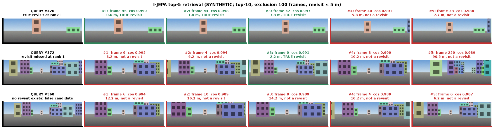
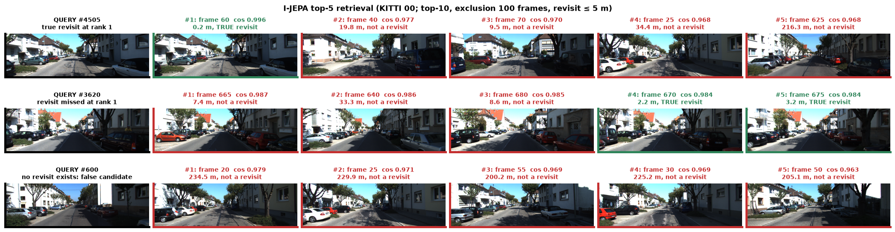

**Loop-closure candidates on the trajectory.** Left: every positive query, linked to its top-1 candidate. Right: the strongest 10 % of all top-1 candidates, which is what a similarity threshold would accept. On the synthetic loop the revisit lies only 0.5 m beside the first pass, so the links are too short to see and appear as coloured dots.

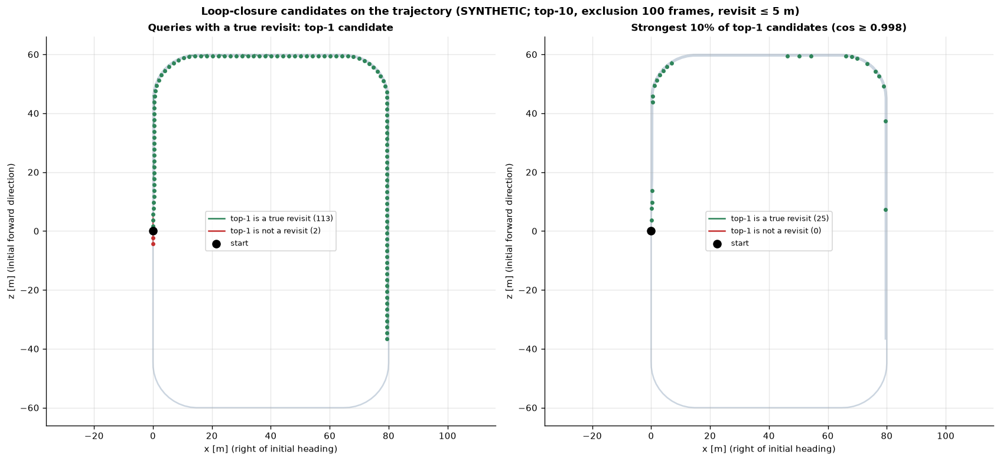
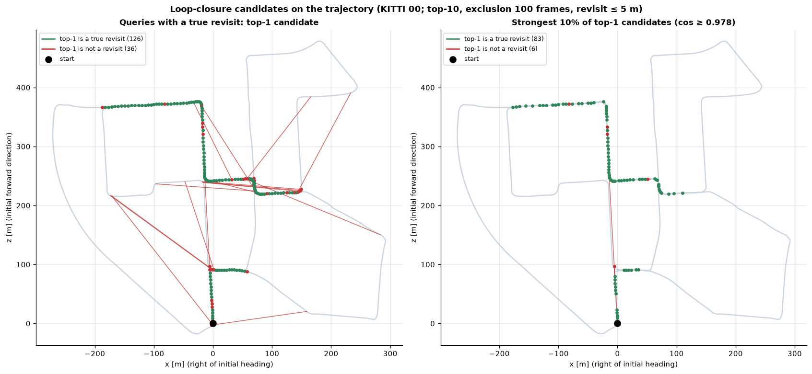

**Eligible similarity matrix.** Cosine similarity is shown only for eligible pairs; the excluded region is grey. Blue marks ground-truth revisit pairs; dots mark each query's top-1 choice (green = true revisit, red = not). On the synthetic data, the red dots for queries before frame ~370 belong to queries that have no revisit at all.

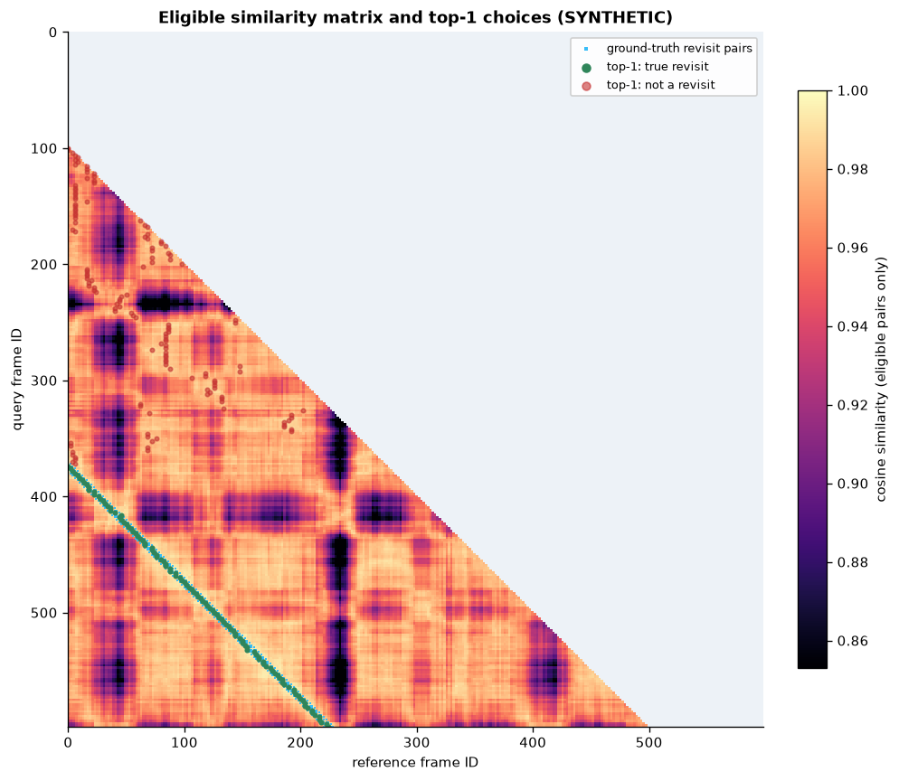
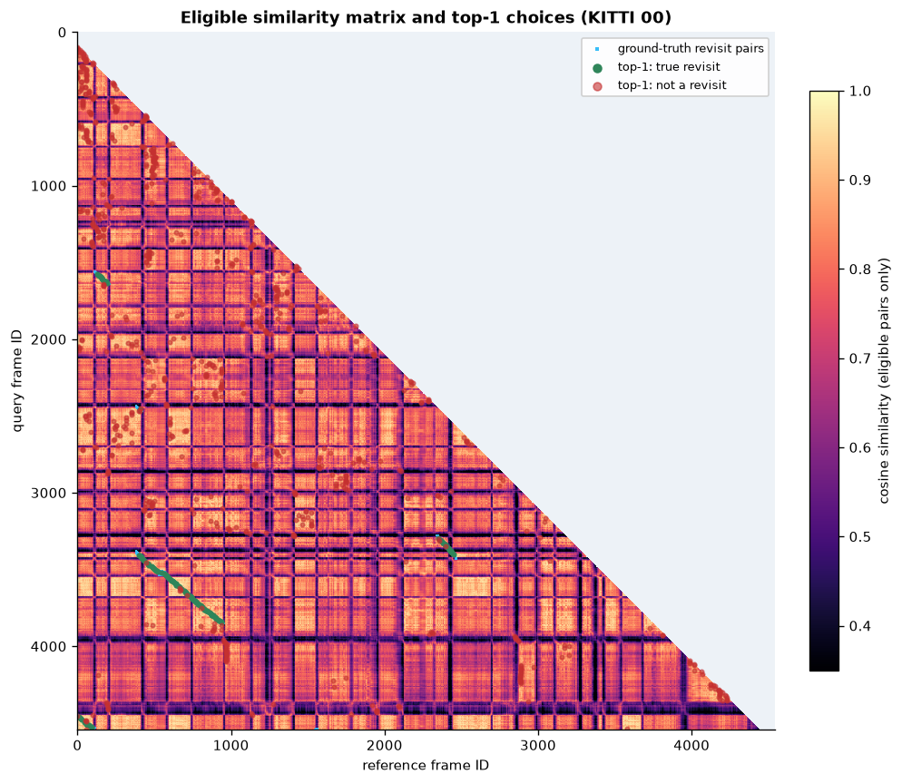

**Recall@K curves** (K = 1…10, both ground-truth definitions; on synthetic data the two coincide):

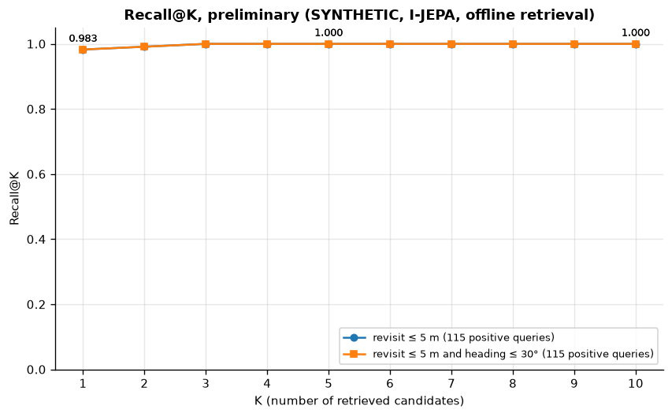
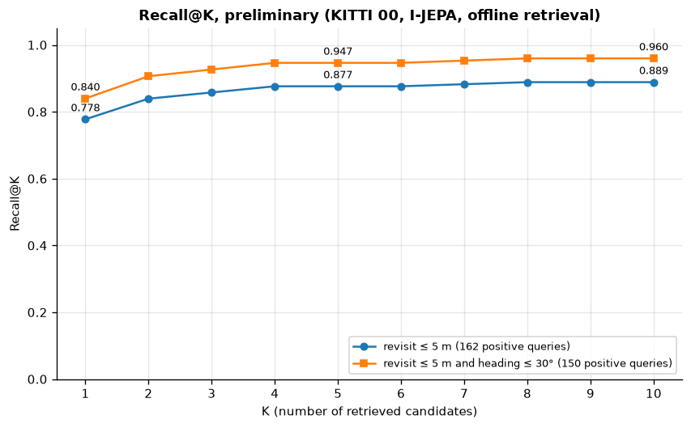

**Chronological retrieval GIFs** (evenly spaced queries at 8 fps: 120 for SYNTHETIC, 110 for KITTI 00 to stay under 10 MB):
- Top left: the current camera frame.
- Bottom left: its top-1 eligible earlier frame, with cosine, distance and ground-truth verdict.
- Right: the trajectory driven so far, the current query, the top-1 candidate with the loop link (green or red), and the queries already answered with a true revisit.

| SYNTHETIC | KITTI 00 |
|---|---|
| 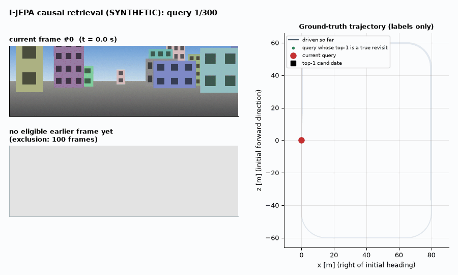 | 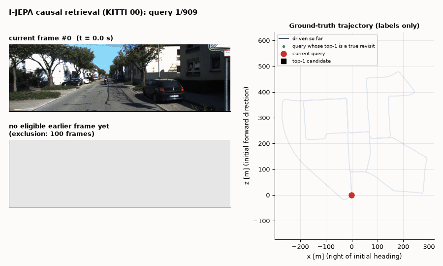 |

## Phase 4: geometric verification

### Objective

Reject loop-closure candidates that *look* similar but are not views of the same 3D scene. For each query and each of its top `verify_top_k` retrieved candidates (5 by default), the two images are matched with ORB features and the matches are tested against the two-view epipolar constraint of a calibrated camera with RANSAC. The decision uses **only the two images and the camera calibration**. Ground-truth poses are attached afterwards, as labels for the figures and statistics.

### ORB keypoints and binary descriptors

ORB (Rublee et al., 2011) detects **oriented FAST** corners on an 8-level image pyramid (scale factor 1.2), keeps the strongest 2000 by Harris score, and assigns each an orientation $\theta$ from the intensity centroid of its patch:

```math
m_{pq} = \sum_{x,y} x^p y^q\, I(x,y), \qquad \theta = \mathrm{atan2}(m_{01},\, m_{10}).
```

The descriptor is **rotated BRIEF**: 256 learned pairwise intensity tests $(\mathbf{a}_k, \mathbf{b}_k)$ on the smoothed patch, rotated by $\theta$,

```math
d_k = \begin{cases} 1 & I(R_\theta \mathbf{a}_k) < I(R_\theta \mathbf{b}_k) \\ 0 & \text{otherwise} \end{cases}, \qquad k = 1,\dots,256,
```

stored as 32 bytes. Binary descriptors are compact and fast to compare, and the orientation and pyramid make them tolerant to in-plane rotation and moderate scale change. They are *not* invariant to large viewpoint or illumination changes, which limits verification of crossing or opposite-direction revisits.

### Hamming distance and matching

Two binary descriptors are compared by the **Hamming distance**, the number of differing bits:

```math
d_H(\mathbf{a}, \mathbf{b}) = \mathrm{popcount}(\mathbf{a} \oplus \mathbf{b}) \in \{0, \dots, 256\}.
```

Matching from the query image into the candidate image (`verification/orb.py`):

1. **Exact 2-nearest-neighbour search** by Hamming distance (OpenCV brute force), giving the best and second-best distances $d_1, d_2$.
2. **Lowe's ratio test**: keep the match only if $d_1 < r   d_2$ with $r$ = 0.8. A feature whose best and second-best candidates are almost equally good is ambiguous and is dropped.
3. **Absolute bound** $d_1 \le 64$ bits.
4. **Mutual check**: the candidate feature's own best match in the query image must be the same query feature. This also removes many-to-one matches.

### Epipolar geometry and the essential matrix

With calibrated intrinsics $K$ (KITTI: from `calib.txt`, the rectified $P_2$ of the colour camera), a pixel $\mathbf{u}$ maps to the normalised image point $\mathbf{x} = K^{-1}[\mathbf{u}^\top, 1]^\top$. If the camera moved rigidly between the two views, $\mathbf{X}_r = R \mathbf{X}_q + \mathbf{t}$, every correct correspondence satisfies the **epipolar constraint**

```math
\mathbf{x}_r^\top E \, \mathbf{x}_q = 0, \qquad E = [\mathbf{t}]_\times R, \qquad
[\mathbf{t}]_\times = \begin{pmatrix} 0 & -t_3 & t_2 \\ t_3 & 0 & -t_1 \\ -t_2 & t_1 & 0 \end{pmatrix}.
```

Geometrically, the query point, the two camera centres and the 3D point lie in one plane, so the match must lie on the **epipolar line** $\mathbf{l}_r = F \mathbf{u}_q$ in the candidate image, with $F = K^{-\top} E K^{-1}$. An essential matrix has singular values $(\sigma, \sigma, 0)$ and 5 degrees of freedom (3 for rotation, 2 for the translation direction).

**Scale is not observable.** $E$ is defined only up to scale, and $\mathbf{t}$ is recovered only as a **unit direction**. This verification does **not** estimate metric translation; a metric relative pose would need depth (stereo, LiDAR or a map).

The residual used to classify a match is the **Sampson distance**, a first-order approximation of the geometric (point-to-epipolar-line) error:

```math
d_S^2 = \frac{(\mathbf{x}_r^\top E \mathbf{x}_q)^2}{(E\mathbf{x}_q)_1^2 + (E\mathbf{x}_q)_2^2 + (E^\top\mathbf{x}_r)_1^2 + (E^\top\mathbf{x}_r)_2^2}.
```

It is in normalised units; a pixel threshold $\epsilon$ (1 px) is divided by the focal length.

### RANSAC

Tentative matches contain outliers, so $E$ is estimated robustly:

1. Draw a random minimal sample of $s$ matches and fit $E$ to it.
2. Count the matches with $d_S < \epsilon$ (the **support**).
3. Keep the model with the largest support. Stop when, with the best inlier fraction $w$ seen so far, the probability of having drawn at least one all-inlier sample reaches the confidence $p$ = 0.999:

```math
N = \frac{\log(1 - p)}{\log\left(1 - w^{s}\right)} .
```

Two estimators are implemented (`verification.estimator`):

| Estimator | Minimal solver | Notes |
|---|---|---|
| `opencv` (default) | Nistér's five-point algorithm, $s = 5$ (`cv2.findEssentialMat`) | Standard, robust to noise; up to 2000 iterations |
| `numpy` | Normalised linear **eight-point** algorithm, $s = 8$, own code | Transparent reference: vectorised batches of hypotheses, Hartley normalisation, projection onto the essential manifold, adaptive stopping and LO-RANSAC refinement (Sampson-weighted iteratively reweighted least squares) |

The eight-point algorithm stacks one row per match, $A \mathrm{vec}(E) = 0$ with rows $(x_r x_q,  x_r y_q,  x_r,  y_r x_q,  y_r y_q,  y_r,  x_q,  y_q,  1)$, solves by SVD, and projects the result onto the closest essential matrix $U \mathrm{diag}(1, 1, 0) V^\top$. Minimal eight-point samples are sensitive to noise, so the local-optimisation step refits on the support with each row divided by its Sampson denominator, which turns the algebraic residual into the Sampson distance. On synthetic scenes with 40 % outliers and 0.4 px noise, the reference recovers on average 92 % as many true inliers as OpenCV's five-point solver with a similar false-inlier rate. The test suite checks both against ground truth.

After RANSAC, `cv2.recoverPose` decomposes $E$ into the four $(R, \pm\mathbf{t})$ candidates and keeps the one that places the triangulated inliers in front of both cameras (cheirality).

### Inlier count, inlier ratio and coverage

* **Inlier count** $n_E$: matches with $d_S < \epsilon$ under the final model.
* **Inlier ratio** $n_E / n_m$, with $n_m$ the number of ratio-tested mutual matches.
* **Coverage**: the fraction of cells of an 8 × 4 image grid that contain at least one inlier, taking the smaller value of the two images. Inliers packed into one small region (a single sign or textured patch) give weak evidence that the *place* is the same.

### Degenerate configurations

| Case | Why it is a problem | How it is handled |
|---|---|---|
| **Missing descriptors** (blank, dark or motion-blurred frame) | No features to match | Fewer than 50 keypoints in either image: reject, `missing_descriptors` |
| **Insufficient matches** | Too little evidence; RANSAC is meaningless | Fewer than 20 matches after the filters: reject, `insufficient_matches` |
| **Repeated structure** (fences, tiled facades) | Matches shifted by one period can still be geometrically consistent, so RANSAC cannot catch them | Self-similarity: the **twin fraction** is the share of keypoints with a descriptor within 24 bits of another keypoint at least 16 px away in the *same* image. At ≥ 0.5 in either image: reject, `repeated_structure` |
| **RANSAC failure** | No model, non-finite $E$, or fewer than 5 inliers | Reject, `ransac_failure` |
| **Pure rotation** | With $\mathbf{t} \approx 0$, every match also satisfies $\mathbf{u}_r \sim K R K^{-1} \mathbf{u}_q$; any $\mathbf{t}$ fits, so $E$ and $\mathbf{t}$ are undetermined | Homography test below: flag `pure_rotation`, pose unreliable |
| **Low parallax** (almost the same viewpoint, or distant scene) | Same as pure rotation, with a small rotation | Homography test, or median rotation-compensated parallax below 1°: flag `low_parallax` |
| **Planar scene** | One homography explains the matches; pose is less well conditioned (and the eight-point solver is degenerate) | Homography test: flag `planar_scene` |
| **Invalid calibration** | Normalised coordinates would be wrong | $K$ not finite, $f_x, f_y \le 0$, principal point outside the image, or bad last row: reject, `invalid_calibration` |

**Homography diagnostic** (optional, on by default). A homography $H$ is fitted to the same matches with RANSAC (`cv2.findHomography`). Its threshold is 2 px rather than 1 px: the homography error is a one-sided 2D transfer error, while the Sampson distance is a 1D point-to-line error. The ratio of 95 % $\chi^2$ quantiles for 2 vs 1 degrees of freedom, $\sqrt{5.99/3.84} \approx 1.25$, times $\sqrt{2}$ for the noise of both images landing on one side, gives about 1.8. If $n_H / n_E \ge 0.9$, the matches are explained by one homography and the configuration is degenerate:

* **Rotation-like** if $K^{-1} H K$ is close to a scaled rotation. Its singular values are then nearly equal, so the spread $(\sigma_1 - \sigma_3)/\sigma_2 \le 0.05$. The nearest rotation $R_H = UV^\top$ gives the turn angle: `pure_rotation` if it is ≥ 2°, otherwise `low_parallax`. Rotation and parallax are then reported from $R_H$, because $E$'s rotation is meaningless.
* Otherwise **`planar_scene`**.

Independently, the **rotation-compensated parallax** of each inlier is $\angle(\mathbf{f}_r, R \mathbf{f}_q)$ for unit bearing vectors $\mathbf{f}$. A median below 1° flags `low_parallax`.

A degenerate configuration does **not** mean a wrong place: two images taken from almost the same spot are a correct loop closure whose relative pose happens to be unobservable. With `degenerate_policy: flag` (default), such pairs are accepted with `pose_reliable = false`. With `degenerate_policy: reject`, they are rejected with the degeneracy as the reason.

### Verification thresholds and decision order

Checks run in this order, and the first failure becomes the recorded rejection reason:

1. `invalid_calibration`
2. `missing_descriptors` (fewer than `min_keypoints` = 50)
3. `repeated_structure` (twin fraction ≥ `max_repeated_fraction` = 0.5)
4. `insufficient_matches` (fewer than `min_matches` = 20)
5. `ransac_failure`
6. `too_few_inliers` ($n_E$ < `min_inliers` = 30)
7. `low_inlier_ratio` ($n_E / n_m$ < `min_inlier_ratio` = 0.3)
8. `concentrated_inliers` (coverage < `min_coverage` = 0.1)
9. `pure_rotation` / `low_parallax` / `planar_scene`, only with `degenerate_policy: reject`
10. otherwise `accepted`

The per-query loop-closure decision is the highest-ranked accepted candidate, if any.

**These thresholds are common heuristic values, not tuned on KITTI.** Tuning them (and the retrieval similarity threshold) on development sequences only is part of Phase 6.

### Configuration (`configs/default.yaml`, block `verification`)

| Key | Default | Meaning |
|---|---|---|
| `verify_top_k` | 5 | candidates per query that are verified |
| `orb.n_features` / `scale_factor` / `n_levels` / `fast_threshold` | 2000 / 1.2 / 8 / 20 | ORB detector |
| `matching.ratio` / `max_hamming` / `mutual` | 0.8 / 64 / true | match filters |
| `min_keypoints`, `min_matches` | 50, 20 | evidence minimums |
| `twin_hamming`, `twin_min_px`, `max_repeated_fraction` | 24, 16, 0.5 | repeated-structure test |
| `estimator` | `opencv` | `opencv` (five-point) or `numpy` (own eight-point RANSAC) |
| `ransac_threshold_px`, `ransac_confidence`, `ransac_max_iters` | 1.0, 0.999, 2000 | RANSAC |
| `min_inliers`, `min_inlier_ratio`, `min_coverage` (`coverage_grid` [8, 4]) | 30, 0.3, 0.1 | acceptance |
| `homography_diagnostic`, `homography_threshold_px`, `homography_dominance` | true, 2.0, 0.9 | homography diagnostic |
| `rotation_tolerance`, `pure_rotation_min_deg`, `min_parallax_deg` | 0.05, 2.0, 1.0 | degeneracy classification |
| `degenerate_policy` | `flag` | `flag` (accept, mark pose unreliable) or `reject` |
| `seed` | 0 | RANSAC seed (deterministic results) |

### Implementation map

| File | Contents |
|---|---|
| `src/latent_loop/verification/orb.py` | `OrbConfig`, `MatchConfig`, `extract_orb`, `hamming_distance`, `match_features` (ratio, Hamming bound, mutual check), `raw_nearest_matches`, `twin_fraction` |
| `src/latent_loop/verification/geometry.py` | `VerificationConfig`, `eight_point`, `sampson_sq`, `ransac_essential_numpy`, `estimate_essential`, `recover_pose`, `homography_rotation_check`, `grid_coverage`, `verify_features`, `verify_pair`, `VerificationResult` |
| `src/latent_loop/verification/pipeline.py` | `FeatureStore` (ORB per frame ID, LRU cache), `verify_candidates`, `VerificationRun` (`save`/`load`/`decisions`), `label_pairs`, `summarize` |
| `src/latent_loop/visualization/matches.py`, `phase4.py` | Phase 4 figures and GIF |
| `scripts/run_verification.py` | verification CLI; writes `results/verification/<dataset>/<encoder>-<fingerprint>/<mode>/top<K>_<estimator>/` |
| `scripts/compare_ransac.py` | re-verifies the saved rank-1 pairs with both RANSAC backends; writes `results/metrics/ransac_comparison_<dataset>.json` |

**Saved results** per run:
* `verification.csv`: one row per verified pair, with every count, ratio, flag and stage timing, plus the ground-truth distance and label, added after the decisions.
* `decisions.csv`: the accepted loop-closure frame per query, or −1.
* `verification.json`: configuration, timing and summary.

**CPU/GPU:** Phase 4 runs entirely on the **CPU** (OpenCV 4.14, NumPy). No neural network is loaded.

### Assumptions, failure cases and limitations

* **Viewpoint.** ORB is not invariant to large viewpoint changes, so crossing and opposite-direction revisits produce few matches and are rejected even when they are true revisits.
* **Repeated structure is detected only when it dominates** (twin fraction ≥ 0.5). Partial repetition, such as identical windows on *different* buildings, can still yield a consistent but wrong epipolar geometry. The synthetic city shows such a case below.
* **The epipolar test is a 1D constraint.** A random match lies within ε of *some* epipolar line more often than within ε of a point, so a minimum inlier count (not only a ratio) is needed.
* **Degenerate pairs are accepted by default.** Their relative pose is unreliable and is flagged as such.
* **No metric scale.** $\mathbf{t}$ is a direction only.
* **Untuned thresholds.** The defaults are heuristic. Phase 6 tunes thresholds on development sequences and reports detection metrics on held-out sequences.

## Steps to run Phase 4

All commands run from the repository root with `.env` active and `PYTHONPATH` unset. Phase 4 reads the saved Phase 3 retrieval results, so run `scripts/run_retrieval.py` with the same `--stride`/`--set` first (see [Steps to run Phase 3](#steps-to-run-phase-3)). Everything runs on the **CPU**.

```bash
# 1. Verify the top-5 candidates of every query, SYNTHETIC (every 2nd frame; ~1 min)
python scripts/run_verification.py --stride 2

# 2. Same on real KITTI 00 (every 5th frame; 4435 pairs, ~16 min, mostly RANSAC on rejected pairs)
python scripts/run_verification.py --stride 5 \
    --set dataset.name=kitti dataset.root=data/raw/kitti/dataset "dataset.sequence='00'"
#    options: --top-k K (verification.verify_top_k)  --estimator {opencv,numpy}
#             --set verification.min_inliers=50 verification.degenerate_policy=reject ...
#    -> results/verification/<dataset_key>/ijepa-<fingerprint>/<mode>/top<K>_<estimator>/
#       {verification.csv, decisions.csv, verification.json}

# 3. Phase 4 figures and GIF from the saved results (~1.5 min each)
python scripts/generate_visualizations.py --phase 4
python scripts/generate_visualizations.py --phase 4 --stride 5 \
    --set dataset.name=kitti dataset.root=data/raw/kitti/dataset "dataset.sequence='00'"
#    options: --gif-pairs N (evenly spaced rank-1 pairs added to the gallery pairs)
#             --gif-fps F  --gif-width PX  --output-dir DIR

# 4. Cross-check the own eight-point RANSAC against OpenCV's five-point on real pairs (~6-7.5 min)
python scripts/compare_ransac.py --stride 5 \
    --set dataset.name=kitti dataset.root=data/raw/kitti/dataset "dataset.sequence='00'"

# 5. Tests
python -m pytest tests/test_verification.py tests/test_verification_plots.py
```

Outputs go to `assets/phase_04_geometry/<dataset_key>_*.png|gif` and `<dataset_key>_phase4_summary.json`. The summary records `loaded_saved_result: true` when the decisions came from the saved run. Every pair drawn in a figure is re-verified to obtain its matches and inlier mask; the generator stops with an error unless the re-run reproduces the saved decision and inlier count exactly. This held for every figure below.

## Phase 4 results

**Inputs and settings.** Candidates are the saved Phase 3 I-JEPA top-5 for every query: SYNTHETIC, every 2nd frame, descriptors from **GPU FP16**; KITTI 00, every 5th frame, descriptors from **GPU FP32**. ORB, matching, RANSAC, decisions and labelling all run on the **CPU** (Ryzen 7 4800H; OpenCV 4.14, five-point RANSAC). The thresholds are the untuned defaults listed above, with `degenerate_policy: flag`. Ground-truth labels: **true revisit** ≤ 5 m, **not a revisit** > 25 m; pairs 5–25 m apart are unlabelled.

| | SYNTHETIC (250 queries with candidates) | KITTI 00 (889 queries with candidates) |
|---|---|---|
| Verified pairs (top-5) | 1240 | 4435 |
| True-revisit pairs accepted | 375 / 419 (89.5 %) | **300 / 300 (100 %)** |
| Not-a-revisit pairs accepted | 2 / 689 (0.29 %) | **6 / 3943 (0.15 %)** |
| Rank-1 only: true revisits accepted / not-a-revisit accepted | 108 / 113 and 1 / 129 | 126 / 126 and 1 / 746 |
| Median RANSAC inliers, true revisit / not a revisit | 66 / 11 | 398 / 9 |
| Queries with an accepted loop (highest-ranked accepted candidate) | 117: 111 true, 5 at 5–25 m, 1 > 25 m | 153: 134 true, 15 at 5–25 m, 4 > 25 m |
| Accepted pairs flagged degenerate (pose unreliable) | 235 / 464 (130 low parallax, 104 planar, 1 pure rotation) | 256 / 449 (246 low parallax, 8 planar, 2 pure rotation) |
| Time per pair incl. ORB (CPU) | 17 ms | 208 ms |
| Median stage times: match / RANSAC / pose + homography (CPU) | 0.8 / 3.8 / 2.1 ms | 8.4 / 216 / 22 ms |
| ORB per frame, incl. PNG read from `/mnt/e` (CPU) | 5.6 ms (416 × 128) | 93 ms (1241 × 376) |

These are **pair-level checks with untuned default thresholds**. They are not loop-closure detection benchmarks: no threshold was tuned, and there is no development/test split. Phase 6 adds both.

**Reading the numbers.**
* **Geometry removes the confident aliasing that retrieval could not.** In Phase 3, query #600 on KITTI 00 had five candidates at cosine 0.96–0.98, all 200–235 m away. All five are rejected here with 8–10 inliers out of 21–34 matches. Over all rank-1 pairs, 745 of 746 wrong candidates are rejected and all 126 true revisits are kept.
* **The two classes barely overlap in inlier count.** On KITTI 00, the fewest inliers of any true-revisit pair is 69 and the most of any rejected non-revisit is 45, with the threshold at 30. The 9.5 % of synthetic true-revisit pairs that are rejected are mostly low-texture views of the procedural city (35 with too few inliers, 6 with fewer than 50 keypoints) and 2 with dominant repeated windows.
* **What geometry verifies is visual overlap, not distance.** Acceptance in the unlabelled 5–25 m band falls with distance: 97 % at 5–10 m, 74 % at 10–15 m, 45 % at 15–20 m, 10 % at 20–25 m. All six accepted pairs more than 25 m apart (26–48 m) show the *same street* from further along it. Their 31–63 inliers sit on the far end of the street, with low coverage (0.12–0.16). These are geometrically correct matches that the 25 m label calls negative. Whether such pairs should count as loop closures is a labelling decision for Phase 6.
* **Most true revisits are low-parallax.** KITTI revisits drive the same lane, so the two views are often almost identical (median rotation-compensated parallax 0.81° for accepted true revisits). 246 of 449 accepted pairs are flagged `low_parallax`: correct place matches whose relative pose is poorly conditioned. With `degenerate_policy: reject` they would be lost, which is why the default only flags them.
* **Own RANSAC vs OpenCV on real pairs.** `scripts/compare_ransac.py` re-verified the 889 rank-1 KITTI 00 pairs with both estimators (CPU). The decisions agree on 99.7 % (138 vs 137 accepted). The 3 disagreements all sit at the `min_inliers` boundary (29–32 inliers). The median inlier count of the eight-point implementation is 1.03× OpenCV's on accepted pairs. Its median RANSAC time is 40 ms vs 206 ms (41 vs 211 ms in an earlier identical run), because its vectorised hypothesis batches stop adaptively, while OpenCV runs all 2000 iterations on the many low-inlier (rejected) pairs.

**ORB keypoints.** Every keypoint is a dot coloured by pyramid level. The 120 strongest also show their support region (31 px × 1.2^level) and orientation.

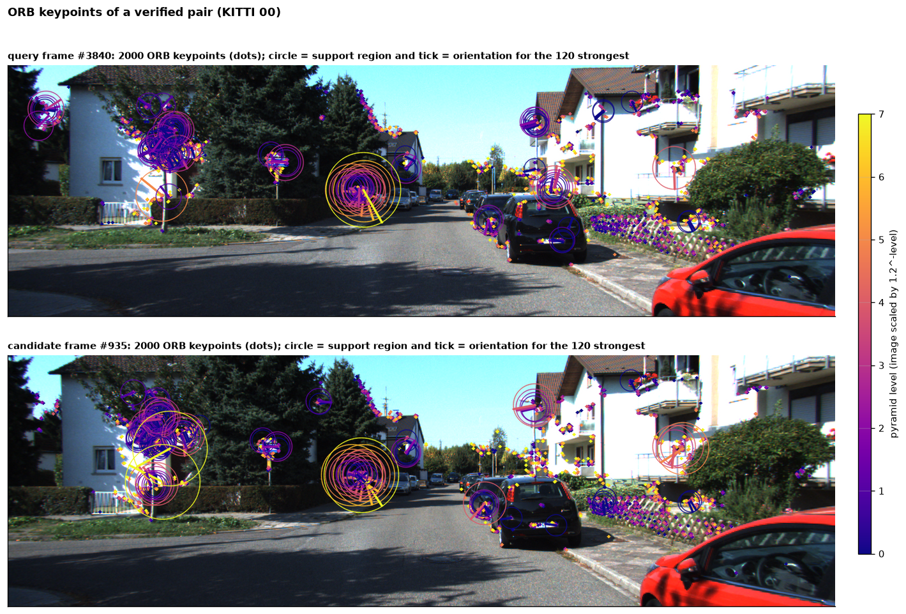
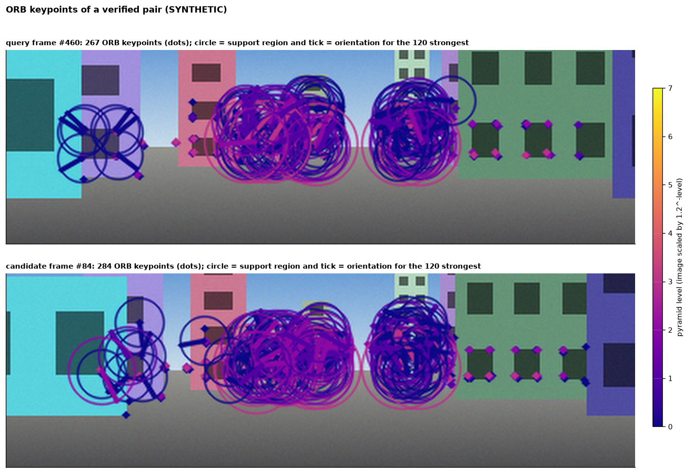

**Raw vs filtered matches.** (a) Unfiltered nearest neighbours by Hamming distance, a random 300 of 2000. (b) The matches that survive the ratio test, the 64-bit bound and the mutual check. The funnel counts are in the captions.

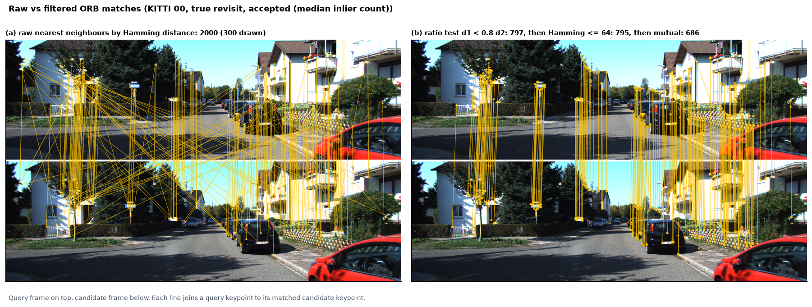
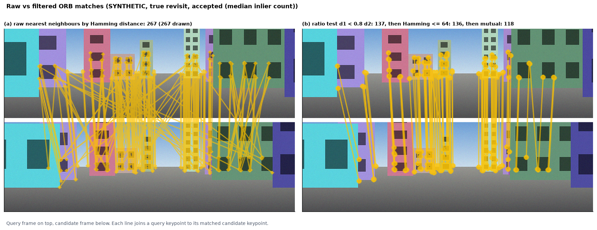

**RANSAC inliers and outliers, with epipolar lines.**
* (a) RANSAC inliers are green and outliers red.
* (b) and (c) Ten inliers of the query and their epipolar lines $\mathbf{l} = F\mathbf{u}_q$ in the candidate. Each matched point lies on its line, which is a visual check of the estimated $E$. On the true revisit the lines meet at the epipole near the vanishing point, as forward motion predicts.
* The second figure shows the confident false candidate, rejected with too few inliers.

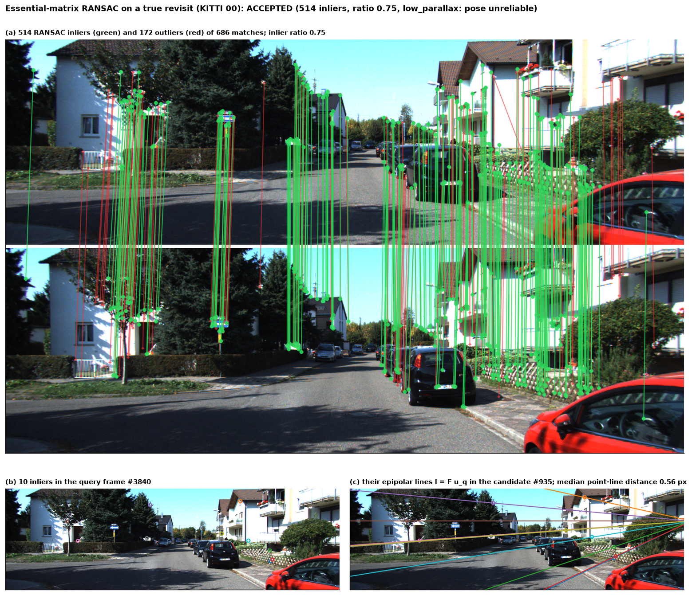
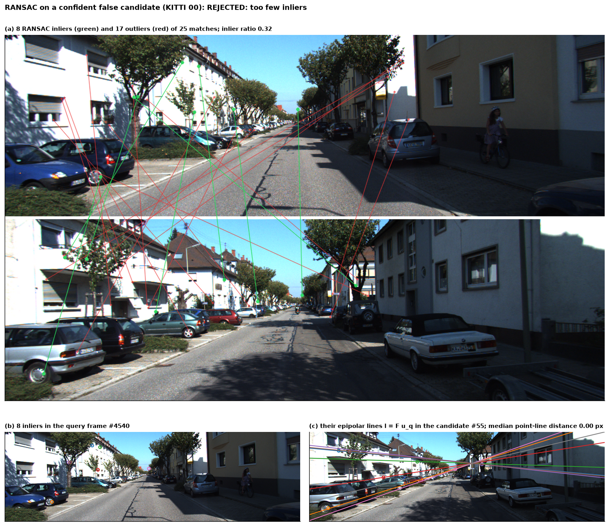
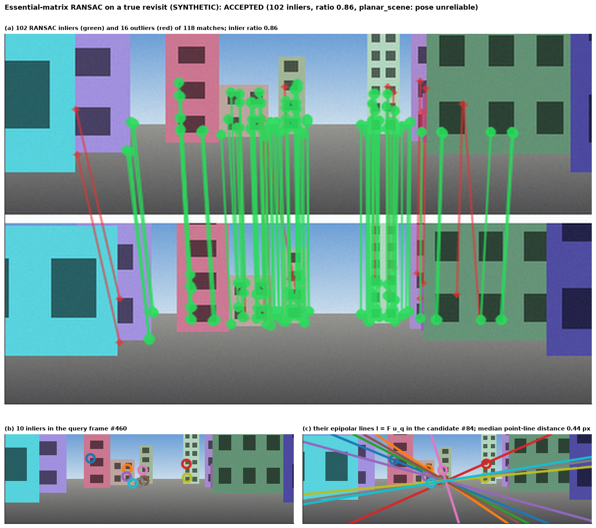
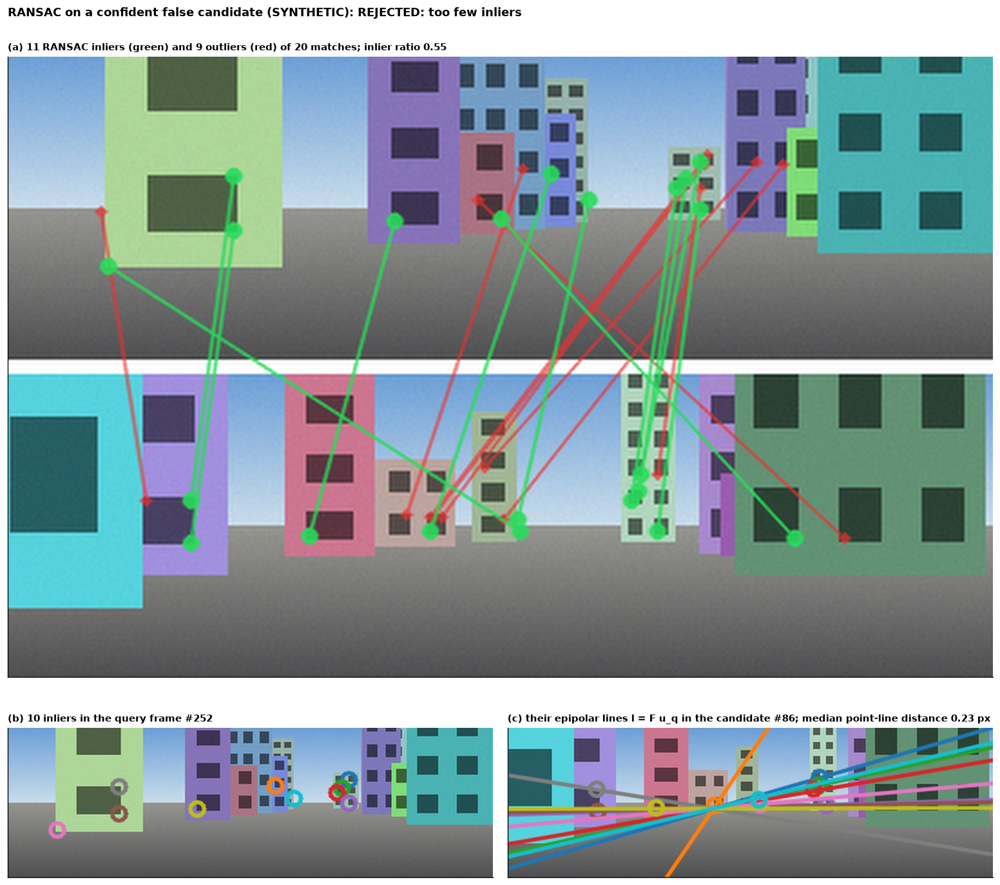

**Accepted and rejected candidate pairs.** The rank-1 examples are chosen deterministically: a true revisit with the median inlier count, the most confident (highest-cosine) false candidate, a missed true revisit (if any), a false positive (if any), a degenerate accepted pair, and the true revisit with the most inliers. KITTI 00 has no missed rank-1 true revisit, so that panel is absent there. The synthetic false positive matches windows on *different* buildings that happen to fit one epipolar geometry. This is the partial repeated structure the twin test does not catch.

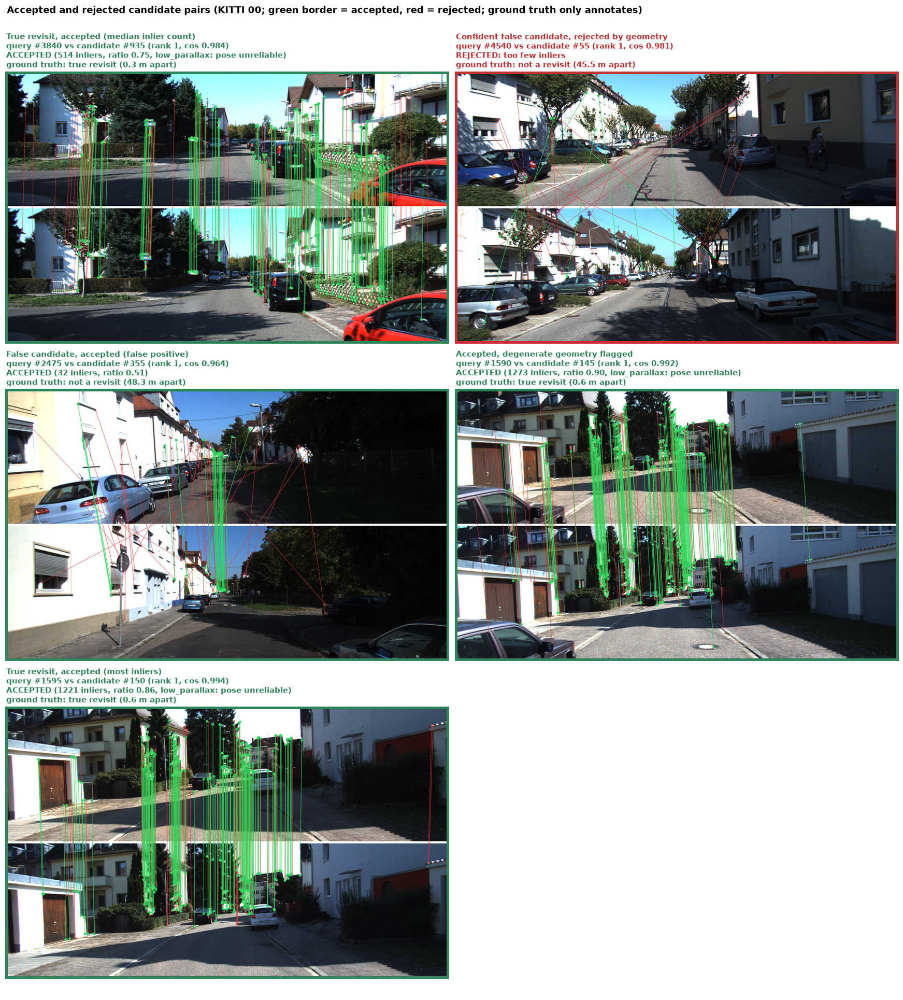
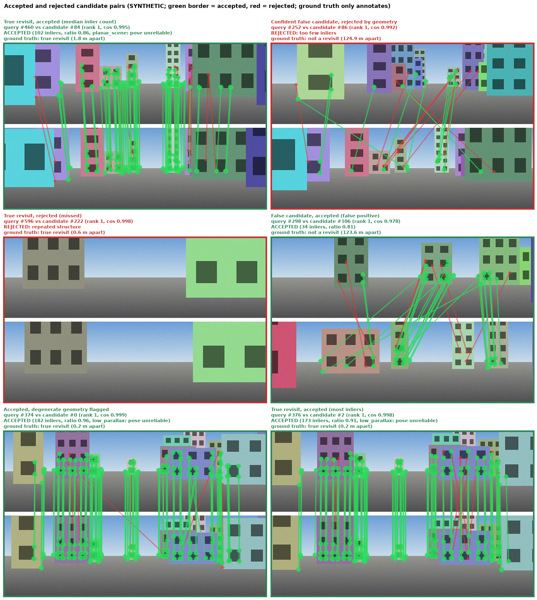

**Statistics.**
* (a) Inlier counts of the pairs that reached RANSAC, with the pairs rejected earlier counted in the legend.
* (b) The acceptance region in the inlier-count / inlier-ratio plane. The 0.3 ratio threshold never binds on either dataset.
* (c) The decision or rejection reason, by ground-truth label.

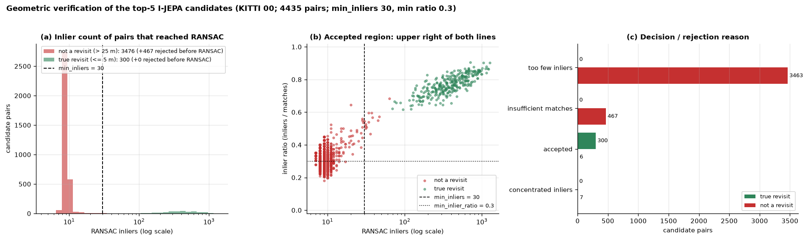
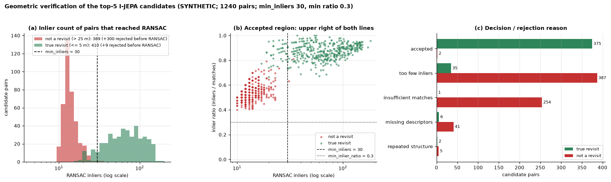

**Top-1 candidates after verification on the trajectory.** Accepted links are coloured by ground truth. Queries whose top-1 was rejected are grey dots, so the hundreds of correctly rejected long-range candidates do not hide the loop closures. The single red link on KITTI 00 is the same-street pair described above.

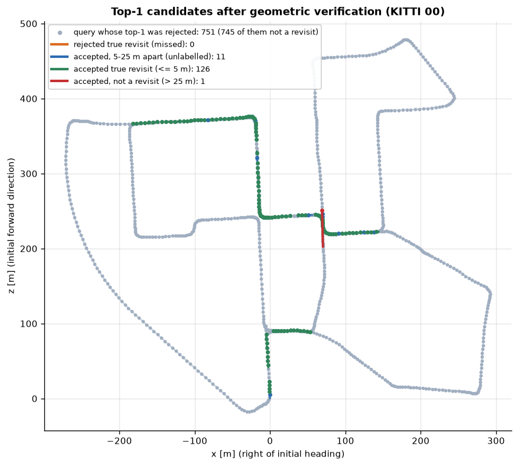
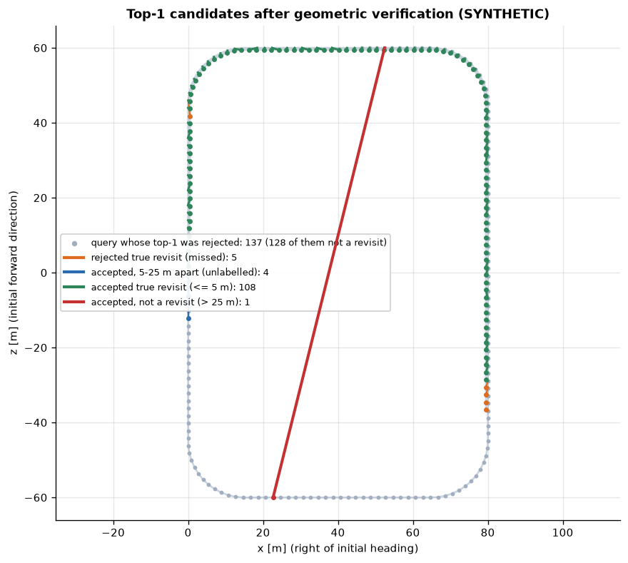

**Geometric verification GIFs.** Each pair is shown in three stages at 8 fps:
1. ratio-tested mutual matches (yellow)
2. RANSAC inliers (green) and outliers (red)
3. the decision, with its reason and the ground-truth annotation

The right panel shows the query and candidate on the trajectory and the decisions so far. The pairs are the gallery examples plus up to 12 evenly spaced labelled rank-1 pairs (duplicates removed), in chronological order: 18 pairs (2.2 MB) for SYNTHETIC, 16 (3.1 MB) for KITTI 00. Each stage is held for several frames; Pillow stores repeated frames once with a longer duration.

| SYNTHETIC | KITTI 00 |
|---|---|
| 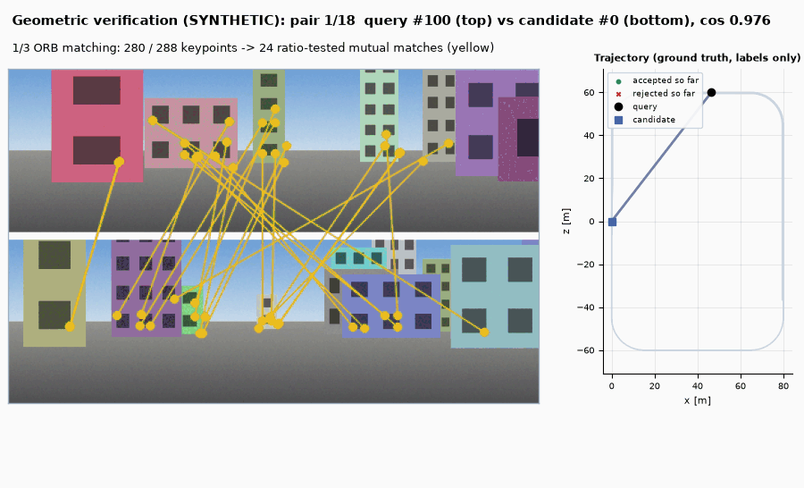 | 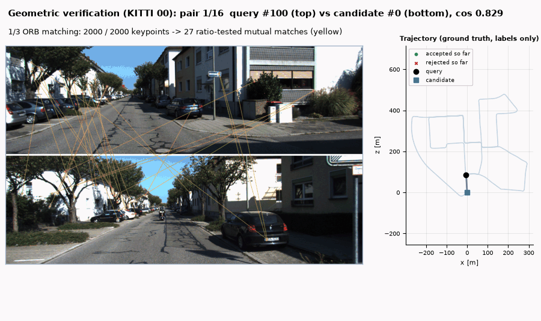 |

## Phase 5: baseline comparison

### Objective

Compare frozen I-JEPA descriptors with an established self-supervised model (DINOv2 ViT-B/14) and two classical descriptors (HSV colour histograms, ORB bag of visual words). Every method runs through **the same pipeline**:

* the same frames;
* the same `VisualEncoder` interface and embedding cache;
* the same exact cosine search with temporal exclusion (Phase 3);
* the same ground truth and Recall@K code.

Only the descriptor changes.

### DINOv2 representations

DINOv2 (Oquab et al., 2024) is a ViT trained by **self-distillation**. A student network sees several augmented crops of an image, and an EMA teacher sees two global crops. The student is trained to match the teacher's output distributions over $K$ prototypes:

* an image-level loss on the [CLS] token (the DINO objective);
* a patch-level masked-token loss (the iBOT objective);
* KoLeo regularisation, which spreads the features;
* Sinkhorn-Knopp centring of the teacher.

For the image-level part, with student and teacher probabilities $p_s = \mathrm{softmax}(h_s(z)/\tau_s)$ and $p_t = \mathrm{softmax}((h_t(z') - c)/\tau_t)$, the loss is:

```math
\mathcal{L}_{\mathrm{DINO}} = -\sum_{k=1}^{K} p_t^{(k)} \log p_s^{(k)} .
```

The released backbones were trained on LVD-142M, a curated set of 142 M images; ViT-B/14 was distilled from ViT-g/14.

**Architecture used here** (`encoders/dinov2.py`):
* ViT-B/14: width 768, 12 blocks, 12 heads, 86.6 M parameters.
* LayerScale on both residual branches.
* A learnable [CLS] token.
* Learned position embeddings for a 37 × 37 grid (518 px). They are bicubically resized to the input grid with the official +0.1 scale offset.

**Descriptor:** the final-LayerNorm [CLS] token, L2-normalised. `pooling: mean` (patch-token mean) is available as an alternative.

**Weights:** the official `dinov2_vitb14_pretrain.pth`, loaded with `strict=True`.

**Verification:** `scripts/verify_dinov2.py` compared this implementation with Meta's reference code (commit 7764ea0, FP32 on the CPU). The outputs are **bitwise identical**: max absolute difference 0.0 over all tokens, for both 224 × 224 inputs and non-square 224 × 728 inputs. GPU FP32 matches CPU to 6 × 10⁻⁷.

### I-JEPA vs DINOv2: training objectives

| | I-JEPA ViT-H/14 | DINOv2 ViT-B/14 |
|---|---|---|
| Objective | Predict the target encoder's *representations* of masked image blocks from a context block (regression in latent space) | Match teacher and student *distributions* over prototypes for crops (image level) and masked patches (patch level) |
| Augmentations | Random resized crop only | Multi-crop, colour jitter, blur, solarisation, ... |
| Global token | None (patch tokens only; mean-pooled here) | [CLS] token trained by the image-level loss |
| Invariance pressure | Implicit: from predicting semantic block content | Explicit: views of one image must agree |
| Pretraining data | ImageNet-1K (1.28 M images), 300 epochs | LVD-142M (142 M curated images); ViT-B distilled from ViT-g |
| Parameters | 630 M | 87 M |

The two models differ in more than the objective: data scale, model size and distillation all change too. The comparison below is therefore of two **released checkpoints**, not a controlled study of the objectives.

### HSV histogram construction

`encoders/classical.py::HSVHistogramEncoder`:

1. Resize the image to 320 px wide.
2. Convert to HSV (OpenCV: $H \in [0,180)$, $S, V \in [0,256)$).
3. Count a joint 3-D histogram with 16 × 4 × 4 = 256 bins: hue is the most discriminative channel and gets the most bins.
4. Normalise to a probability vector $p$ and store $\sqrt{p}$ (the Hellinger embedding).

Since $\lVert \sqrt{p} \rVert_2 = 1$, cosine similarity equals the **Bhattacharyya coefficient**:

```math
\cos\left(\sqrt{p}, \sqrt{q}\right) = \sum_{i} \sqrt{p_i \, q_i} \in [0, 1].
```

An optional spatial grid (`hsv.grid`) concatenates per-cell histograms. The default is one global histogram, which is invariant to where colours appear in the image.

### ORB bag of visual words

`encoders/classical.py::OrbBoVWEncoder`:

1. Extract 1000 ORB descriptors (256 bits each) per image, at full resolution.
2. **Quantise** each descriptor to the nearest of $K$ = 1000 binary visual words by Hamming distance (FAISS `IndexBinaryFlat`).
3. Count the word histogram $n_w$ and weight it with **tf-idf**: $v_w = (n_w / n) \log(N / \mathrm{df}_w)$, where $n$ is the descriptor count, $N$ the number of vocabulary-fitting images and $\mathrm{df}_w$ the number of those images that contain word $w$.
4. L2-normalise, so retrieval uses cosine similarity. An image without descriptors gets the uniform vector $1/\sqrt{K}$.

### Visual vocabulary fitting (development data only)

`scripts/fit_vocabulary.py` fits the vocabulary with **k-majority clustering**:

1. Unpack each descriptor into 256 bits $b \in \lbrace 0, 1 \rbrace^{256}$. For binary vectors, squared Euclidean distance equals Hamming distance, $\lVert b - b' \rVert_2^2 = d_H(b, b')$.
2. Run k-means (FAISS, 20 iterations, seed 0) on a random sample of at most 200,000 descriptors.
3. Binarise each centroid by majority vote: bit $= 1$ if the mean is at least 0.5.
4. Compute the idf over the fitting images.

The vocabulary file records its sources and a digest. That digest is part of the descriptor-cache fingerprint, so a refit can never reuse stale descriptors.

**Development/test split** (`splits` in `configs/default.yaml`), introduced here because the vocabulary is the first fitted component:

| Role | KITTI sequences | Used for |
|---|---|---|
| Development | 00, 05 | Vocabulary fitting (05 only); design inspection (00, already inspected in Phases 2–4); threshold tuning (Phase 6) |
| Held-out test | 02, 06, 08, 09 | Evaluated once in Phase 6; never used for fitting or tuning |

`vocabulary_plan` raises an error if any fitting sequence is not listed in `splits.dev` or is listed in `splits.test`; a test covers this. If the evaluated sequence is one of the fitting sequences, it is flagged `in_sample`.

* **KITTI vocabulary:** fitted on sequence **05**: 553 frames (every 5th), 552,998 descriptors, 200,000 sampled. All 1000 words are used. It is evaluated on 00, so the KITTI numbers below are *not* in-sample for the vocabulary.
* **Synthetic vocabulary:** fitted on a *different generated city* (seed 11, all 599 frames, 161,108 descriptors). Synthetic frames have few ORB features (about 270 each), so they are not subsampled. The evaluated city is seed 7.

### Experimental fairness

| Factor | Treatment |
|---|---|
| Frames, sampling, temporal exclusion, top-K, ground truth | Identical for all methods; one saved `retrieval.npz` per method in the same format |
| Neural preprocessing | Identical: squash to 224 × 224, ImageNet normalisation, so both use 16 × 16 patches of 14 px |
| Pooling | Each model's natural global descriptor: I-JEPA has no [CLS] token, so it uses the patch mean; DINOv2 uses [CLS]. DINOv2 patch-mean is available but not reported |
| Precision | Both neural models run in FP32 on the GPU (`auto` picks FP32 on the GTX 1650 Ti); DINOv2 GPU vs CPU cosine is 1.0 |
| Classical baselines | Full-resolution input for ORB; vocabulary from development data only |
| Tuning | None: every method uses default settings. Phase 2 found `aspect` preprocessing better than `squash` for I-JEPA on KITTI 00; it is *not* used here, and choosing it belongs to Phase 6, on development data |
| Statistical caveat | One sequence; consecutive queries are correlated, so the paired tests below are optimistic |

### Computational trade-offs

`scripts/profile_encoders.py` measures every encoder under identical conditions:
* the same 64 KITTI 00 frames, held in RAM (I/O excluded);
* sequential model loading;
* one warm-up batch, then batch size 8.

| | I-JEPA ViT-H/14 | DINOv2 ViT-B/14 | ORB bag of words | HSV histogram |
|---|---|---|---|---|
| Device (precision) | GPU (FP32) | GPU (FP32) | CPU | CPU |
| Parameters | 630.4 M | 86.6 M | none (1000 × 256-bit vocabulary) | none |
| Weights / vocabulary file | 2.52 GB | 346 MB | 34 KB | none |
| Input | 224 × 224 (squash) | 224 × 224 (squash) | 1241 × 376, 1000 ORB keypoints | 320 px wide |
| Descriptor | 1280-D float32 (5.1 KB) | 768-D (3.1 KB) | 1000-D (4.0 KB) | 256-D (1.0 KB) |
| Encoding time per image | **215 ms** | 35 ms | 11 ms | 1.6 ms |
| Peak GPU memory | 2585 MB | 401 MB | 0 | 0 |
| Model load time (from `/mnt/e`) | 74 s | 9.7 s | 0.1 s | 0 |

Search cost is negligible for all methods at this scale: 0.05–0.21 ms per query with exact FAISS search on the CPU.

### Implementation map

| File | Contents |
|---|---|
| `src/latent_loop/encoders/dinov2.py` | `DinoViT` (LayerScale blocks, [CLS], interpolated pos-embed), `DINOv2Encoder`, `CHECKPOINTS`, `write_sidecar` |
| `src/latent_loop/encoders/classical.py` | `HSVHistogramEncoder`, `Vocabulary`, `fit_vocabulary` (k-majority + idf), `OrbBoVWEncoder`, `vocabulary_plan` (development-only guard) |
| `src/latent_loop/encoders/__init__.py` | `build_encoder` for `ijepa`, `dinov2`, `hsv`, `orb_bovw` |
| `src/latent_loop/visualization/baselines.py`, `phase5.py` | Comparison figures and GIF |
| `scripts/verify_dinov2.py`, `fit_vocabulary.py`, `profile_encoders.py` | Reference check, vocabulary fitting, cost profile |
| `scripts/download_checkpoints.py dinov2` | Download or reuse the checkpoint; record its SHA-256 |
| `configs/dinov2.yaml`; `splits`, `hsv`, `orb_bovw`, `extraction`, `device` in `configs/default.yaml` | Configuration |

## Steps to run Phase 5

All commands run from the repository root with `.env` active and `PYTHONPATH` unset. KITTI commands use `--set dataset.name=kitti dataset.root=data/raw/kitti/dataset "dataset.sequence='00'"`, abbreviated below as `$KITTI00`:

```bash
KITTI00="dataset.name=kitti dataset.root=data/raw/kitti/dataset dataset.sequence='00'"

# 1. DINOv2 ViT-B/14 checkpoint (346 MB; reused if present) and SHA-256 sidecar
python scripts/download_checkpoints.py dinov2 --name vitb14

# 2. Check the DINOv2 implementation against Meta's code (~1 min; writes results/metrics/dinov2_verification.json)
git clone --depth 1 https://github.com/facebookresearch/dinov2 /tmp/dinov2_official
python scripts/verify_dinov2.py --official-repo /tmp/dinov2_official

# 3. Fit the ORB vocabularies on development data only (synthetic: seed-11 city, ~30 s;
#    KITTI: sequence 05, ~2 min). A test sequence in orb_bovw.fit_kitti_sequences is refused.
python scripts/fit_vocabulary.py
python scripts/fit_vocabulary.py --set $KITTI00

# 4. Descriptors + retrieval + causal-replay check for each baseline (extracts if not cached)
for enc in hsv orb_bovw; do
  python scripts/run_retrieval.py --config configs/default.yaml --encoder $enc --stride 2 --check-causal
  python scripts/run_retrieval.py --config configs/default.yaml --encoder $enc --stride 5 --check-causal --set $KITTI00
done
python scripts/run_retrieval.py --config configs/dinov2.yaml --encoder dinov2 --stride 2 --check-causal
python scripts/run_retrieval.py --config configs/dinov2.yaml --encoder dinov2 --stride 5 --check-causal --set $KITTI00
#    (I-JEPA results come from Phase 3; its cache fingerprint d49bc21384 is unchanged.)

# 5. Encoder cost profile (64 frames in RAM; GPU for the neural models; ~3 min)
python scripts/profile_encoders.py --stride 2 --frames 64
python scripts/profile_encoders.py --stride 5 --frames 64 --set $KITTI00

# 6. Phase 5 figures and GIF (~2.5 min each). The KITTI GIF uses 64 frames, 800 px and
#    128 colours to stay under 10 MB (five photographs per frame compress poorly).
python scripts/generate_visualizations.py --phase 5 --max-frames 80
python scripts/generate_visualizations.py --phase 5 --stride 5 --max-frames 64 \
    --gif-width 800 --gif-colors 128 --set $KITTI00

# 7. Tests
python -m pytest tests/test_baselines.py tests/test_baseline_plots.py
```

The `KITTI00` variable is expanded unquoted so that `--set` receives three separate arguments; the inner single quotes keep the sequence a string. The runs below used the equivalent explicit form (`--set dataset.name=kitti dataset.root=data/raw/kitti/dataset "dataset.sequence='00'"`). The variable form was checked separately and reproduces identical results.

## Phase 5 results

**Setup.**
* SYNTHETIC: every 2nd frame, 300 queries. KITTI 00: every 5th frame, 909 queries.
* Top-10 retrieval, temporal exclusion 100 frames, revisit ≤ 5 m.
* I-JEPA and DINOv2 descriptors from the **GPU (FP32)**; I-JEPA's SYNTHETIC cache dates from Phase 2 (GPU FP16).
* HSV and ORB bag of words on the **CPU**. Retrieval and metrics on the **CPU**.
* Offline and causal-replay retrieval gave identical candidates for every method.

**KITTI 00 (development sequence), preliminary Recall@K on positive queries:**

| Method | R@1 / R@5 / R@10, distance-only (162 queries) | R@1 / R@5 / R@10, same direction (150) | Pair ROC AUC | Encoding time per image |
|---|---|---|---|---|
| I-JEPA ViT-H/14 | 0.778 / 0.877 / 0.889 | 0.840 / 0.947 / 0.960 | 0.834 | 215 ms (GPU) |
| DINOv2 ViT-B/14 | 0.895 / **0.920** / 0.920 | 0.967 / **0.993** / 0.993 | 0.950 | 35 ms (GPU) |
| ORB bag of words | **0.901** / 0.914 / **0.932** | **0.973** / 0.987 / **1.000** | **0.959** | 11 ms (CPU) |
| HSV histogram | 0.852 / 0.901 / 0.907 | 0.920 / 0.973 / 0.973 | 0.888 | 1.6 ms (CPU) |

**SYNTHETIC:**

| Method | R@1 / R@5 / R@10 (115 queries; both definitions identical) | Pair ROC AUC |
|---|---|---|
| I-JEPA ViT-H/14 | 0.983 / 1.000 / 1.000 | 0.985 |
| DINOv2 ViT-B/14 | 0.983 / 1.000 / 1.000 | 0.960 |
| ORB bag of words | 0.991 / 1.000 / 1.000 | 0.996 |
| HSV histogram | 1.000 / 1.000 / 1.000 | 0.998 |

"Pair ROC AUC" separates the cosines of all eligible true-revisit pairs (≤ 5 m) from non-revisit pairs (> 25 m). These are retrieval checks on one development sequence, not loop-closure detection results.

**Reading the numbers.**
* **On KITTI 00, I-JEPA retrieves worse than every baseline at K = 1.** In paired comparisons on the 162 positive queries:
  * DINOv2 is right where I-JEPA is wrong 21 times, and the reverse happens 2 times (exact McNemar p = 6.6 × 10⁻⁵).
  * For ORB bag of words the counts are 21 vs 1 (p = 1.1 × 10⁻⁵).
  * DINOv2 and ORB bag of words are statistically indistinguishable (3 vs 4, p = 1.0).
  * Consecutive queries are correlated, so these p-values overstate the evidence. The direction is nevertheless consistent across K and both ground-truth definitions.
* **I-JEPA's cosines are compressed.** Its non-revisit pairs have a median cosine of 0.75 and a 99th percentile of 0.94, against 0.95 for true revisits. Confident wrong candidates are therefore common, as Phase 3 found. DINOv2's [CLS] token separates the two populations much better (AUC 0.95 vs 0.83).
* **The gap narrows at higher K.** I-JEPA's Recall@10 (0.889) is within 1.8–4.3 points of the others, so many I-JEPA misses are near misses. Phase 4 geometric verification can recover some of these from the top-5.
* **Cost.** I-JEPA ViT-H/14 is 6× slower than DINOv2 ViT-B/14 and uses 6.4× more GPU memory, for a lower Recall@1 here.
* **SYNTHETIC is too easy to rank methods.** Every building in the procedural city has a unique flat colour, so a global colour histogram alone reaches Recall@1 = 1.0. Differences of one or two queries out of 115 are not meaningful.
* **Not tuned.** All four methods use defaults. Most importantly, I-JEPA uses `squash`, although Phase 2 measured `aspect` as better on this sequence. Phase 6 will choose preprocessing, pooling and thresholds on the development sequences (00, 05), and then evaluate once on the held-out sequences (02, 06, 08, 09) with detection metrics. **No claim that any method is generally better follows from these numbers.**

**Preliminary Recall@K.** Curves use a shared axis from 0.5, and the bars start at 0.

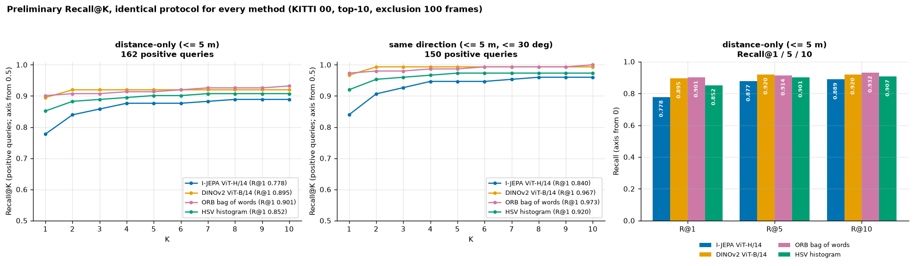
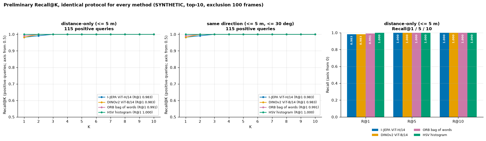

**Embedding similarity comparisons.**
* Top: each method's cosine similarity for eligible pairs, each on its own colour scale (1st to 99.9th percentile), because the methods' similarity ranges differ.
* Bottom: cosine distributions of true-revisit and non-revisit pairs, with the ROC AUC.

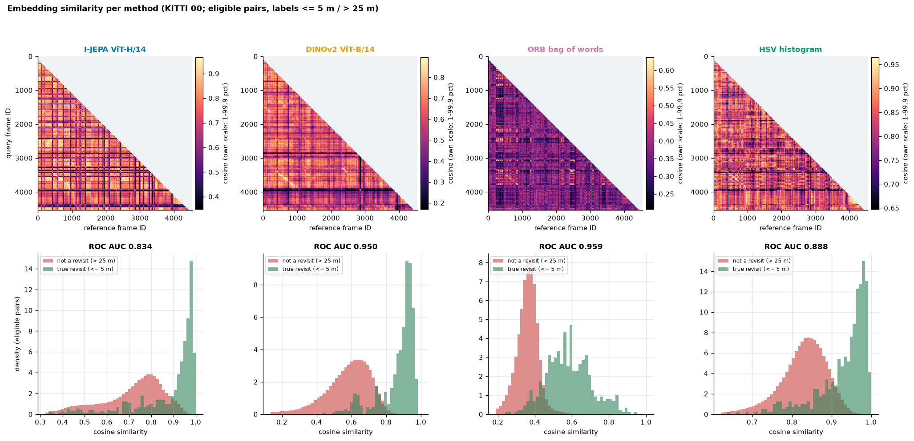
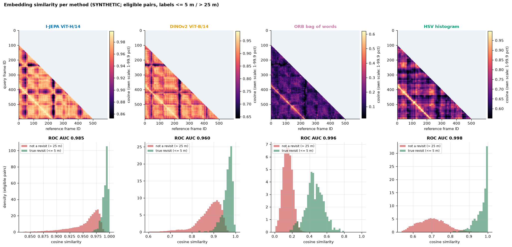

**Qualitative successes and failures.** Rows are chosen deterministically by case, using the highest I-JEPA top-1 cosine within each case. Each row shows the query (black) and every method's top-1 candidate (green = true revisit). Query #600 is the Phase 3 aliasing example: every method returns a false candidate 132–235 m away.

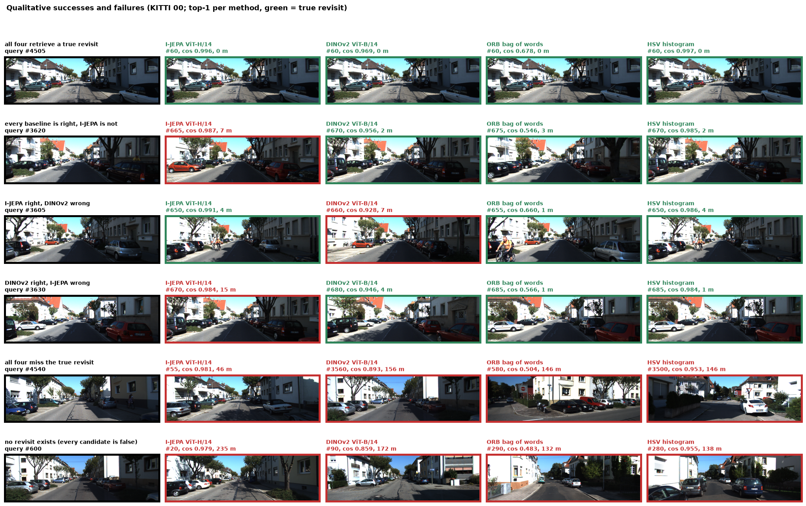
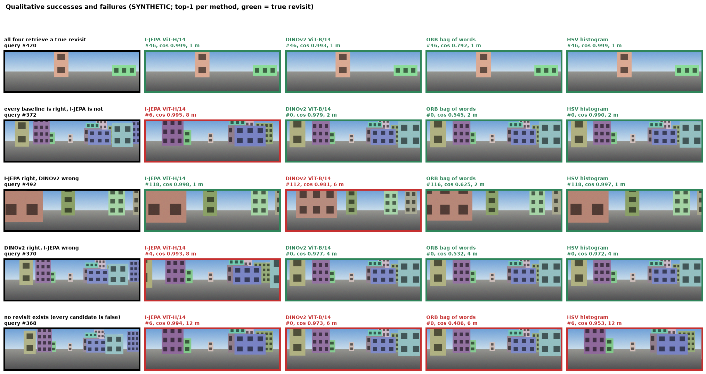

**Side-by-side retrieved images (top-3 per method).** Query 1 is a revisit that every method gets right. Query 2 is one where I-JEPA and the baselines disagree.

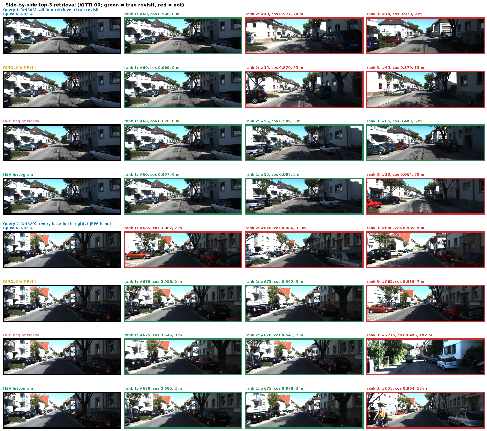
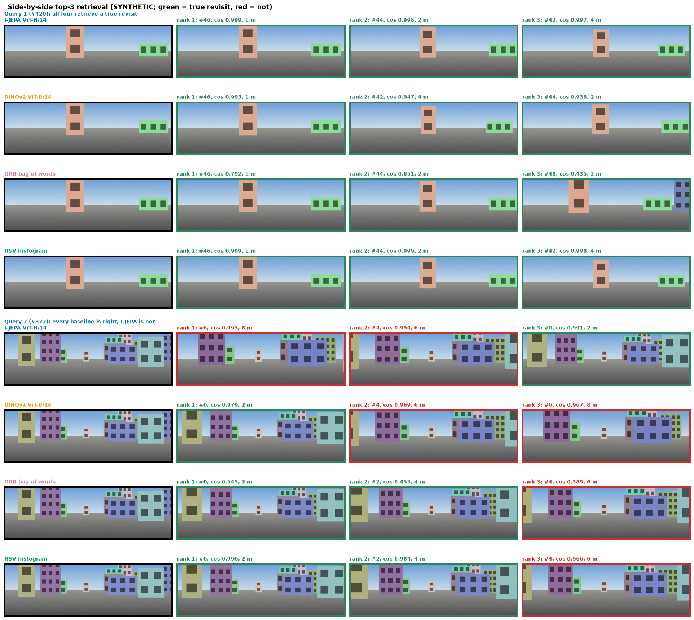

**Computational trade-offs** (from `results/metrics/encoder_profile_kitti_00_cam2.json`):

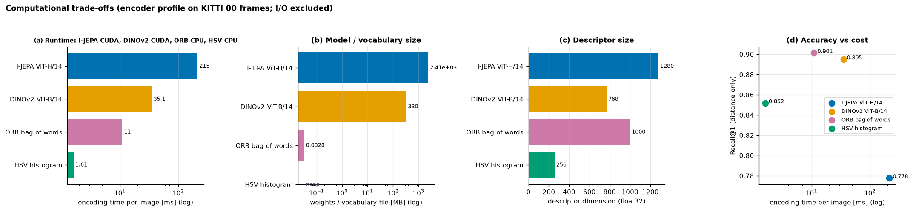

**Side-by-side retrieval GIFs.** Each frame shows:
* the query (top left);
* each method's top-1 eligible candidate in a 2 × 2 grid, with a green or red border for the ground-truth verdict and a running Recall@1 over the positive queries seen so far;
* the trajectory, with each method's candidate position in its colour.

SYNTHETIC: 80 evenly spaced queries, 900 px, 8.1 MB. KITTI 00: 64 queries, 800 px, 128 colours, 9.0 MB. Both at 8 fps.

| SYNTHETIC | KITTI 00 |
|---|---|
|  |  |

## Phase 6: benchmarking and evaluation

### Objective

Measure place recognition and loop-closure detection for six configurations under one protocol:
* I-JEPA retrieval, and I-JEPA + geometric verification (GV);
* DINOv2 retrieval, and DINOv2 + GV;
* ORB bag of words;
* HSV histogram.

All choices are made on development sequences. The held-out sequences are evaluated **once**, with those choices frozen.

### Experimental protocol

`scripts/run_benchmark.py` (`src/latent_loop/evaluation/runner.py`) runs two stages, and the code enforces their order:

1. **Development stage** (KITTI 00, 05):
   * Descriptors and retrieval for every method, and for each preprocessing variant of the neural encoders (`squash` or `aspect`).
   * **Variant selection** per encoder by pooled development retrieval mAP, written to `selection.json`.
   * Geometric verification of the top-5 candidates for the "+ GV" methods.
   * **Threshold selection** per method on the pooled development PR curve, written to `thresholds.json`.
2. **Test stage** (KITTI 02, 06, 08, 09):
   * Refuses to run without `selection.json` and `thresholds.json`, and refuses overlapping splits.
   * Recomputes nothing that could be tuned.
   * Reports every metric at the development thresholds.

Shared settings:
* every 5th frame on every sequence (2 Hz), left colour camera (`image_2`);
* top-10 exact cosine retrieval with a 100-frame temporal exclusion;
* causal replay (identical candidates to offline retrieval, and it gives per-query timing);
* verification of the top 5 with the Phase 4 checks.

**Detector output.** Each method emits at most one loop-closure hypothesis per query:

| Method type | Hypothesis | Score |
|---|---|---|
| Retrieval only | rank-1 candidate | its cosine similarity |
| + GV | among the top-5 candidates that pass every geometric check (ratio, coverage, degeneracy policy), the one with the most RANSAC inliers | its inlier count |

For "+ GV", the verification minimum is set to `min_inliers: 0`, because the inlier threshold *is* the detection threshold and is chosen on development data. The loop is predicted when score ≥ τ.

### Dataset splits

| Split | Sequences | Frames used (every 5th) | Used for |
|---|---|---|---|
| Development | 00, 05 | 909 + 553 | preprocessing selection, thresholds, ORB vocabulary (05), earlier design inspection (00) |
| Held-out test | 02, 06, 08, 09 | 933 + 221 + 815 + 319 | one final evaluation |

These six sequences are the KITTI odometry sequences with substantial revisits. 08 revisits most places in the **opposite direction**, which a forward camera sees as a different scene.

### Ground-truth definitions

For evaluation only, reference $r$ is a **true revisit** of query $q$ iff $f_r \le f_q - 100$ (original frame IDs, i.e. at least 10 s earlier) and $\lVert p_q - p_r \rVert_2 \le 5$ m on the ground plane. A **positive query** has at least one eligible true revisit; $Q^+$ is the set of positive queries. A predicted loop is **correct** iff its candidate is a true revisit of the query. A prediction 5–25 m away counts as wrong, and is reported separately as a "near" false positive, because Phase 4 showed that such pairs often share real visual overlap. Recall@1 is also reported under the same-direction definition (heading difference ≤ 30°).

### Metric equations

**Retrieval (positive queries only).** Ranking quality is measured on $Q^+$; queries without a revisit cannot be answered correctly by retrieval.

```math
\mathrm{R@}K = \frac{1}{\lvert Q^{+}\rvert} \sum_{q \in Q^{+}} \mathbb{1}\left[\mathcal{C}_K(q) \cap P(q) \neq \emptyset\right],
\qquad
\mathrm{AP}(q) = \frac{1}{\lvert P(q)\rvert} \sum_{k=1}^{n_q} \mathrm{Prec@}k(q)\, \mathrm{rel}_k(q),
\qquad
\mathrm{mAP} = \frac{1}{\lvert Q^{+}\rvert} \sum_{q \in Q^{+}} \mathrm{AP}(q),
```

where $\mathcal{C}_K(q)$ is the top-K list, $P(q)$ the true revisits, and AP ranks **all** $n_q$ eligible references of $q$.

**Detection (all queries with at least one eligible reference).** With $N$ evaluable queries and threshold τ:

```math
\mathrm{TP} = \#\{q : s_q \ge \tau,\ \hat r_q \in P(q)\}, \quad
\mathrm{FP} = \#\{q : s_q \ge \tau,\ \hat r_q \notin P(q)\}, \quad
\mathrm{FN} = \lvert Q^{+}\rvert - \mathrm{TP},
```

```math
\mathrm{Precision} = \frac{\mathrm{TP}}{\mathrm{TP}+\mathrm{FP}}, \quad
\mathrm{Recall} = \frac{\mathrm{TP}}{\lvert Q^{+}\rvert}, \quad
F_1 = \frac{2\,\mathrm{TP}}{2\,\mathrm{TP}+\mathrm{FP}+\mathrm{FN}}, \quad
\mathrm{FP}/1000 = \frac{1000\,\mathrm{FP}}{N}.
```

A positive query with a *wrong* loop counts as both an FP and an FN. Queries without a revisit enter only through FP and TN. The **confusion matrix** has rows "has revisit" and "no revisit", and columns "correct loop", "wrong loop" and "no loop".

**Detection AP** is the step-wise area under the pooled PR curve over all distinct thresholds, $\sum_i P_i (R_i - R_{i-1})$. It can stay below 1 even for a perfect ranking, because recall is capped by queries whose hypothesis is wrong. The implementation is checked against a brute-force evaluation of every threshold (`tests/test_benchmark.py`).

### Threshold selection

On the pooled development predictions, two thresholds are chosen:
* τ maximising F1 (the highest such τ on ties) is the **operating threshold** applied to the test sequences;
* τ₁₀₀, the lowest threshold whose precision on development data is still 1.0, is also reported, because a SLAM back-end usually needs near-zero false loops.

Neither threshold, nor the preprocessing variant, ever sees test data.

### Computational measurements

| Quantity | How it is measured |
|---|---|
| Encoder latency, peak GPU memory, host-RAM increase | `scripts/profile_encoders.py --tag benchmark`: the selected variants on the same 64 KITTI 00 frames held in RAM; sequential loading, warm-up, batch 8. GPU for the neural encoders, CPU for the classical ones |
| Retrieval latency | Causal replay on the test sequences: per-query FAISS search plus insertion of the frame (CPU) |
| Verification latency | ORB extraction of the query frame (including the image read) plus matching, RANSAC, pose and homography for its 5 candidate pairs (CPU; measured inside parallel workers on the test sequences) |
| End-to-end latency | encoder + retrieval + verification per query (single-frame streaming estimate) |
| Embedding storage | float32 descriptor bytes × test frames |

### Implementation map

| File | Contents |
|---|---|
| `src/latent_loop/evaluation/benchmark.py` | `average_precision_ranked`, `retrieval_average_precision` (full eligible ranking), `Predictions`, `make_predictions`, `detection_at` (P, R, F1, FP/1000, confusion), `pr_curve` (+ detection AP), `select_threshold` |
| `src/latent_loop/evaluation/runner.py` | `Benchmark` (`run_dev`, `run_test`), `sequence_config`, `with_variant`, `efficiency_table` |
| `src/latent_loop/verification/parallel.py` | `verify_pairs` (process pool, per-config pair cache), `pairs_from_candidates` |
| `src/latent_loop/visualization/evaluation.py`, `phase6.py` | Phase 6 figures and playback GIF |
| `scripts/run_benchmark.py`, `configs/benchmark.yaml` | Benchmark CLI and configuration |

**Outputs** go to `results/benchmark/kitti_stride5/`:
* `selection.json`, `thresholds.json`;
* `{dev,test}_metrics.{csv,json}`: one row per method × sequence, plus a pooled row;
* `curves/{dev,test}/<method>.npz`;
* `predictions/{dev,test}/<method>_<seq>.csv`: one hypothesis per query, with ground-truth columns;
* `test_timing.json`, `efficiency.{csv,json}`;
* `pair_cache/`: verified pairs per sequence and config hash.

## Steps to run Phase 6

All commands run from the repository root with `.env` active and `PYTHONPATH` unset. The ORB vocabulary (Phase 5, step 3) must exist. Descriptors are extracted on demand, so the first run extracts every development and test sequence: about 2–2.5 h here on the GTX 1650 Ti, dominated by I-JEPA in `aspect` mode and image reads from `/mnt/e`.

```bash
# 1. Development stage: variant selection, verification, thresholds (18 min with cached 00 descriptors)
python scripts/run_benchmark.py --stage dev
#    -> results/benchmark/kitti_stride5/{selection.json, thresholds.json, dev_metrics.csv, ...}

# 2. Encoder cost of the selected variants (idle GPU; 64 KITTI 00 frames in RAM; ~3 min)
python scripts/profile_encoders.py --config configs/benchmark.yaml --tag benchmark --stride 5 \
    --frames 64 --set dataset.name=kitti dataset.root=data/raw/kitti/dataset \
    "dataset.sequence='00'" ijepa.resize_mode=aspect dinov2.resize_mode=aspect

# 3. Test stage: frozen evaluation on 02, 06, 08, 09 (about 20 min of verification with
#    6 workers; under 1 min when descriptors and verified pairs are cached)
python scripts/run_benchmark.py --stage test
#    options: --workers N   --stage all   --set benchmark.verify_top_k=3 ...

# 4. Figures and playback GIFs (~2.5 min each; --gif-sequence picks the test sequence)
python scripts/generate_visualizations.py --phase 6 --gif-sequence 08
python scripts/generate_visualizations.py --phase 6 --gif-sequence 06

# 5. Tests
python -m pytest tests/test_benchmark.py
```

The test descriptors used below were extracted ahead of step 3 with `scripts/extract_embeddings.py --config configs/benchmark.yaml --encoder <name> --stride 5 --set ... ijepa.resize_mode=aspect` (and likewise for `dinov2.resize_mode=aspect`). These produce the same cache fingerprints the test stage uses; step 3 extracts them itself if they are missing.

## Phase 6 results

**Setup.**
* Every 5th frame of each sequence; left colour camera.
* Descriptors: I-JEPA ViT-H/14 and DINOv2 ViT-B/14 on the **GPU (FP32)**; HSV and ORB bag of words on the **CPU**.
* Retrieval (exact FAISS) and geometric verification (OpenCV, 6 processes) on the **CPU**.
* Development: 1,422 queries, 251 with a revisit. Test: 2,208 queries, 190 with a revisit.

**Selected on development data:**

| | Choice | Development evidence |
|---|---|---|
| I-JEPA preprocessing | `aspect` | pooled retrieval mAP 0.634 vs 0.587 for `squash` |
| DINOv2 preprocessing | `aspect` | 0.804 vs 0.798 |
| Operating threshold (max F1) | I-JEPA 0.968, DINOv2 0.923, ORB BoW 0.550, HSV 0.967 (cosine); I-JEPA + GV 133, DINOv2 + GV 172 (inliers) | development F1: 0.748, 0.890, 0.734, 0.716; 0.921, 0.933 |

**Held-out test results (pooled over 02, 06, 08, 09; development thresholds).**

| Method | R@1 | R@5 | R@10 | R@1 same direction (109 queries) | mAP | Detection AP | Precision | Recall | **F1** | TP / FP / FN | FP per 1,000 |
|---|---|---|---|---|---|---|---|---|---|---|---|
| I-JEPA | 0.500 | 0.558 | 0.568 | 0.872 | 0.466 | 0.469 | 0.422 | 0.484 | 0.451 | 92 / 126 / 98 | 57.1 |
| I-JEPA + GV | (same retrieval) | | | | | 0.549 | **0.980** | **0.511** | **0.671** | 97 / 2 / 93 | **0.9** |
| DINOv2 | 0.526 | 0.574 | 0.579 | 0.899 | **0.521** | 0.478 | 0.962 | 0.400 | 0.565 | 76 / 3 / 114 | 1.4 |
| DINOv2 + GV | (same retrieval) | | | | | **0.550** | **0.980** | **0.511** | **0.671** | 97 / 2 / 93 | **0.9** |
| ORB bag of words | **0.563** | 0.568 | 0.589 | **0.954** | 0.496 | 0.405 | 0.629 | 0.384 | 0.477 | 73 / 43 / 117 | 19.5 |
| HSV histogram | 0.537 | **0.589** | **0.605** | 0.917 | 0.507 | 0.485 | 0.340 | 0.505 | 0.407 | 96 / 186 / 94 | 84.2 |

At the stricter development threshold for 100 % precision, test recall and precision are:

| Method | Recall | Precision |
|---|---|---|
| I-JEPA + GV | 0.479 | 0.989 |
| DINOv2 + GV | 0.405 | 0.987 |
| I-JEPA | 0.321 | 0.984 |
| DINOv2 | 0.163 | 1.000 |
| HSV | 0.347 | 0.971 |
| ORB bag of words | 0.021 | 1.000 |

**Per-sequence detection F1 (test):**

| Method | 02 (63 revisit queries) | 06 (54) | 08 (69, all opposite direction) | 09 (4) |
|---|---|---|---|---|
| I-JEPA | 0.503 | 0.624 | 0.000 | 0.857 |
| I-JEPA + GV | 0.815 | **0.962** | 0.000 | 0.667 |
| DINOv2 | 0.680 | 0.833 | 0.000 | 0.857 |
| DINOv2 + GV | **0.826** | **0.962** | 0.000 | 0.400 |
| ORB bag of words | 0.569 | 0.839 | 0.000 | 0.200 |
| HSV histogram | 0.429 | 0.829 | 0.000 | 0.000 |

**Computational measurements** (encoder: `profile_encoders.py`; retrieval and verification: measured on the test sequences):

| Method | Encoder (device) | Retrieval / query | Verification / query (CPU) | End-to-end / query | Peak GPU | Host RAM increase | Test descriptors |
|---|---|---|---|---|---|---|---|
| I-JEPA (`aspect`) | 798 ms (GPU) | 0.26 ms | none | 798 ms | 2853 MB | 306 MB | 11.2 MB (1280-D) |
| I-JEPA + GV | 798 ms (GPU) | 0.26 ms | 1324 ms | 2122 ms | 2853 MB | 306 MB | 11.2 MB |
| DINOv2 (`aspect`) | 112 ms (GPU) | 0.19 ms | none | 112 ms | 567 MB | 601 MB | 6.7 MB (768-D) |
| DINOv2 + GV | 112 ms (GPU) | 0.19 ms | 1281 ms | 1393 ms | 567 MB | 601 MB | 6.7 MB |
| ORB bag of words | 10.3 ms (CPU) | 0.23 ms | none | 10.5 ms | none | 1.9 MB | 8.7 MB (1000-D) |
| HSV histogram | 1.8 ms (CPU) | 0.13 ms | none | 1.9 ms | none | 0.8 MB | 2.2 MB (256-D) |

### Results interpretation

* **Geometric verification is what makes a detector usable.** At the development thresholds, every retrieval-only method except DINOv2 produces tens of false loops per 1,000 test queries: I-JEPA 57, HSV 84, ORB bag of words 19. With GV, I-JEPA drops to 0.9 FP per 1,000 (126 → 2 false loops) and finds slightly more correct loops (92 → 97). For DINOv2, GV adds 21 correct loops at the same false-alarm level. In a paired test over the 190 positive queries, DINOv2 + GV is right where DINOv2 is wrong 27 times, and the reverse 6 times (exact McNemar p = 3 × 10⁻⁴).
* **With GV, I-JEPA and DINOv2 are indistinguishable here.** Both reach F1 0.671 with 97 correct and 2 wrong loops; they agree on 98 % of the positive test queries (2 vs 2 discordant). Their detection APs differ by 0.001. DINOv2 achieves this with an encoder 7× faster (112 vs 798 ms) using 5× less GPU memory.
* **Without GV, DINOv2 is the most reliable retrieval-only detector** (precision 0.96 at its development threshold), and I-JEPA the least reliable among the neural ones (precision 0.42). I-JEPA's development threshold (cosine 0.968) does not transfer: on test it admits many confident wrong candidates, whose cosine distribution is compressed near 1 (see Phase 5).
* **Retrieval ranks the methods differently from detection.** At rank 1 the classical ORB bag of words is best on test (R@1 0.563; same-direction 0.954). On the paired test queries it beats I-JEPA (13 vs 1, p = 0.002). The I-JEPA vs DINOv2 difference at rank 1 is not significant (5 vs 10, p = 0.30).
* **Conclusions on JEPA.** On these sequences, frozen I-JEPA descriptors with geometric verification match DINOv2 with geometric verification for loop detection. Without verification, I-JEPA is worse than DINOv2. It is also several times more expensive. **No result here shows I-JEPA outperforming the baselines.**

### Failure analysis

* **KITTI 08: opposite-direction revisits.** All 69 revisit queries of 08 pass places in the opposite direction, and none has a same-direction revisit. Every method scores F1 0 there; I-JEPA top-1 retrieval is 0 / 69. A forward camera sees a different scene, and neither global descriptors nor ORB matching can recover it. 08 contributes 36 % of the test revisit queries, which is the main reason test recall (0.51 at best) is far below development recall (0.86–0.89 for the GV methods). Excluding 08 (a secondary analysis, not the primary result), both GV methods reach F1 0.882.
* **Crossing revisits.** In 02, 12 of the 63 revisit queries cross an earlier path at a different heading (51 same-direction). These are mostly missed.
* **False positives are near misses.** Both remaining false loops of each GV method connect frames 5–8 m apart that show the same street (see the examples). By the 5 m definition they are wrong. A metric-pose back-end might accept them, but this verification estimates no scale (Phase 4).
* **Few-revisit sequences are noisy.** 09 has only 4 revisit queries, so its per-sequence F1 changes by 0.2–0.5 per query. I-JEPA + GV 0.667 vs DINOv2 + GV 0.400 there is one or two queries.
* **Threshold transfer.** Development F1 thresholds of the cosine-scored methods transfer poorly: I-JEPA, HSV and ORB bag of words over-accept on 02 (precision 0.39, 0.29 and 0.62). Inlier-count thresholds transfer well: precision is 0.98–0.995 on development and 0.98 on test.

### Limitations

* **Small test set.** 190 test revisit queries, dominated by 02, 06 and 08. Consecutive queries are correlated, so the McNemar p-values above overstate the evidence.
* **Settings.** One camera (left colour), every 5th frame, one ground-truth radius (5 m), top-5 verification and default verification checks. Only the preprocessing variant and the detection threshold were tuned, both on development data.
* **ORB vocabulary.** It was fitted on development sequence 05. Its development metrics on 05 are in-sample; its test metrics are not.
* **Latency estimates.** Verification latency was measured inside 6 parallel worker processes reading images from `/mnt/e`; a single process on a local disk would be faster. The End-to-end column sums per-stage means for streaming one frame at a time, and assumes the earlier frames' ORB features are cached.
* **No back-end.** No pose-graph optimisation or trajectory error is evaluated; detected loops are not used for SLAM here.

**Detection precision-recall curves** (pooled; one hypothesis per query). Left: development, where the thresholds were chosen. Right: test, with dots at the operating point given by the development threshold.


**Recall@K and mAP on the test set** (retrieval methods only; GV does not change retrieval):


**F1 comparison**: per test sequence and pooled, with pooled precision against recall, and false alarms per 1,000 queries:


**Query-level confusion matrices** (pooled test). Rows: query has a revisit or not. Columns: correct loop, wrong loop, no loop.


**Runtime and memory** (encoder: GPU for I-JEPA and DINOv2, CPU for the classical baselines; retrieval and verification on the CPU):


**Trajectory loop-closure plots** (test sequences; development thresholds). Green: correct predicted loop. Red: wrong loop. Orange ×: revisit query without a correct loop.


**False-positive and false-negative examples** (GV methods, test sequences). Each row shows the query, its predicted loop, and the closest true revisit:
* **False positives** are the highest-scoring wrong loops, all 5–8 m away.
* **False negatives** are the median missed query in the sequence with the most misses (08, where the true revisit faces the other way) and in the next one (02, a crossing).


**Trajectory playback GIFs** (I-JEPA + GV and DINOv2 + GV; 110 evenly spaced frames at 8 fps). Each frame shows the camera image, the trajectory so far, and every predicted loop closure coloured by ground-truth correctness:
* KITTI 06, where loops are detected (6.9 MB);
* KITTI 08, where every revisit is in the opposite direction and nothing is detected (7.2 MB).

| KITTI 06 (held-out) | KITTI 08 (held-out, failure case) |
|---|---|
|  |  |

## Troubleshooting

| Symptom | Cause and fix |
|---|---|
| Warnings about `launch-ros`/`ament` or odd imports from `ros2_humble` | `~/.bashrc` sources ROS 2 Humble, which adds Python 3.10 packages to `PYTHONPATH`. Run `unset PYTHONPATH` in the shell (or prefix commands with `env -u PYTHONPATH`). |
| VS Code reports `opencv-python-headless`/`imageio` "not installed" | The editor uses a different interpreter. Select `.env/bin/python`. |
| `pip install` or imports are very slow | The venv (`.env/`) is on `/mnt/<drive>`, where file I/O is slow. This is expected; a venv on the Linux filesystem is faster. |
| `ERROR: Image directory not found ... image_2` | KITTI is not unpacked at `data/raw/kitti/dataset`. See [Dataset preparation](#kitti-odometry-selective-download-done), or pass `--root`. |
| `Pose/frame misalignment` | `poses/XX.txt` and `times.txt` come from different sequences or an incomplete download. |
| GIF larger than 10 MB | Lower `--max-frames` or `--gif-width`. Noisy images compress poorly in GIF. |
| `unable to mmap ... Cannot allocate memory (12)` when loading a checkpoint | Private memory maps are charged against RAM + swap. The project loads with a shared map (`load_mmap`); call that instead of `torch.load(..., mmap=True)`. |
| I-JEPA inference is slower than expected in FP16 | GPUs without Tensor Cores (e.g. GTX 16xx) can be slower in FP16. Keep `ijepa.precision: auto`, which benchmarks and picks FP32 here. |
| `ModuleNotFoundError: faiss` | Install the ML extra: `pip install -e ".[dev,ml]"` (or `pip install faiss-cpu==1.15.1`). |
| `descriptors must be L2-normalised` from the retrieval index | The descriptors did not come from a `VisualEncoder` (which normalises them). Normalise with `latent_loop.features.pooling.l2_normalize`. |
| A stopped vehicle "revisits" itself | The 100-frame exclusion assumes motion. Add `--set retrieval.temporal_exclusion_seconds=...`; a distance-travelled rule is future work. |
| Verification of KITTI is slow (~0.2 s per pair) | RANSAC runs up to 2000 iterations on pairs with few inliers, i.e. on most wrong candidates. Lower `--top-k`, or use `--estimator numpy` (vectorised, adaptive stopping; median RANSAC 40 vs 206 ms per pair on KITTI 00). |
| `No retrieval result in ...` from `run_verification.py` | Phase 4 reads saved Phase 3 results. Run `scripts/run_retrieval.py` with the same `--config`, `--stride` and `--set` first. |
| `Re-verification of (q, c) gave ...` from `--phase 4` | The saved verification result was produced with different code or settings. Re-run `scripts/run_verification.py`. |
| Many correct revisits flagged `low_parallax` | Expected: revisits along the same lane give nearly identical views. The place match is correct, but its relative pose is poorly conditioned. Only `degenerate_policy: reject` turns the flag into a rejection. |
| `ORB visual vocabulary not found` | Fit it first: `python scripts/fit_vocabulary.py` with the same `--config`/`--set` as the evaluation run. |
| `Vocabulary fit sequences [...] are not development-only` | `orb_bovw.fit_kitti_sequences` lists a held-out (`splits.test`) or unlisted sequence. Only `splits.dev` sequences may be used for fitting. |
| `DINOv2 weights not found` | `python scripts/download_checkpoints.py dinov2 --name vitb14` (346 MB). |
| `No cached descriptors / retrieval result for <method>` from `--phase 5` | Run `scripts/run_retrieval.py --encoder <method>` with the same `--stride`/`--set` (step 4 of Phase 5). |
| Phase 5 GIF larger than 10 MB | Use fewer frames, a narrower width or fewer palette colours, e.g. `--max-frames 64 --gif-width 800 --gif-colors 128`. |
| `Run the development stage first` from `run_benchmark.py --stage test` | The test stage only applies `selection.json`/`thresholds.json` from the development stage. Run `--stage dev` first. |
| Benchmark verification is slow | Increase `--workers` (CPU cores), or lower `benchmark.verify_top_k`. Verified pairs are cached in `results/benchmark/<name>/pair_cache/`, so re-runs are fast. |
| Extraction much slower than the profile | The profile excludes disk I/O; on `/mnt/e` image reads can dominate (KITTI 08: 665 s of GPU encoding within a 46 min extraction). |
| Wall-clock gaps in long runs | The machine slept. Timings use a monotonic clock that pauses during suspend, so measurements are unaffected. |
| `torch.cuda.OutOfMemoryError` | Handled automatically: the batch is halved, then the CPU is used. Lower `extraction.batch_size` to avoid the retries. |
| `I-JEPA target-encoder weights not found` | Run `python scripts/download_checkpoints.py ijepa --name vith14_in1k` (step 2 above). |
| `import torch` fails with `cannot read file data` | A corrupted PyTorch install (seen after two concurrent `pip install` runs). Run `pip install --force-reinstall --no-deps torch==2.15.0`. |
| Downloads or extraction look stuck in `D` state (`p9_client_rpc`) | `/mnt/<drive>` I/O is slow under concurrent load. Wait, or run one heavy job at a time. |

## References

- M. Assran et al., *Self-Supervised Learning from Images with a Joint-Embedding Predictive
  Architecture*, CVPR 2023. Code: <https://github.com/facebookresearch/ijepa>
- M. Oquab et al., *DINOv2: Learning Robust Visual Features without Supervision*, TMLR 2024.
  Code: <https://github.com/facebookresearch/dinov2>
- J. Johnson, M. Douze, H. Jégou, *Billion-scale similarity search with GPUs* (FAISS).
  Code: <https://github.com/facebookresearch/faiss>
- M. Caron et al., *Emerging Properties in Self-Supervised Vision Transformers* (DINO), ICCV 2021.
- J. Sivic, A. Zisserman, *Video Google: A Text Retrieval Approach to Object Matching in
  Videos*, ICCV 2003 (bag of visual words, tf-idf).
- D. Gálvez-López, J. D. Tardós, *Bags of Binary Words for Fast Place Recognition in Image
  Sequences*, IEEE T-RO 2012 (binary vocabularies for loop closure).
- M. J. Swain, D. H. Ballard, *Color Indexing*, IJCV 1991 (colour histograms).
- Q. McNemar, *Note on the sampling error of the difference between correlated proportions or
  percentages*, Psychometrika, 1947 (paired test).
- S. Lowry et al., *Visual Place Recognition: A Survey*, IEEE T-RO 2016 (evaluation conventions).
- E. Rublee, V. Rabaud, K. Konolige, G. Bradski, *ORB: An efficient alternative to SIFT or
  SURF*, ICCV 2011.
- D. G. Lowe, *Distinctive Image Features from Scale-Invariant Keypoints*, IJCV 2004 (ratio test).
- M. A. Fischler, R. C. Bolles, *Random Sample Consensus*, Communications of the ACM, 1981.
- O. Chum, J. Matas, J. Kittler, *Locally Optimized RANSAC*, DAGM 2003.
- D. Nistér, *An Efficient Solution to the Five-Point Relative Pose Problem*, IEEE TPAMI 2004.
- R. Hartley, A. Zisserman, *Multiple View Geometry in Computer Vision*, 2nd ed., Cambridge
  University Press, 2004 (eight-point algorithm, normalisation, Sampson distance).
- A. Geiger, P. Lenz, R. Urtasun, *Are we ready for Autonomous Driving? The KITTI Vision
  Benchmark Suite*, CVPR 2012. <https://www.cvlibs.net/datasets/kitti/eval_odometry.php>

## License

MIT. See [LICENSE](LICENSE).
