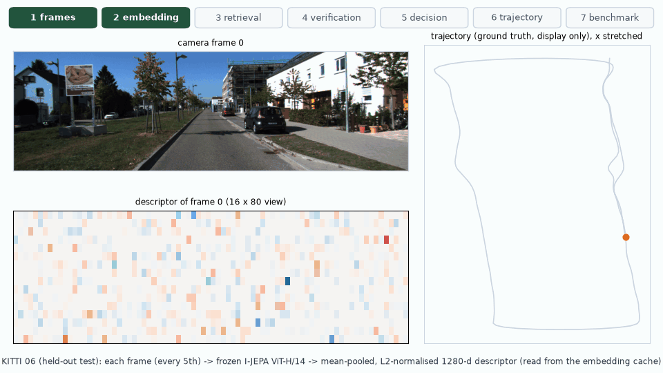
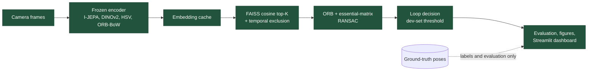

# Latent-Loop

**Self-supervised visual place recognition and loop closure detection with JEPA representations, geometric verification and a reproducible KITTI benchmark.**

> **Research question.** Can frozen, pretrained I-JEPA features detect loop closures as well as DINOv2 and classical methods can?



*One held-out query, traced from the camera frame through the I-JEPA descriptor, retrieval, ORB + RANSAC verification and the loop decision to the trajectory and benchmark. Every number is read from saved outputs ([how this GIF is made](docs/phase8_integration.md#end-to-end-pipeline-gif)).*

## Answer, in short

The evaluation is on held-out KITTI sequences 02, 06, 08 and 09: 2,208 queries, 190 of them true revisits. Thresholds were chosen on sequences 00 and 05 only. The neural encoders ran on the **GPU** (GTX 1650 Ti, FP32); everything else ran on the **CPU**.

| Method | Recall@1 | Detection F1 | False loops per 1,000 | Time per query |
|---|---|---|---|---|
| I-JEPA | 0.500 | 0.451 | 57.1 | 798 ms |
| **I-JEPA + geometric verification** | 0.500 | **0.671** | **0.9** | 2122 ms |
| DINOv2 | 0.526 | 0.565 | 1.4 | 112 ms |
| **DINOv2 + geometric verification** | 0.526 | **0.671** | **0.9** | 1393 ms |
| ORB bag of words | **0.563** | 0.477 | 19.5 | 10.5 ms |
| HSV histogram | 0.537 | 0.407 | 84.2 | 1.9 ms |

* **Geometric verification is what makes a usable detector.** It cuts I-JEPA's false loops from 126 to 2.
* **With verification, I-JEPA and DINOv2 tie:** 97 correct and 2 wrong loops each. DINOv2 is 7× faster.
* **Without verification, I-JEPA is the weakest neural method.** The classical ORB bag of words has the best Recall@1.
* **Every method fails on KITTI 08,** where all revisits are driven in the opposite direction.
* **No result shows I-JEPA outperforming the baselines.**

Details: [results summary](docs/results.md) · [full evaluation](docs/phase6_evaluation.md)

**Benchmark v2** is a second, single held-out run with settings chosen on development data only: mean-patch pooling, 2–3-frame averaging, and DINOv3 added.
* DINOv2 without verification reaches F1 0.678 at 36 ms per query. That matches the geometric-verification detectors, which take about 1.3 s per query.
* DINOv3 (ViT-B/16) is not significantly better than DINOv2.
* I-JEPA is still the weakest neural descriptor.

See [Benchmark v2](docs/benchmark_v2.md).

## Pipeline



No model is trained. Ground-truth poses never select a candidate.

## Quick start

```bash
cd jepa_slam && unset PYTHONPATH            # ROS 2 setups leak into PYTHONPATH
python3.12 -m venv .env && source .env/bin/activate
pip install -e ".[dev,ml,dashboard]"

python -m pytest                            # 179 tests
streamlit run app/streamlit_app.py          # dashboard over the committed benchmark results
```

The dashboard's overview and benchmark views work straight from a clone. To reproduce everything from raw data:

```bash
python scripts/download_kitti.py                                   # 15.4 GB: KITTI 00 02 05 06 08 09, camera 2
# Official I-JEPA ViT-H/14: place IN1K-vit.h.14-300e.pth.tar (10.4 GB) in checkpoints/, then
python scripts/download_checkpoints.py ijepa --name vith14_in1k --skip-download   # extracts the encoder
python scripts/download_checkpoints.py dinov2 --name vitb14        # official DINOv2 ViT-B/14 (346 MB)
python scripts/fit_vocabulary.py --set dataset.name=kitti dataset.root=data/raw/kitti/dataset \
    "dataset.sequence='00'"                                       # ORB vocabulary from dev sequence 05
python scripts/run_benchmark.py --stage dev                        # choose variants and thresholds on 00, 05
python scripts/run_benchmark.py --stage test                       # one evaluation on 02, 06, 08, 09
python scripts/generate_visualizations.py --phase 6                # benchmark figures
python scripts/generate_visualizations.py --phase 8                # the GIF above
```

The exact arguments, run times and options of each step are in the phase documents below.

## Documentation

| Document | Contents |
|---|---|
| [Installation and data](docs/installation.md) | Hardware, environment, KITTI download, synthetic data |
| [Architecture](docs/architecture.md) | Module map, data flow and design rules |
| [Phase 1: dataset infrastructure](docs/phase1_dataset.md) | KITTI and synthetic loaders, poses, sampling, revisit labels |
| [Phase 2: I-JEPA features](docs/phase2_ijepa.md) | JEPA principles, the encoder, checkpoint verification, GPU precision |
| [Phase 3: place retrieval](docs/phase3_retrieval.md) | Cosine / FAISS retrieval, temporal exclusion, causal replay |
| [Phase 4: geometric verification](docs/phase4_verification.md) | ORB, epipolar geometry, RANSAC, degeneracy |
| [Phase 5: baselines](docs/phase5_baselines.md) | DINOv2, HSV histogram, ORB bag of words |
| [Phase 6: benchmark](docs/phase6_evaluation.md) | Dev/test protocol, metrics, held-out results, failure analysis |
| [Phase 7: dashboard](docs/phase7_dashboard.md) | Streamlit app, its views, screenshots |
| [Phase 8: integration](docs/phase8_integration.md) | Release checks, reproducibility, the end-to-end GIF |
| [Results summary](docs/results.md) | Headline numbers, conclusions, limitations |
| [Benchmark v2](docs/benchmark_v2.md) | Second held-out run: pooling, frame averaging, DINOv3 |
| [Improvement ideas](docs/improvements.md) | What the Platonic-representation / JEPA paper suggests, with first measurements |
| [Troubleshooting](docs/troubleshooting.md) | Known problems and fixes |
| [References](docs/references.md) | Papers and code |

## Project status

| Phase | Scope | Status |
|---|---|---|
| 1 | Environment and dataset infrastructure | Complete |
| 2 | I-JEPA feature extraction (official checkpoint, verified against Meta's code) | Complete |
| 3 | Visual place retrieval (FAISS, causal replay) | Complete |
| 4 | Geometric verification (ORB + five-point RANSAC) | Complete |
| 5 | Baselines (DINOv2, HSV, ORB bag of words) | Complete |
| 6 | Benchmark (development selection, one held-out test) | Complete |
| 7 | Streamlit dashboard | Complete |
| 8 | Final integration and release | Complete |
| v2 | Wider development selection + DINOv3, one more held-out run | Complete |

## Repository layout

```text
app/                streamlit_app.py (dashboard)
configs/            default, kitti, ijepa, dinov2, benchmark (.yaml)
src/latent_loop/    datasets/ encoders/ features/ retrieval/ verification/
                    evaluation/ dashboard/ visualization/ utils/
scripts/            command-line tools (download, extract, retrieve, verify, benchmark, figures)
tests/              pytest suite
results/benchmark/  committed benchmark outputs (11 MB)
assets/             figures and GIFs, one folder per phase
docs/               documentation
```

## License

Code: MIT ([LICENSE](LICENSE)). KITTI data: CC BY-NC-SA 3.0 (non-commercial). The pretrained checkpoints keep their own licences (I-JEPA: CC BY-NC 4.0; DINOv2: Apache 2.0; DINOv3: DINOv3 License) and are never included in this repository. Only results, code written for this project, and links to the official sources are shared.
