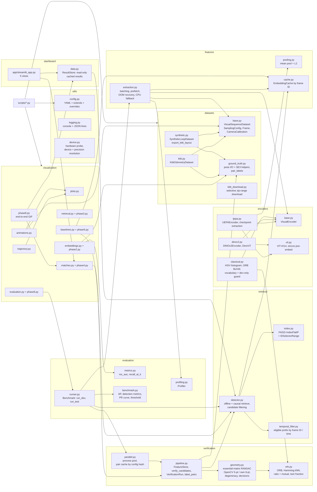
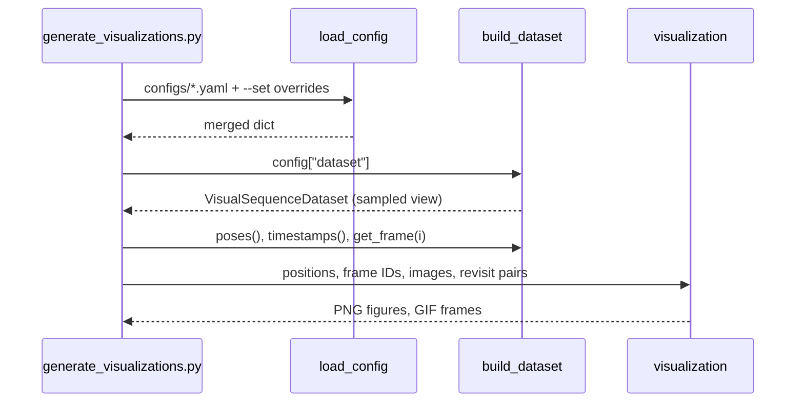
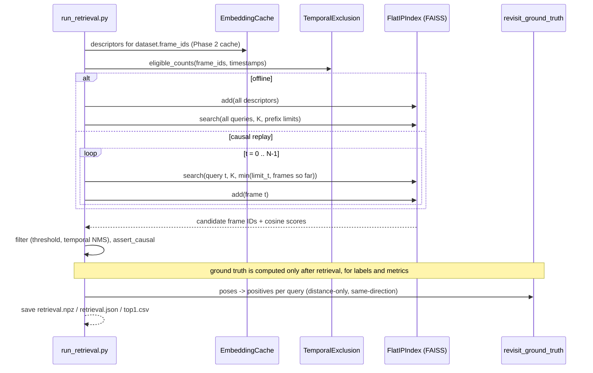
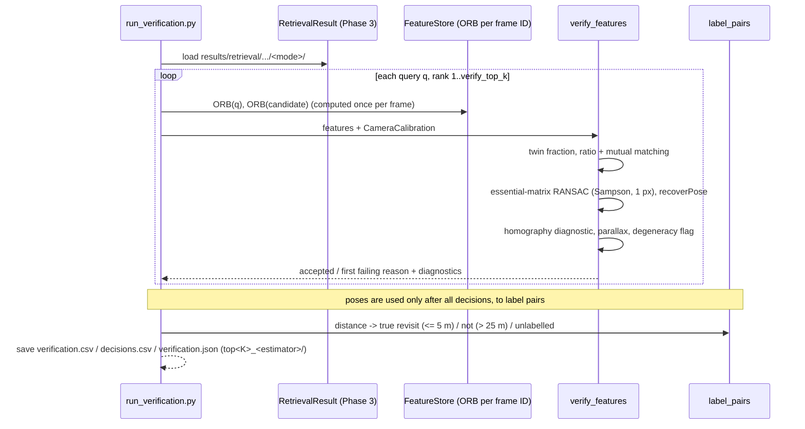
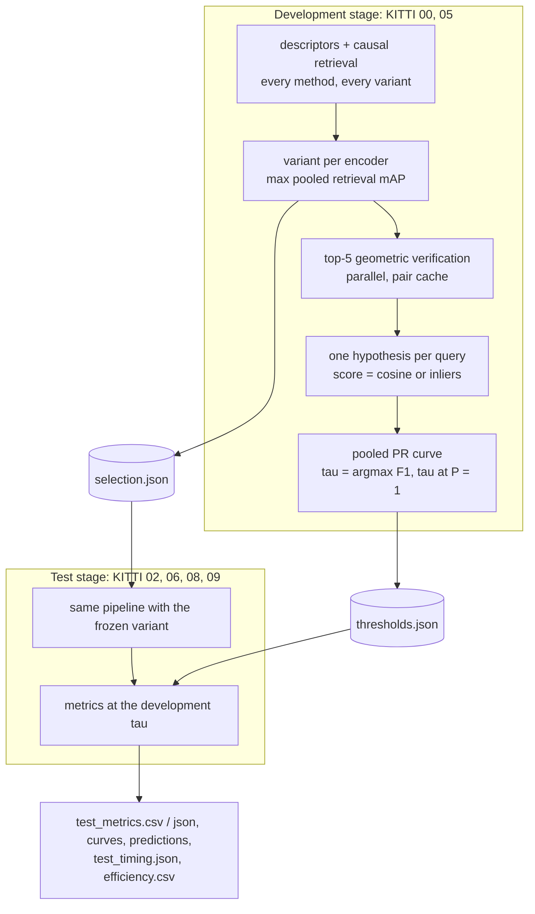
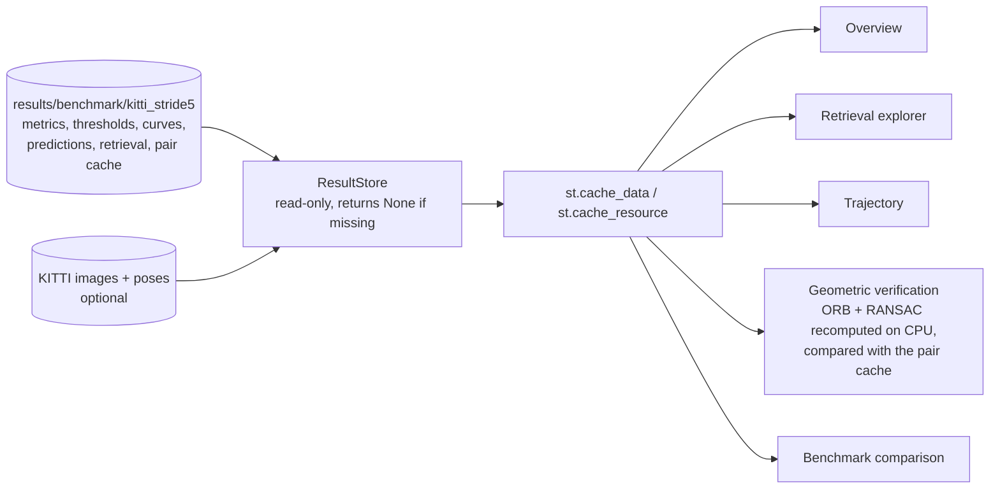

# Architecture

[Back to README](../README.md)

Module map, data flow per phase, and the design rules that keep the evaluation honest.
The full algorithm descriptions are in the phase documents linked from the README.

## Module map



## Data flow (Phase 1)



## Design rules

1. **Original frame IDs are the identity of a frame.** View indices are only positions in a
   sampled list. Temporal exclusion and causal filtering (Phase 3) use frame IDs or timestamps.
2. **Ground truth is for labels only.** `get_pose` exists for evaluation and plots; retrieval
   code will receive only images and frame IDs and timestamps.
3. **Lazy I/O.** Images are decoded on access. Datasets hold poses and timestamps only.
4. **Determinism.** The synthetic world, trajectory and pixel noise are fully determined by
   `dataset.synthetic.seed`.

## Data flow (Phase 2)

```mermaid
sequenceDiagram
    participant CLI as extract_embeddings.py / generate_visualizations.py --phase 2
    participant DS as VisualSequenceDataset
    participant Enc as IJEPAEncoder
    participant Ext as extract_embeddings
    participant C as EmbeddingCache
    CLI->>Enc: build_encoder("ijepa", config)
    Note over Enc: device auto -> cuda/cpu; precision auto -> bf16 / benchmarked fp16 vs fp32
    CLI->>Ext: dataset, encoder, cache, batch_size
    Ext->>C: missing(frame_ids)
    loop batches of missing frame IDs
        Ext->>DS: get_image (prefetch thread)
        Ext->>Enc: encode_batch(images)
        Note over Enc: resize + ImageNet norm -> ViT-H/14 (inference_mode) -> mean pool -> L2
        Enc-->>Ext: (B, 1280) float32, unit norm
        Ext->>C: add(frame_ids, embeddings) every flush_every frames (atomic)
    end
    Ext->>C: load().select(dataset.frame_ids)
    C-->>CLI: embeddings in dataset order + profile
```

## Design rules (continued)

5. **Checkpoint identity is part of the cache key.** The encoder fingerprint hashes the checkpoint
   SHA-256, architecture, input size, resize mode, normalisation and pooling, so changing any of
   them can never silently reuse stale descriptors. Device and precision are recorded per run but
   not hashed.

## Data flow (Phase 3)



6. **Eligibility is a prefix.** Frames are indexed chronologically, so every query's eligible set
   is `[0, n_q)`, enforced inside FAISS with `IDSelectorRange`. Offline evaluation and causal
   replay are therefore exactly equivalent, which is tested.

## Data flow (Phase 4)



7. **Decisions never see poses.** `verify_features`, `verify_pair` and `verify_candidates` take
   images (or ORB features) and the calibration only; a test asserts that their signatures have
   no pose or ground-truth argument. Labels are attached afterwards by `label_pairs`.
8. **Figures re-derive, then check.** Phase 4 figures re-run verification with
   `keep_details=True` for the pairs they draw and fail unless the decision and inlier count
   match the saved run exactly (RANSAC is seeded, so this is deterministic).

## Phase 5: one interface, four descriptors

```mermaid
flowchart LR
    F[frames of one sequence] --> I[I-JEPA ViT-H/14<br/>patch mean]
    F --> D[DINOv2 ViT-B/14<br/>CLS token]
    F --> H[HSV histogram<br/>sqrt-normalised]
    F --> O[ORB bag of words<br/>tf-idf]
    V[(vocabulary fitted on<br/>splits.dev only)] --> O
    I & D & H & O --> C[EmbeddingCache<br/>key = dataset + encoder fingerprint]
    C --> R[retrieve: same exclusion,<br/>top-K, offline / causal]
    R --> S[retrieval.npz per method]
    S --> E[Recall@K, AUC, figures]
```

9. **Development and test data are separated in configuration.** `splits.dev` (00, 05) may be
   used for fitting and tuning; `splits.test` (02, 06, 08, 09) may not. `vocabulary_plan`
   refuses to fit on anything but development sequences, and the vocabulary digest and fit
   sources are part of the ORB-BoVW fingerprint.
10. **Baselines share every stage but the descriptor.** All encoders implement `VisualEncoder`
    (L2-normalised float32 output), so caching, FAISS retrieval, saved-result format and
    metrics are the same code for every method.

## Phase 6: development selection, then one held-out evaluation



11. **The test stage cannot tune.** `Benchmark.run_test` refuses to run without the development
    stage's `selection.json` and `thresholds.json` and rejects overlapping splits; it only
    applies them. Verification results are cached per (sequence, verification-config hash),
    so re-running never changes a decision.

## Phase 7: dashboard over cached results



12. **The dashboard never runs a neural network.** It reads Phase 6 outputs only. The single
    computation it does, ORB + RANSAC for one pair, is checked against the cached decision
    and the result of that check is shown.
13. **Missing inputs degrade, they do not crash.** Every `ResultStore` loader returns `None`
    when its file is absent, and each view states what is missing and which command makes it.

## Phase 8: integration

14. **Release figures come from saved outputs.** `visualization/phase8.py` reads the same
    `ResultStore` as the dashboard, the embedding cache and the pair cache; the five pairs it
    draws are re-verified and compared with the cache (`phase8_summary.json`, `matches_cache`).
15. **Reproducibility is checked by re-running, not assumed.** Re-running the test stage from
    caches reproduces `test_metrics.csv`, `test_metrics.json`, every prediction file and every
    retrieval array byte for byte; only wall-clock timing fields change.

