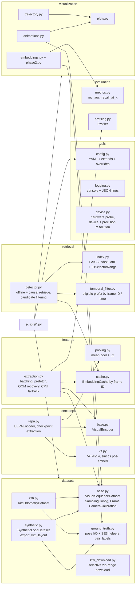
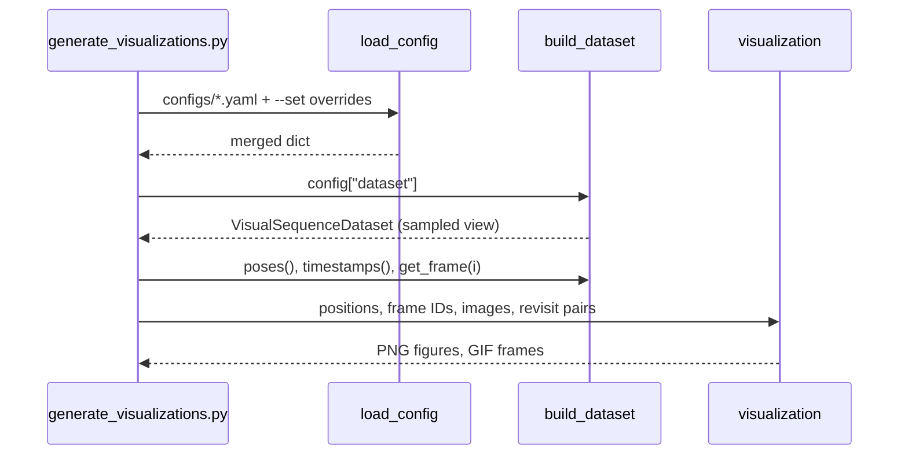
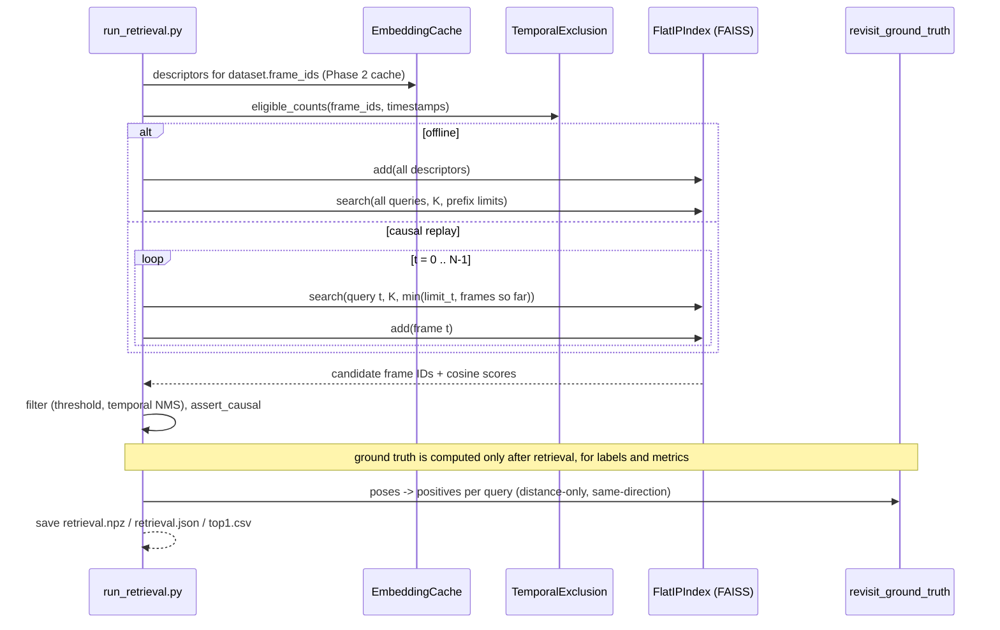

# Architecture

Status: Phase 3. This document grows with each phase.

## Module map



## Data flow (Phase 1)



## Design rules

1. **Original frame IDs are the identity of a frame.** View indices are only positions in a
   sampled list. Temporal exclusion and causal filtering (Phase 3) use frame IDs or timestamps.
2. **Ground truth is for labels only.** `get_pose` exists for evaluation and plots; retrieval
   code will receive only images and frame IDs and timestamps.
3. **Lazy I/O.** Images are decoded on access. Datasets hold poses and timestamps only.
4. **Determinism.** The synthetic world, trajectory and pixel noise are fully determined by
   `dataset.synthetic.seed`.

## Data flow (Phase 2)

```mermaid
sequenceDiagram
    participant CLI as extract_embeddings.py / generate_visualizations.py --phase 2
    participant DS as VisualSequenceDataset
    participant Enc as IJEPAEncoder
    participant Ext as extract_embeddings
    participant C as EmbeddingCache
    CLI->>Enc: build_encoder("ijepa", config)
    Note over Enc: device auto -> cuda/cpu; precision auto -> bf16 / benchmarked fp16 vs fp32
    CLI->>Ext: dataset, encoder, cache, batch_size
    Ext->>C: missing(frame_ids)
    loop batches of missing frame IDs
        Ext->>DS: get_image (prefetch thread)
        Ext->>Enc: encode_batch(images)
        Note over Enc: resize + ImageNet norm -> ViT-H/14 (inference_mode) -> mean pool -> L2
        Enc-->>Ext: (B, 1280) float32, unit norm
        Ext->>C: add(frame_ids, embeddings) every flush_every frames (atomic)
    end
    Ext->>C: load().select(dataset.frame_ids)
    C-->>CLI: embeddings in dataset order + profile
```

## Design rules (continued)

5. **Checkpoint identity is part of the cache key.** The encoder fingerprint hashes the checkpoint
   SHA-256, architecture, input size, resize mode, normalisation and pooling, so changing any of
   them can never silently reuse stale descriptors. Device and precision are recorded per run but
   not hashed.

## Data flow (Phase 3)



6. **Eligibility is a prefix.** Frames are indexed chronologically, so every query's eligible set
   is `[0, n_q)`, enforced inside FAISS with `IDSelectorRange`. Offline evaluation and causal
   replay are therefore exactly equivalent, which is tested.
