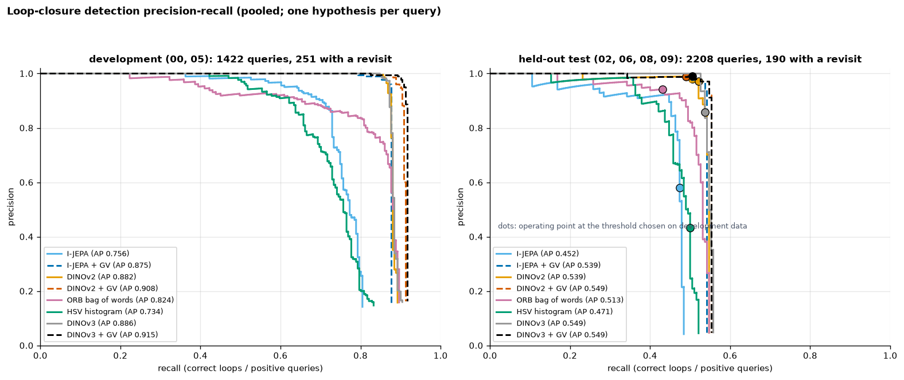
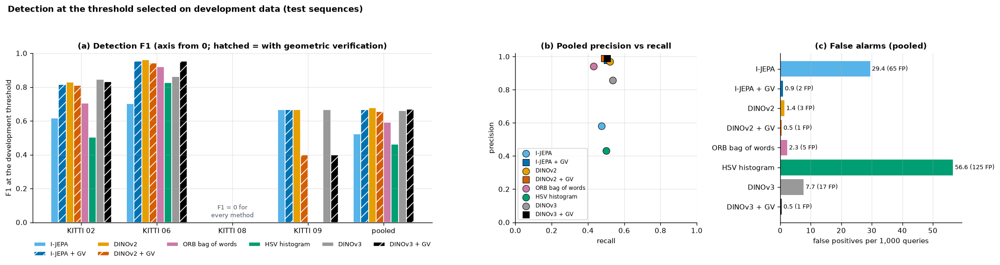
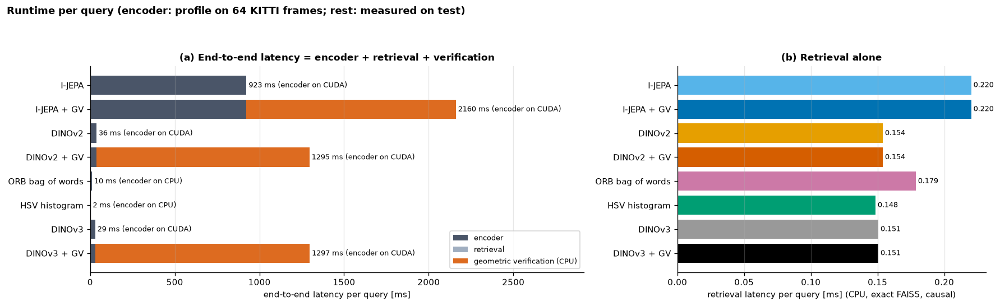
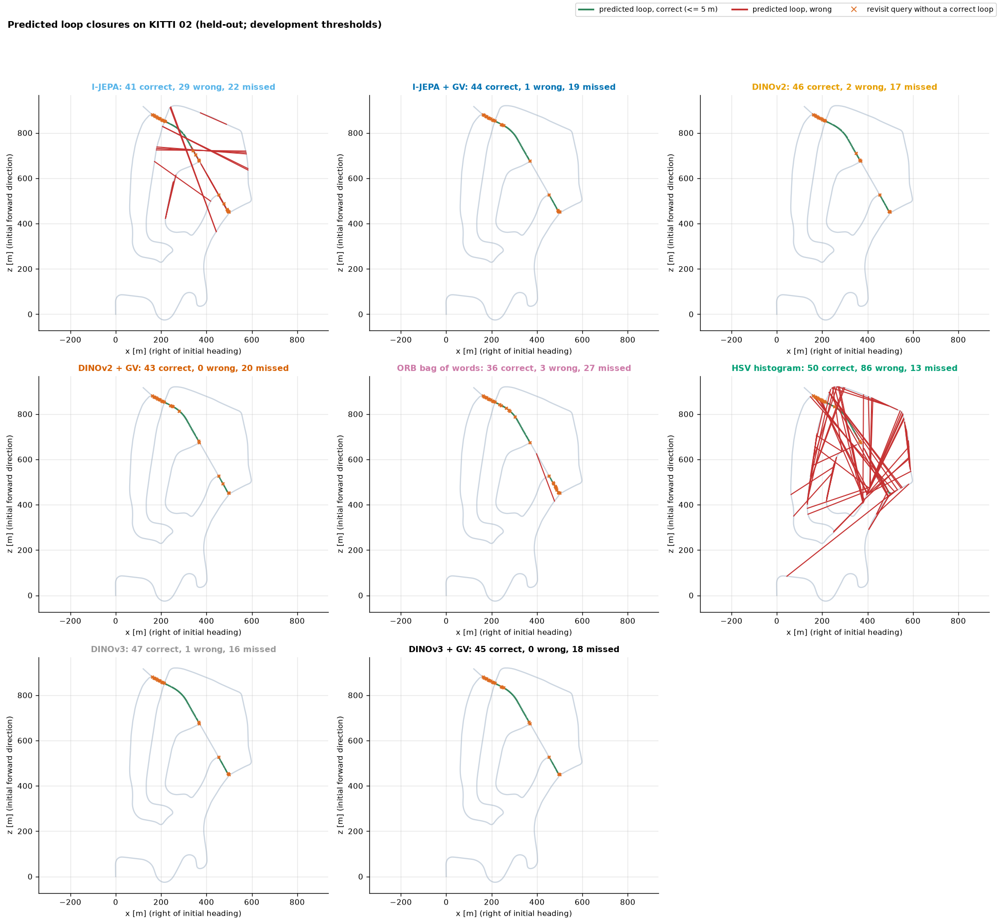
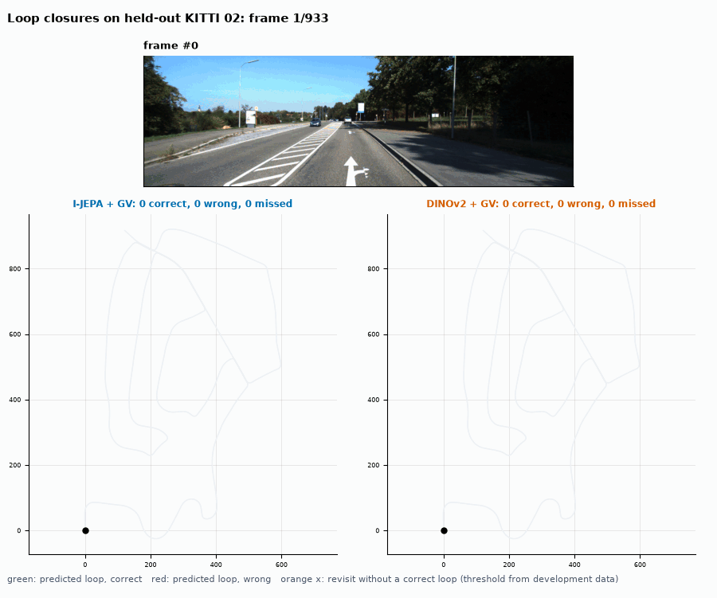

# Benchmark v2: a wider development selection, plus DINOv3

[Back to README](../README.md)

## What changed, and what did not

**What changed.** v2 repeats the [Phase 6 protocol](phase6_evaluation.md) exactly, but the development stage may choose among more settings per encoder. All of them were motivated by the [development-only probes](improvements.md):

| Setting | Candidates | Applies to |
|---|---|---|
| Resize mode | `squash`, `aspect` | neural encoders |
| Pooling | CLS token, mean of the patch tokens | DINOv2, DINOv3 |
| Causal frame averaging window w | 1 (off), 2, 3 sampled frames | every encoder |
| Checkpoint | ViT-B/16, ViT-L/16 (official LVD-1689M weights) | DINOv3 (new) |

**What did not change.**
* The selection rule: the best pooled retrieval mAP on development sequences 00 + 05.
* The thresholds: the max-F1 point on development data.
* The test sequences, the ground truth and the verification settings.

The test sequences were evaluated **once** for v2. This is the second look at the held-out set after Phase 6. It is reported next to Phase 6, which is unchanged and remains in `results/benchmark/kitti_stride5`.

**Commands.**

```bash
python scripts/run_benchmark.py --config configs/benchmark_v2.yaml --stage dev    # 2 h 29 min (GPU + CPU)
python scripts/profile_encoders.py --config configs/benchmark_v2.yaml --tag benchmark_v2 --stride 5 \
    --frames 64 --set dataset.name=kitti dataset.root=data/raw/kitti/dataset "dataset.sequence='00'" \
    ijepa.resize_mode=aspect dinov2.resize_mode=squash dinov2.pooling=mean \
    dinov3.checkpoint=vitb16 dinov3.resize_mode=squash dinov3.pooling=mean
python scripts/run_benchmark.py --config configs/benchmark_v2.yaml --stage test   # 27 min
python scripts/generate_visualizations.py --phase 6 --config configs/benchmark_v2.yaml \
    --output-dir assets/benchmark_v2 --gif-sequence 02
streamlit run app/streamlit_app.py -- --config configs/benchmark_v2.yaml
```

**DINOv3.**
* The backbone is built by Meta's own code, from <https://github.com/facebookresearch/dinov3>, cloned to the git-ignored `external/dinov3`.
* The official checkpoints are loaded strictly.
* Each file is accepted only if its SHA-256 matches the hash in its official name: ViT-B/16 `73cec8be`, ViT-L/16 `8aa4cbdd`.

The weights are licence-gated, so they are **not** included here. Request them at
<https://ai.meta.com/resources/models-and-libraries/dinov3-downloads/>, then run:

```bash
python scripts/download_checkpoints.py dinov3 --name vitb16 --url "<your URL>"
```

## Development selections

From `selection.json`:

| Encoder | Selected | Development mAP (Phase 6 choice → v2) |
|---|---|---|
| I-JEPA | `aspect`, w = 3 | 0.634 → 0.756 |
| DINOv2 ViT-B/14 | `squash`, mean patch, w = 2 | 0.804 → 0.846 |
| DINOv3 | **ViT-B/16**, `squash`, mean patch, w = 2 | new: 0.855. ViT-L/16 at best 0.852 |
| ORB bag of words | w = 2 | 0.791 → 0.842 |
| HSV histogram | w = 2 | 0.711 → 0.742 |

Every selection uses a short frame average (w = 2 or 3). Both DINO models select mean-patch pooling. The larger DINOv3 ViT-L/16 was not better on development data than ViT-B/16, at about 3× the encoder cost.

## Held-out test results

Pooled over sequences 02, 06, 08 and 09: 2,208 queries, 190 with a true revisit.

| Method | Recall@1 | mAP | Precision | Recall | **F1** | Correct / false loops | False loops per 1,000 | Phase 6 F1 |
|---|---|---|---|---|---|---|---|---|
| I-JEPA | 0.484 | 0.497 | 0.581 | 0.474 | 0.522 | 90 / 65 | 29.4 | 0.451 |
| I-JEPA + GV | 0.484 | 0.497 | 0.980 | 0.505 | 0.667 | 96 / 2 | 0.9 | 0.671 |
| DINOv2 | 0.547 | **0.566** | 0.971 | 0.521 | **0.678** | 99 / 3 | 1.4 | 0.565 |
| DINOv2 + GV | 0.547 | **0.566** | 0.989 | 0.489 | 0.655 | 93 / 1 | **0.5** | 0.671 |
| DINOv3 | **0.558** | 0.565 | 0.857 | **0.537** | 0.660 | 102 / 17 | 7.7 | — |
| DINOv3 + GV | **0.558** | 0.565 | **0.990** | 0.505 | 0.669 | 96 / 1 | **0.5** | — |
| ORB bag of words | 0.547 | 0.533 | 0.943 | 0.432 | 0.592 | 82 / 5 | 2.3 | 0.477 |
| HSV histogram | 0.521 | 0.517 | 0.432 | 0.500 | 0.463 | 95 / 125 | 56.6 | 0.407 |

**Per-sequence F1** (KITTI 08 is 0 for every method, as in Phase 6):

| Method | 02 | 06 | 09 |
|---|---|---|---|
| DINOv2 | 0.829 | 0.962 | 0.667 |
| DINOv2 + GV | 0.811 | 0.942 | 0.400 |
| DINOv3 | **0.847** | 0.862 | 0.667 |
| DINOv3 + GV | 0.833 | 0.952 | 0.400 |
| I-JEPA + GV | 0.815 | 0.952 | 0.667 |

**Paired tests on the test queries** (exact McNemar on the 190 revisit queries, comparing correct-loop detections; from `results/benchmark/kitti_stride5_v2/paired_vs_v1.json`):

| Comparison | Correct loops | Discordant | p | False loops |
|---|---|---|---|---|
| DINOv2 v2 vs Phase 6 | 76 → 99 | +25 / −2 | **6 × 10⁻⁶** | 3 → 3 |
| ORB bag of words v2 vs Phase 6 | 73 → 82 | +17 / −8 | 0.11 | 43 → 5 |
| I-JEPA v2 vs Phase 6 | 92 → 90 | +7 / −9 | 0.80 | 126 → 65 |
| HSV v2 vs Phase 6 | 96 → 95 | +3 / −4 | 1.0 | 186 → 125 |
| DINOv2 + GV v2 vs Phase 6 | 97 → 93 | +0 / −4 | 0.13 | 2 → 1 |
| I-JEPA + GV v2 vs Phase 6 | 97 → 96 | +1 / −2 | 1.0 | 2 → 2 |
| DINOv3 + GV vs DINOv2 + GV (both v2) | 93 → 96 | +3 / −0 | 0.25 | 1 → 1 |
| DINOv3 vs DINOv2 (both v2) | 99 → 102 | +3 / −0 | 0.25 | 3 → 17 |
| DINOv3 + GV vs I-JEPA + GV (both v2) | 96 → 96 | +3 / −3 | 1.0 | 2 → 1 |

## Cost

Encoder from `profile_encoders.py` (64 KITTI frames in RAM). Retrieval and verification are measured on the test set.

| Method | Encoder (device) | End-to-end per query | Peak GPU |
|---|---|---|---|
| I-JEPA (+ GV) | 923 ms (GPU) | 923 ms (2160 ms) | 2853 MB |
| DINOv2 (+ GV), `squash` | 36 ms (GPU) | **36 ms** (1295 ms) | 401 MB |
| DINOv3 ViT-B/16 (+ GV), `squash` | 29 ms (GPU) | **29 ms** (1297 ms) | 388 MB |
| ORB bag of words | 10 ms (CPU) | 10.5 ms | — |
| HSV histogram | 1.6 ms (CPU) | 1.8 ms | — |

* **`squash` is much cheaper than `aspect`.** It feeds a 224 × 224 image, 196 patches at ViT/16. Phase 6's `aspect` mode for DINOv2 used a wider input: 112 ms.
* **Frame averaging costs nothing measurable.** It is one vector sum per frame.
* I-JEPA's encoder took 923 ms here against 798 ms in the Phase 6 profile. The model and variant are the same, so this is run-to-run variation on this GPU.

## Reading the results

1. **The development-selected changes generalise to the retrieval-only detectors.**
   * The largest gain is for DINOv2. With mean-patch pooling and 2-frame averaging, it finds 99 correct loops instead of 76 (p = 6 × 10⁻⁶) at the same 3 false loops.
   * Its F1 of 0.678 matches the geometric-verification detectors, at **36 ms instead of about 1.3 s per query**.
   * ORB bag of words and I-JEPA keep their recall but make far fewer false loops: 43 → 5 and 126 → 65.
2. **Geometric verification no longer adds F1 on top of a strong descriptor.**
   * All GV detectors sit at F1 0.655–0.669, as in Phase 6.
   * Their limit is not retrieval: KITTI 08's opposite-direction revisits (36 % of the test revisits) defeat every method.
   * GV still gives the fewest false loops (0.5 per 1,000 queries).
3. **DINOv3 is not significantly better than DINOv2 here.**
   * It has the best Recall@1 (0.558) and, with GV, the best precision (0.990). The paired difference to DINOv2 is +3 / −0 correct loops (p = 0.25).
   * Without GV, its development threshold transfers less well: 17 false loops against DINOv2's 3.
   * The paper's claim that DINOv3 aligns best is not contradicted, but on this loop-closure benchmark it buys no measurable accuracy over DINOv2 + mean pooling.
4. **I-JEPA remains the weakest neural descriptor.**
   * With GV it ties the others (96 correct, 2 false loops).
   * Its retrieval (Recall@1 0.484, mAP 0.497) stays below DINOv2 and DINOv3, at 25–30× their encoder cost.
   * **No result shows I-JEPA outperforming the baselines.**

## Caveats

* This is a second evaluation on the same test set. The settings were frozen on development data before it ran, but a third round of tuning would start to overfit the test set. Any further changes need a new held-out split (e.g. other KITTI sequences or another dataset).
* There are 190 test revisit queries, consecutive queries are correlated, and several comparisons are reported. Treat p ≈ 0.1–0.3 as "no detectable difference".
* Recall@1 for I-JEPA, ORB and HSV went down slightly (by 0.016 each) while mAP went up. Averaging improves the full ranking more than the top-1 hit.

## Figures






The playback of KITTI 02 (I-JEPA + GV and DINOv2 + GV, held-out, 7.3 MB):


