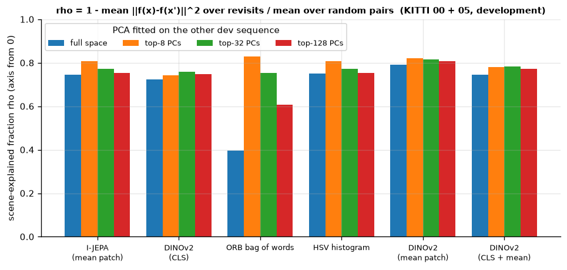
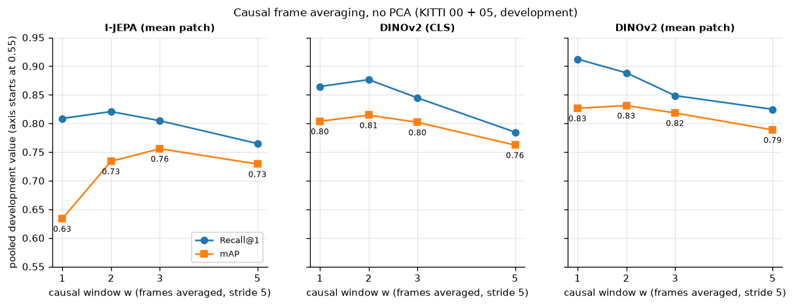

# Improvement ideas from the Platonic-representation / JEPA paper

[Back to README](../README.md)

**Paper.** R. Balestriero and Y. LeCun, *Proving and Improving the Platonic Representation
Hypothesis with JEPAs*, arXiv:2610.39302v1.

This page maps the paper's claims onto this project and tests the cheapest ones. **The tests use
the development sequences only** (KITTI 00 + 05, 251 revisit queries). The held-out test
sequences were not touched, so the Phase 6 result stays a single, clean evaluation.

## What the paper says, and what it means here

| Paper | Meaning for loop closure | Status here |
|---|---|---|
| **Good views versus bad views.** Two observations of the same scene teach invariance to real nuisance; corruptions of a single image do not. | A true revisit is exactly a "good view" pair: the same place seen at different times. | Used to define the probe below |
| **Nuisance costs alignment (Theorem 3).** The cost is measured by the scene-explained fraction ρ(f). | ρ measures how much of a descriptor's variation is place rather than nuisance (lighting, cars, small viewpoint changes). | **Measured** (probe 1) |
| **Alignment lives in the leading spectral directions.** | Projecting onto the top principal components might drop nuisance. | **Measured** (probes 1 and 2): ρ is higher in the top 8 directions, but PCA truncation does not help retrieval |
| **I-JEPA (mean patch) aligns much worse than DINOv2 (Table 12).** **CLS + mean-patch concatenation and DINOv3 align best.** | The choice of pooling matters as much as the backbone. | **Measured** for DINOv2 mean and CLS + mean (probe 3). DINOv3 not run: it needs a checkpoint download, which requires approval |
| **Averaging over video frames helps.** | A descriptor can average the last few frames: several good views of nearly the same place. | **Measured** (probe 2), with causal averaging only |
| **Orthogonal-Procrustes rotation between encoders.** | Descriptors from different encoders could be mapped into one space. | Proposed, not measured |
| **Trimming views; gradient clipping and LeJEPA / SIGReg prevent collapse.** | These are training-time techniques. They matter only if a head is ever trained on revisit pairs. | Not applicable while the encoders stay frozen |

## Probe 1: scene-explained fraction ρ

For each encoder:

* **Same-place pairs:** one per revisit query — the query and its *closest* true revisit (≥ 100 frames older, ≤ 5 m).
* **Reference:** 20,000 random frame pairs.

$$
\rho(f) = 1 - \frac{\operatorname{mean}_{\text{revisits}} \lVert f(x)-f(x')\rVert^2}{\operatorname{mean}_{\text{random}} \lVert f(x)-f(y)\rVert^2}
$$

* ρ = 1 means a revisit maps onto the same descriptor.
* ρ = 0 means a revisit is no closer than a random frame.

Restricting the differences to the top-k principal directions gives ρ in a subspace. The PCA is fitted on the *other* development sequence. Ground-truth poses are used here only to choose the pairs being measured.

| Encoder | ρ full space | top-8 | top-32 | top-128 |
|---|---|---|---|---|
| I-JEPA (mean patch, 1280-d) | 0.745 | 0.808 | 0.773 | 0.754 |
| DINOv2 (CLS, 768-d) | 0.725 | 0.742 | 0.758 | 0.747 |
| DINOv2 (mean patch) | **0.792** | 0.820 | 0.816 | 0.808 |
| DINOv2 (CLS + mean) | 0.746 | 0.780 | 0.784 | 0.771 |
| ORB bag of words | 0.396 | 0.830 | 0.752 | 0.607 |
| HSV histogram | 0.750 | 0.806 | 0.773 | 0.753 |

Mean of the per-sequence values over 00 and 05.



**Reading.**

* **Mean-patch DINOv2 has the highest ρ, and its leading directions carry most of it.** This agrees with the paper. Most encoders' ρ also peaks in the top 8 directions.
* **ρ does not rank the encoder families by retrieval quality.**
  * HSV has a higher ρ than DINOv2-CLS, yet retrieves worse.
  * ORB bag of words has the lowest ρ, yet the second-best development Recall@1 (0.900).

  ρ is a mean over squared distances. Retrieval depends on the *ranking* within each query's neighbourhood. Sparse bag-of-words vectors have a wide spread that hurts ρ but not the ranking.

So ρ is a useful diagnostic *within* one encoder family (e.g. pooling choices), not a substitute for Recall@K.

## Probe 2: causal frame averaging and PCA truncation

**Frame averaging.** Each descriptor is replaced by the normalised mean of its last w sampled frames:

$$
\tilde f_t = \frac{\sum_{s=t-w+1}^{t} f_s}{\left\lVert \sum_{s=t-w+1}^{t} f_s \right\rVert}
$$

The stride is 5, so w = 2 spans 0.5 s at 10 Hz. The average uses only past frames, so it stays causal and adds no latency. Queries and references are averaged the same way.

**PCA truncation.** Optionally, descriptors are then projected onto k principal components, fitted on the other development sequence, and re-normalised.

**Statistics.** Recall@1 is compared with an exact paired McNemar test. Per-query AP is compared with a Wilcoxon signed-rank test, both against the same encoder without changes.

| Encoder | Change | Recall@1 | mAP | Paired tests |
|---|---|---|---|---|
| I-JEPA | none | 0.809 | 0.634 | |
| I-JEPA | **w = 2** | 0.821 | **0.734** | R@1 +11 / −8, p = 0.65; AP p = 2 × 10⁻¹³ |
| I-JEPA | w = 3 | 0.805 | **0.756** | R@1 +12 / −13, p = 1.0; AP p = 7 × 10⁻¹³ |
| I-JEPA | w = 5 | 0.765 | 0.729 | R@1 +13 / −24, p = 0.10 |
| DINOv2 (CLS) | none | 0.865 | 0.804 | |
| DINOv2 (CLS) | w = 2 | 0.876 | 0.815 | R@1 p = 0.51; AP p = 0.019 |
| DINOv2 (CLS) | w = 5 | 0.785 | 0.762 | R@1 +4 / −24, p = 2 × 10⁻⁴ |
| ORB bag of words | w = 2 | 0.896 (from 0.900) | 0.842 (from 0.791) | AP p = 1 × 10⁻⁶ |
| any | PCA 64 | lower everywhere | lower | e.g. DINOv2 mAP 0.804 → 0.778 |
| any | PCA 256 | ≈ unchanged | ≈ unchanged | |



**Reading.**

* **Short averaging (2–3 frames) is the largest effect measured for I-JEPA: mAP +0.10 to +0.12.**
  * Rank-1 accuracy does not change.
  * It is the full ranking that improves: more of the true revisit frames rise above look-alike places. This should matter for verifying top-K candidates and for the detection threshold, since a higher-scoring true revisit can be accepted.
* For DINOv2 the effect is small: w = 2 gives mAP +0.01.
* Longer windows (w = 5, 2.5 s) blur places together and hurt every encoder.
* **PCA truncation never helps, despite the paper's spectral argument.** The most likely reason: descriptors are L2-normalised and compared by cosine, which is already dominated by the leading directions.

## Probe 3: pooling (DINOv2 CLS vs mean patch vs both)

DINOv2 ViT-B/14 was re-extracted with mean-patch pooling (`aspect`, as selected in Phase 6). This covered 1,462 frames on the **GPU** (FP32) and took about 7 of the run's 9 minutes, mostly image reads from `/mnt/e`. The CLS and mean descriptors were also concatenated, each normalised first.

| DINOv2 descriptor | Recall@1 | mAP | vs CLS (paired) |
|---|---|---|---|
| CLS (Phase 6 choice) | 0.865 | 0.804 | |
| **mean patch** | **0.912** | **0.826** | R@1 **+13 / −1, p = 0.002**; AP p = 0.016 |
| CLS + mean | 0.892 | 0.822 | R@1 +7 / −0, p = 0.016; AP p = 8 × 10⁻⁷ |
| I-JEPA (mean patch), for reference | 0.809 | 0.634 | R@1 +9 / −23, p = 0.020 |

**Reading.**

* For place recognition on KITTI, **mean-patch pooling is the best DINOv2 descriptor tested.** It beats the CLS token used in Phase 6 by 4.7 points of Recall@1.
* The paper's best *alignment* setting, CLS + mean, lies between the two here.
* The same pooling does not rescue I-JEPA: mean-patch DINOv2 is far ahead of mean-patch I-JEPA. This is consistent with the paper's Table 12, where I-JEPA aligns worse than DINOv2.

## Caveats

* **These are development-set numbers.** About 60 variants were compared on the same 251 queries, so with that many comparisons some p-values around 0.02–0.05 are expected by chance. Consecutive queries are also correlated.
* **The robust findings are the strongest ones:**
  * DINOv2 mean patch beats CLS (p = 0.002);
  * I-JEPA with 2–3-frame averaging has a higher mAP (p ≈ 10⁻¹³);
  * w = 5 hurts.
* **None of these changes has been evaluated on the held-out test sequences.** The Phase 6 conclusions are unchanged.

## Outcome on the held-out test set

Steps 1 and 3 below were carried out as [Benchmark v2](benchmark_v2.md):
* the development-stage grid was widened;
* DINOv3 ViT-B/16 and ViT-L/16 were added;
* the test set was evaluated once.

What held up on test:
* **Mean-patch pooling plus 2-frame averaging made DINOv2's retrieval-only detector much better:** F1 0.565 → 0.678, +25 / −2 correct loops, p = 6 × 10⁻⁶.
* **Frame averaging removed many false loops** from ORB bag of words (43 → 5) and I-JEPA (126 → 65).
* **DINOv3 did not beat DINOv2 significantly.**

## Recommended next steps

Ranked by evidence and cost.

1. *(Done: [Benchmark v2](benchmark_v2.md).)* **Freeze two changes on development data, then run the test set once more as a clearly labelled second evaluation:**
   * DINOv2 with mean-patch pooling;
   * causal 2-frame averaging for every global descriptor.

   Thresholds would be re-selected on 00 + 05 with `run_benchmark.py --stage dev`. Report it next to the Phase 6 result, not in place of it. This needs your go-ahead: it is a second look at the held-out set.
2. **Add ρ to the benchmark as a diagnostic** per encoder. It is cheap and uses labels only, but report it next to Recall@K and never instead of it.
3. *(Done: [Benchmark v2](benchmark_v2.md).)* **Try DINOv3** — the paper's best-aligned encoder — if you approve downloading its official checkpoint. Run it with the same `VisualEncoder` interface and the same reference check against the official code as in Phases 2 and 5.
4. **Train a small "good views" head** on the frozen features: a linear or MLP projection trained on development revisit pairs. Use SIGReg or a variance term to prevent collapse, as the paper recommends for JEPA training. This tunes a head on top of the frozen encoder and does not retrain I-JEPA or DINOv2. It needs a third data split (e.g. hold 05 out of training) to select its hyperparameters without touching the test set.
5. **Use orthogonal Procrustes** to map I-JEPA descriptors into DINOv2's space: fit the rotation on development frames, then test whether a shared index or a fused score helps. The paper's alignment results suggest mostly the leading directions will transfer.
6. **Handle opposite-direction revisits (KITTI 08)** — the dominant failure in Phase 6 — which none of the above addresses. That needs a rear or side camera, or descriptors made invariant to viewing direction.

## Reproduce

```bash
unset PYTHONPATH && source .env/bin/activate
python scripts/probe_representations.py          # ~9 min the first time (DINOv2 mean-patch
                                                 # extraction on the GPU), ~2 min when cached
python scripts/probe_representations.py --figures-only
python -m pytest tests/test_probes.py            # 7 tests
```

* Outputs:
  * `results/probes/{probes.json, probes.csv, rho.csv, per_query.npz}`;
  * `assets/improvements/{rho_by_encoder.png, frame_averaging.png}`.
* The script refuses any sequence outside `splits.dev`.
* Code: `src/latent_loop/evaluation/probes.py`.
