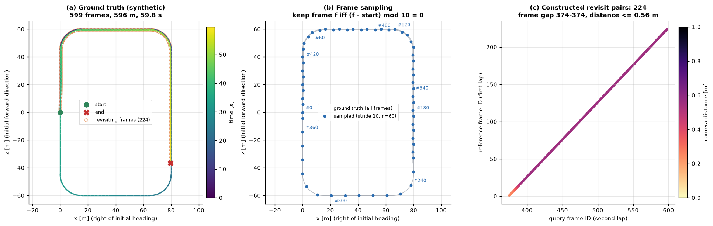
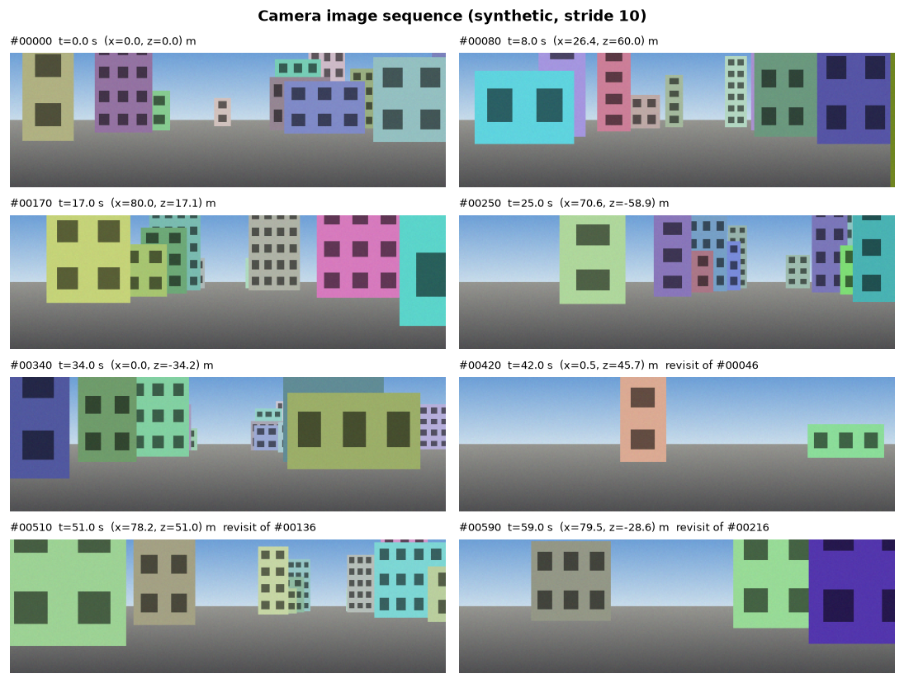
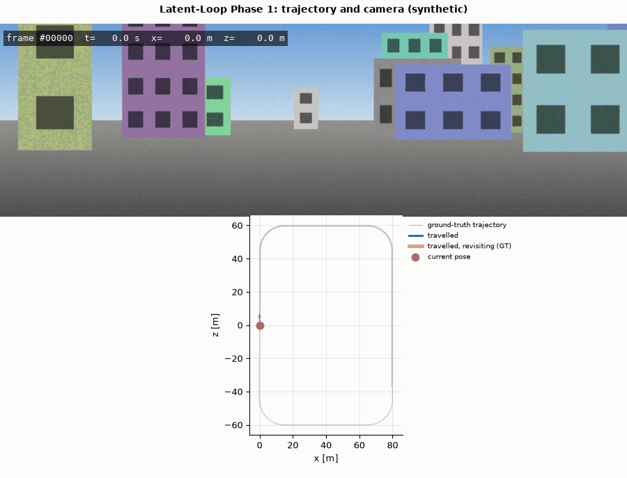

# Phase 1: environment and dataset infrastructure

[Back to README](../README.md)

## Objective

Provide a reliable, tested data layer. Later phases receive camera frames together with
**original frame IDs**, **timestamps**, **calibration** and (for evaluation only)
**ground-truth poses**, all correctly aligned and independent of any frame sampling.

## Dataset interface

`src/latent_loop/datasets/base.py` defines `VisualSequenceDataset`:

```python
class VisualSequenceDataset:
    def __len__(self) -> int: ...                          # frames in the sampled view
    def get_frame(self, index) -> Frame: ...               # image + frame_id + timestamp + pose
    def get_pose(self, index) -> np.ndarray | None: ...    # 4x4 T_world_camera
    def get_timestamp(self, index) -> float: ...           # seconds
    def get_calibration(self) -> CameraCalibration: ...    # K, P, image size, T_cam0_cam
    def frame_id(self, index) -> int: ...                  # original frame number
    frame_ids: np.ndarray                                   # original IDs of the view
```

`index` addresses the sampled view (`0..len-1`). `frame_id(index)` is the frame number in the
source sequence. **Temporal reasoning in later phases (temporal exclusion, causal replay) must
use `frame_id` or timestamps, never `index`**, because a strided view with missing frames does
not map indices to time uniformly.

| Output | Type | Notes |
|---|---|---|
| `Frame.image` | `uint8`, `H×W×3` RGB or `H×W` grayscale | loaded lazily from disk on every call |
| `Frame.pose` | `float64 (4,4)` or `None` | `None` when the sequence has no ground truth |
| `Frame.timestamp` | `float` seconds | from `times.txt`, or estimated at 10 Hz if it is missing |
| `CameraCalibration.K` | `(3,3)` | intrinsics of the camera that produced the images |

Implementations are `KittiOdometryDataset` (`kitti.py`) and `SyntheticLoopDataset`
(`synthetic.py`). `build_dataset(config)` builds either from YAML.

## Pose coordinate conventions

KITTI poses (`poses/XX.txt`) store one row-major 3×4 matrix per line: the homogeneous transform
from the camera-0 frame at time *k* into the world frame. The world frame is camera 0 at the
first frame:

```math
T_{wc_k} = \begin{bmatrix} R_k & t_k \\ 0^\top & 1 \end{bmatrix},\qquad
p_w = R_k\,p_{c} + t_k .
```

Camera axes: **x right, y down, z forward**. The vehicle moves in the x–z plane, so trajectory
plots are top-down (x, z). Heading (yaw) is the direction of the camera's forward axis
$f = R_k e_z$:

```math
\psi_k = \mathrm{atan2}(f_x, f_z) = \mathrm{atan2}(R_{k,13}, R_{k,33}),
```

so $\psi=0$ looks along world +z and $\psi=+\pi/2$ along +x (a right turn).

**Cameras other than camera 0.** The rectified projection matrices are
$P_i = K\ [\ I \mid b_i\ ]$, so a point in camera-0 coordinates maps to camera *i* as
$X_{c_i} = X_{c_0} + b_i$ with $b_i = K^{-1}P_i[:,3]$. The loader therefore returns

```math
T_{w c_i} = T_{w c_0}\,T_{c_0 c_i},\qquad T_{c_0 c_i} = \begin{bmatrix} I & -K^{-1}P_i[:,3] \\ 0^\top & 1\end{bmatrix}.
```

For camera 2 on KITTI this is about a 6 cm shift to the left (−x). The test
`test_kitti_calibration_parsing` checks this. Calibration validity (`fx, fy > 0`, principal
point inside the image, finite values) is checked by `CameraCalibration.is_valid()`.

Other utilities in `ground_truth.py`: SE(3) inverse $T^{-1} = [R^\top \mid -R^\top t]$, relative
pose $T_{ab} = T_{wa}^{-1}T_{wb}$, arc length $s_k = \sum_{j<k}\lVert t_{j+1}-t_j\rVert$, and
rotation validity ($R^\top R = I$, $\det R = 1$).

## KITTI loading algorithm

1. List `image_i/NNNNNN.png`; the integer `NNNNNN` is the frame ID.
2. Read `times.txt`. Line *k* is frame *k*, and timestamps must be strictly increasing. If the
   file is missing, timestamps are estimated as $k/10\ \text{Hz}$ and flagged
   (`timestamps_estimated=True`).
3. Frames listed in `times.txt` without an image go into `missing_frame_ids` and are skipped
   with a warning. They do **not** shift the alignment, because every lookup goes through the
   frame ID.
4. Read `poses/XX.txt` if it exists. Its line count must equal the number of frames in
   `times.txt`, otherwise a `ValueError("Pose/frame misalignment")` is raised. If the file is
   absent (sequences 11–21), `has_poses=False` and `get_pose` returns `None`.
5. Parse `calib.txt` and build `CameraCalibration` for the selected camera. The image size is
   taken from the first available image.
6. Apply frame sampling (below). Images are decoded only when requested (lazy loading).

## Frame sampling algorithm

Given the available frame IDs $A$ (images present) and `start`, `end`, `stride` $k$ and
`max_frames` $M$:

```math
S = \mathrm{first}_M\Big(\lbrace \, f \in A \ :\  \text{start} \le f < \text{end},\quad  (f-\text{start}) \bmod k = 0 \,\rbrace \Big)
```

Selection is on the **frame-ID grid**, not on positions in the list of available frames. With
frame 3 missing and stride 2, the result is `0, 2, 4, 6, 8`, still evenly spaced in time;
slicing the list would give `0, 2, 5, 7`. This is tested in
`test_sampling_uses_frame_id_grid_not_list_positions`. Sampling never changes frame IDs, so
image, pose and timestamp stay aligned (`test_kitti_sampling_preserves_original_ids`).

Configuration (`configs/default.yaml`):

```yaml
dataset:
  sampling:
    start: 0          # first original frame ID (inclusive)
    end: null         # last original frame ID (exclusive)
    stride: 1         # keep frame IDs f with (f - start) % stride == 0
    max_frames: null  # cap on the number of sampled frames
```

Any value can be overridden from the command line, e.g. `--set dataset.sampling.stride=5`.

## Synthetic dataset with known revisits

`SyntheticLoopDataset` exists so that every later phase can be tested against **exact** loop
closure ground truth before running on KITTI. All of it is deterministic given `seed`.

**Route.** A rounded rectangle, $W \times L = 80 \times 120$ m with corner radius $r = 15$ m,
has perimeter

```math
P = 2(W+L) - 8r + 2\pi r = 374.25\ \text{m}.
```

The vehicle starts halfway along the left straight, heading +z, and drives `laps = 1.6` laps
with frame spacing $\Delta = 1$ m at 10 Hz (10 m/s). That gives 599 frames and 596 m. Frame
*k* sits at arc length $s_k = k\Delta$. Positions are interpolated on a dense polyline, and the
heading is the central-difference tangent.

**Second-lap offset.** To avoid pixel-identical revisits, frames with $s_k \ge P$ drift
smoothly to a lateral offset of $d_0 = 0.5$ m to the right:

```math
d(s) = d_0\,\sigma\left(\tfrac{s-P}{20\,\text{m}}\right),\qquad \sigma(x)=3x^2-2x^3 \text{ on } [0,1].
```

**Constructed revisit pairs.** Every frame *k* with $s_k \ge P$ revisits first-lap frame
$j = \mathrm{round}((s_k - P)/\Delta)$. The sequence has 224 pairs, all exactly 374 frames
(37.4 s) apart and at most 0.56 m apart in space. These pairs come from the construction, not
from a distance threshold, and Phase 3 will compare its threshold-based labels against them.

**World and rendering.** 66 buildings (seeded width 4–11 m, height 4–20 m, HSV colour, window
grid) stand 9–15 m to either side of the road, never closer than 7 m to the route. Each frame
is rendered with a pinhole camera, $f_x = f_y = 0.55\ W_{img}$ (about 85° horizontal FOV),
416×128 px:

```math
u = f_x \frac{x_c}{z_c} + c_x,\qquad v = f_y \frac{y_c}{z_c} + c_y,\qquad p_c = R^\top (p_w - t).
```

Buildings are drawn far to near (painter's algorithm) with depth haze
$\alpha = 1 - e^{-z_c/70\ \text{m}}$ plus seeded Gaussian pixel noise ($\sigma = 2$). The ground
plane is $y_w = 1.65$ m (camera height).

**Limitations.** The images are flat billboards with no texture variation, lighting change,
occlusion by dynamic objects or perspective distortion of facades. Revisits are easy by design:
`test_synthetic_revisits_look_more_similar_than_other_places` checks that revisit pairs differ
less than half as much in pixels as unrelated places. Results on this data are pipeline sanity
checks, **not** evidence about real-world place recognition.

## Configuration and logging

- `utils/config.py`: YAML with `extends:` inheritance (deep merge; cycles are detected), dotted
  CLI overrides parsed as YAML scalars, and `resolve_path` (relative to the repository root).
- `utils/logging.py`: console format `HH:MM:SS LEVEL logger: message key=value` and an optional
  JSON-lines file (`logging.file` in the config). Fields passed through `extra={...}` become
  structured keys.
- `utils/device.py`: CPU, RAM, disk, GPU (`nvidia-smi`) and PyTorch/CUDA status. Every probe
  fails gracefully, so it works before PyTorch is installed.

## Computational considerations

Measured on the hardware above. Phase 1 uses no GPU: everything runs on the **CPU**.

| Operation | Device | Cost |
|---|---|---|
| Construct the synthetic dataset (poses + 66 buildings) | CPU | 49 ms |
| Render one 416×128 synthetic frame | CPU | 5.5 ms |
| Load one 416×128 PNG in KITTI layout from `/mnt/e` | CPU | 16.6 ms |
| Full Phase 1 visualization run (2 PNG + 120-frame GIF) | CPU | 15 s as originally recorded in Phase 1; 1 min 43 s re-measured during Phase 2 verification with the venv in `.env/` on `/mnt/e` (Python start-up and imports over 9P dominate) |

Images are decoded lazily, so memory use does not grow with sequence length (a full KITTI
sequence 00 holds 4,541 frames).

## Failure cases handled

| Situation | Behaviour |
|---|---|
| Image directory or `calib.txt` missing | `FileNotFoundError` with the path; the CLI prints download instructions |
| Some frames lack images | skipped, listed in `missing_frame_ids`, alignment preserved |
| `poses/XX.txt` missing (test sequences) | `has_poses=False`, `get_pose → None`, `poses()` raises |
| Pose count ≠ frame count | `ValueError("Pose/frame misalignment")` |
| `times.txt` missing | 10 Hz timestamps, `timestamps_estimated=True`, warning logged |
| Non-monotonic timestamps, malformed pose/calibration lines | `ValueError` with file and line number |
| Invalid sampling (`stride<1`, `end<=start`, unknown keys) | `ValueError` |

---

## Steps to run Phase 1

All commands run from the repository root with the virtual environment active and `PYTHONPATH`
unset (see [Installation](installation.md#environment-setup)). Each has been run on the machine described above.

```bash
# 1. Inspect the environment (writes results/metrics/environment.json)
python scripts/check_environment.py

# 2. Run the tests (Phase 1: 51 tests; whole suite after Phase 6: 159 tests, ~4 min on /mnt/e)
python -m pytest

# 3. Lint and format check
ruff check . && ruff format --check .

# 4. Generate the Phase 1 figures and GIF from the synthetic dataset
python scripts/generate_visualizations.py --phase 1
#    options: --stride N  --max-frames N  --gif-fps F  --gif-width PX  --output-dir DIR
#             --config configs/kitti.yaml  --sequence 05  --set key.path=value ...

# 5. (Optional) export the synthetic sequence in KITTI layout and validate it with the KITTI loader
python scripts/prepare_dataset.py synthetic --out data/processed/synthetic_kitti
python scripts/prepare_dataset.py kitti --root data/processed/synthetic_kitti --sequence 00

# 6. Once real KITTI is unpacked under data/raw/kitti/dataset
python scripts/prepare_dataset.py kitti --sequence 00
python scripts/generate_visualizations.py --phase 1 --config configs/kitti.yaml --sequence 00
```

Outputs are written to `assets/phase_01_dataset/` with a dataset tag prefix: `synthetic_*` or
`kitti_<seq>_cam<camera>_*`. Each run also writes `<tag>_phase1_summary.json` with the dataset
summary, GIF size and render time. To view them, open the PNG/GIF in VS Code or run
`explorer.exe assets/phase_01_dataset` from WSL.

Step 6 is the only command not yet run against real KITTI data. The same code path was run on
the KITTI-layout export from step 5.

## Phase 1 results

All panels below show the **synthetic** dataset (seed 7).

**Ground-truth trajectory, frame sampling and constructed revisits**
(`synthetic_trajectory.png`). (a) The 596 m trajectory coloured by time; orange circles mark
the 224 second-lap frames that revisit first-lap places. (b) The sampled view with stride 10
(60 frames) and original frame IDs; labels from the two laps appear side by side where the
route repeats (for example #0 and #360). (c) Query frame ID against reference frame ID for every
constructed revisit pair: a straight line with a constant 374-frame gap, coloured by camera
distance (≤ 0.56 m, from the lap-2 lateral offset).



**Camera image sequence** (`synthetic_camera_sequence.png`): eight evenly spaced sampled
frames with frame ID, timestamp and ground-truth position. The last three frames are revisits
and name the first-lap frame they correspond to.



**Trajectory and synchronised camera GIF** (`synthetic_trajectory_camera.gif`: 120 frames,
10 fps, 900×686 px, 9.0 MB). Top: the rendered camera image with frame ID, time and position.
Bottom: the top-down trajectory, with the travelled path in blue, revisiting frames in orange,
and the current pose with a heading arrow. During the second lap the overlay names the
first-lap frame of the same place (ground truth by construction, **not** a detection).


