# Phase 2: I-JEPA feature extraction

[Back to README](../README.md)

## Objective

Turn every camera frame into a fixed-length global descriptor $d \in \mathbb{R}^{1280}$ with $\lVert d \rVert_2 = 1$, using the **frozen, pretrained** I-JEPA ViT-H/14 encoder. Later phases compare descriptors with cosine similarity to find revisited places.

This project does **not** train I-JEPA, its predictor or any other network. The official weights are used unchanged, under `torch.inference_mode()`.

## JEPA learning principles

A Joint-Embedding Predictive Architecture learns by **predicting representations, not pixels**:
- Pixel-reconstruction methods (MAE) must reproduce every texture detail.
- Invariance methods (SimCLR, DINO) rely on hand-designed augmentations to decide what to ignore.

A JEPA instead predicts the *embedding* of a hidden part of the input from the embedding of a visible part. Because the target is an abstract representation, the network can discard unpredictable low-level detail and keep structural and semantic content.

## I-JEPA architecture (pretraining, shown for context)

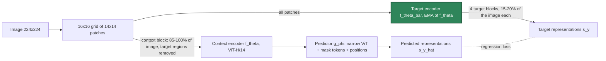

* **Context encoder** $f_\theta$: a ViT that sees only the visible context patches.
* **Target encoder** $f_{\bar\theta}$: the same architecture with weights updated as an exponential moving average, $\bar\theta \leftarrow m\ \bar\theta + (1-m)\ \theta$. It encodes the *full* image, and the target blocks are read from its output.
* **Predictor** $g_\phi$: from the context representations plus learnable mask tokens (carrying each target patch's position embedding), it predicts the target patch representations.
**Loss.** The paper writes it as an L2 distance averaged over the $M = 4$ target blocks $B_i$:

```math
\mathcal{L} = \frac{1}{M}\sum_{i=1}^{M}\sum_{j \in B_i}\left\lVert \hat{s}_{y_j} - s_{y_j}\right\rVert_2^2 .
```

The official training code (`src/train.py`) instead applies `F.layer_norm` to the target features and uses `F.smooth_l1_loss`. Gradients reach only $\theta$ and $\phi$. The EMA target and multi-block masking (large, semantic target blocks plus an informative context) prevent representational collapse without negative pairs or hand-crafted augmentations.

Pretraining settings of the checkpoint used here, read from the official `configs/in1k_vith14_ep300.yaml`:

| Setting | Value |
|---|---|
| Data augmentation | `RandomResizedCrop(224, scale=(0.3, 1.0))` only; no flips, colour jitter or blur |
| Context block | 1 block covering 85–100 % of the image, with target regions removed |
| Target blocks | 4 blocks of 15–20 % of the image each, aspect ratio 0.75–1.5 |
| Predictor | 12-layer ViT, width 384 |
| EMA momentum $m$ | 0.996 → 1.0 over training |
| Schedule | 300 epochs, batch 2048, lr 1e-3, weight decay 0.04 → 0.4, BF16 |

**What this project uses:** only the **target encoder** (green above), which is the network the I-JEPA paper evaluates. The context encoder, predictor and optimiser state stored in the official checkpoint are discarded.

## Why pretrained I-JEPA embeddings may support place recognition

To predict the representation of a missing region from its surroundings, the encoder has to model spatial layout and object structure, such as facades, road edges and skyline shape, rather than exact pixel values. Place recognition needs the same invariance: a revisited place keeps its layout, while illumination, small viewpoint changes and sensor noise vary.

Whether this transfers from ImageNet object images to driving scenes is an **open empirical question** that this project measures; it is not assumed. Phase 2 reports separability diagnostics only. Retrieval and detection metrics follow in Phases 3 and 6.

## Encoder as used here

| Property | Value | How it was verified |
|---|---|---|
| Checkpoint | `IN1K-vit.h.14-300e.pth.tar` (ImageNet-1K, 300 epochs; stored epoch index 299) | official URL; size 10,358,004,345 B; SHA-256 `0382013c…aae22`, recorded in `checkpoints/ijepa/vith14_in1k_target_encoder.json` |
| Network | ViT-H/14: 32 blocks, width 1280, 16 heads, MLP ratio 4, LayerNorm eps 1e-6, qkv bias | official `src/models/vision_transformer.py::vit_huge` |
| Parameters | **630,434,560** (excluding the fixed position embedding) | counted after a `strict=True` load of all 389 tensors |
| Class token | **none**; the output is the 256 patch tokens after the final LayerNorm | official `VisionTransformer.forward` |
| Position embedding | fixed 2-D sine-cosine: first half of the channels encodes the column, second half the row | our generator equals the official function exactly; the loaded tensor is checked against it |
| Input | 224 × 224 RGB, ImageNet mean (0.485, 0.456, 0.406) / std (0.229, 0.224, 0.225) | official `make_transforms` |

`src/latent_loop/encoders/vit.py` is an independent implementation. Meta's code is CC BY-NC 4.0 and is not vendored, but parameter names match so the official target encoder loads with `strict=True`.

**Equivalence with the official implementation** (`scripts/verify_ijepa.py`, 4 synthetic frames, identical weights and inputs; reference comparison on **CPU, FP32** for both models, then **GPU FP16** vs **CPU FP32** for our encoder):

| Check | Result |
|---|---|
| Patch tokens (4 × 256 × 1280), mean absolute difference | 1.0 × 10⁻⁶ |
| Patch tokens, maximum absolute difference | 1.1 × 10⁻³ on values up to 19.9 (5.6 × 10⁻⁵ relative) |
| Minimum per-token cosine similarity | 0.9999997 |
| Global descriptor cosine, ours vs official | 1.000000 |
| GPU FP16 vs CPU FP32 descriptors (GTX 1650 Ti) | cosine ≥ 0.99999, max abs diff 1.7 × 10⁻³ |

The small token differences come from fused attention (`scaled_dot_product_attention`) summing in a different order across 32 layers.

**Position-embedding drift (finding).** The *target* encoder's stored `pos_embed` differs from the exact sin-cos values by up to 1.44 × 10⁻⁴, while the *context* encoder's copy in the same file matches to 3 × 10⁻⁸. The EMA update $p \leftarrow m p + (1-m) q$ is applied to every parameter, including this fixed one, and FP32 rounding accumulates over ~187k updates.

The loader therefore accepts drift up to 10⁻³ (a wrong layout differs by about 2), records the measured drift and **uses the stored values unchanged**. For non-square grids (`aspect` mode) the exact sin-cos values are generated.

## Descriptor extraction algorithm

For an image $I$ (KITTI colour; KITTI grayscale replicated to 3 channels; or synthetic):

1. **Resize** according to `ijepa.resize_mode`. The official repository defines only *training* transforms, so deterministic inference geometry is a project choice:
   * `squash` (default): resize the full frame to 224 × 224. This keeps the entire field of view of wide driving images (KITTI is 3.3 : 1), at the cost of anisotropic scaling.
   * `center_crop`: short side to 224, then a 224 × 224 centre crop (ImageNet evaluation style). This discards about 70 % of a KITTI frame.
   * `aspect`: height 224, width rounded to a multiple of 14 (728 for synthetic, 742 for KITTI). Sin-cos position embeddings are generated for the wider grid; columns beyond the 16 seen in pretraining are extrapolated.
2. **Normalise**: $x = (I/255 - \mu)/\sigma$ per channel.
3. **Encode**: $Z = f_{\bar\theta}(x) \in \mathbb{R}^{N \times 1280}$, with $N = 256$ patch tokens for 224 × 224 input.
4. **Mean-pool** (no class token exists): $g = \frac{1}{N}\sum_{i=1}^{N} z_i$, computed in FP32.
5. **L2-normalise**: $d = g / \max(\lVert g\rVert_2, \epsilon)$. Then $d_a^\top d_b = \cos\angle(d_a, d_b)$, so Phase 3's inner-product FAISS index performs cosine retrieval.

Inputs and outputs:
- `encode_batch(list of uint8 H×W or H×W×3 images)` returns `float32 (B, 1280)` with unit-norm rows.
- `encode_tokens(...)` returns the `(B, N, 1280)` patch tokens and the patch grid, which the patch-similarity figure uses.

## GPU optimisation and robustness

| Mechanism | Implementation |
|---|---|
| Frozen encoder | `requires_grad_(False)` and `eval()`; every forward pass runs under `torch.inference_mode()` |
| Precision selection | `ijepa.precision: auto` picks BF16 on GPUs with native BF16. Otherwise it **measures** FP16 vs FP32 matrix-multiply speed once per process and picks the faster; CPU always uses FP32. Weights are cast to the chosen dtype; pooling and normalisation run in FP32 |
| Why measured, not assumed | GPUs without Tensor Cores can be slower in FP16. On this GTX 1650 Ti (TU117), a 4096² matmul ran at 0.36 TFLOPS in FP16 vs 1.62 TFLOPS in FP32, and ViT-H/14 took **943 ms/image in FP16 vs 237 ms/image in FP32** (batch 8). `auto` therefore selects FP32 here. FP16 and BF16 remain available explicitly |
| Efficient attention | `F.scaled_dot_product_attention` (fused kernels, no materialised attention matrix) |
| Configurable batch size | `extraction.batch_size` (default 8) |
| CUDA OOM recovery | on `torch.cuda.OutOfMemoryError`: free cached blocks, halve the batch and retry the same frames; at batch size 1, move the model to the CPU in FP32 (`cpu_fallback: true`). Every fallback is recorded in the cache metadata |
| CPU fallback | `device: auto` uses the CPU when CUDA is unavailable; `--device cpu` forces it |
| Lazy loading with overlap | images are decoded or rendered only when needed, in a background thread that prepares batch *k+1* while batch *k* is encoded |
| Incremental disk cache | `data/cache/embeddings/<dataset>/<encoder>-<fingerprint>/{embeddings.npy, frame_ids.npy, meta.json}`. Rows are keyed by **original frame ID**, so different strides share entries and only missing frames are encoded. Writes are atomic and flushed every 256 frames, so interrupted runs resume |
| Cache invalidation | the fingerprint hashes the checkpoint SHA-256, architecture, input size, resize mode, normalisation and pooling. Device and precision are recorded but not hashed, so a CPU fallback does not invalidate the cache (FP16 and FP32 descriptors agree to cosine ≥ 0.99999) |
| Sequential model loading | `unload()` drops the model and calls `torch.cuda.empty_cache()` before another model is loaded |
| Shared memory-mapped loading | `torch.load(..., mmap=True)` under `MAP_SHARED`. PyTorch's default private (copy-on-write) mapping is charged against RAM + swap and failed with `ENOMEM` for the 10.4 GB checkpoint on this 7.4 GiB machine; a shared mapping is file-backed and is not charged |
| Profiling | per-stage wall-clock time with `torch.cuda.synchronize()`, peak GPU memory (allocated and reserved) and peak process RSS, written to the cache metadata and `results/metrics/` |

## Configuration (`configs/ijepa.yaml`, extends `default.yaml`)

| Key | Default | Meaning |
|---|---|---|
| `device` | `auto` | `auto` / `cuda` / `cpu` |
| `encoder` | `ijepa` | encoder registry name |
| `ijepa.checkpoint` | `vith14_in1k` | `vith14_in1k`, `vith16_448_in1k`, `vith14_in22k`, `vitg16_in22k` (only the first is downloaded) |
| `ijepa.precision` | `auto` | `auto` / `fp32` / `fp16` / `bf16` |
| `ijepa.resize_mode` | `squash` | `squash` / `center_crop` / `aspect` |
| `ijepa.image_size` | `null` | `null` = pre-training resolution (224) |
| `ijepa.pooling` | `mean` | mean of patch tokens |
| `extraction.batch_size` | `8` | images per forward pass |
| `extraction.cpu_fallback` | `true` | CPU FP32 after OOM at batch size 1 |
| `extraction.flush_every` | `256` | frames between cache writes |
| `extraction.cache_root` | `data/cache/embeddings` | cache location |

## Implementation map

| File | Contents |
|---|---|
| `src/latent_loop/encoders/base.py` | `VisualEncoder` interface (`load_model`, `preprocess`, `encode_batch`, `embedding_dim`, `info`, `fingerprint`, `unload`, `to_device`) |
| `src/latent_loop/encoders/vit.py` | `ViTConfig`, `sincos_pos_embed_2d`, `VisionTransformer`, `build_vit` |
| `src/latent_loop/encoders/ijepa.py` | `CHECKPOINTS` registry, `extract_target_encoder`, `load_mmap`, `resize_image`, `IJEPAEncoder` |
| `src/latent_loop/features/pooling.py` | `pool_tokens`, `l2_normalize` |
| `src/latent_loop/features/cache.py` | `EmbeddingCache`, `CachedEmbeddings` |
| `src/latent_loop/features/extraction.py` | `extract_embeddings` (batching, prefetch, OOM recovery, CPU fallback), `dataset_cache_key` |
| `src/latent_loop/evaluation/profiling.py` | `Profiler`, `peak_rss_mb` |
| `src/latent_loop/evaluation/metrics.py` | `roc_auc` (Mann–Whitney U) |
| `src/latent_loop/datasets/ground_truth.py` | `pair_labels` (positive / negative / ignored pairs for evaluation) |
| `src/latent_loop/utils/device.py` | `resolve_device`, `resolve_precision`, `fp16_faster_than_fp32`, `torch_dtype` |
| `src/latent_loop/visualization/embeddings.py`, `phase2.py` | Phase 2 figures and GIF |
| `scripts/download_checkpoints.py`, `extract_embeddings.py`, `verify_ijepa.py` | checkpoint setup, extraction CLI, official-equivalence check |

## Diagnostic labels and metric

To judge descriptors before retrieval exists, every pair (query $i$, earlier frame $j$) is labelled from ground truth, for **evaluation only**. With ground-plane distance $d_{ij}$ and gap $g_{ij} = f_i - f_j$ (with $f$ the original frame ID) in *original* frame IDs:

* **positive**: $g_{ij} \ge 100$ and $d_{ij} \le 5$ m
* **negative**: $g_{ij} \ge 100$ and $d_{ij} > 25$ m
* **ignored**: $g_{ij} < 100$, $j \ge i$, or the ambiguous band 5–25 m

The separability score is the ROC AUC of cosine similarity for positives vs negatives:

```math
\mathrm{AUC} = P(s_{\text{pos}} > s_{\text{neg}}) + \tfrac12 P(s_{\text{pos}} = s_{\text{neg}}),
```

computed with the Mann–Whitney U statistic. 0.5 is chance. This is a property of the descriptor space, **not** a retrieval or loop-detection result.

## Assumptions, failure cases and limitations

* **ImageNet → driving domain gap.** The checkpoint was pretrained on object-centric ImageNet images; how well it transfers to street scenes is measured here, not assumed.
* **Anisotropic descriptor space.** All pairwise cosines fall in a narrow high band (synthetic: 0.85–1.0), and the first principal component explains about half of the variance. Mean pooling preserves a large shared component, so absolute similarity thresholds will be fragile. Mean-centring or whitening is a candidate improvement to evaluate on development data in later phases.
* **Perceptual aliasing.** In the synthetic city, repeated facades produce negatives (different places 88 m apart) with cosine 0.993, about as high as a typical true revisit (median 0.994). Phase 4 geometric verification targets exactly this case.
* **Preprocessing choice is data-dependent.** `squash` separates best on the synthetic sequence (AUC 0.985), but `aspect` does on KITTI 00 (0.882 vs 0.834). The default stays `squash` because KITTI 00 is a likely held-out test sequence: choosing the mode there would leak test data. The resize mode must be selected on development sequences in Phase 6.
* **Speed on this laptop.** 237 ms/image in FP32 (ViT-H/14 is a 630 M-parameter model). Images and the venv on the Windows drive (`/mnt/e`) add I/O latency.
* **Revisits a forward camera cannot see.** The distance-only labels count crossing revisits (passing the same spot at a different heading, e.g. through an intersection) as positives. On KITTI 00 these 60 crossing pairs have median cosine 0.548, which pulls the overall AUC down to 0.834, versus 0.919 for the 465 same-direction revisits. Phase 3 reports retrieval under both label definitions. KITTI 08 (driven largely in reverse) is expected to be hardest.
* **Checkpoint licence.** I-JEPA weights are CC BY-NC 4.0 (non-commercial).

---

## Steps to run Phase 2

All commands run from the repository root with `.env` active and `PYTHONPATH` unset. Each one
was run on the machine above. Device and duration are given where they matter.

```bash
# 1. List the official I-JEPA checkpoints (URLs from the official README)
python scripts/download_checkpoints.py list

# 2. Extract the target encoder (2.5 GB) from the official 10.4 GB checkpoint.
#    Reuses checkpoints/IN1K-vit.h.14-300e.pth.tar if present. CPU, ~9 min on /mnt/e.
python scripts/download_checkpoints.py ijepa --name vith14_in1k --skip-download
#    Without --skip-download the script first downloads the file with curl (resumable).
#    That branch was not exercised here: the checkpoint had already been downloaded.

# 3. Verify against Meta's reference implementation (CPU FP32 + GPU check, ~6 min)
git clone --depth 1 https://github.com/facebookresearch/ijepa /tmp/ijepa_official
python scripts/verify_ijepa.py --official-repo /tmp/ijepa_official
#    -> results/metrics/ijepa_verification.json

# 4. Extract or reload cached descriptors (GPU if available; prints a JSON report and
#    writes results/metrics/extraction_<dataset>_<encoder>-<fingerprint>.json)
python scripts/extract_embeddings.py --config configs/ijepa.yaml --stride 2
#    options: --batch-size N  --max-frames N  --device {auto,cuda,cpu}  --no-cache
#             --set ijepa.resize_mode=aspect  ijepa.precision=fp16  ...

# 5. Force the CPU path (FP32; ~1.8 s/image on the Ryzen 7 4800H)
python scripts/extract_embeddings.py --config configs/ijepa.yaml --device cpu --max-frames 8 --batch-size 4 --no-cache

# 6. Phase 2 figures and GIF, SYNTHETIC (every 2nd frame; 30 min the first time, measured
#    with GPU FP16 before the FP32 default; ~4 min when the embeddings are cached)
python scripts/generate_visualizations.py --phase 2

# 7. Phase 2 figures and GIF, real KITTI 00 (every 5th frame; ~32 min on GPU FP32 incl. 3 resize modes)
python scripts/generate_visualizations.py --phase 2 --stride 5 \
    --set dataset.name=kitti dataset.root=data/raw/kitti/dataset "dataset.sequence='00'"
#    options: --no-preprocessing-comparison (skip center_crop/aspect), --max-frames, --gif-fps,
#             --gif-width, --output-dir, --encoder

# 8. Tests (the real-checkpoint test is skipped automatically if the weights are absent)
python -m pytest tests/test_encoders.py tests/test_features.py tests/test_metrics.py tests/test_embedding_plots.py tests/test_kitti_download.py
python -m pytest tests/test_encoders.py -k real    # strict load + GPU encode of the real ViT-H/14
```

Outputs go to `assets/phase_02_ijepa/<dataset_key>_*.png|gif` plus
`<dataset_key>_phase2_summary.json`. Descriptors are cached under `data/cache/embeddings/`. To
view them, open the files in VS Code or run `explorer.exe assets/phase_02_ijepa` from WSL.

## Phase 2 results

All descriptors use the frozen I-JEPA ViT-H/14 target encoder (`squash`, 224 px, mean pooling) unless a row states otherwise. The device and precision of every measurement are stated explicitly; they are read from the cache metadata, which records them for each extraction run (no OOM fallbacks occurred). Pair labels follow the [diagnostic definition](#diagnostic-labels-and-metric) (positive ≤ 5 m, negative > 25 m, gap ≥ 100 original frames). These are **descriptor-space diagnostics, not retrieval results.**

| | SYNTHETIC (seed 7, every 2nd frame) | KITTI 00 (real, every 5th frame) |
|---|---|---|
| Embeddings computed on | **GPU** (GTX 1650 Ti), **FP16**, batch 8 (computed before `auto` was changed to measure FP16 speed) | **GPU** (GTX 1650 Ti), **FP32**, batch 8 |
| Similarity statistics and AUC computed on | CPU (NumPy, FP32) | CPU (NumPy, FP32) |
| Frames encoded | 300 | 909 |
| Positive / negative pairs | 565 / 28,473 | 527 / 391,867 |
| ROC AUC, all positives | **0.985** | **0.834** |
| ROC AUC, same-direction positives (< 30°) | — | **0.919** (465 pairs) |
| Median cosine: revisit / different place | 0.994 / 0.965 | 0.947 / 0.749 |
| 99th percentile cosine of different places | 0.987 | 0.935 |
| PCs for 50 % / 90 % of descriptor variance | 2 / 18 | 5 / 37 |
| Resize-mode AUC: squash / center_crop / aspect | **0.985** / 0.950 / 0.968 | 0.834 / 0.799 / **0.882** |

**Runtime and memory** (images and venv on the E: drive):

| Measurement | Device / precision | Value |
|---|---|---|
| Encoder forward pass, KITTI 00 (909 frames) | GPU, FP32, batch 8 | **240 ms/image** (batch median 1.85 s) |
| Encoder forward pass, synthetic (300 frames) | GPU, FP16, batch 8 | 872 ms/image (batch median 6.65 s) |
| Encoder forward pass, CPU fallback (`--device cpu`, 8 synthetic frames) | CPU (Ryzen 7 4800H, 16 threads), FP32, batch 4 | 1,778 ms/image (7.4× slower than GPU FP32); peak RSS 4.9 GB |
| Image loading wait, KITTI PNG 1241 × 376 from `/mnt/e` (prefetch thread) | CPU | 267 ms/image, the bottleneck |
| ViT-H/14 batch of 8, FP16 vs FP32 (benchmark) | GPU | 943 vs 237 ms/image, so `auto` → FP32 |
| 4096² matrix multiply, FP16 vs FP32 | GPU | 0.36 vs 1.62 TFLOPS |
| Peak GPU memory (PyTorch allocator), KITTI run | GPU, FP32 | 2.58 GB allocated / 2.68 GB reserved, of 4 GB |
| Peak GPU memory, synthetic run | GPU, FP16 | 1.26 GB allocated / 1.40 GB reserved |
| Peak process RSS, KITTI run | CPU memory | 4.9 GB (includes file-backed mapped weight pages) |
| Descriptor storage | disk | 1280 × 4 B = 5 KB per frame (KITTI 00 at stride 5: 4.65 MB) |
| Target-encoder extraction from the 10.4 GB checkpoint (SHA-256 + copy) | CPU | 8 min 53 s, peak RSS 5.2 GB |

**Embedding similarity matrices.** $s_{ij} = d_i^\top d_j$ for every pair of sampled frames. Right panels overlay ground-truth revisit pairs (blue) and the 100-frame temporal-exclusion boundary. In both datasets the revisits appear as bright stripes parallel to the main diagonal. Dark cross-bands are viewpoint changes, such as corners in the synthetic route and turns or open areas in KITTI.

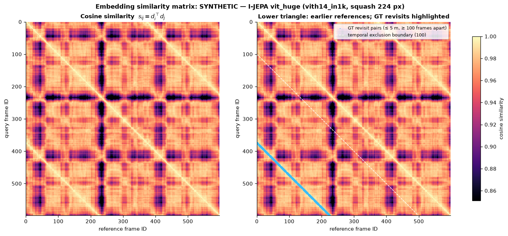
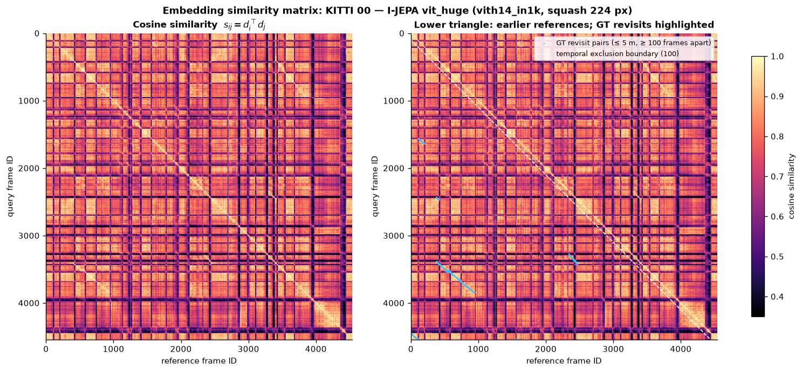

**Descriptor distributions.** Top left: cosine of revisit pairs vs different-place pairs. Top right: descriptor component values (all norms equal 1). Bottom left: PCA of the global descriptors, coloured by time, with links between revisit pairs. Bottom right: cumulative explained variance. On KITTI the revisit distribution is bimodal; the low mode is the crossing revisits described in the limitations.

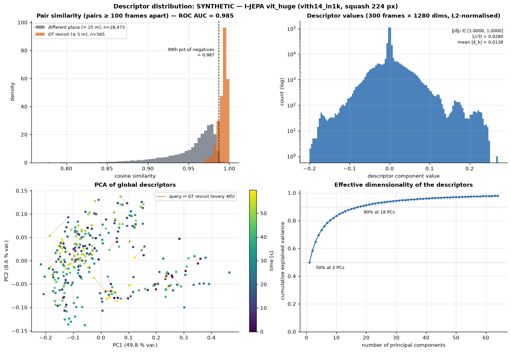
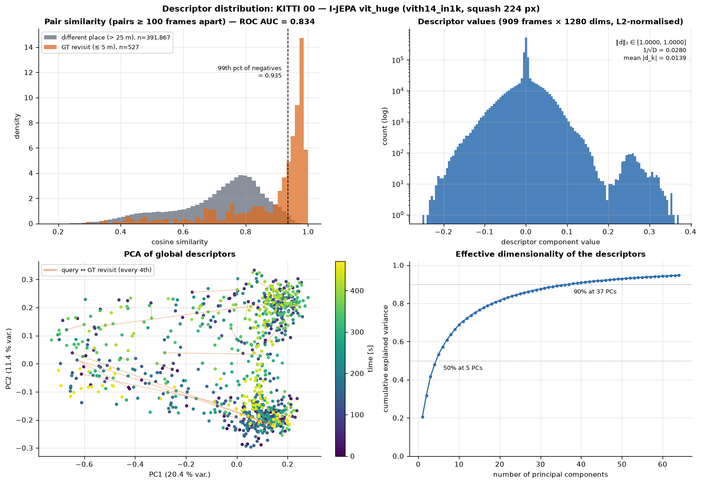

**Feature similarity heatmaps.** For each query patch $a$: $h_a = \max_b \cos(q_a, r_b)$ over the reference patches. Rows show a ground-truth revisit, the hardest negative (most similar pair more than 25 m apart) and a random negative. The right column maps the first three PCA components of the patch tokens to RGB.

In KITTI 00, the revisit #3395 ↔ #2445 (0.3 m apart) scores 0.993. The "hardest negative" is 26.9 m away on what appears to be the same street, just outside the 25 m negative radius. In the synthetic city, repeated facades produce a negative 88 m away at 0.993.

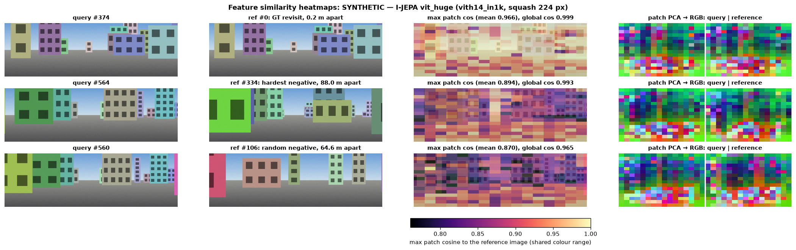
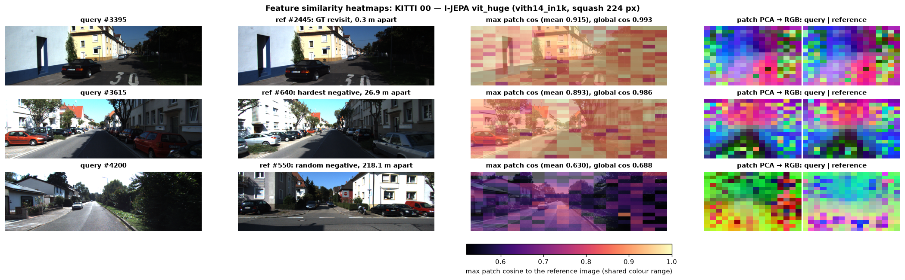

**Preprocessing comparison** (same weights and frames; only the resize mode changes):

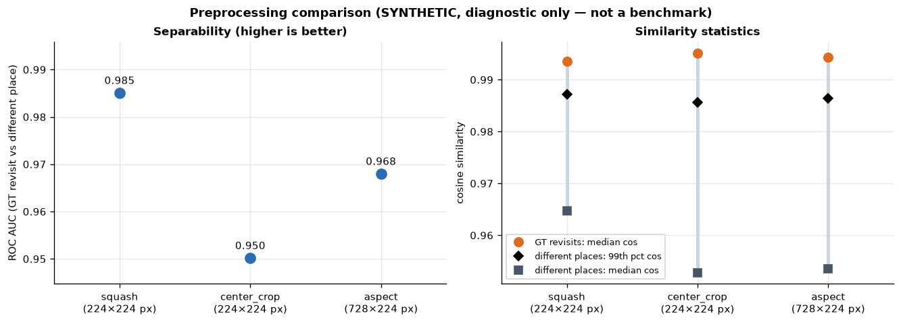
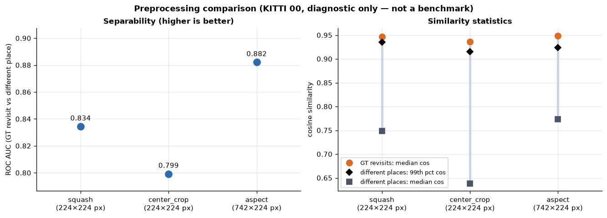

**Similarity evolution GIFs.** Frames are processed chronologically:
- Top left: the current camera frame.
- Right: the causal similarity matrix filling row by row (references in the future stay grey).
- Bottom left: cosine of the current query to every earlier frame. The last 100 frames are shaded as temporally excluded. Orange dots mark ground-truth revisits, and ▼ marks the most similar eligible frame together with its ground-truth verdict.

This only *visualises* similarities. Retrieval with FAISS, top-K and causal replay is Phase 3.

| SYNTHETIC (120 frames, 3.9 MB) | KITTI 00 (120 frames, 6.8 MB) |
|---|---|
| 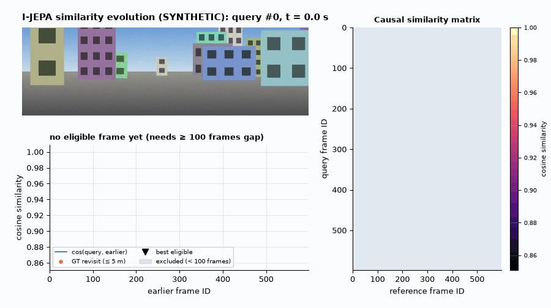 | 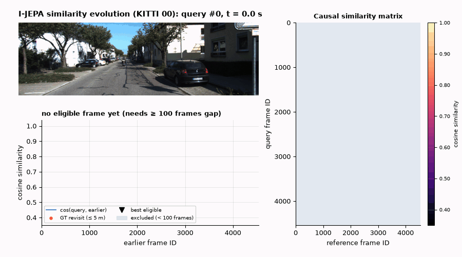 |

The `synthetic_5cb1448a` prefix is the dataset cache key: a hash of the synthetic configuration, so a changed seed or resolution never reuses stale embeddings. Every run also writes `<key>_phase2_summary.json`, containing all numbers above, the encoder identity and the extraction profile.

---
