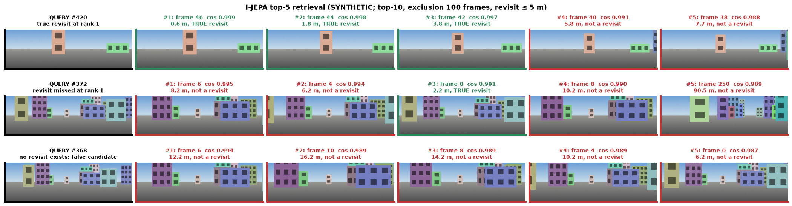
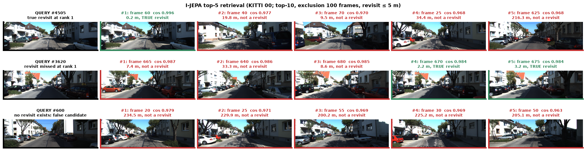
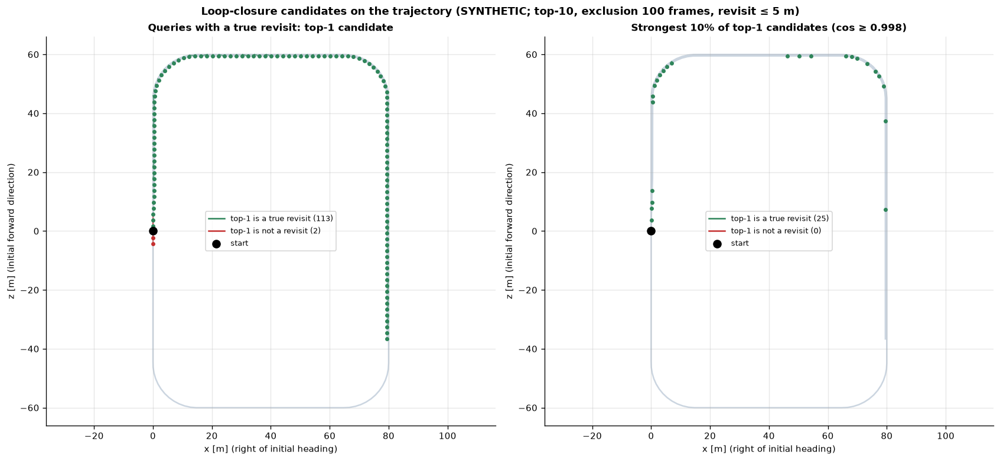
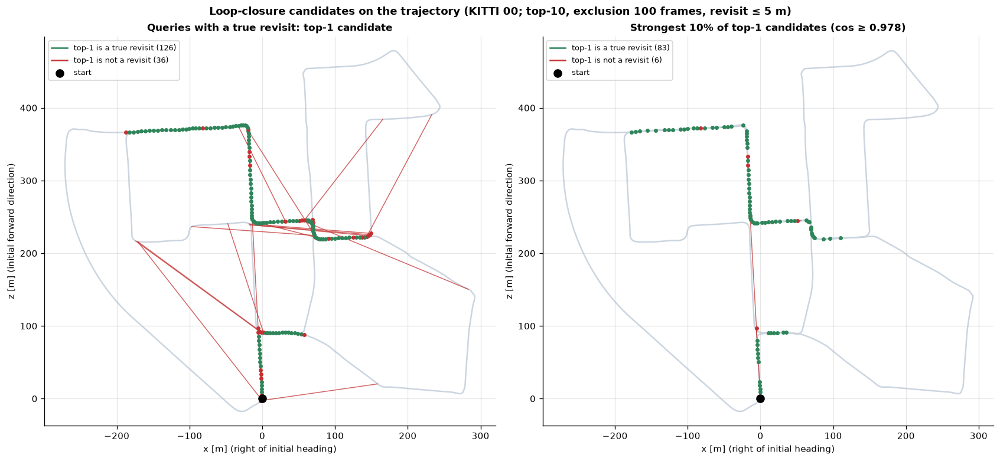
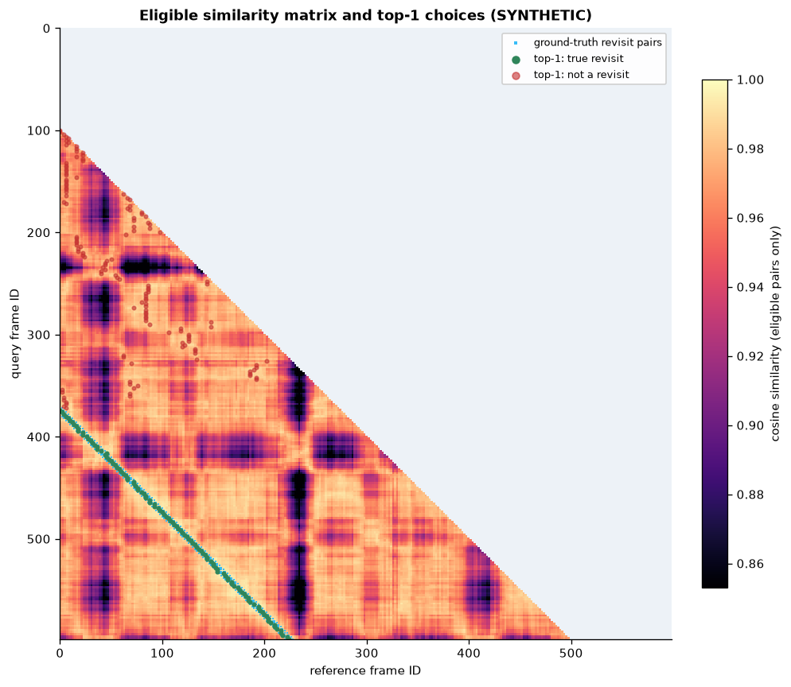
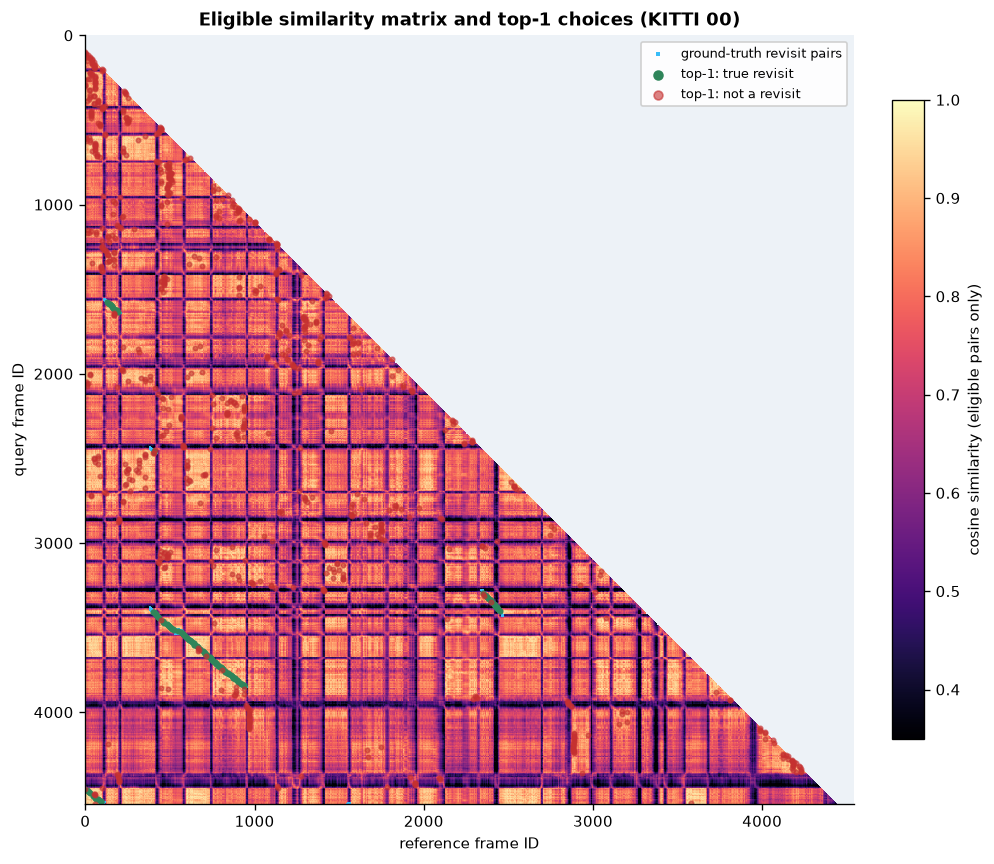
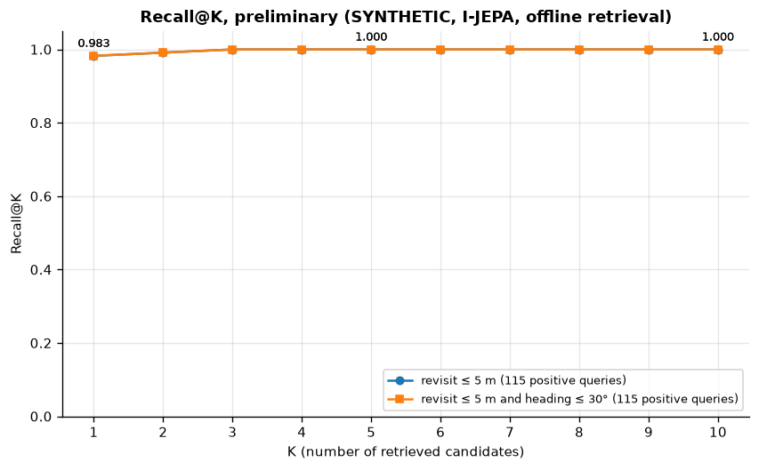
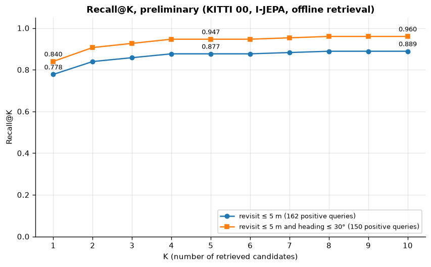
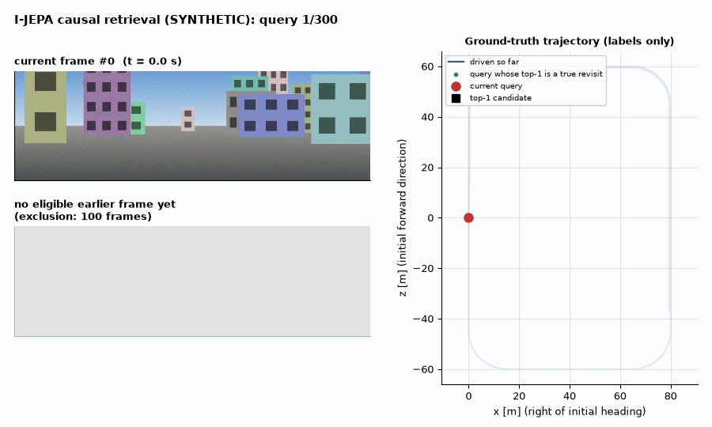
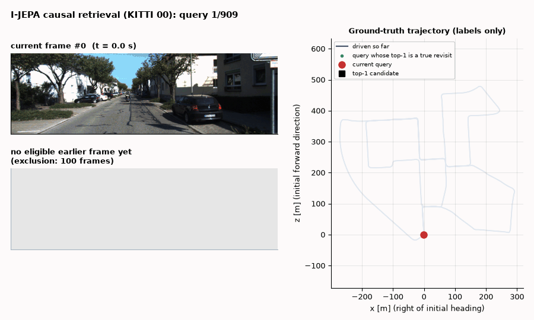

# Phase 3: visual place retrieval

[Back to README](../README.md)

## Objective

For every camera frame, find the earlier frames most likely to show the **same place**, using only the Phase 2 descriptors. These ranked *loop-closure candidates* are what Phase 4 checks geometrically.

Retrieval never sees ground truth. Poses are used only afterwards, to label the results and draw the figures.

## Cosine similarity, L2 normalisation and the FAISS index

Phase 2 descriptors are L2-normalised, $\lVert d \rVert_2 = 1$. For unit vectors the inner product **is** the cosine similarity:

```math
s(q, r) \;=\; d_q^{\top} d_r \;=\; \lVert d_q\rVert\,\lVert d_r\rVert \cos\theta_{qr} \;=\; \cos\theta_{qr} \in [-1, 1].
```

Ranking references by inner product is therefore ranking by cosine similarity. Equivalently, it ranks by Euclidean distance, since $\lVert d_q - d_r \rVert^2 = 2 - 2 s(q,r)$.

`FlatIPIndex` (`src/latent_loop/retrieval/index.py`) wraps FAISS `IndexFlatIP`. This is an **exact**, exhaustive inner-product search with no quantisation or approximation: on N references it costs $O(N D)$ per query, with D = 1280. At KITTI scale (≤ 4,661 frames per sequence) exhaustive search takes well under a millisecond per query on the CPU, so an approximate index would only add error. A test checks the FAISS results against a NumPy brute-force `argsort`.

Descriptors are added in **chronological order**, so index position $p$ is the $p$-th observed frame. Adding out of order, or adding descriptors that aren't unit-norm (tolerance 10⁻³), raises an error.

## Top-K retrieval

For query $q$ with eligible reference set $\mathcal{E}(q)$, the candidates are the $K$ eligible references with the highest similarity:

```math
\mathcal{C}_K(q) \;=\; \mathop{\mathrm{argtop}_K}\limits_{r \in \mathcal{E}(q)} \; s(q, r),
```

returned as original frame IDs with their cosine scores, in descending order. When fewer than $K$ frames are eligible, the remaining slots hold frame ID −1 and score `nan`.

## Temporal exclusion

Consecutive frames look alike because they **are** almost the same place, so they must not count as loop closures. A reference $r$ is eligible for query $q$ only if:

```math
f_r < f_q, \qquad f_r \le f_q - \Delta_f, \qquad \text{and optionally}\quad t_r \le t_q - \Delta_t ,
```

where $f$ is the **original** frame ID (default $\Delta_f = 100$ frames = 10 s at KITTI's 10 Hz) and $t$ the timestamp (optional $\Delta_t$).

The rule is defined on original IDs, never on positions in a subsampled array. With stride 5, a gap of 100 frames is 20 array positions, and the code measures it as 100 frames; a test checks this at stride 10.

Because frame IDs and timestamps increase monotonically, $\mathcal{E}(q)$ is always a **prefix** of the chronologically ordered index, $[0, n_q)$. It is enforced *inside* the search with `faiss.IDSelectorRange(0, n_q)` rather than by over-fetching and filtering afterwards, so the result is exact even when the most similar frames are all excluded.

## Two retrieval modes

| Mode | Index contents when query $q$ is searched | Use |
|---|---|---|
| `offline` | all frames, added once; each query restricted to its eligible prefix | fast evaluation over precomputed descriptors |
| `causal` | only frames observed **before** $q$ (frame $q$ is added after its own search) | replays the sequence as a robot would see it; the future cannot be retrieved by construction |

With the same settings the two modes return **identical** candidates, because the eligible set is the same prefix in both. This is checked in the unit tests and with `run_retrieval.py --check-causal` on real descriptors (identical, maximum score difference 0.0). `assert_causal` independently checks every saved candidate against the exclusion rule.

## Candidate filtering

Applied in this order to each ranked list (ground truth is not consulted):

1. **Similarity threshold** (`min_similarity`, default off): drop candidates with $s < \tau$.
2. **Temporal non-maximum suppression** (`nms_frames`, default 0 = off): walking down the ranking, drop any candidate whose frame ID lies within `nms_frames` of a candidate already kept. Without it, the top-K for a revisit are often K consecutive frames of the *same* earlier pass. With it, they are K distinct places, which gives geometric verification more diverse hypotheses. The search is widened to $K (2 \cdot \text{nms} + 1)$ so that K slots can still be filled.

Phase 3 reports retrieval **without** thresholds or NMS (pure top-K). Choosing $\tau$ and NMS settings is a detection decision; it belongs in Phase 6 and is tuned on development sequences only.

## Ground-truth revisit labels

For evaluation only, `revisit_ground_truth` marks reference $r$ as a **true revisit** of query $q$ iff

```math
f_r \le f_q - \Delta_f \quad\text{and}\quad \lVert p_q - p_r\rVert_2 \le \rho ,
```

with $p$ the camera centre on the ground plane (x-z) and spatial threshold $\rho$ = 5 m by default. A query whose positive set is non-empty is a **positive query**.

Phase 2 showed that some revisits pass the same spot at a different heading, which a forward camera cannot recognise. Results are therefore reported under two definitions:

| Definition | Extra condition | Rationale |
|---|---|---|
| `distance_only` | none | standard KITTI loop-closure labelling |
| `same_direction` | $\lvert \mathrm{wrap}(\psi_q - \psi_r) \rvert \le 30°$ | only revisits a forward-facing camera can recognise |

Both thresholds are configurable (`ground_truth.spatial_threshold_m`, `ground_truth.max_heading_diff_deg`).

## Preliminary metric

Phase 3 reports Recall@K on **positive queries only**, as a sanity check of retrieval. The full metric suite (AP, PR curves, detection precision, recall and F1 with thresholds tuned on development data) comes in Phase 6.

```math
\mathrm{Recall@}K \;=\; \frac{\bigl|\{\, q \in Q^{+} : \mathcal{C}_K(q) \cap P(q) \neq \emptyset \,\}\bigr|}{\lvert Q^{+} \rvert},
```

where $Q^{+}$ is the set of positive queries and $P(q)$ the true revisits of $q$. Queries without a true revisit are excluded from the denominator here, but count as potential false alarms in Phase 6.

## Configuration (`configs/default.yaml`)

| Key | Default | Meaning |
|---|---|---|
| `retrieval.top_k` | 10 | candidates kept per query |
| `retrieval.temporal_exclusion_frames` | 100 | $\Delta_f$ in original frame IDs |
| `retrieval.temporal_exclusion_seconds` | `null` | optional $\Delta_t$ |
| `retrieval.min_similarity` | `null` | optional threshold $\tau$ |
| `retrieval.nms_frames` | 0 | temporal NMS radius (frames) |
| `retrieval.mode` | `offline` | `offline` or `causal` |
| `ground_truth.spatial_threshold_m` | 5.0 | $\rho$ |
| `ground_truth.max_heading_diff_deg` | 30.0 | heading limit of the `same_direction` definition |

## Implementation map

| File | Contents |
|---|---|
| `src/latent_loop/retrieval/index.py` | `FlatIPIndex` (FAISS `IndexFlatIP` + `IDSelectorRange`), `exact_search_numpy` (test reference) |
| `src/latent_loop/retrieval/temporal_filter.py` | `TemporalExclusion` (`eligible_count(s)`, `is_eligible`), `validate_chronological` |
| `src/latent_loop/retrieval/detector.py` | `RetrievalConfig`, `RetrievalResult` (`save`/`load`), `retrieve` (offline / causal), `filter_candidates`, `assert_causal` |
| `src/latent_loop/datasets/ground_truth.py` | `revisit_ground_truth`, `RevisitGroundTruth` |
| `src/latent_loop/evaluation/metrics.py` | `recall_at_k`, `first_hit_rank` |
| `src/latent_loop/visualization/retrieval.py`, `phase3.py` | Phase 3 figures and GIF |
| `scripts/run_retrieval.py` | retrieval CLI; writes `results/retrieval/<dataset>/<encoder>-<fingerprint>/<mode>/` |

**Saved results** per run: `retrieval.npz` holds `query_frame_ids`, `query_timestamps`, `candidate_ids (N, K)`, `scores (N, K)` and `eligible_counts`. `retrieval.json` holds the configuration, timing, causal check and preliminary Recall@K for both ground-truth definitions. `top1.csv` has one row per query: top-1 frame, cosine, number of eligible references and the ground-truth verdicts.

**CPU/GPU:** retrieval runs on the **CPU** (FAISS CPU, float32). Only descriptor extraction (Phase 2) uses the GPU, and the Phase 3 scripts read descriptors from the cache without loading the model.

## Assumptions, failure cases and limitations

* **Perceptual aliasing.** Different places that look alike (repeated facades, similar suburban streets) can outrank the true revisit. Retrieval alone cannot reject them; Phase 4 geometric verification targets this.
* **Viewpoint.** Crossing and opposite-direction revisits are mostly not retrieved by a forward camera; see the gap between the two ground-truth definitions in the results.
* **Fixed exclusion window.** 100 frames assumes motion. A vehicle stopped for more than 10 s will retrieve itself as a "revisit"; `temporal_exclusion_seconds` or a distance-travelled rule (planned) can address this.
* **Exhaustive search** scales linearly with the map size. That's fine for single KITTI sequences; city-scale maps would need an approximate index, at some cost in recall.
* **Recall@K uses positive queries only.** It says nothing about false alarms on queries without a revisit; detection metrics come in Phase 6.
* **Preliminary numbers.** KITTI 00 is subsampled (every 5th frame) and its resize mode was not tuned. The numbers below are sanity checks, not benchmark results.

## Steps to run Phase 3

All commands run from the repository root with `.env` active and `PYTHONPATH` unset. They use the Phase 2 descriptor cache; if a descriptor is missing it is extracted first (GPU if available).

```bash
# 1. Retrieval + saved results + causal-replay equivalence check, SYNTHETIC (every 2nd frame)
python scripts/run_retrieval.py --config configs/ijepa.yaml --stride 2 --check-causal

# 2. Same on real KITTI 00 (every 5th frame)
python scripts/run_retrieval.py --config configs/ijepa.yaml --stride 5 --check-causal \
    --set dataset.name=kitti dataset.root=data/raw/kitti/dataset "dataset.sequence='00'"
#    options: --mode {offline,causal}  --top-k K  --exclusion-frames N
#             --set retrieval.nms_frames=10 retrieval.min_similarity=0.95 ...
#    -> results/retrieval/<dataset_key>/ijepa-<fingerprint>/<mode>/{retrieval.npz,retrieval.json,top1.csv}

# 3. Phase 3 figures and GIF from the saved results (about 2.5 min synthetic, 4 min KITTI 00)
python scripts/generate_visualizations.py --phase 3
python scripts/generate_visualizations.py --phase 3 --stride 5 --max-frames 110 \
    --set dataset.name=kitti dataset.root=data/raw/kitti/dataset "dataset.sequence='00'"

# 4. Tests
python -m pytest tests/test_retrieval.py tests/test_retrieval_plots.py
```

Outputs go to `assets/phase_03_retrieval/<dataset_key>_*.png|gif` and `<dataset_key>_phase3_summary.json`. The summary records `loaded_saved_result: true` when the figures were drawn from the saved retrieval results, as they were for every figure below.

## Phase 3 results

Descriptors are the cached Phase 2 I-JEPA embeddings: SYNTHETIC on **GPU, FP16**; KITTI 00 on **GPU, FP32** (`squash`, 224 px). Retrieval, ground-truth labelling and metrics run on the **CPU** (FAISS CPU 1.15.1, float32). Settings: top-10, temporal exclusion 100 original frames, no threshold, no NMS, revisit ≤ 5 m.

| | SYNTHETIC (300 queries) | KITTI 00 (909 queries, every 5th frame) |
|---|---|---|
| Positive queries: distance-only / same-direction | 115 / 115 | 162 / 150 |
| Recall@1 / @5 / @10, distance-only | 0.983 / 1.000 / 1.000 | **0.778** / 0.877 / 0.889 |
| Recall@1 / @5 / @10, same-direction (≤ 30°) | 0.983 / 1.000 / 1.000 | **0.840** / 0.947 / 0.960 |
| Offline vs causal replay | identical candidates, max score diff 0.0 | identical candidates, max score diff 0.0 |
| Search time per query, offline / causal (CPU) | 0.078 / 0.087 ms | 0.163 / 0.241 ms |
| Index build, offline (CPU) | 27 ms | 5 ms |

These are **preliminary** retrieval checks on positive queries only. They are not loop-closure detection results: there is no threshold, false alarms are not counted, and there is no development/test split. Phase 6 adds those.

**Reading the numbers.**
* **Crossing revisits.** On KITTI 00, 22 % of positive queries miss the true revisit at rank 1. The same-direction definition removes 12 positive queries (crossing revisits a forward camera cannot see) and raises Recall@1 from 0.778 to 0.840.
* **Most misses are near misses.** Recall rises from 0.840 at K = 1 to 0.947 at K = 5 (same-direction). The gallery shows a typical miss: the top-1 is 7.4 m away, just outside the 5 m threshold, and the true revisit is at rank 4.
* **False candidates are confident.** For query #600, which has no revisit, all five candidates are similar suburban streets more than 200 m away with cosine 0.96–0.98. A similarity threshold alone cannot reject these; Phase 4 adds geometric verification for this.
* **Strong candidates are mostly right.** Among the strongest 10 % of all top-1 candidates on KITTI 00 (cosine ≥ 0.978), 83 of 89 are true revisits.

**Top-5 retrieval galleries.** Each row shows a query (black frame) and its five highest-scoring eligible earlier frames. Captions give the rank, frame ID, cosine, camera-centre distance and ground-truth verdict (green = true revisit, red = not a revisit). The rows are chosen deterministically: the best rank-1 hit, the most confident rank-1 miss, and the most confident candidate for a query that has no revisit.




**Loop-closure candidates on the trajectory.** Left: every positive query, linked to its top-1 candidate. Right: the strongest 10 % of all top-1 candidates, which is what a similarity threshold would accept. On the synthetic loop the revisit lies only 0.5 m beside the first pass, so the links are too short to see and appear as coloured dots.




**Eligible similarity matrix.** Cosine similarity is shown only for eligible pairs; the excluded region is grey. Blue marks ground-truth revisit pairs; dots mark each query's top-1 choice (green = true revisit, red = not). On the synthetic data, the red dots for queries before frame ~370 belong to queries that have no revisit at all.




**Recall@K curves** (K = 1…10, both ground-truth definitions; on synthetic data the two coincide):




**Chronological retrieval GIFs** (evenly spaced queries at 8 fps: 120 for SYNTHETIC, 110 for KITTI 00 to stay under 10 MB):
- Top left: the current camera frame.
- Bottom left: its top-1 eligible earlier frame, with cosine, distance and ground-truth verdict.
- Right: the trajectory driven so far, the current query, the top-1 candidate with the loop link (green or red), and the queries already answered with a true revisit.

| SYNTHETIC | KITTI 00 |
|---|---|
|  |  |
