# Phase 4: geometric verification

[Back to README](../README.md)

## Objective

Reject loop-closure candidates that *look* similar but are not views of the same 3D scene. For each query and each of its top `verify_top_k` retrieved candidates (5 by default), the two images are matched with ORB features and the matches are tested against the two-view epipolar constraint of a calibrated camera with RANSAC. The decision uses **only the two images and the camera calibration**. Ground-truth poses are attached afterwards, as labels for the figures and statistics.

## ORB keypoints and binary descriptors

ORB (Rublee et al., 2011) detects **oriented FAST** corners on an 8-level image pyramid (scale factor 1.2), keeps the strongest 2000 by Harris score, and assigns each an orientation $\theta$ from the intensity centroid of its patch:

```math
m_{pq} = \sum_{x,y} x^p y^q\, I(x,y), \qquad \theta = \mathrm{atan2}(m_{01},\, m_{10}).
```

The descriptor is **rotated BRIEF**: 256 learned pairwise intensity tests $(\mathbf{a}_k, \mathbf{b}_k)$ on the smoothed patch, rotated by $\theta$,

```math
d_k = \begin{cases} 1 & I(R_\theta \mathbf{a}_k) < I(R_\theta \mathbf{b}_k) \\ 0 & \text{otherwise} \end{cases}, \qquad k = 1,\dots,256,
```

stored as 32 bytes. Binary descriptors are compact and fast to compare, and the orientation and pyramid make them tolerant to in-plane rotation and moderate scale change. They are *not* invariant to large viewpoint or illumination changes, which limits verification of crossing or opposite-direction revisits.

## Hamming distance and matching

Two binary descriptors are compared by the **Hamming distance**, the number of differing bits:

```math
d_H(\mathbf{a}, \mathbf{b}) = \mathrm{popcount}(\mathbf{a} \oplus \mathbf{b}) \in \{0, \dots, 256\}.
```

Matching from the query image into the candidate image (`verification/orb.py`):

1. **Exact 2-nearest-neighbour search** by Hamming distance (OpenCV brute force), giving the best and second-best distances $d_1, d_2$.
2. **Lowe's ratio test**: keep the match only if $d_1 < r   d_2$ with $r$ = 0.8. A feature whose best and second-best candidates are almost equally good is ambiguous and is dropped.
3. **Absolute bound** $d_1 \le 64$ bits.
4. **Mutual check**: the candidate feature's own best match in the query image must be the same query feature. This also removes many-to-one matches.

## Epipolar geometry and the essential matrix

With calibrated intrinsics $K$ (KITTI: from `calib.txt`, the rectified $P_2$ of the colour camera), a pixel $\mathbf{u}$ maps to the normalised image point $\mathbf{x} = K^{-1}[\mathbf{u}^\top, 1]^\top$. If the camera moved rigidly between the two views, $\mathbf{X}_r = R \mathbf{X}_q + \mathbf{t}$, every correct correspondence satisfies the **epipolar constraint**

```math
\mathbf{x}_r^\top E \, \mathbf{x}_q = 0, \qquad E = [\mathbf{t}]_\times R, \qquad
[\mathbf{t}]_\times = \begin{pmatrix} 0 & -t_3 & t_2 \\ t_3 & 0 & -t_1 \\ -t_2 & t_1 & 0 \end{pmatrix}.
```

Geometrically, the query point, the two camera centres and the 3D point lie in one plane, so the match must lie on the **epipolar line** $\mathbf{l}_r = F \mathbf{u}_q$ in the candidate image, with $F = K^{-\top} E K^{-1}$. An essential matrix has singular values $(\sigma, \sigma, 0)$ and 5 degrees of freedom (3 for rotation, 2 for the translation direction).

**Scale is not observable.** $E$ is defined only up to scale, and $\mathbf{t}$ is recovered only as a **unit direction**. This verification does **not** estimate metric translation; a metric relative pose would need depth (stereo, LiDAR or a map).

The residual used to classify a match is the **Sampson distance**, a first-order approximation of the geometric (point-to-epipolar-line) error:

```math
d_S^2 = \frac{(\mathbf{x}_r^\top E \mathbf{x}_q)^2}{(E\mathbf{x}_q)_1^2 + (E\mathbf{x}_q)_2^2 + (E^\top\mathbf{x}_r)_1^2 + (E^\top\mathbf{x}_r)_2^2}.
```

It is in normalised units; a pixel threshold $\epsilon$ (1 px) is divided by the focal length.

## RANSAC

Tentative matches contain outliers, so $E$ is estimated robustly:

1. Draw a random minimal sample of $s$ matches and fit $E$ to it.
2. Count the matches with $d_S < \epsilon$ (the **support**).
3. Keep the model with the largest support. Stop when, with the best inlier fraction $w$ seen so far, the probability of having drawn at least one all-inlier sample reaches the confidence $p$ = 0.999:

```math
N = \frac{\log(1 - p)}{\log\left(1 - w^{s}\right)} .
```

Two estimators are implemented (`verification.estimator`):

| Estimator | Minimal solver | Notes |
|---|---|---|
| `opencv` (default) | Nistér's five-point algorithm, $s = 5$ (`cv2.findEssentialMat`) | Standard, robust to noise; up to 2000 iterations |
| `numpy` | Normalised linear **eight-point** algorithm, $s = 8$, own code | Transparent reference: vectorised batches of hypotheses, Hartley normalisation, projection onto the essential manifold, adaptive stopping and LO-RANSAC refinement (Sampson-weighted iteratively reweighted least squares) |

The eight-point algorithm stacks one row per match, $A \mathrm{vec}(E) = 0$ with rows $(x_r x_q,  x_r y_q,  x_r,  y_r x_q,  y_r y_q,  y_r,  x_q,  y_q,  1)$, solves by SVD, and projects the result onto the closest essential matrix $U \mathrm{diag}(1, 1, 0) V^\top$. Minimal eight-point samples are sensitive to noise, so the local-optimisation step refits on the support with each row divided by its Sampson denominator, which turns the algebraic residual into the Sampson distance. On synthetic scenes with 40 % outliers and 0.4 px noise, the reference recovers on average 92 % as many true inliers as OpenCV's five-point solver with a similar false-inlier rate. The test suite checks both against ground truth.

After RANSAC, `cv2.recoverPose` decomposes $E$ into the four $(R, \pm\mathbf{t})$ candidates and keeps the one that places the triangulated inliers in front of both cameras (cheirality).

## Inlier count, inlier ratio and coverage

* **Inlier count** $n_E$: matches with $d_S < \epsilon$ under the final model.
* **Inlier ratio** $n_E / n_m$, with $n_m$ the number of ratio-tested mutual matches.
* **Coverage**: the fraction of cells of an 8 × 4 image grid that contain at least one inlier, taking the smaller value of the two images. Inliers packed into one small region (a single sign or textured patch) give weak evidence that the *place* is the same.

## Degenerate configurations

| Case | Why it is a problem | How it is handled |
|---|---|---|
| **Missing descriptors** (blank, dark or motion-blurred frame) | No features to match | Fewer than 50 keypoints in either image: reject, `missing_descriptors` |
| **Insufficient matches** | Too little evidence; RANSAC is meaningless | Fewer than 20 matches after the filters: reject, `insufficient_matches` |
| **Repeated structure** (fences, tiled facades) | Matches shifted by one period can still be geometrically consistent, so RANSAC cannot catch them | Self-similarity: the **twin fraction** is the share of keypoints with a descriptor within 24 bits of another keypoint at least 16 px away in the *same* image. At ≥ 0.5 in either image: reject, `repeated_structure` |
| **RANSAC failure** | No model, non-finite $E$, or fewer than 5 inliers | Reject, `ransac_failure` |
| **Pure rotation** | With $\mathbf{t} \approx 0$, every match also satisfies $\mathbf{u}_r \sim K R K^{-1} \mathbf{u}_q$; any $\mathbf{t}$ fits, so $E$ and $\mathbf{t}$ are undetermined | Homography test below: flag `pure_rotation`, pose unreliable |
| **Low parallax** (almost the same viewpoint, or distant scene) | Same as pure rotation, with a small rotation | Homography test, or median rotation-compensated parallax below 1°: flag `low_parallax` |
| **Planar scene** | One homography explains the matches; pose is less well conditioned (and the eight-point solver is degenerate) | Homography test: flag `planar_scene` |
| **Invalid calibration** | Normalised coordinates would be wrong | $K$ not finite, $f_x, f_y \le 0$, principal point outside the image, or bad last row: reject, `invalid_calibration` |

**Homography diagnostic** (optional, on by default). A homography $H$ is fitted to the same matches with RANSAC (`cv2.findHomography`). Its threshold is 2 px rather than 1 px: the homography error is a one-sided 2D transfer error, while the Sampson distance is a 1D point-to-line error. The ratio of 95 % $\chi^2$ quantiles for 2 vs 1 degrees of freedom, $\sqrt{5.99/3.84} \approx 1.25$, times $\sqrt{2}$ for the noise of both images landing on one side, gives about 1.8. If $n_H / n_E \ge 0.9$, the matches are explained by one homography and the configuration is degenerate:

* **Rotation-like** if $K^{-1} H K$ is close to a scaled rotation. Its singular values are then nearly equal, so the spread $(\sigma_1 - \sigma_3)/\sigma_2 \le 0.05$. The nearest rotation $R_H = UV^\top$ gives the turn angle: `pure_rotation` if it is ≥ 2°, otherwise `low_parallax`. Rotation and parallax are then reported from $R_H$, because $E$'s rotation is meaningless.
* Otherwise **`planar_scene`**.

Independently, the **rotation-compensated parallax** of each inlier is $\angle(\mathbf{f}_r, R \mathbf{f}_q)$ for unit bearing vectors $\mathbf{f}$. A median below 1° flags `low_parallax`.

A degenerate configuration does **not** mean a wrong place: two images taken from almost the same spot are a correct loop closure whose relative pose happens to be unobservable. With `degenerate_policy: flag` (default), such pairs are accepted with `pose_reliable = false`. With `degenerate_policy: reject`, they are rejected with the degeneracy as the reason.

## Verification thresholds and decision order

Checks run in this order, and the first failure becomes the recorded rejection reason:

1. `invalid_calibration`
2. `missing_descriptors` (fewer than `min_keypoints` = 50)
3. `repeated_structure` (twin fraction ≥ `max_repeated_fraction` = 0.5)
4. `insufficient_matches` (fewer than `min_matches` = 20)
5. `ransac_failure`
6. `too_few_inliers` ($n_E$ < `min_inliers` = 30)
7. `low_inlier_ratio` ($n_E / n_m$ < `min_inlier_ratio` = 0.3)
8. `concentrated_inliers` (coverage < `min_coverage` = 0.1)
9. `pure_rotation` / `low_parallax` / `planar_scene`, only with `degenerate_policy: reject`
10. otherwise `accepted`

The per-query loop-closure decision is the highest-ranked accepted candidate, if any.

**These thresholds are common heuristic values, not tuned on KITTI.** Tuning them (and the retrieval similarity threshold) on development sequences only is part of Phase 6.

## Configuration (`configs/default.yaml`, block `verification`)

| Key | Default | Meaning |
|---|---|---|
| `verify_top_k` | 5 | candidates per query that are verified |
| `orb.n_features` / `scale_factor` / `n_levels` / `fast_threshold` | 2000 / 1.2 / 8 / 20 | ORB detector |
| `matching.ratio` / `max_hamming` / `mutual` | 0.8 / 64 / true | match filters |
| `min_keypoints`, `min_matches` | 50, 20 | evidence minimums |
| `twin_hamming`, `twin_min_px`, `max_repeated_fraction` | 24, 16, 0.5 | repeated-structure test |
| `estimator` | `opencv` | `opencv` (five-point) or `numpy` (own eight-point RANSAC) |
| `ransac_threshold_px`, `ransac_confidence`, `ransac_max_iters` | 1.0, 0.999, 2000 | RANSAC |
| `min_inliers`, `min_inlier_ratio`, `min_coverage` (`coverage_grid` [8, 4]) | 30, 0.3, 0.1 | acceptance |
| `homography_diagnostic`, `homography_threshold_px`, `homography_dominance` | true, 2.0, 0.9 | homography diagnostic |
| `rotation_tolerance`, `pure_rotation_min_deg`, `min_parallax_deg` | 0.05, 2.0, 1.0 | degeneracy classification |
| `degenerate_policy` | `flag` | `flag` (accept, mark pose unreliable) or `reject` |
| `seed` | 0 | RANSAC seed (deterministic results) |

## Implementation map

| File | Contents |
|---|---|
| `src/latent_loop/verification/orb.py` | `OrbConfig`, `MatchConfig`, `extract_orb`, `hamming_distance`, `match_features` (ratio, Hamming bound, mutual check), `raw_nearest_matches`, `twin_fraction` |
| `src/latent_loop/verification/geometry.py` | `VerificationConfig`, `eight_point`, `sampson_sq`, `ransac_essential_numpy`, `estimate_essential`, `recover_pose`, `homography_rotation_check`, `grid_coverage`, `verify_features`, `verify_pair`, `VerificationResult` |
| `src/latent_loop/verification/pipeline.py` | `FeatureStore` (ORB per frame ID, LRU cache), `verify_candidates`, `VerificationRun` (`save`/`load`/`decisions`), `label_pairs`, `summarize` |
| `src/latent_loop/visualization/matches.py`, `phase4.py` | Phase 4 figures and GIF |
| `scripts/run_verification.py` | verification CLI; writes `results/verification/<dataset>/<encoder>-<fingerprint>/<mode>/top<K>_<estimator>/` |
| `scripts/compare_ransac.py` | re-verifies the saved rank-1 pairs with both RANSAC backends; writes `results/metrics/ransac_comparison_<dataset>.json` |

**Saved results** per run:
* `verification.csv`: one row per verified pair, with every count, ratio, flag and stage timing, plus the ground-truth distance and label, added after the decisions.
* `decisions.csv`: the accepted loop-closure frame per query, or −1.
* `verification.json`: configuration, timing and summary.

**CPU/GPU:** Phase 4 runs entirely on the **CPU** (OpenCV 4.14, NumPy). No neural network is loaded.

## Assumptions, failure cases and limitations

* **Viewpoint.** ORB is not invariant to large viewpoint changes, so crossing and opposite-direction revisits produce few matches and are rejected even when they are true revisits.
* **Repeated structure is detected only when it dominates** (twin fraction ≥ 0.5). Partial repetition, such as identical windows on *different* buildings, can still yield a consistent but wrong epipolar geometry. The synthetic city shows such a case below.
* **The epipolar test is a 1D constraint.** A random match lies within ε of *some* epipolar line more often than within ε of a point, so a minimum inlier count (not only a ratio) is needed.
* **Degenerate pairs are accepted by default.** Their relative pose is unreliable and is flagged as such.
* **No metric scale.** $\mathbf{t}$ is a direction only.
* **Untuned thresholds.** The defaults are heuristic. Phase 6 tunes thresholds on development sequences and reports detection metrics on held-out sequences.

## Steps to run Phase 4

All commands run from the repository root with `.env` active and `PYTHONPATH` unset. Phase 4 reads the saved Phase 3 retrieval results, so run `scripts/run_retrieval.py` with the same `--stride`/`--set` first (see [Steps to run Phase 3](phase3_retrieval.md#steps-to-run-phase-3)). Everything runs on the **CPU**.

```bash
# 1. Verify the top-5 candidates of every query, SYNTHETIC (every 2nd frame; ~1 min)
python scripts/run_verification.py --stride 2

# 2. Same on real KITTI 00 (every 5th frame; 4435 pairs, ~16 min, mostly RANSAC on rejected pairs)
python scripts/run_verification.py --stride 5 \
    --set dataset.name=kitti dataset.root=data/raw/kitti/dataset "dataset.sequence='00'"
#    options: --top-k K (verification.verify_top_k)  --estimator {opencv,numpy}
#             --set verification.min_inliers=50 verification.degenerate_policy=reject ...
#    -> results/verification/<dataset_key>/ijepa-<fingerprint>/<mode>/top<K>_<estimator>/
#       {verification.csv, decisions.csv, verification.json}

# 3. Phase 4 figures and GIF from the saved results (~1.5 min each)
python scripts/generate_visualizations.py --phase 4
python scripts/generate_visualizations.py --phase 4 --stride 5 \
    --set dataset.name=kitti dataset.root=data/raw/kitti/dataset "dataset.sequence='00'"
#    options: --gif-pairs N (evenly spaced rank-1 pairs added to the gallery pairs)
#             --gif-fps F  --gif-width PX  --output-dir DIR

# 4. Cross-check the own eight-point RANSAC against OpenCV's five-point on real pairs (~6-7.5 min)
python scripts/compare_ransac.py --stride 5 \
    --set dataset.name=kitti dataset.root=data/raw/kitti/dataset "dataset.sequence='00'"

# 5. Tests
python -m pytest tests/test_verification.py tests/test_verification_plots.py
```

Outputs go to `assets/phase_04_geometry/<dataset_key>_*.png|gif` and `<dataset_key>_phase4_summary.json`. The summary records `loaded_saved_result: true` when the decisions came from the saved run. Every pair drawn in a figure is re-verified to obtain its matches and inlier mask; the generator stops with an error unless the re-run reproduces the saved decision and inlier count exactly. This held for every figure below.

## Phase 4 results

**Inputs and settings.** Candidates are the saved Phase 3 I-JEPA top-5 for every query: SYNTHETIC, every 2nd frame, descriptors from **GPU FP16**; KITTI 00, every 5th frame, descriptors from **GPU FP32**. ORB, matching, RANSAC, decisions and labelling all run on the **CPU** (Ryzen 7 4800H; OpenCV 4.14, five-point RANSAC). The thresholds are the untuned defaults listed above, with `degenerate_policy: flag`. Ground-truth labels: **true revisit** ≤ 5 m, **not a revisit** > 25 m; pairs 5–25 m apart are unlabelled.

| | SYNTHETIC (250 queries with candidates) | KITTI 00 (889 queries with candidates) |
|---|---|---|
| Verified pairs (top-5) | 1240 | 4435 |
| True-revisit pairs accepted | 375 / 419 (89.5 %) | **300 / 300 (100 %)** |
| Not-a-revisit pairs accepted | 2 / 689 (0.29 %) | **6 / 3943 (0.15 %)** |
| Rank-1 only: true revisits accepted / not-a-revisit accepted | 108 / 113 and 1 / 129 | 126 / 126 and 1 / 746 |
| Median RANSAC inliers, true revisit / not a revisit | 66 / 11 | 398 / 9 |
| Queries with an accepted loop (highest-ranked accepted candidate) | 117: 111 true, 5 at 5–25 m, 1 > 25 m | 153: 134 true, 15 at 5–25 m, 4 > 25 m |
| Accepted pairs flagged degenerate (pose unreliable) | 235 / 464 (130 low parallax, 104 planar, 1 pure rotation) | 256 / 449 (246 low parallax, 8 planar, 2 pure rotation) |
| Time per pair incl. ORB (CPU) | 17 ms | 208 ms |
| Median stage times: match / RANSAC / pose + homography (CPU) | 0.8 / 3.8 / 2.1 ms | 8.4 / 216 / 22 ms |
| ORB per frame, incl. PNG read from `/mnt/e` (CPU) | 5.6 ms (416 × 128) | 93 ms (1241 × 376) |

These are **pair-level checks with untuned default thresholds**. They are not loop-closure detection benchmarks: no threshold was tuned, and there is no development/test split. Phase 6 adds both.

**Reading the numbers.**
* **Geometry removes the confident aliasing that retrieval could not.** In Phase 3, query #600 on KITTI 00 had five candidates at cosine 0.96–0.98, all 200–235 m away. All five are rejected here with 8–10 inliers out of 21–34 matches. Over all rank-1 pairs, 745 of 746 wrong candidates are rejected and all 126 true revisits are kept.
* **The two classes barely overlap in inlier count.** On KITTI 00, the fewest inliers of any true-revisit pair is 69 and the most of any rejected non-revisit is 45, with the threshold at 30. The 9.5 % of synthetic true-revisit pairs that are rejected are mostly low-texture views of the procedural city (35 with too few inliers, 6 with fewer than 50 keypoints) and 2 with dominant repeated windows.
* **What geometry verifies is visual overlap, not distance.** Acceptance in the unlabelled 5–25 m band falls with distance: 97 % at 5–10 m, 74 % at 10–15 m, 45 % at 15–20 m, 10 % at 20–25 m. All six accepted pairs more than 25 m apart (26–48 m) show the *same street* from further along it. Their 31–63 inliers sit on the far end of the street, with low coverage (0.12–0.16). These are geometrically correct matches that the 25 m label calls negative. Whether such pairs should count as loop closures is a labelling decision for Phase 6.
* **Most true revisits are low-parallax.** KITTI revisits drive the same lane, so the two views are often almost identical (median rotation-compensated parallax 0.81° for accepted true revisits). 246 of 449 accepted pairs are flagged `low_parallax`: correct place matches whose relative pose is poorly conditioned. With `degenerate_policy: reject` they would be lost, which is why the default only flags them.
* **Own RANSAC vs OpenCV on real pairs.** `scripts/compare_ransac.py` re-verified the 889 rank-1 KITTI 00 pairs with both estimators (CPU). The decisions agree on 99.7 % (138 vs 137 accepted). The 3 disagreements all sit at the `min_inliers` boundary (29–32 inliers). The median inlier count of the eight-point implementation is 1.03× OpenCV's on accepted pairs. Its median RANSAC time is 40 ms vs 206 ms (41 vs 211 ms in an earlier identical run), because its vectorised hypothesis batches stop adaptively, while OpenCV runs all 2000 iterations on the many low-inlier (rejected) pairs.

**ORB keypoints.** Every keypoint is a dot coloured by pyramid level. The 120 strongest also show their support region (31 px × 1.2^level) and orientation.

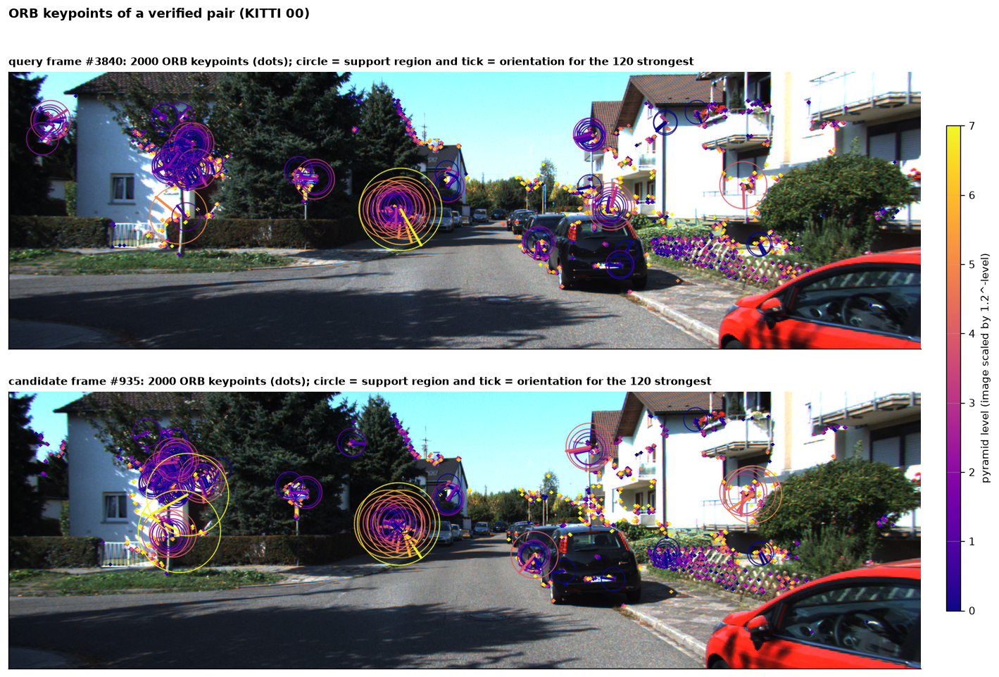
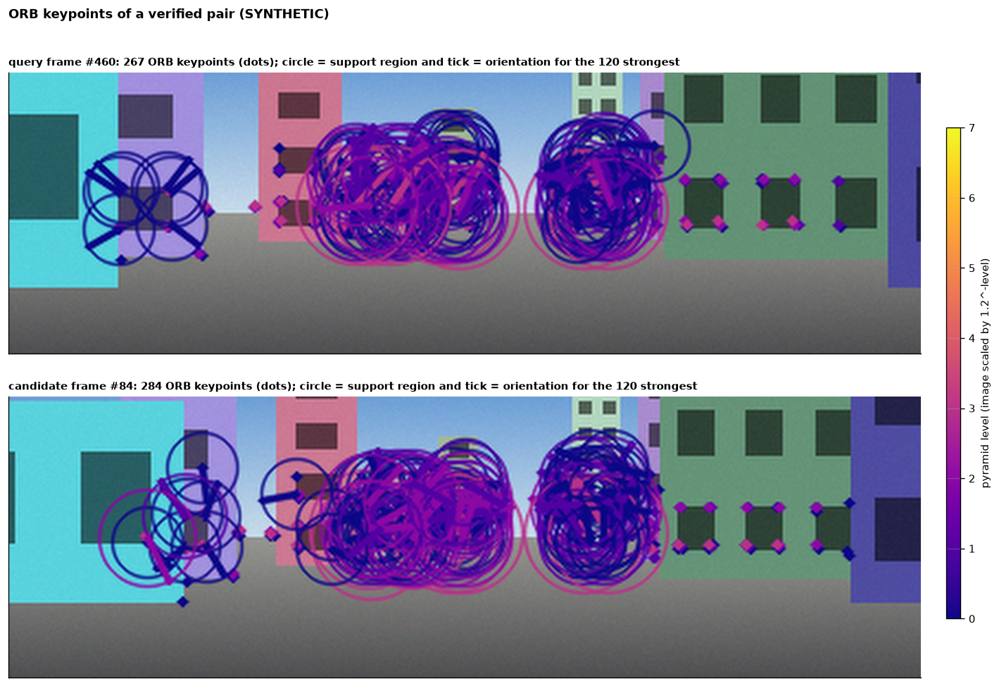

**Raw vs filtered matches.** (a) Unfiltered nearest neighbours by Hamming distance, a random 300 of 2000. (b) The matches that survive the ratio test, the 64-bit bound and the mutual check. The funnel counts are in the captions.

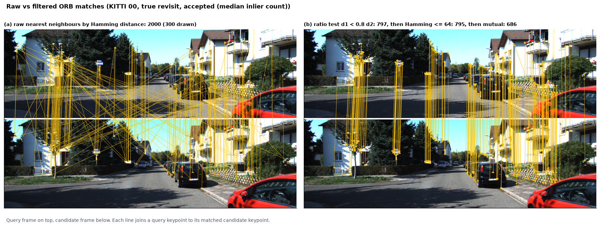
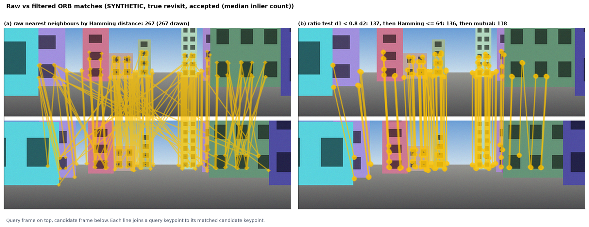

**RANSAC inliers and outliers, with epipolar lines.**
* (a) RANSAC inliers are green and outliers red.
* (b) and (c) Ten inliers of the query and their epipolar lines $\mathbf{l} = F\mathbf{u}_q$ in the candidate. Each matched point lies on its line, which is a visual check of the estimated $E$. On the true revisit the lines meet at the epipole near the vanishing point, as forward motion predicts.
* The second figure shows the confident false candidate, rejected with too few inliers.

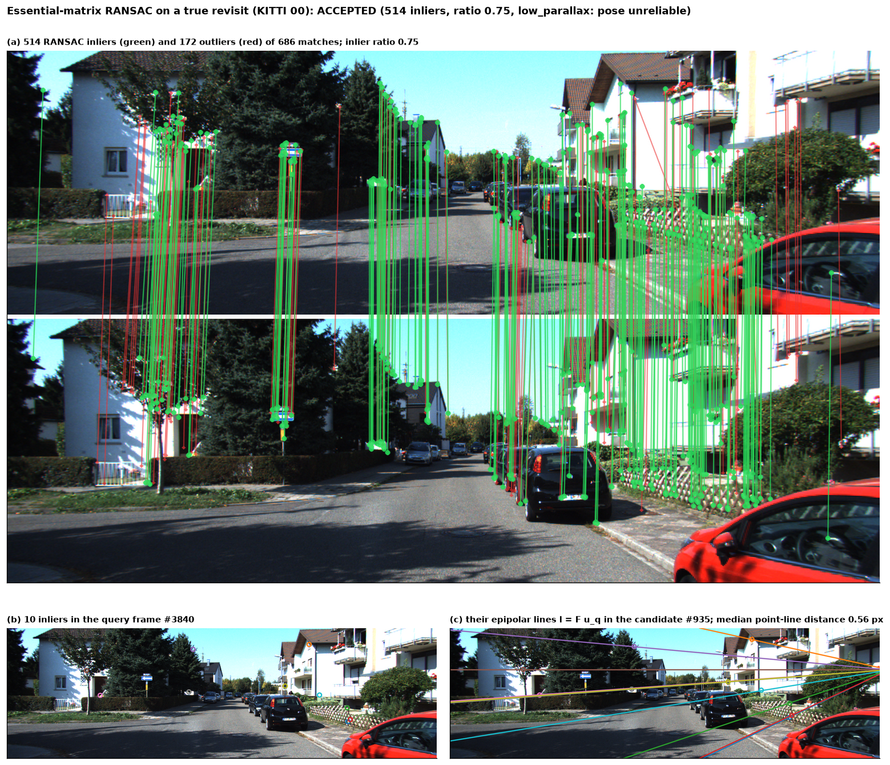
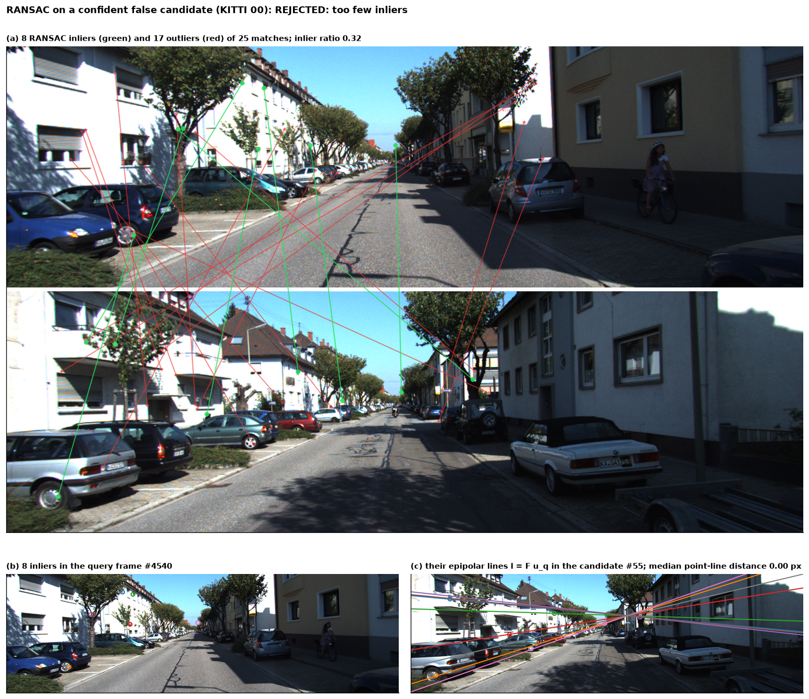
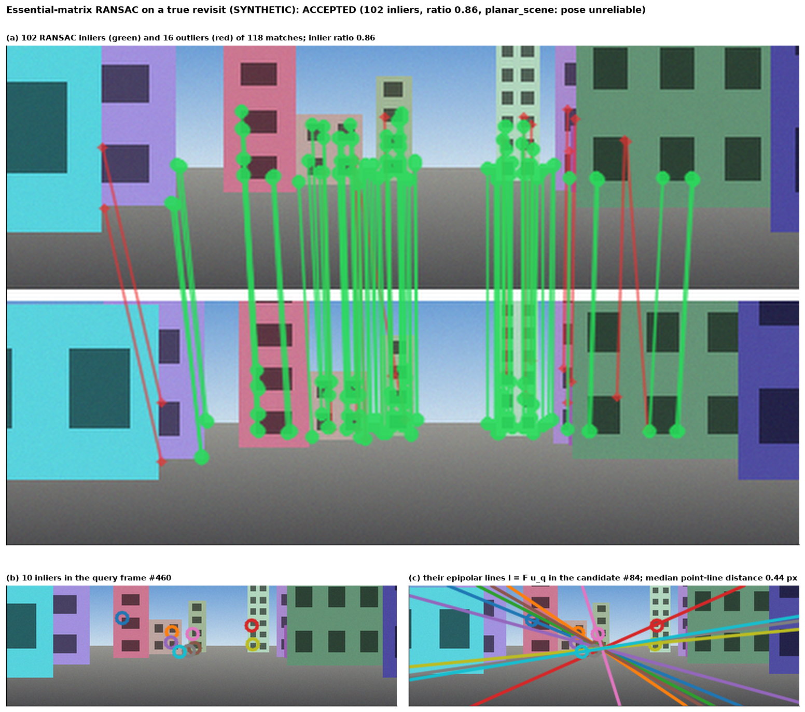
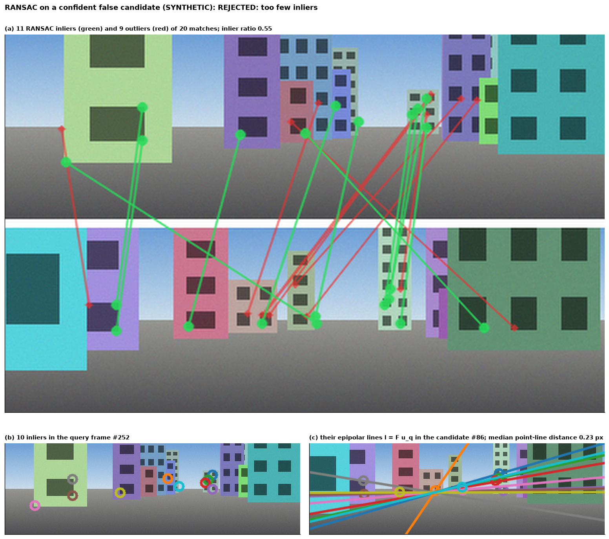

**Accepted and rejected candidate pairs.** The rank-1 examples are chosen deterministically: a true revisit with the median inlier count, the most confident (highest-cosine) false candidate, a missed true revisit (if any), a false positive (if any), a degenerate accepted pair, and the true revisit with the most inliers. KITTI 00 has no missed rank-1 true revisit, so that panel is absent there. The synthetic false positive matches windows on *different* buildings that happen to fit one epipolar geometry. This is the partial repeated structure the twin test does not catch.

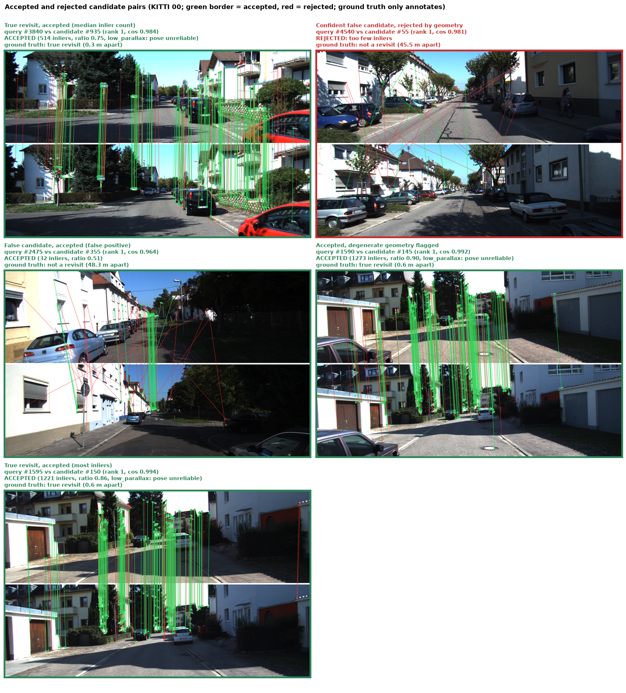
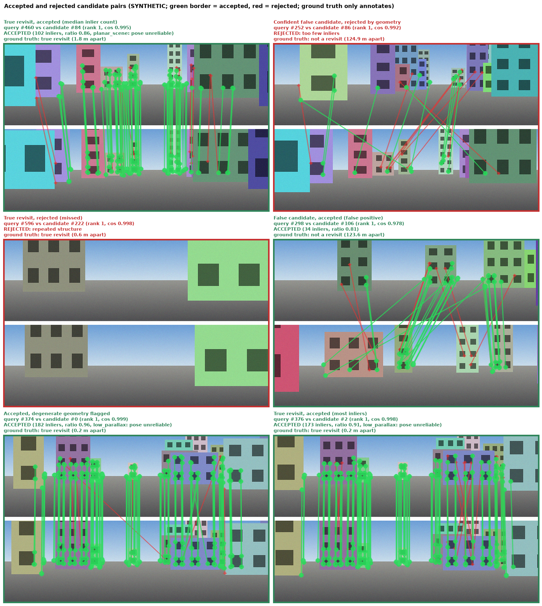

**Statistics.**
* (a) Inlier counts of the pairs that reached RANSAC, with the pairs rejected earlier counted in the legend.
* (b) The acceptance region in the inlier-count / inlier-ratio plane. The 0.3 ratio threshold never binds on either dataset.
* (c) The decision or rejection reason, by ground-truth label.

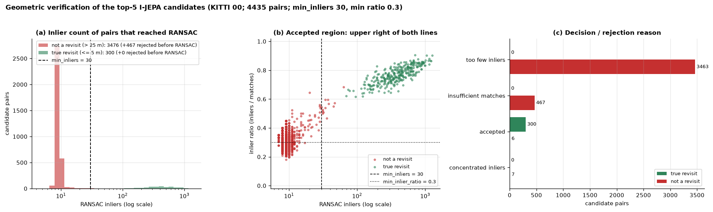
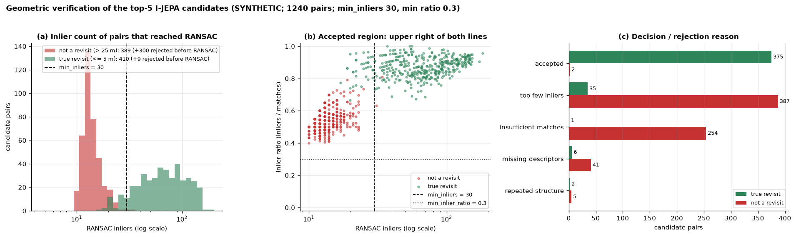

**Top-1 candidates after verification on the trajectory.** Accepted links are coloured by ground truth. Queries whose top-1 was rejected are grey dots, so the hundreds of correctly rejected long-range candidates do not hide the loop closures. The single red link on KITTI 00 is the same-street pair described above.

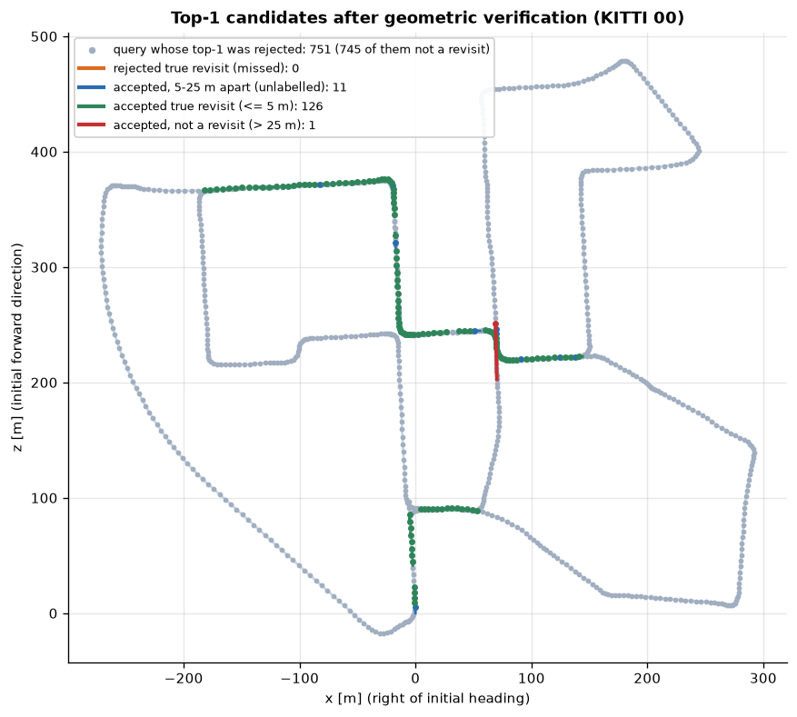
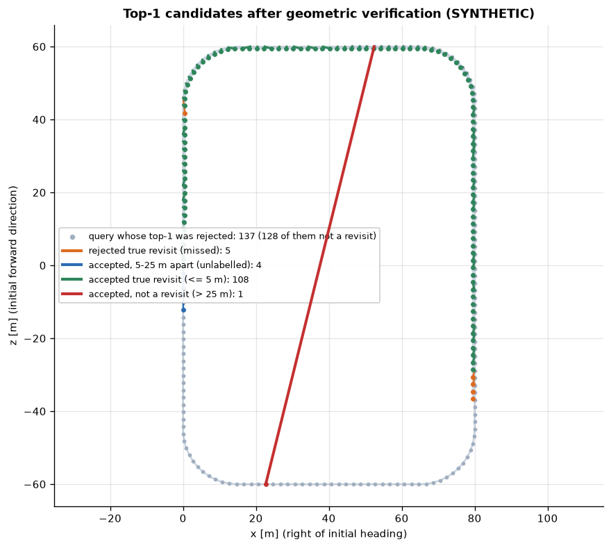

**Geometric verification GIFs.** Each pair is shown in three stages at 8 fps:
1. ratio-tested mutual matches (yellow)
2. RANSAC inliers (green) and outliers (red)
3. the decision, with its reason and the ground-truth annotation

The right panel shows the query and candidate on the trajectory and the decisions so far. The pairs are the gallery examples plus up to 12 evenly spaced labelled rank-1 pairs (duplicates removed), in chronological order: 18 pairs (2.2 MB) for SYNTHETIC, 16 (3.1 MB) for KITTI 00. Each stage is held for several frames; Pillow stores repeated frames once with a longer duration.

| SYNTHETIC | KITTI 00 |
|---|---|
| 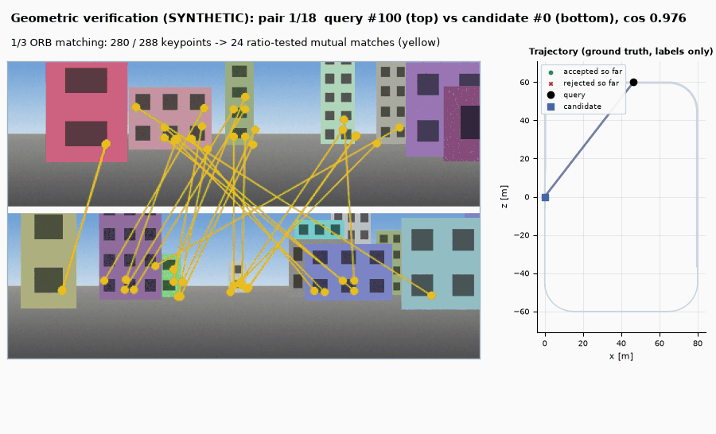 | 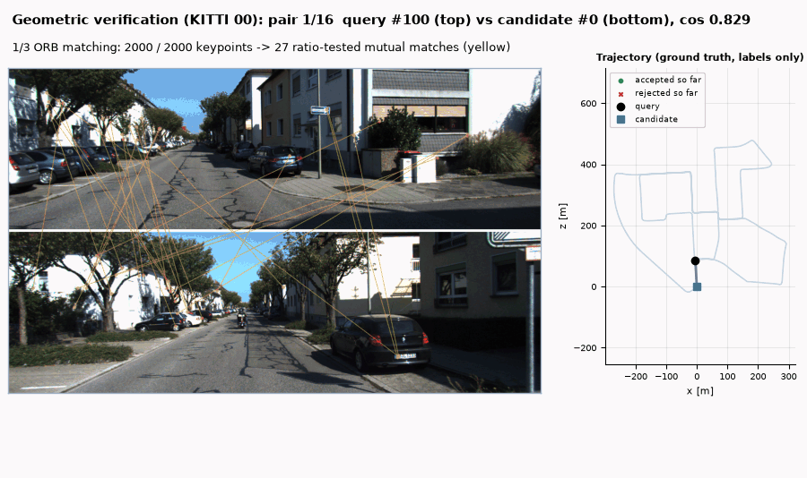 |
