# Phase 5: baseline comparison

[Back to README](../README.md)

## Objective

Compare frozen I-JEPA descriptors with an established self-supervised model (DINOv2 ViT-B/14) and two classical descriptors (HSV colour histograms, ORB bag of visual words). Every method runs through **the same pipeline**:

* the same frames;
* the same `VisualEncoder` interface and embedding cache;
* the same exact cosine search with temporal exclusion (Phase 3);
* the same ground truth and Recall@K code.

Only the descriptor changes.

## DINOv2 representations

DINOv2 (Oquab et al., 2024) is a ViT trained by **self-distillation**. A student network sees several augmented crops of an image, and an EMA teacher sees two global crops. The student is trained to match the teacher's output distributions over $K$ prototypes:

* an image-level loss on the [CLS] token (the DINO objective);
* a patch-level masked-token loss (the iBOT objective);
* KoLeo regularisation, which spreads the features;
* Sinkhorn-Knopp centring of the teacher.

For the image-level part, with student and teacher probabilities $p_s = \mathrm{softmax}(h_s(z)/\tau_s)$ and $p_t = \mathrm{softmax}((h_t(z') - c)/\tau_t)$, the loss is:

```math
\mathcal{L}_{\mathrm{DINO}} = -\sum_{k=1}^{K} p_t^{(k)} \log p_s^{(k)} .
```

The released backbones were trained on LVD-142M, a curated set of 142 M images; ViT-B/14 was distilled from ViT-g/14.

**Architecture used here** (`encoders/dinov2.py`):
* ViT-B/14: width 768, 12 blocks, 12 heads, 86.6 M parameters.
* LayerScale on both residual branches.
* A learnable [CLS] token.
* Learned position embeddings for a 37 × 37 grid (518 px). They are bicubically resized to the input grid with the official +0.1 scale offset.

**Descriptor:** the final-LayerNorm [CLS] token, L2-normalised. `pooling: mean` (patch-token mean) is available as an alternative.

**Weights:** the official `dinov2_vitb14_pretrain.pth`, loaded with `strict=True`.

**Verification:** `scripts/verify_dinov2.py` compared this implementation with Meta's reference code (commit 7764ea0, FP32 on the CPU). The outputs are **bitwise identical**: max absolute difference 0.0 over all tokens, for both 224 × 224 inputs and non-square 224 × 728 inputs. GPU FP32 matches CPU to 6 × 10⁻⁷.

## I-JEPA vs DINOv2: training objectives

| | I-JEPA ViT-H/14 | DINOv2 ViT-B/14 |
|---|---|---|
| Objective | Predict the target encoder's *representations* of masked image blocks from a context block (regression in latent space) | Match teacher and student *distributions* over prototypes for crops (image level) and masked patches (patch level) |
| Augmentations | Random resized crop only | Multi-crop, colour jitter, blur, solarisation, ... |
| Global token | None (patch tokens only; mean-pooled here) | [CLS] token trained by the image-level loss |
| Invariance pressure | Implicit: from predicting semantic block content | Explicit: views of one image must agree |
| Pretraining data | ImageNet-1K (1.28 M images), 300 epochs | LVD-142M (142 M curated images); ViT-B distilled from ViT-g |
| Parameters | 630 M | 87 M |

The two models differ in more than the objective: data scale, model size and distillation all change too. The comparison below is therefore of two **released checkpoints**, not a controlled study of the objectives.

## HSV histogram construction

`encoders/classical.py::HSVHistogramEncoder`:

1. Resize the image to 320 px wide.
2. Convert to HSV (OpenCV: $H \in [0,180)$, $S, V \in [0,256)$).
3. Count a joint 3-D histogram with 16 × 4 × 4 = 256 bins: hue is the most discriminative channel and gets the most bins.
4. Normalise to a probability vector $p$ and store $\sqrt{p}$ (the Hellinger embedding).

Since $\lVert \sqrt{p} \rVert_2 = 1$, cosine similarity equals the **Bhattacharyya coefficient**:

```math
\cos\left(\sqrt{p}, \sqrt{q}\right) = \sum_{i} \sqrt{p_i \, q_i} \in [0, 1].
```

An optional spatial grid (`hsv.grid`) concatenates per-cell histograms. The default is one global histogram, which is invariant to where colours appear in the image.

## ORB bag of visual words

`encoders/classical.py::OrbBoVWEncoder`:

1. Extract 1000 ORB descriptors (256 bits each) per image, at full resolution.
2. **Quantise** each descriptor to the nearest of $K$ = 1000 binary visual words by Hamming distance (FAISS `IndexBinaryFlat`).
3. Count the word histogram $n_w$ and weight it with **tf-idf**: $v_w = (n_w / n) \log(N / \mathrm{df}_w)$, where $n$ is the descriptor count, $N$ the number of vocabulary-fitting images and $\mathrm{df}_w$ the number of those images that contain word $w$.
4. L2-normalise, so retrieval uses cosine similarity. An image without descriptors gets the uniform vector $1/\sqrt{K}$.

## Visual vocabulary fitting (development data only)

`scripts/fit_vocabulary.py` fits the vocabulary with **k-majority clustering**:

1. Unpack each descriptor into 256 bits $b \in \lbrace 0, 1 \rbrace^{256}$. For binary vectors, squared Euclidean distance equals Hamming distance, $\lVert b - b' \rVert_2^2 = d_H(b, b')$.
2. Run k-means (FAISS, 20 iterations, seed 0) on a random sample of at most 200,000 descriptors.
3. Binarise each centroid by majority vote: bit $= 1$ if the mean is at least 0.5.
4. Compute the idf over the fitting images.

The vocabulary file records its sources and a digest. That digest is part of the descriptor-cache fingerprint, so a refit can never reuse stale descriptors.

**Development/test split** (`splits` in `configs/default.yaml`), introduced here because the vocabulary is the first fitted component:

| Role | KITTI sequences | Used for |
|---|---|---|
| Development | 00, 05 | Vocabulary fitting (05 only); design inspection (00, already inspected in Phases 2–4); threshold tuning (Phase 6) |
| Held-out test | 02, 06, 08, 09 | Evaluated once in Phase 6; never used for fitting or tuning |

`vocabulary_plan` raises an error if any fitting sequence is not listed in `splits.dev` or is listed in `splits.test`; a test covers this. If the evaluated sequence is one of the fitting sequences, it is flagged `in_sample`.

* **KITTI vocabulary:** fitted on sequence **05**: 553 frames (every 5th), 552,998 descriptors, 200,000 sampled. All 1000 words are used. It is evaluated on 00, so the KITTI numbers below are *not* in-sample for the vocabulary.
* **Synthetic vocabulary:** fitted on a *different generated city* (seed 11, all 599 frames, 161,108 descriptors). Synthetic frames have few ORB features (about 270 each), so they are not subsampled. The evaluated city is seed 7.

## Experimental fairness

| Factor | Treatment |
|---|---|
| Frames, sampling, temporal exclusion, top-K, ground truth | Identical for all methods; one saved `retrieval.npz` per method in the same format |
| Neural preprocessing | Identical: squash to 224 × 224, ImageNet normalisation, so both use 16 × 16 patches of 14 px |
| Pooling | Each model's natural global descriptor: I-JEPA has no [CLS] token, so it uses the patch mean; DINOv2 uses [CLS]. DINOv2 patch-mean is available but not reported |
| Precision | Both neural models run in FP32 on the GPU (`auto` picks FP32 on the GTX 1650 Ti); DINOv2 GPU vs CPU cosine is 1.0 |
| Classical baselines | Full-resolution input for ORB; vocabulary from development data only |
| Tuning | None: every method uses default settings. Phase 2 found `aspect` preprocessing better than `squash` for I-JEPA on KITTI 00; it is *not* used here, and choosing it belongs to Phase 6, on development data |
| Statistical caveat | One sequence; consecutive queries are correlated, so the paired tests below are optimistic |

## Computational trade-offs

`scripts/profile_encoders.py` measures every encoder under identical conditions:
* the same 64 KITTI 00 frames, held in RAM (I/O excluded);
* sequential model loading;
* one warm-up batch, then batch size 8.

| | I-JEPA ViT-H/14 | DINOv2 ViT-B/14 | ORB bag of words | HSV histogram |
|---|---|---|---|---|
| Device (precision) | GPU (FP32) | GPU (FP32) | CPU | CPU |
| Parameters | 630.4 M | 86.6 M | none (1000 × 256-bit vocabulary) | none |
| Weights / vocabulary file | 2.52 GB | 346 MB | 34 KB | none |
| Input | 224 × 224 (squash) | 224 × 224 (squash) | 1241 × 376, 1000 ORB keypoints | 320 px wide |
| Descriptor | 1280-D float32 (5.1 KB) | 768-D (3.1 KB) | 1000-D (4.0 KB) | 256-D (1.0 KB) |
| Encoding time per image | **215 ms** | 35 ms | 11 ms | 1.6 ms |
| Peak GPU memory | 2585 MB | 401 MB | 0 | 0 |
| Model load time (from `/mnt/e`) | 74 s | 9.7 s | 0.1 s | 0 |

Search cost is negligible for all methods at this scale: 0.05–0.21 ms per query with exact FAISS search on the CPU.

## Implementation map

| File | Contents |
|---|---|
| `src/latent_loop/encoders/dinov2.py` | `DinoViT` (LayerScale blocks, [CLS], interpolated pos-embed), `DINOv2Encoder`, `CHECKPOINTS`, `write_sidecar` |
| `src/latent_loop/encoders/classical.py` | `HSVHistogramEncoder`, `Vocabulary`, `fit_vocabulary` (k-majority + idf), `OrbBoVWEncoder`, `vocabulary_plan` (development-only guard) |
| `src/latent_loop/encoders/__init__.py` | `build_encoder` for `ijepa`, `dinov2`, `hsv`, `orb_bovw` |
| `src/latent_loop/visualization/baselines.py`, `phase5.py` | Comparison figures and GIF |
| `scripts/verify_dinov2.py`, `fit_vocabulary.py`, `profile_encoders.py` | Reference check, vocabulary fitting, cost profile |
| `scripts/download_checkpoints.py dinov2` | Download or reuse the checkpoint; record its SHA-256 |
| `configs/dinov2.yaml`; `splits`, `hsv`, `orb_bovw`, `extraction`, `device` in `configs/default.yaml` | Configuration |

## Steps to run Phase 5

All commands run from the repository root with `.env` active and `PYTHONPATH` unset. KITTI commands use `--set dataset.name=kitti dataset.root=data/raw/kitti/dataset "dataset.sequence='00'"`, abbreviated below as `$KITTI00`:

```bash
KITTI00="dataset.name=kitti dataset.root=data/raw/kitti/dataset dataset.sequence='00'"

# 1. DINOv2 ViT-B/14 checkpoint (346 MB; reused if present) and SHA-256 sidecar
python scripts/download_checkpoints.py dinov2 --name vitb14

# 2. Check the DINOv2 implementation against Meta's code (~1 min; writes results/metrics/dinov2_verification.json)
git clone --depth 1 https://github.com/facebookresearch/dinov2 /tmp/dinov2_official
python scripts/verify_dinov2.py --official-repo /tmp/dinov2_official

# 3. Fit the ORB vocabularies on development data only (synthetic: seed-11 city, ~30 s;
#    KITTI: sequence 05, ~2 min). A test sequence in orb_bovw.fit_kitti_sequences is refused.
python scripts/fit_vocabulary.py
python scripts/fit_vocabulary.py --set $KITTI00

# 4. Descriptors + retrieval + causal-replay check for each baseline (extracts if not cached)
for enc in hsv orb_bovw; do
  python scripts/run_retrieval.py --config configs/default.yaml --encoder $enc --stride 2 --check-causal
  python scripts/run_retrieval.py --config configs/default.yaml --encoder $enc --stride 5 --check-causal --set $KITTI00
done
python scripts/run_retrieval.py --config configs/dinov2.yaml --encoder dinov2 --stride 2 --check-causal
python scripts/run_retrieval.py --config configs/dinov2.yaml --encoder dinov2 --stride 5 --check-causal --set $KITTI00
#    (I-JEPA results come from Phase 3; its cache fingerprint d49bc21384 is unchanged.)

# 5. Encoder cost profile (64 frames in RAM; GPU for the neural models; ~3 min)
python scripts/profile_encoders.py --stride 2 --frames 64
python scripts/profile_encoders.py --stride 5 --frames 64 --set $KITTI00

# 6. Phase 5 figures and GIF (~2.5 min each). The KITTI GIF uses 64 frames, 800 px and
#    128 colours to stay under 10 MB (five photographs per frame compress poorly).
python scripts/generate_visualizations.py --phase 5 --max-frames 80
python scripts/generate_visualizations.py --phase 5 --stride 5 --max-frames 64 \
    --gif-width 800 --gif-colors 128 --set $KITTI00

# 7. Tests
python -m pytest tests/test_baselines.py tests/test_baseline_plots.py
```

The `KITTI00` variable is expanded unquoted so that `--set` receives three separate arguments; the inner single quotes keep the sequence a string. The runs below used the equivalent explicit form (`--set dataset.name=kitti dataset.root=data/raw/kitti/dataset "dataset.sequence='00'"`). The variable form was checked separately and reproduces identical results.

## Phase 5 results

**Setup.**
* SYNTHETIC: every 2nd frame, 300 queries. KITTI 00: every 5th frame, 909 queries.
* Top-10 retrieval, temporal exclusion 100 frames, revisit ≤ 5 m.
* I-JEPA and DINOv2 descriptors from the **GPU (FP32)**; I-JEPA's SYNTHETIC cache dates from Phase 2 (GPU FP16).
* HSV and ORB bag of words on the **CPU**. Retrieval and metrics on the **CPU**.
* Offline and causal-replay retrieval gave identical candidates for every method.

**KITTI 00 (development sequence), preliminary Recall@K on positive queries:**

| Method | R@1 / R@5 / R@10, distance-only (162 queries) | R@1 / R@5 / R@10, same direction (150) | Pair ROC AUC | Encoding time per image |
|---|---|---|---|---|
| I-JEPA ViT-H/14 | 0.778 / 0.877 / 0.889 | 0.840 / 0.947 / 0.960 | 0.834 | 215 ms (GPU) |
| DINOv2 ViT-B/14 | 0.895 / **0.920** / 0.920 | 0.967 / **0.993** / 0.993 | 0.950 | 35 ms (GPU) |
| ORB bag of words | **0.901** / 0.914 / **0.932** | **0.973** / 0.987 / **1.000** | **0.959** | 11 ms (CPU) |
| HSV histogram | 0.852 / 0.901 / 0.907 | 0.920 / 0.973 / 0.973 | 0.888 | 1.6 ms (CPU) |

**SYNTHETIC:**

| Method | R@1 / R@5 / R@10 (115 queries; both definitions identical) | Pair ROC AUC |
|---|---|---|
| I-JEPA ViT-H/14 | 0.983 / 1.000 / 1.000 | 0.985 |
| DINOv2 ViT-B/14 | 0.983 / 1.000 / 1.000 | 0.960 |
| ORB bag of words | 0.991 / 1.000 / 1.000 | 0.996 |
| HSV histogram | 1.000 / 1.000 / 1.000 | 0.998 |

"Pair ROC AUC" separates the cosines of all eligible true-revisit pairs (≤ 5 m) from non-revisit pairs (> 25 m). These are retrieval checks on one development sequence, not loop-closure detection results.

**Reading the numbers.**
* **On KITTI 00, I-JEPA retrieves worse than every baseline at K = 1.** In paired comparisons on the 162 positive queries:
  * DINOv2 is right where I-JEPA is wrong 21 times, and the reverse happens 2 times (exact McNemar p = 6.6 × 10⁻⁵).
  * For ORB bag of words the counts are 21 vs 1 (p = 1.1 × 10⁻⁵).
  * DINOv2 and ORB bag of words are statistically indistinguishable (3 vs 4, p = 1.0).
  * Consecutive queries are correlated, so these p-values overstate the evidence. The direction is nevertheless consistent across K and both ground-truth definitions.
* **I-JEPA's cosines are compressed.** Its non-revisit pairs have a median cosine of 0.75 and a 99th percentile of 0.94, against 0.95 for true revisits. Confident wrong candidates are therefore common, as Phase 3 found. DINOv2's [CLS] token separates the two populations much better (AUC 0.95 vs 0.83).
* **The gap narrows at higher K.** I-JEPA's Recall@10 (0.889) is within 1.8–4.3 points of the others, so many I-JEPA misses are near misses. Phase 4 geometric verification can recover some of these from the top-5.
* **Cost.** I-JEPA ViT-H/14 is 6× slower than DINOv2 ViT-B/14 and uses 6.4× more GPU memory, for a lower Recall@1 here.
* **SYNTHETIC is too easy to rank methods.** Every building in the procedural city has a unique flat colour, so a global colour histogram alone reaches Recall@1 = 1.0. Differences of one or two queries out of 115 are not meaningful.
* **Not tuned.** All four methods use defaults. Most importantly, I-JEPA uses `squash`, although Phase 2 measured `aspect` as better on this sequence. Phase 6 will choose preprocessing, pooling and thresholds on the development sequences (00, 05), and then evaluate once on the held-out sequences (02, 06, 08, 09) with detection metrics. **No claim that any method is generally better follows from these numbers.**

**Preliminary Recall@K.** Curves use a shared axis from 0.5, and the bars start at 0.

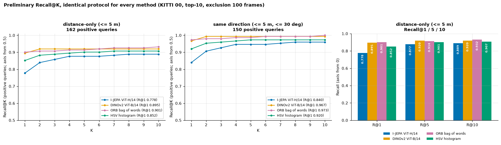
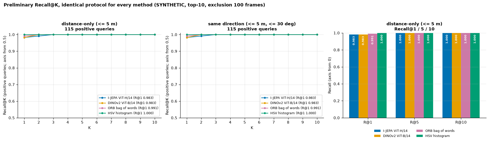

**Embedding similarity comparisons.**
* Top: each method's cosine similarity for eligible pairs, each on its own colour scale (1st to 99.9th percentile), because the methods' similarity ranges differ.
* Bottom: cosine distributions of true-revisit and non-revisit pairs, with the ROC AUC.

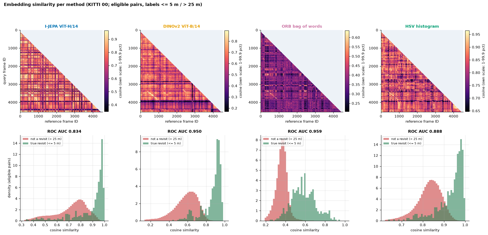
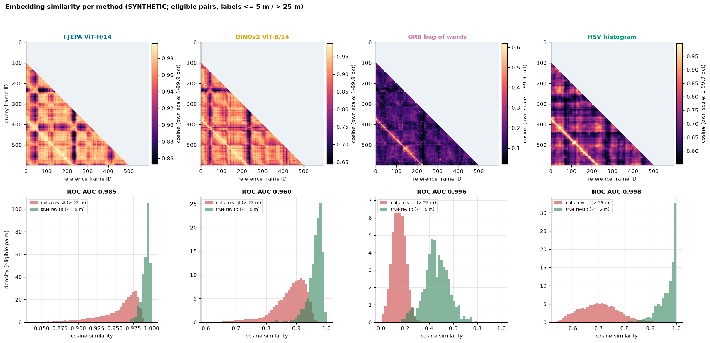

**Qualitative successes and failures.** Rows are chosen deterministically by case, using the highest I-JEPA top-1 cosine within each case. Each row shows the query (black) and every method's top-1 candidate (green = true revisit). Query #600 is the Phase 3 aliasing example: every method returns a false candidate 132–235 m away.

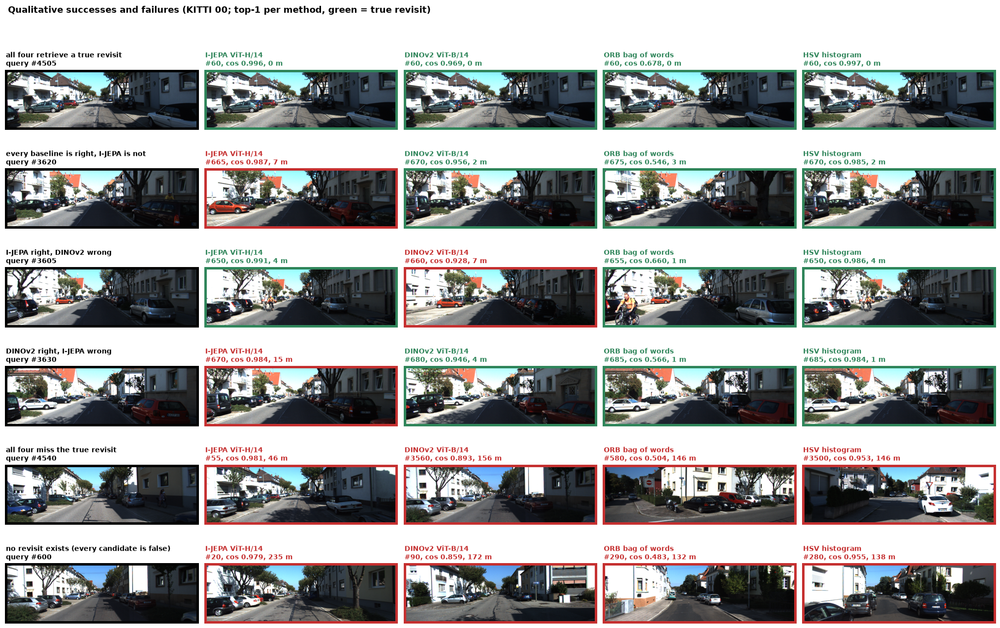
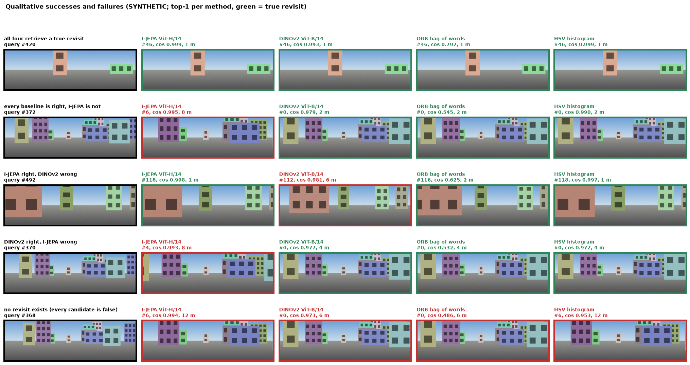

**Side-by-side retrieved images (top-3 per method).** Query 1 is a revisit that every method gets right. Query 2 is one where I-JEPA and the baselines disagree.

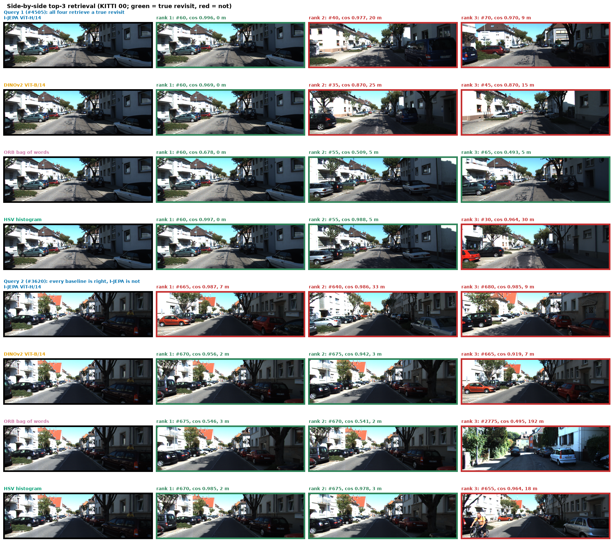
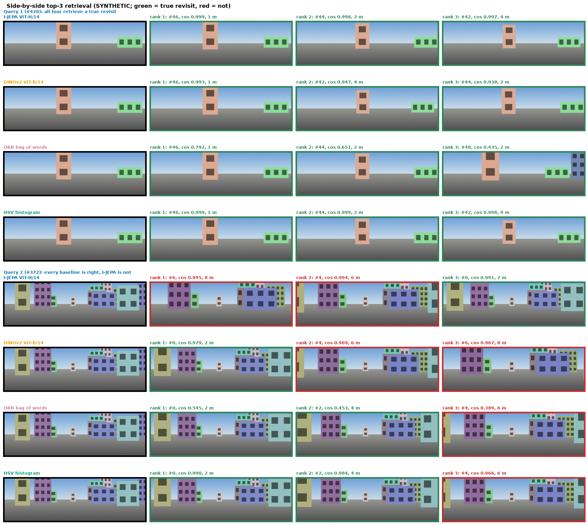

**Computational trade-offs** (from `results/metrics/encoder_profile_kitti_00_cam2.json`):

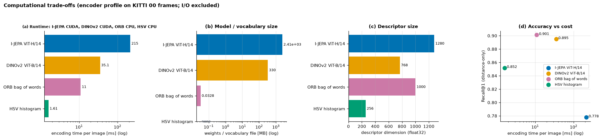

**Side-by-side retrieval GIFs.** Each frame shows:
* the query (top left);
* each method's top-1 eligible candidate in a 2 × 2 grid, with a green or red border for the ground-truth verdict and a running Recall@1 over the positive queries seen so far;
* the trajectory, with each method's candidate position in its colour.

SYNTHETIC: 80 evenly spaced queries, 900 px, 8.1 MB. KITTI 00: 64 queries, 800 px, 128 colours, 9.0 MB. Both at 8 fps.

| SYNTHETIC | KITTI 00 |
|---|---|
| 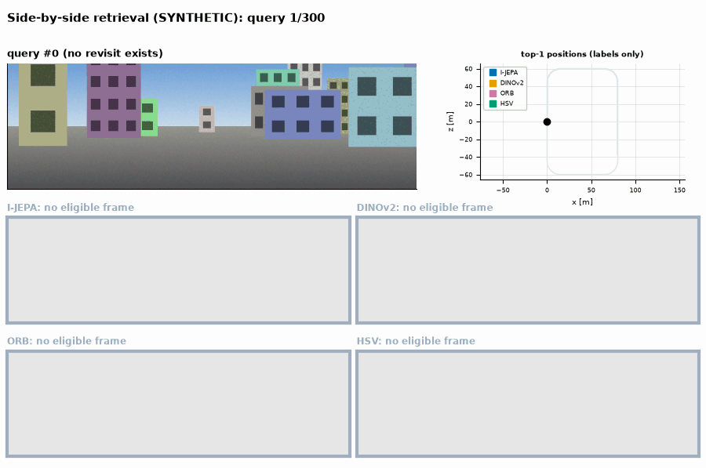 | 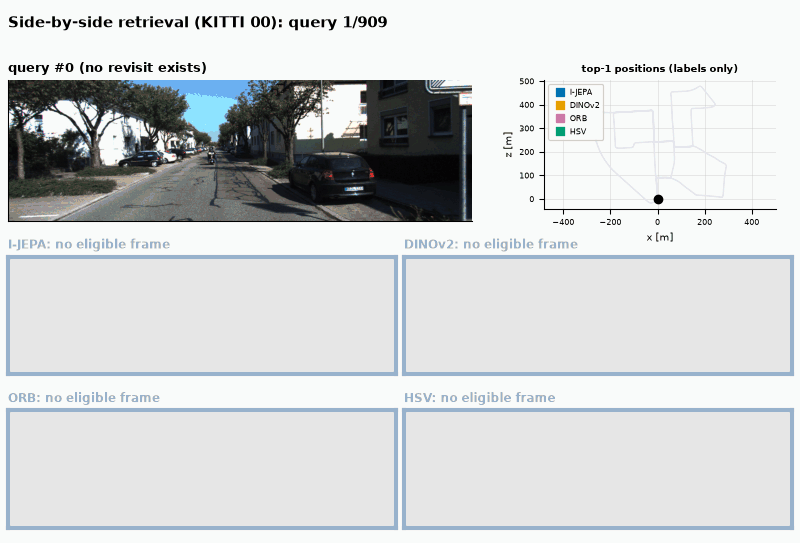 |
