# Phase 6: benchmarking and evaluation

[Back to README](../README.md)

## Objective

Measure place recognition and loop-closure detection for six configurations under one protocol:
* I-JEPA retrieval, and I-JEPA + geometric verification (GV);
* DINOv2 retrieval, and DINOv2 + GV;
* ORB bag of words;
* HSV histogram.

All choices are made on development sequences. The held-out sequences are evaluated **once**, with those choices frozen.

## Experimental protocol

`scripts/run_benchmark.py` (`src/latent_loop/evaluation/runner.py`) runs two stages, and the code enforces their order:

1. **Development stage** (KITTI 00, 05):
   * Descriptors and retrieval for every method, and for each preprocessing variant of the neural encoders (`squash` or `aspect`).
   * **Variant selection** per encoder by pooled development retrieval mAP, written to `selection.json`.
   * Geometric verification of the top-5 candidates for the "+ GV" methods.
   * **Threshold selection** per method on the pooled development PR curve, written to `thresholds.json`.
2. **Test stage** (KITTI 02, 06, 08, 09):
   * Refuses to run without `selection.json` and `thresholds.json`, and refuses overlapping splits.
   * Recomputes nothing that could be tuned.
   * Reports every metric at the development thresholds.

Shared settings:
* every 5th frame on every sequence (2 Hz), left colour camera (`image_2`);
* top-10 exact cosine retrieval with a 100-frame temporal exclusion;
* causal replay (identical candidates to offline retrieval, and it gives per-query timing);
* verification of the top 5 with the Phase 4 checks.

**Detector output.** Each method emits at most one loop-closure hypothesis per query:

| Method type | Hypothesis | Score |
|---|---|---|
| Retrieval only | rank-1 candidate | its cosine similarity |
| + GV | among the top-5 candidates that pass every geometric check (ratio, coverage, degeneracy policy), the one with the most RANSAC inliers | its inlier count |

For "+ GV", the verification minimum is set to `min_inliers: 0`, because the inlier threshold *is* the detection threshold and is chosen on development data. The loop is predicted when score ≥ τ.

## Dataset splits

| Split | Sequences | Frames used (every 5th) | Used for |
|---|---|---|---|
| Development | 00, 05 | 909 + 553 | preprocessing selection, thresholds, ORB vocabulary (05), earlier design inspection (00) |
| Held-out test | 02, 06, 08, 09 | 933 + 221 + 815 + 319 | one final evaluation |

These six sequences are the KITTI odometry sequences with substantial revisits. 08 revisits most places in the **opposite direction**, which a forward camera sees as a different scene.

## Ground-truth definitions

For evaluation only, reference $r$ is a **true revisit** of query $q$ iff $f_r \le f_q - 100$ (original frame IDs, i.e. at least 10 s earlier) and $\lVert p_q - p_r \rVert_2 \le 5$ m on the ground plane. A **positive query** has at least one eligible true revisit; $Q^+$ is the set of positive queries. A predicted loop is **correct** iff its candidate is a true revisit of the query. A prediction 5–25 m away counts as wrong, and is reported separately as a "near" false positive, because Phase 4 showed that such pairs often share real visual overlap. Recall@1 is also reported under the same-direction definition (heading difference ≤ 30°).

## Metric equations

**Retrieval (positive queries only).** Ranking quality is measured on $Q^+$; queries without a revisit cannot be answered correctly by retrieval.

```math
\mathrm{R@}K = \frac{1}{\lvert Q^{+}\rvert} \sum_{q \in Q^{+}} \mathbb{1}\left[\mathcal{C}_K(q) \cap P(q) \neq \emptyset\right],
\qquad
\mathrm{AP}(q) = \frac{1}{\lvert P(q)\rvert} \sum_{k=1}^{n_q} \mathrm{Prec@}k(q)\, \mathrm{rel}_k(q),
\qquad
\mathrm{mAP} = \frac{1}{\lvert Q^{+}\rvert} \sum_{q \in Q^{+}} \mathrm{AP}(q),
```

where $\mathcal{C}_K(q)$ is the top-K list, $P(q)$ the true revisits, and AP ranks **all** $n_q$ eligible references of $q$.

**Detection (all queries with at least one eligible reference).** With $N$ evaluable queries and threshold τ:

```math
\mathrm{TP} = \#\{q : s_q \ge \tau,\ \hat r_q \in P(q)\}, \quad
\mathrm{FP} = \#\{q : s_q \ge \tau,\ \hat r_q \notin P(q)\}, \quad
\mathrm{FN} = \lvert Q^{+}\rvert - \mathrm{TP},
```

```math
\mathrm{Precision} = \frac{\mathrm{TP}}{\mathrm{TP}+\mathrm{FP}}, \quad
\mathrm{Recall} = \frac{\mathrm{TP}}{\lvert Q^{+}\rvert}, \quad
F_1 = \frac{2\,\mathrm{TP}}{2\,\mathrm{TP}+\mathrm{FP}+\mathrm{FN}}, \quad
\mathrm{FP}/1000 = \frac{1000\,\mathrm{FP}}{N}.
```

A positive query with a *wrong* loop counts as both an FP and an FN. Queries without a revisit enter only through FP and TN. The **confusion matrix** has rows "has revisit" and "no revisit", and columns "correct loop", "wrong loop" and "no loop".

**Detection AP** is the step-wise area under the pooled PR curve over all distinct thresholds, $\sum_i P_i (R_i - R_{i-1})$. It can stay below 1 even for a perfect ranking, because recall is capped by queries whose hypothesis is wrong. The implementation is checked against a brute-force evaluation of every threshold (`tests/test_benchmark.py`).

## Threshold selection

On the pooled development predictions, two thresholds are chosen:
* τ maximising F1 (the highest such τ on ties) is the **operating threshold** applied to the test sequences;
* τ₁₀₀, the lowest threshold whose precision on development data is still 1.0, is also reported, because a SLAM back-end usually needs near-zero false loops.

Neither threshold, nor the preprocessing variant, ever sees test data.

## Computational measurements

| Quantity | How it is measured |
|---|---|
| Encoder latency, peak GPU memory, host-RAM increase | `scripts/profile_encoders.py --tag benchmark`: the selected variants on the same 64 KITTI 00 frames held in RAM; sequential loading, warm-up, batch 8. GPU for the neural encoders, CPU for the classical ones |
| Retrieval latency | Causal replay on the test sequences: per-query FAISS search plus insertion of the frame (CPU) |
| Verification latency | ORB extraction of the query frame (including the image read) plus matching, RANSAC, pose and homography for its 5 candidate pairs (CPU; measured inside parallel workers on the test sequences) |
| End-to-end latency | encoder + retrieval + verification per query (single-frame streaming estimate) |
| Embedding storage | float32 descriptor bytes × test frames |

## Implementation map

| File | Contents |
|---|---|
| `src/latent_loop/evaluation/benchmark.py` | `average_precision_ranked`, `retrieval_average_precision` (full eligible ranking), `Predictions`, `make_predictions`, `detection_at` (P, R, F1, FP/1000, confusion), `pr_curve` (+ detection AP), `select_threshold` |
| `src/latent_loop/evaluation/runner.py` | `Benchmark` (`run_dev`, `run_test`), `sequence_config`, `with_variant`, `efficiency_table` |
| `src/latent_loop/verification/parallel.py` | `verify_pairs` (process pool, per-config pair cache), `pairs_from_candidates` |
| `src/latent_loop/visualization/evaluation.py`, `phase6.py` | Phase 6 figures and playback GIF |
| `scripts/run_benchmark.py`, `configs/benchmark.yaml` | Benchmark CLI and configuration |

**Outputs** go to `results/benchmark/kitti_stride5/`:
* `selection.json`, `thresholds.json`;
* `{dev,test}_metrics.{csv,json}`: one row per method × sequence, plus a pooled row;
* `curves/{dev,test}/<method>.npz`;
* `predictions/{dev,test}/<method>_<seq>.csv`: one hypothesis per query, with ground-truth columns;
* `test_timing.json`, `efficiency.{csv,json}`;
* `pair_cache/`: verified pairs per sequence and config hash.

## Steps to run Phase 6

All commands run from the repository root with `.env` active and `PYTHONPATH` unset. The ORB vocabulary (Phase 5, step 3) must exist. Descriptors are extracted on demand, so the first run extracts every development and test sequence: about 2–2.5 h here on the GTX 1650 Ti, dominated by I-JEPA in `aspect` mode and image reads from `/mnt/e`. With the sampled frames staged to a local disk, the full Phase 6 run from empty caches took 1 h 53 min (development 47 min, profile 5 min, test 60 min; [Phase 8](phase8_integration.md#full-pipeline-re-run)).

```bash
# 1. Development stage: variant selection, verification, thresholds (18 min with cached 00 descriptors)
python scripts/run_benchmark.py --stage dev
#    -> results/benchmark/kitti_stride5/{selection.json, thresholds.json, dev_metrics.csv, ...}

# 2. Encoder cost of the selected variants (idle GPU; 64 KITTI 00 frames in RAM; ~3 min)
python scripts/profile_encoders.py --config configs/benchmark.yaml --tag benchmark --stride 5 \
    --frames 64 --set dataset.name=kitti dataset.root=data/raw/kitti/dataset \
    "dataset.sequence='00'" ijepa.resize_mode=aspect dinov2.resize_mode=aspect

# 3. Test stage: frozen evaluation on 02, 06, 08, 09 (about 20 min of verification with
#    6 workers; under 1 min when descriptors and verified pairs are cached)
python scripts/run_benchmark.py --stage test
#    options: --workers N   --stage all   --set benchmark.verify_top_k=3 ...

# 4. Figures and playback GIFs (~2.5 min each; --gif-sequence picks the test sequence)
python scripts/generate_visualizations.py --phase 6 --gif-sequence 08
python scripts/generate_visualizations.py --phase 6 --gif-sequence 06

# 5. Tests
python -m pytest tests/test_benchmark.py
```

The test descriptors used below were extracted ahead of step 3 with `scripts/extract_embeddings.py --config configs/benchmark.yaml --encoder <name> --stride 5 --set ... ijepa.resize_mode=aspect` (and likewise for `dinov2.resize_mode=aspect`). These produce the same cache fingerprints the test stage uses; step 3 extracts them itself if they are missing.

## Phase 6 results

**Setup.**
* Every 5th frame of each sequence; left colour camera.
* Descriptors: I-JEPA ViT-H/14 and DINOv2 ViT-B/14 on the **GPU (FP32)**; HSV and ORB bag of words on the **CPU**.
* Retrieval (exact FAISS) and geometric verification (OpenCV, 6 processes) on the **CPU**.
* Development: 1,422 queries, 251 with a revisit. Test: 2,208 queries, 190 with a revisit.

**Selected on development data:**

| | Choice | Development evidence |
|---|---|---|
| I-JEPA preprocessing | `aspect` | pooled retrieval mAP 0.634 vs 0.587 for `squash` |
| DINOv2 preprocessing | `aspect` | 0.804 vs 0.798 |
| Operating threshold (max F1) | I-JEPA 0.968, DINOv2 0.923, ORB BoW 0.550, HSV 0.967 (cosine); I-JEPA + GV 133, DINOv2 + GV 172 (inliers) | development F1: 0.748, 0.890, 0.734, 0.716; 0.921, 0.933 |

**Held-out test results (pooled over 02, 06, 08, 09; development thresholds).**

| Method | R@1 | R@5 | R@10 | R@1 same direction (109 queries) | mAP | Detection AP | Precision | Recall | **F1** | TP / FP / FN | FP per 1,000 |
|---|---|---|---|---|---|---|---|---|---|---|---|
| I-JEPA | 0.500 | 0.558 | 0.568 | 0.872 | 0.466 | 0.469 | 0.422 | 0.484 | 0.451 | 92 / 126 / 98 | 57.1 |
| I-JEPA + GV | (same retrieval) | | | | | 0.549 | **0.980** | **0.511** | **0.671** | 97 / 2 / 93 | **0.9** |
| DINOv2 | 0.526 | 0.574 | 0.579 | 0.899 | **0.521** | 0.478 | 0.962 | 0.400 | 0.565 | 76 / 3 / 114 | 1.4 |
| DINOv2 + GV | (same retrieval) | | | | | **0.550** | **0.980** | **0.511** | **0.671** | 97 / 2 / 93 | **0.9** |
| ORB bag of words | **0.563** | 0.568 | 0.589 | **0.954** | 0.496 | 0.405 | 0.629 | 0.384 | 0.477 | 73 / 43 / 117 | 19.5 |
| HSV histogram | 0.537 | **0.589** | **0.605** | 0.917 | 0.507 | 0.485 | 0.340 | 0.505 | 0.407 | 96 / 186 / 94 | 84.2 |

At the stricter development threshold for 100 % precision, test recall and precision are:

| Method | Recall | Precision |
|---|---|---|
| I-JEPA + GV | 0.479 | 0.989 |
| DINOv2 + GV | 0.405 | 0.987 |
| I-JEPA | 0.321 | 0.984 |
| DINOv2 | 0.163 | 1.000 |
| HSV | 0.347 | 0.971 |
| ORB bag of words | 0.021 | 1.000 |

**Per-sequence detection F1 (test):**

| Method | 02 (63 revisit queries) | 06 (54) | 08 (69, all opposite direction) | 09 (4) |
|---|---|---|---|---|
| I-JEPA | 0.503 | 0.624 | 0.000 | 0.857 |
| I-JEPA + GV | 0.815 | **0.962** | 0.000 | 0.667 |
| DINOv2 | 0.680 | 0.833 | 0.000 | 0.857 |
| DINOv2 + GV | **0.826** | **0.962** | 0.000 | 0.400 |
| ORB bag of words | 0.569 | 0.839 | 0.000 | 0.200 |
| HSV histogram | 0.429 | 0.829 | 0.000 | 0.000 |

**Computational measurements** (encoder: `profile_encoders.py`; retrieval and verification: measured on the test sequences with 8 CPU workers; all from the complete re-run in [Phase 8](phase8_integration.md#full-pipeline-re-run), which reproduced every accuracy number above exactly):

| Method | Encoder (device) | Retrieval / query | Verification / query (CPU) | End-to-end / query | Peak GPU | Host RAM increase | Test descriptors |
|---|---|---|---|---|---|---|---|
| I-JEPA (`aspect`) | 834 ms (GPU) | 0.23 ms | none | 835 ms | 2853 MB | 373 MB | 11.2 MB (1280-D) |
| I-JEPA + GV | 834 ms (GPU) | 0.23 ms | 1468 ms | 2303 ms | 2853 MB | 373 MB | 11.2 MB |
| DINOv2 (`aspect`) | 114 ms (GPU) | 0.16 ms | none | 114 ms | 567 MB | 274 MB | 6.7 MB (768-D) |
| DINOv2 + GV | 114 ms (GPU) | 0.16 ms | 1428 ms | 1542 ms | 567 MB | 274 MB | 6.7 MB |
| ORB bag of words | 9.2 ms (CPU) | 0.18 ms | none | 9.4 ms | none | 1.9 MB | 8.7 MB (1000-D) |
| HSV histogram | 1.8 ms (CPU) | 0.12 ms | none | 1.9 ms | none | 0.5 MB | 2.2 MB (256-D) |

### Results interpretation

* **Geometric verification is what makes a detector usable.** At the development thresholds, every retrieval-only method except DINOv2 produces tens of false loops per 1,000 test queries: I-JEPA 57, HSV 84, ORB bag of words 19. With GV, I-JEPA drops to 0.9 FP per 1,000 (126 → 2 false loops) and finds slightly more correct loops (92 → 97). For DINOv2, GV adds 21 correct loops at the same false-alarm level. In a paired test over the 190 positive queries, DINOv2 + GV is right where DINOv2 is wrong 27 times, and the reverse 6 times (exact McNemar p = 3 × 10⁻⁴).
* **With GV, I-JEPA and DINOv2 are indistinguishable here.** Both reach F1 0.671 with 97 correct and 2 wrong loops; they agree on 98 % of the positive test queries (2 vs 2 discordant). Their detection APs differ by 0.001. DINOv2 achieves this with an encoder 7× faster (114 vs 834 ms) using 5× less GPU memory.
* **Without GV, DINOv2 is the most reliable retrieval-only detector** (precision 0.96 at its development threshold), and I-JEPA the least reliable among the neural ones (precision 0.42). I-JEPA's development threshold (cosine 0.968) does not transfer: on test it admits many confident wrong candidates, whose cosine distribution is compressed near 1 (see Phase 5).
* **Retrieval ranks the methods differently from detection.** At rank 1 the classical ORB bag of words is best on test (R@1 0.563; same-direction 0.954). On the paired test queries it beats I-JEPA (13 vs 1, p = 0.002). The I-JEPA vs DINOv2 difference at rank 1 is not significant (5 vs 10, p = 0.30).
* **Conclusions on JEPA.** On these sequences, frozen I-JEPA descriptors with geometric verification match DINOv2 with geometric verification for loop detection. Without verification, I-JEPA is worse than DINOv2. It is also several times more expensive. **No result here shows I-JEPA outperforming the baselines.**

### Failure analysis

* **KITTI 08: opposite-direction revisits.** All 69 revisit queries of 08 pass places in the opposite direction, and none has a same-direction revisit. Every method scores F1 0 there; I-JEPA top-1 retrieval is 0 / 69. A forward camera sees a different scene, and neither global descriptors nor ORB matching can recover it. 08 contributes 36 % of the test revisit queries, which is the main reason test recall (0.51 at best) is far below development recall (0.86–0.89 for the GV methods). Excluding 08 (a secondary analysis, not the primary result), both GV methods reach F1 0.882.
* **Crossing revisits.** In 02, 12 of the 63 revisit queries cross an earlier path at a different heading (51 same-direction). These are mostly missed.
* **False positives are near misses.** Both remaining false loops of each GV method connect frames 5–8 m apart that show the same street (see the examples). By the 5 m definition they are wrong. A metric-pose back-end might accept them, but this verification estimates no scale (Phase 4).
* **Few-revisit sequences are noisy.** 09 has only 4 revisit queries, so its per-sequence F1 changes by 0.2–0.5 per query. I-JEPA + GV 0.667 vs DINOv2 + GV 0.400 there is one or two queries.
* **Threshold transfer.** Development F1 thresholds of the cosine-scored methods transfer poorly: I-JEPA, HSV and ORB bag of words over-accept on 02 (precision 0.39, 0.29 and 0.62). Inlier-count thresholds transfer well: precision is 0.98–0.995 on development and 0.98 on test.

### Limitations

* **Small test set.** 190 test revisit queries, dominated by 02, 06 and 08. Consecutive queries are correlated, so the McNemar p-values above overstate the evidence.
* **Settings.** One camera (left colour), every 5th frame, one ground-truth radius (5 m), top-5 verification and default verification checks. Only the preprocessing variant and the detection threshold were tuned, both on development data.
* **ORB vocabulary.** It was fitted on development sequence 05. Its development metrics on 05 are in-sample; its test metrics are not.
* **Latency estimates.** Verification latency was measured inside 8 parallel worker processes on 8 cores, with images on a local disk. Per query it was about 11 % higher than in the first run (6 workers, images on `/mnt/e`), so CPU contention matters more than disk reads; a single dedicated process would be faster. The End-to-end column sums per-stage means for streaming one frame at a time, and assumes the earlier frames' ORB features are cached.
* **No back-end.** No pose-graph optimisation or trajectory error is evaluated; detected loops are not used for SLAM here.

**Detection precision-recall curves** (pooled; one hypothesis per query). Left: development, where the thresholds were chosen. Right: test, with dots at the operating point given by the development threshold.

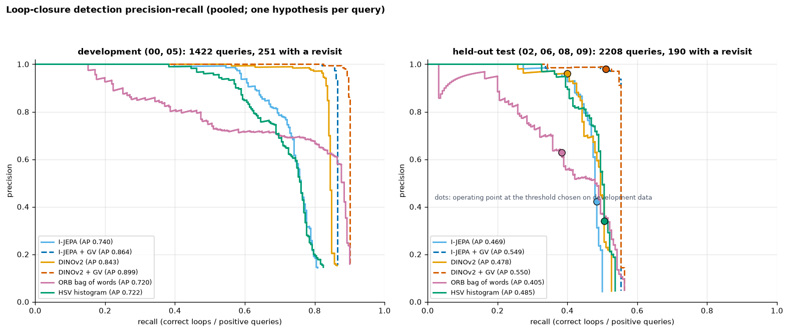

**Recall@K and mAP on the test set** (retrieval methods only; GV does not change retrieval):

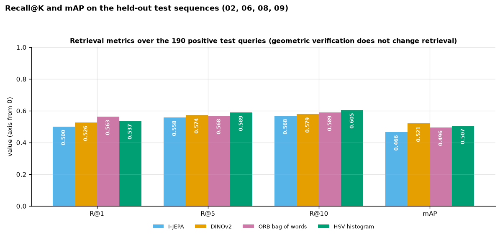

**F1 comparison**: per test sequence and pooled, with pooled precision against recall, and false alarms per 1,000 queries:

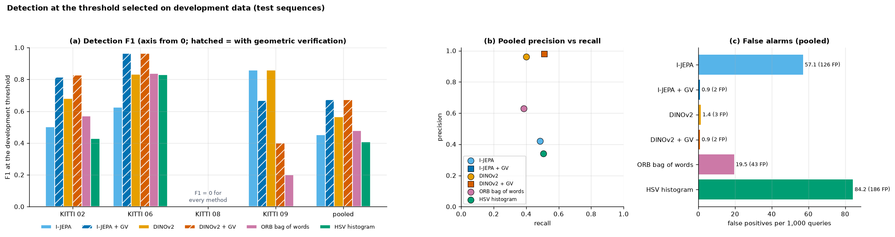

**Query-level confusion matrices** (pooled test). Rows: query has a revisit or not. Columns: correct loop, wrong loop, no loop.

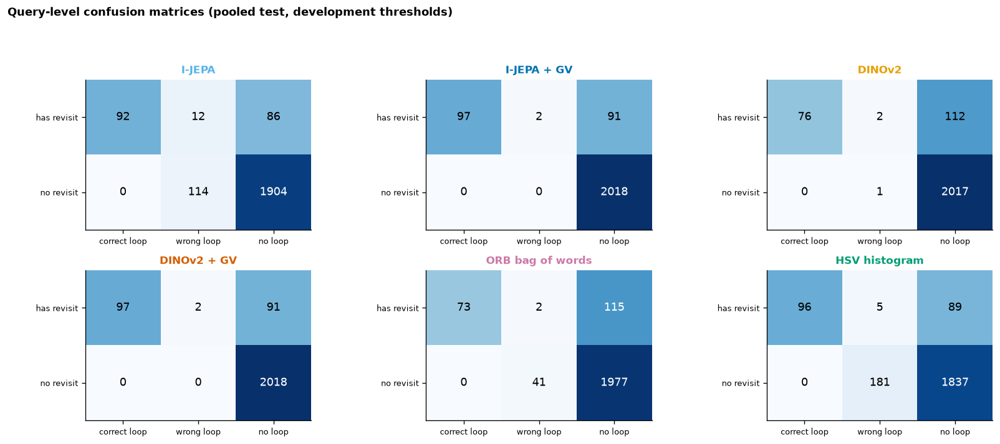

**Runtime and memory** (encoder: GPU for I-JEPA and DINOv2, CPU for the classical baselines; retrieval and verification on the CPU):

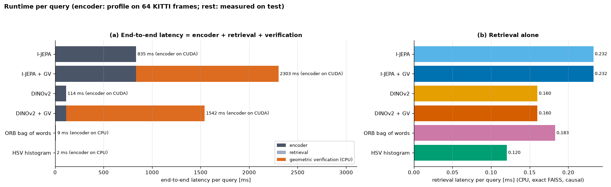
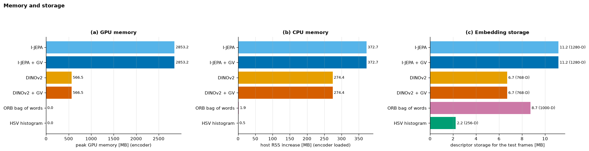

**Trajectory loop-closure plots** (test sequences; development thresholds). Green: correct predicted loop. Red: wrong loop. Orange ×: revisit query without a correct loop.

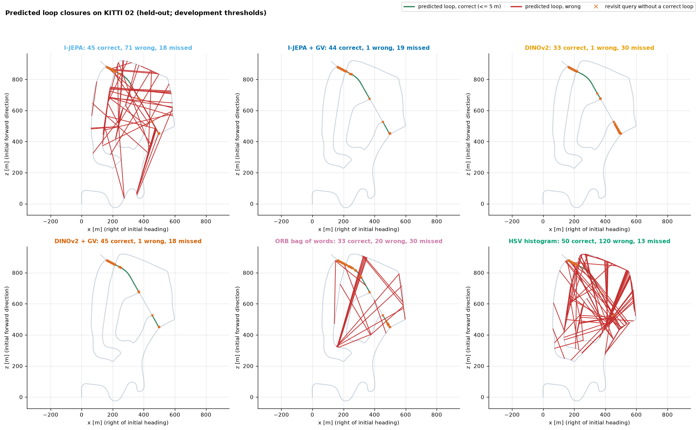
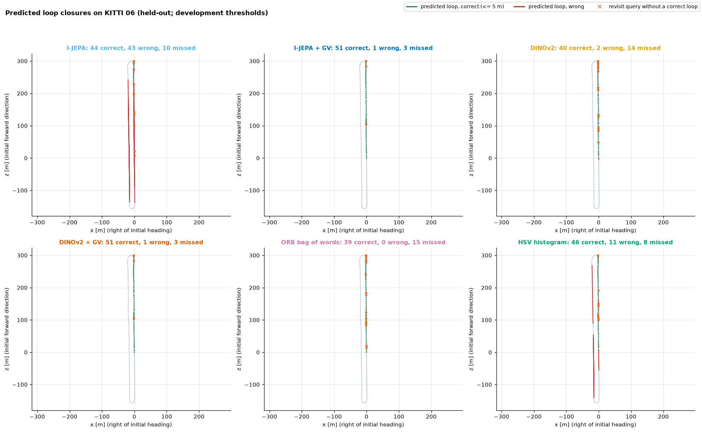
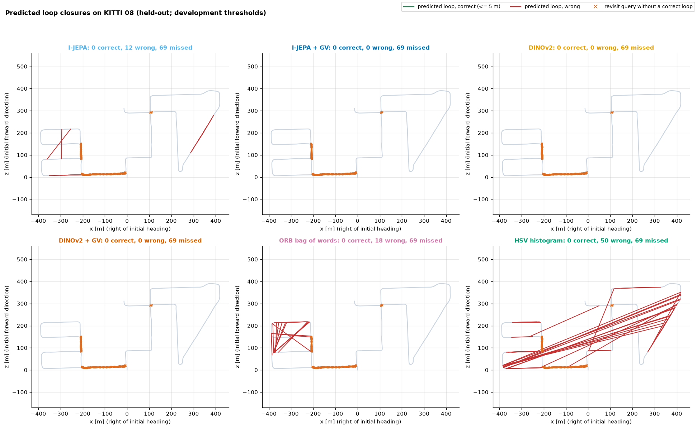
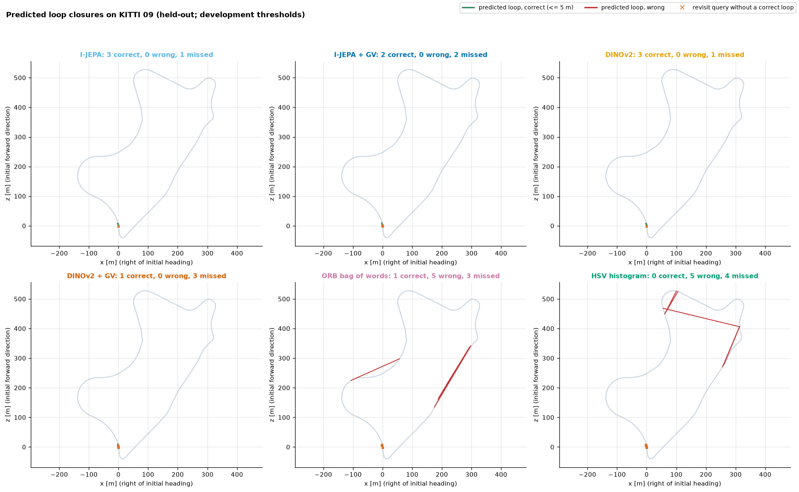

**False-positive and false-negative examples** (GV methods, test sequences). Each row shows the query, its predicted loop, and the closest true revisit:
* **False positives** are the highest-scoring wrong loops, all 5–8 m away.
* **False negatives** are the median missed query in the sequence with the most misses (08, where the true revisit faces the other way) and in the next one (02, a crossing).

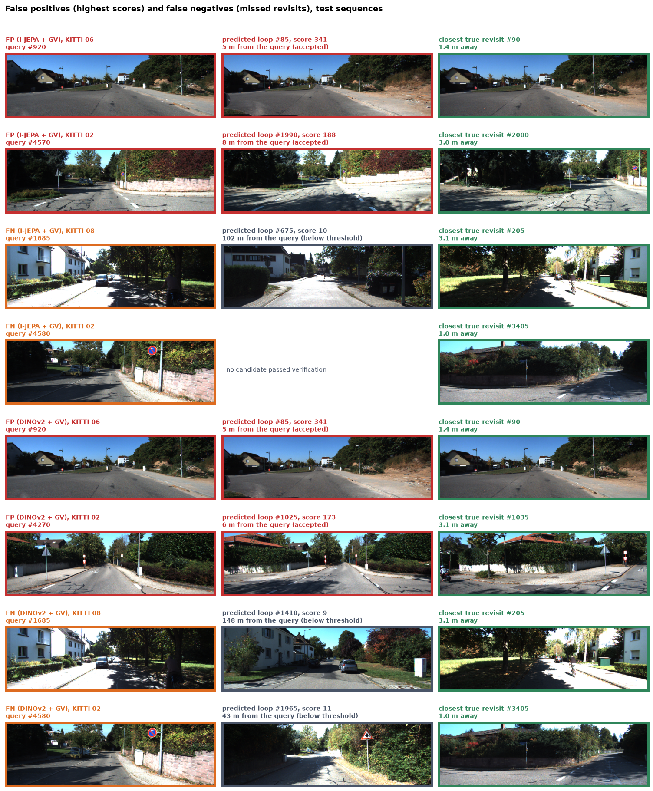

**Trajectory playback GIFs** (I-JEPA + GV and DINOv2 + GV; 110 evenly spaced frames at 8 fps). Each frame shows the camera image, the trajectory so far, and every predicted loop closure coloured by ground-truth correctness:
* KITTI 06, where loops are detected (6.9 MB);
* KITTI 08, where every revisit is in the opposite direction and nothing is detected (7.2 MB).

| KITTI 06 (held-out) | KITTI 08 (held-out, failure case) |
|---|---|
| 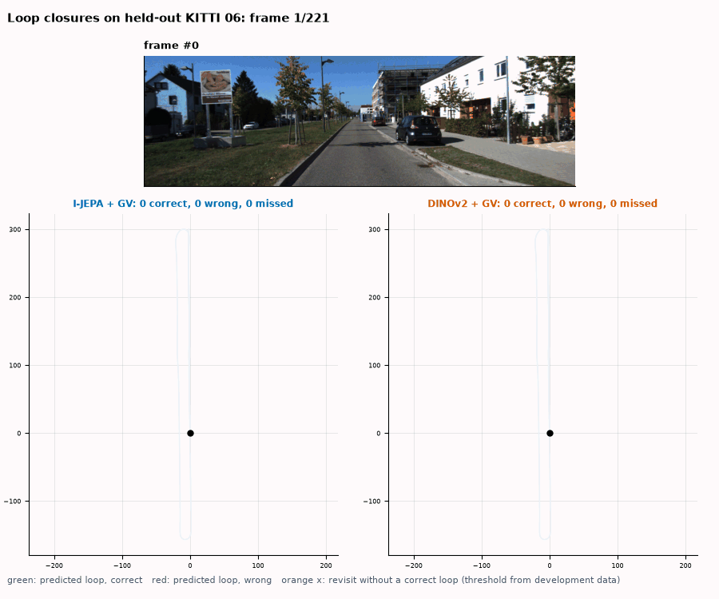 | 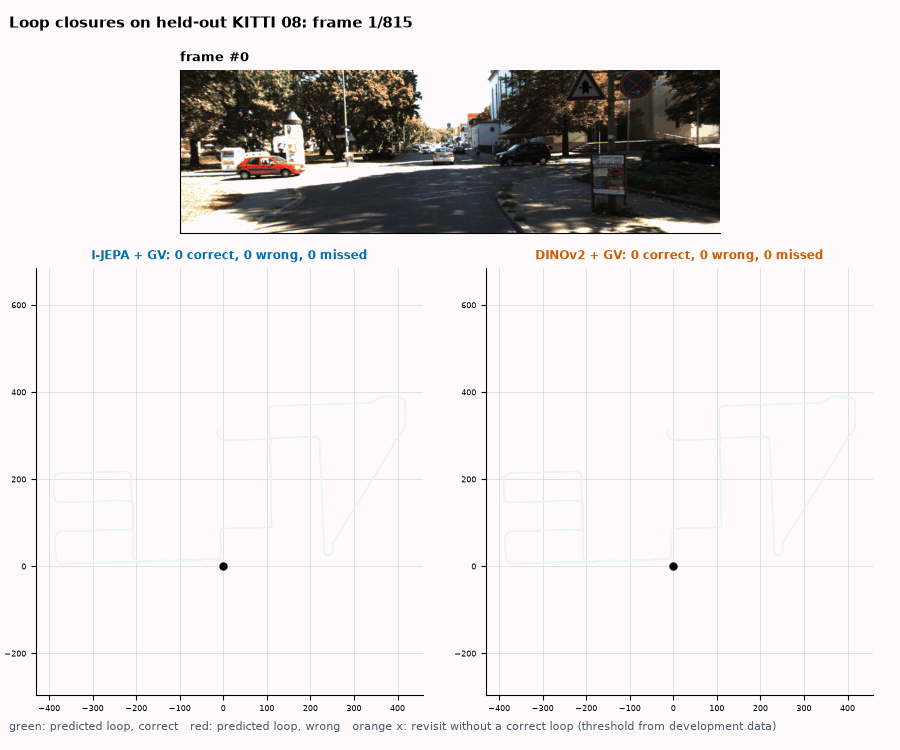 |
