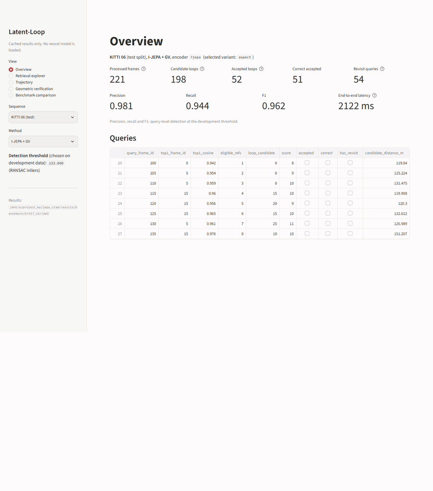
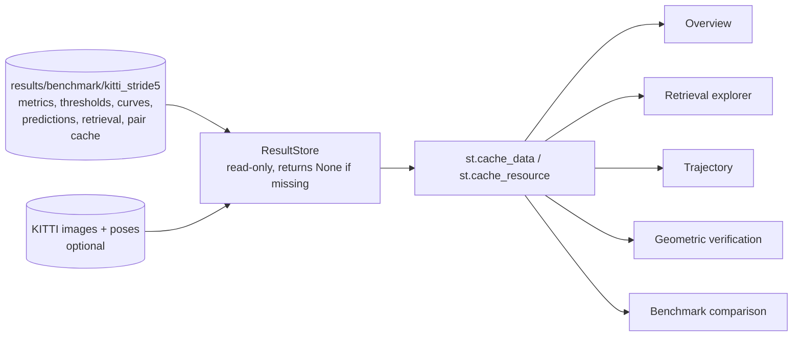
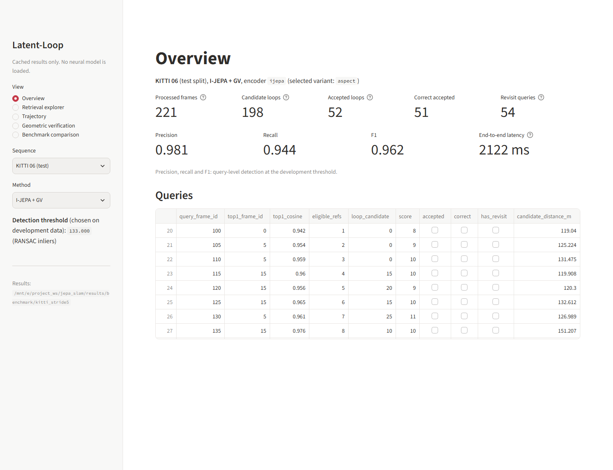
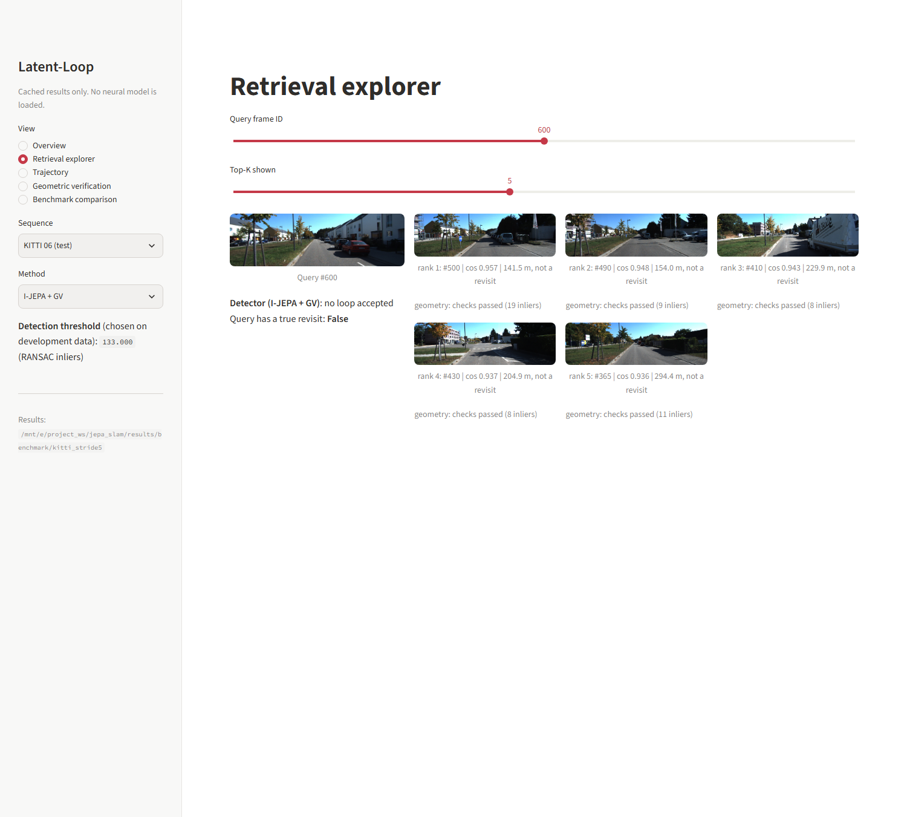
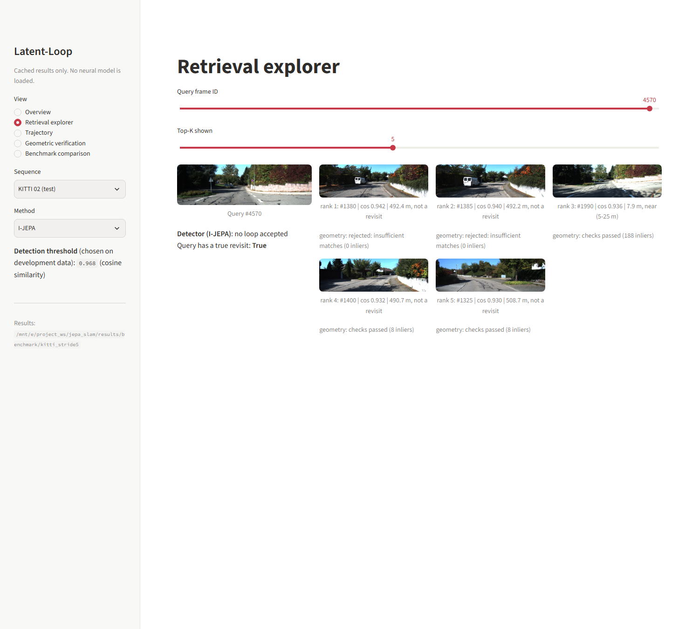
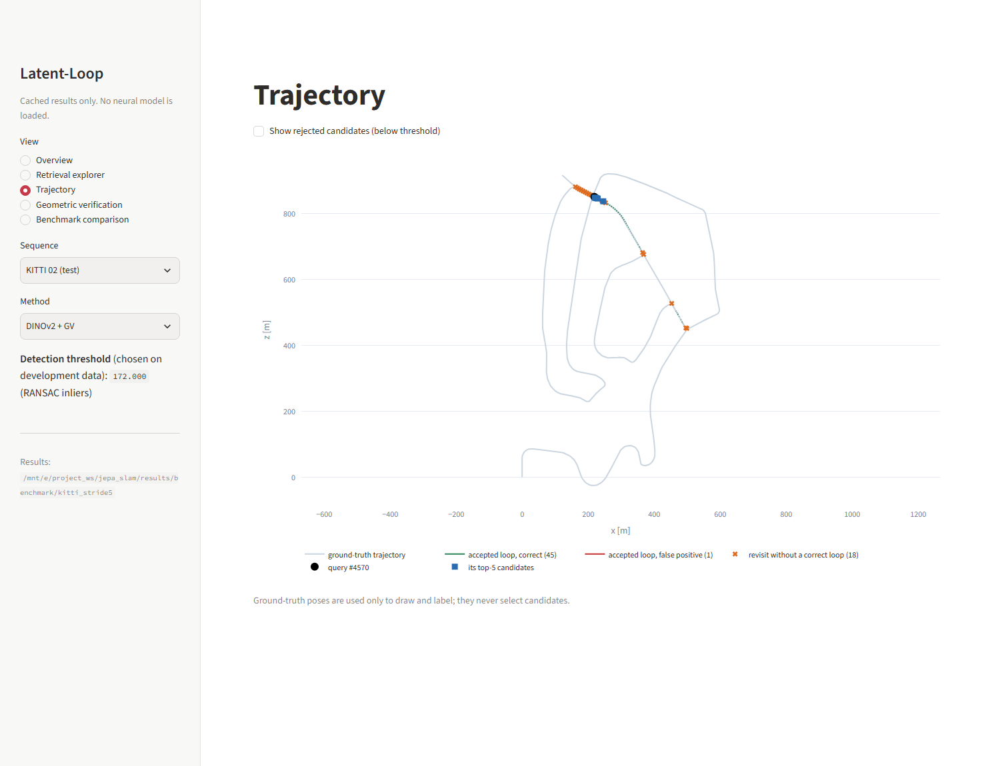
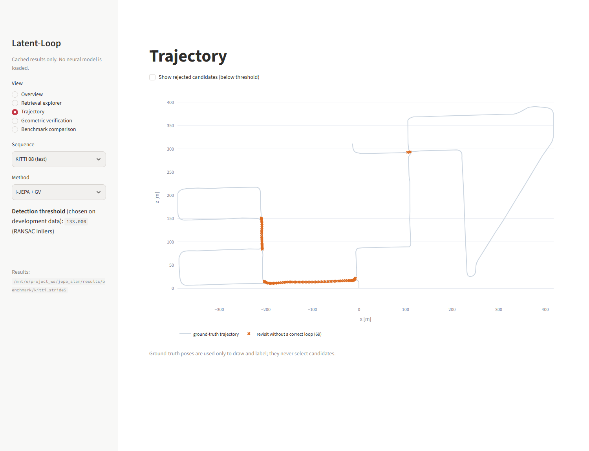
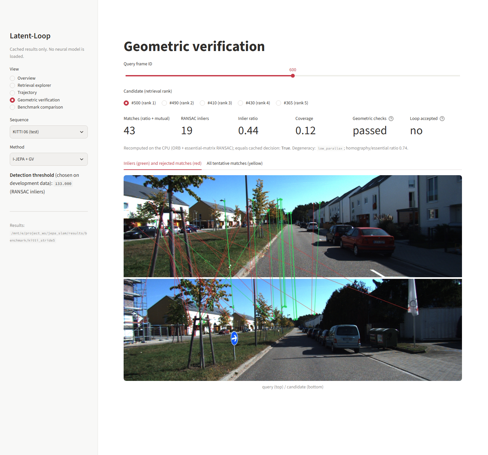
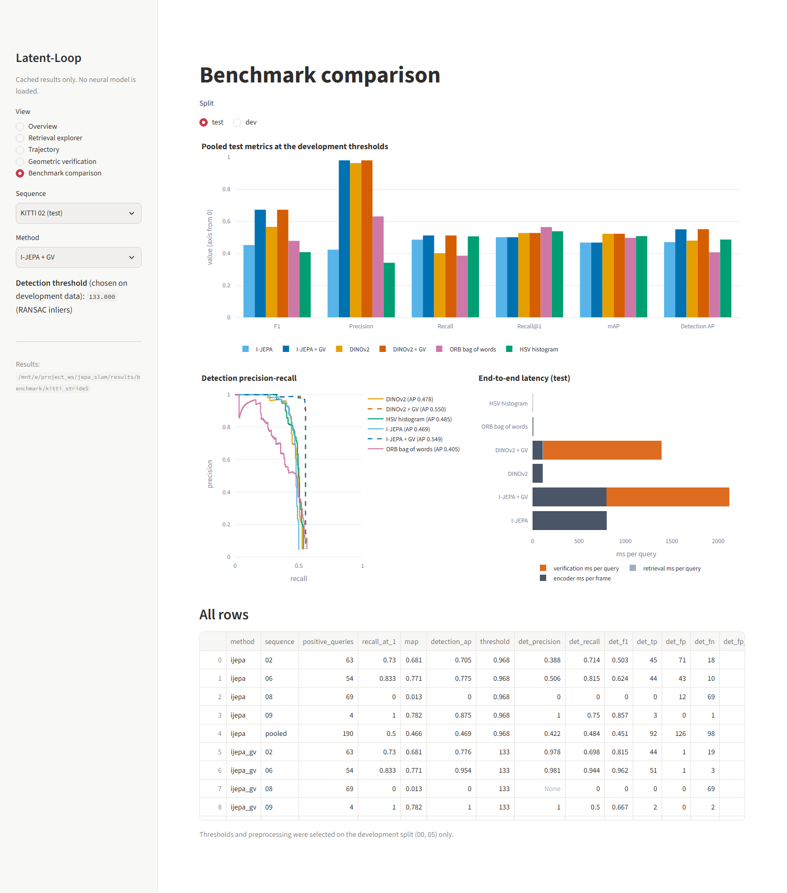

# Phase 7: Streamlit dashboard

[Back to README](../README.md)

## Objective

The dashboard lets you browse the Phase 6 benchmark interactively: for any held-out (or
development) sequence and method you can see:

* what was retrieved;
* what geometric verification decided;
* where the loops land on the trajectory;
* how the methods compare.

It loads **no neural network**. Everything comes from saved results, so it starts in seconds on
a CPU-only machine.



## Architecture



The code is in two parts:

* `src/latent_loop/dashboard/data.py`
  * `ResultStore`: a read-only view of one benchmark run, configured by `configs/benchmark.yaml`. Each loader (`metrics`, `thresholds`, `curves`, `predictions`, `retrieval`, `pairs`, `dataset`, ...) returns `None` when its file is missing, instead of raising.
  * `query_table` and `overview_numbers`: pure functions, unit-tested on their own.
* `app/streamlit_app.py`: the user interface. The sidebar selects:
  * the view;
  * the sequence, labelled with its split;
  * the method;

  and shows the method's development threshold.

**Cached result loading.**
* `ResultStore` and the KITTI dataset objects are held in `st.cache_resource`.
* Tables, predictions and retrieval arrays are held in `st.cache_data`.

So a widget change re-runs the script without re-reading `/mnt/e`.

**Deep links.** Query parameters select the view and its state, for example:

```text
?view=retrieval&seq=02&method=ijepa&q=4570
?view=trajectory&seq=08&method=ijepa_gv
?view=benchmark&split=test
```

The available parameters are `view`, `seq`, `method`, `q` (query frame ID) and `split`.

## Views

| View | What it shows | Source |
|---|---|---|
| Overview | Processed frames, candidate / accepted / correct loops, revisit queries, precision, recall, F1, end-to-end latency, and a sortable table of every query | `predictions/`, `test_metrics.csv`, `efficiency.csv`, `retrieval/` |
| Retrieval explorer | The query and its top-K images, each with its cosine, ground-truth distance (labels only) and cached verification status | `retrieval/`, `pair_cache/`, KITTI images |
| Trajectory | The ground-truth path, accepted loops (green: correct, red: false), optionally the rejected candidates, revisit queries without a correct loop, and the selected query with its top-5 | `predictions/`, KITTI poses |
| Geometric verification | One query–candidate pair: ORB + essential-matrix RANSAC **recomputed on the CPU**, compared with the cached decision, drawn as inliers / rejected matches / all tentative matches | `pair_cache/`, KITTI images, calibration |
| Benchmark comparison | Grouped bars of the headline metrics, detection PR curves, a latency breakdown, and every metrics row; for the test or development split | `{split}_metrics.csv`, `curves/`, `efficiency.csv` |

Ground-truth poses are used only to draw the trajectory and label outcomes, as everywhere else in
the project. The verification view prints whether its recomputation **equals the cached
decision**. It did in every pair inspected, including all five pairs drawn in the Phase 8 GIF.

## Running it

```bash
unset PYTHONPATH && source .env/bin/activate
pip install -e ".[dashboard]"          # streamlit + plotly (tested 1.67.0 / 7.1.0)
streamlit run app/streamlit_app.py     # http://localhost:8501
```

`.streamlit/config.toml` sets the light theme and turns off usage statistics.

**Data requirements.**

| Needed for | Files | Committed? |
|---|---|---|
| Every view | `results/benchmark/kitti_stride5/` (metrics, thresholds, curves, predictions, retrieval, pair cache; 11 MB) | yes |
| Images, trajectory, verification | KITTI images, calibration and poses under `data/raw/kitti/dataset` | no (see [installation](installation.md)) |

Without KITTI, the overview and benchmark views work fully; the image-based views say what is missing. Without benchmark results, the app tells you to run:

```bash
python scripts/run_benchmark.py --stage dev
python scripts/run_benchmark.py --stage test
```

**Measured responsiveness** (Streamlit `AppTest`, one process, CPU, repository on `/mnt/e`):

| View | First run | Re-run (caches warm) |
|---|---|---|
| Overview (first view of the process) | 20.4 s | 0.45 s |
| Retrieval explorer | 10.0 s | 0.40 s |
| Trajectory | 5.7 s | 0.40 s |
| Geometric verification (ORB + RANSAC recomputed) | 5.0 s | 0.65 s |
| Benchmark comparison | 5.3 s | 0.46 s |

The first run of the process pays for:
* imports;
* reading the results;
* building the KITTI index on `/mnt/e`.

Later views share those caches.

## Screenshots

The screenshots below are of the running app, taken with `scripts/capture_dashboard.py`. They come from real results; nothing is mocked.

**Overview** (KITTI 06, I-JEPA + GV). The numbers equal the benchmark row: TP 51, FP 1, precision 0.981, recall 0.944.



**Retrieval explorer**. Left: a correct revisit on KITTI 06. Right: perceptual aliasing on KITTI 02. There, I-JEPA's top two candidates are about 490 m away; verification rejects them with 0 inliers.

| KITTI 06, query 600 | KITTI 02, query 4570 |
|---|---|
|  |  |

**Trajectory**. Left: KITTI 02 with DINOv2 + GV and one selected query. Right: KITTI 08, where all 69 revisits are in the opposite direction and none is found.

| KITTI 02 | KITTI 08 |
|---|---|
|  |  |

**Geometric verification** (KITTI 06, query 600 against rank-1 frame 500). The pair passes the geometric checks with 19 inliers (`low_parallax`), but 19 is below the development threshold of 133, so no loop is accepted.



**Benchmark comparison** (test split):



## Tests

```bash
python -m pytest tests/test_dashboard.py      # 8 tests, ~50 s
```

The tests cover:

* `ResultStore` on missing results;
* `overview_numbers` and `query_table` on a hand-made prediction table;
* `ResultStore` against the real benchmark outputs;
* each of the five views rendered by Streamlit's `AppTest` without an exception.

## Reproducing the screenshots and the walkthrough GIF

```bash
streamlit run app/streamlit_app.py --server.headless true &        # keep it running
python scripts/capture_dashboard.py \
    --chrome "/mnt/c/Program Files/Google/Chrome/Application/chrome.exe" --delay 45
#    options: --base-url  --out DIR  --width 1500  --delay S  --port 8600  --gif-width  --gif-fps
```

* Headless Chrome's `--screenshot` fires on the page `load` event, which comes before Streamlit has rendered over its websocket. The script therefore wraps the app in a local page. That page also holds an image that a local server delays by `--delay` seconds, which postpones `load`.
* 25 s left the tables and images blank on `/mnt/e`; 45 s was enough for every view.
* The GIF stitches the seven screenshots, at 900 px and 8 fps. It is 0.43 MB.
* On WSL, the Windows Chrome binary is given Windows paths via `wslpath -w`.

## Troubleshooting

| Symptom | Fix |
|---|---|
| `ModuleNotFoundError: streamlit` / `plotly` | `pip install -e ".[dashboard]"` |
| "No benchmark results in ..." | Run the Phase 6 commands above, or point the app at another run: `streamlit run app/streamlit_app.py -- --set benchmark.output_dir=DIR` |
| "KITTI images not found" | Download KITTI ([installation](installation.md)); the other views keep working |
| Screenshots show grey placeholders | Increase `--delay` in `capture_dashboard.py` (image and table loading from `/mnt/e` is slow) |
| `pkill -f streamlit` kills your own shell | The pattern matches the shell's own command line. Stop the server by its PID instead |
