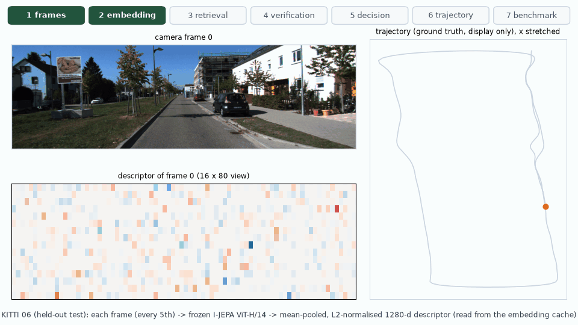

# Phase 8: final integration and release

[Back to README](../README.md)

## Objective

Phase 8 checks that the eight phases work together from a clean checkout, and that the release
makes no claims the results do not support. It also renders one end-to-end figure of the whole
pipeline from saved outputs.

## End-to-end pipeline GIF



The GIF walks one held-out query, frame 1010 of KITTI 06 with I-JEPA + GV, through every stage. Everything is read from disk.

| Stage | Source | What the GIF shows |
|---|---|---|
| 1–2 frames → embedding | KITTI images, I-JEPA embedding cache (`aspect`, fingerprint `fe45894e2c`) | 18 frames up to the query, each with its 1280-d descriptor |
| 3 retrieval | `results/benchmark/.../retrieval/kitti_06_cam2/ijepa-fe45894e2c` | The top-5 by cosine among the 183 references older than the exclusion window |
| 4 verification | Pair cache, re-verified for the drawing | ORB inliers and the inlier count of each candidate against the threshold of 133 |
| 5 decision | `thresholds.json`, `predictions/test/ijepa_gv_06.csv` | Accepted with 255 inliers; graded against ground truth as a TP (2.1 m) |
| 6 trajectory | Predictions | Causal replay of all accepted loops on 06 (51 correct, 1 false) |
| 7 benchmark | `test_metrics.csv` | Pooled test Recall@1 and detection F1 of all six methods |

The query's top-5 (from `assets/phase_08_final/phase8_summary.json`):

| Rank | Frame | Cosine | Inliers | Ground-truth distance |
|---|---|---|---|---|
| 1 | 185 | 0.987 | **255** | 2.1 m |
| 2 | 805 | 0.981 | 9 | 265 m (aliasing) |
| 3 | 190 | 0.980 | 181 | 2.3 m |
| 4 | 180 | 0.978 | 64 | 7.0 m |
| 5 | 200 | 0.973 | 15 | 9.8 m |

In all five pairs, the recomputed decision equals the cached one (`matches_cache: true`).

Candidate 2 shows why verification matters: a place 265 m away scores almost the same cosine as the true revisit, and it is rejected only because it has 9 inliers.

On the trajectory panels, the 06 path is stretched sideways so that the loop edges between the two lanes are visible. The panel title says so.

GIF: 960 × 540 px, 8 fps, 14 s, 2.19 MB. Rendering took about 2 min on the CPU: matplotlib, plus ORB + RANSAC for 5 pairs.

## Integration checks

All checks were run on 2026-11-06 on the development machine (see [installation](installation.md)).

| Check | How | Result |
|---|---|---|
| Unit and integration tests | `python -m pytest` | **181 passed, 0 skipped** in 5 min 46 s (incl. the probe, DINOv3 and re-run tests added afterwards) (CPU + GPU; the real-checkpoint tests run because the weights are present) |
| Lint and format | `ruff check .` and `ruff format --check .` | clean (94 files) |
| Command-line tools | `python scripts/<each>.py --help` for all 17 scripts | all succeed |
| CPU fallback | `extract_embeddings.py --config configs/kitti.yaml --encoder {ijepa,dinov2} --max-frames 8 --device cpu --no-cache` | both succeed on the CPU (FP32) |
| GPU inference | same with `--device cuda` | both succeed on the GTX 1650 Ti (FP32, chosen automatically) |
| Hard-coded paths | `grep` for `/mnt/`, `/home/`, `C:\` in `src scripts app configs tests` | none in code; only a docstring example in `capture_dashboard.py` and a comment in `kitti_download.py` |
| Evaluation leakage | Code review (see below) | no path from ground truth or test data into a decision |
| Cache correctness | Fingerprints, config hash, recomputation | embedding caches are keyed by an encoder fingerprint; pair caches by a hash of the verification config; recomputed pairs equal the cache (5 / 5 in the GIF, every pair inspected in the dashboard) |
| Benchmark reproducibility | `run_benchmark.py --stage test` re-run from caches (58.6 s) | `test_metrics.csv`, `test_metrics.json`, all 24 prediction files and all retrieval arrays are **byte-identical**; only wall-clock timing fields change (e.g. I-JEPA retrieval 0.263 → 0.282 ms per query). The committed timing files were kept |
| Dependencies | `requirements.txt`, `pyproject.toml` | pinned versions tested here; extras `dev`, `ml` (torch, faiss), `dashboard` (streamlit, plotly) |
| Figures and GIFs | every GIF under `assets/` | 13 GIFs, all ≤ 9.8 MB and 800–960 px wide; authored at 8–10 fps (identical consecutive frames are merged, so held frames show longer) |

**Leakage review.** Each rule below is enforced in code, not left as a convention:

* **Retrieval and verification never see poses.**
  * `retrieval/` receives descriptors, frame IDs and timestamps.
  * `verification/` receives images and the calibration.
  * Ground-truth poses enter only `datasets/ground_truth.py`, the metric code and the plots.
* **The test stage cannot tune.** `Benchmark.run_test` refuses to start without the development stage's `selection.json` and `thresholds.json`, and it rejects overlapping splits.
* **The ORB vocabulary is fitted on development data only.** `vocabulary_plan` refuses any sequence outside `splits.dev`, and the vocabulary's digest is part of the ORB bag-of-words fingerprint.
* **Release figures use the development thresholds.** The Phase 8 GIF and the dashboard read `thresholds.json`.

## Full pipeline re-run

To refresh every measurement in one consistent session, the complete benchmark (Phase 6 and v2) was re-run **from empty embedding, vocabulary and pair caches** with one command:

```bash
python scripts/reproduce_pipeline.py --fast-root ~/latent_loop_fast --workers 8
#    options: --runs v1 v2   --skip-stage   --out results/rerun
#    -> results/rerun/<benchmark name>/..., results/rerun/pipeline_run.json
```

The script first copies every 5th frame of the six sequences (plus calibration, times and poses) to a local Linux disk, because image reads from `/mnt/e` dominated earlier runs. The KITTI loader only lists frames whose image exists, so the sampled frame IDs are unchanged. Then, for each benchmark, it runs the development stage, profiles the selected encoder variants and runs the test stage, and compares the outputs with `results/benchmark/<name>`. Neural encoders ran on the GPU (GTX 1650 Ti, FP32), and ORB, HSV, retrieval and verification ran on the CPU (8 worker processes).

| Step | Wall time |
|---|---|
| Stage 3,750 KITTI frames to the local disk | 3.5 min |
| ORB vocabulary (development sequence 05) | 1.2 min |
| Phase 6: development stage / encoder profile / test stage | 47 min / 5 min / 60 min |
| v2: development stage / encoder profile / test stage | 46 min / 5 min / 21 min |
| **Total** | **3 h 8 min** |

The v2 test stage is shorter because it reuses the verified pairs of Phase 6. This is legitimate, because pair caches are keyed by the verification config hash and the decisions are deterministic.

**Outcome.** Accuracy reproduced exactly:

| Check | Phase 6 | v2 |
|---|---|---|
| Per-sequence and pooled test metrics (R@1, R@5, mAP, detection AP, precision, recall, F1, TP / FP / FN) | 30 rows, 0 differences | 40 rows, 0 differences |
| `selection.json`, `thresholds.json` | identical | identical |
| Test prediction files | 24 / 24 byte-identical | 32 / 32 byte-identical |
| Verification decisions in the pair caches (every column except timings) | identical | identical |

Only wall-clock fields changed. The re-run's timing files were promoted to `results/benchmark/`, and the encoder profiles to `results/metrics/encoder_profile_benchmark{,_v2}.json`. The cost tables in [Phase 6](phase6_evaluation.md), [Benchmark v2](benchmark_v2.md), the [results summary](results.md) and the README now come from this run. Compared with the first run:

* The GPU encoder times moved by 1–8 %, which is run-to-run variation. For example, I-JEPA took 798 → 834 ms per frame in Phase 6 and 923 → 854 ms in v2.
* Verification took about 11 % longer per query: with 8 workers on 8 cores, CPU contention costs more than the image reads it saved.

The committed Phase 6 development table also gained its pooled same-direction Recall@1, a column added to the runner after Phase 6. All per-sequence values are unchanged.

## Issues found and fixed in Phase 8

| Issue | Fix |
|---|---|
| The dashboard wrote `verification: accepted (8 inliers)` for pairs that passed the geometric checks but fell below the inlier threshold, which reads as an accepted loop | The labels now say "checks passed" or "rejected: reason". The verification view separates **Geometric checks** from **Loop accepted** |
| The dashboard hard-coded the 5 m and 25 m label radii | Read from `ground_truth.spatial_threshold_m` (the 25 m "near" band uses the `pair_labels` default) |
| The dashboard could only read `configs/benchmark.yaml` | `streamlit run app/streamlit_app.py -- --config X --set key=value` |
| `capture_dashboard.py` could report an old screenshot as new when Chrome exited early | The target is deleted first; a missing or too-early file is retried once, then raised as an error. Requests without parameters (favicon) get a 404 |

**Open issue.** Extraction reports in `results/metrics/` are named by dataset and fingerprint only. A smoke run with `--max-frames 8` therefore overwrites the report of a full run. These reports are git-ignored, and no documented number depends on them. Including the frame count in the name would fix it.

## Steps to run Phase 8

```bash
unset PYTHONPATH && source .env/bin/activate

# 1. Everything still passes
python -m pytest                      # 181 tests, ~6 min on /mnt/e
ruff check . && ruff format --check .

# 2. CPU fallback and GPU smoke test (8 KITTI 00 frames, no cache)
python scripts/extract_embeddings.py --config configs/kitti.yaml --encoder dinov2 \
    --stride 5 --max-frames 8 --batch-size 4 --device cpu --no-cache
python scripts/extract_embeddings.py --config configs/kitti.yaml --encoder dinov2 \
    --stride 5 --max-frames 8 --batch-size 4 --device cuda --no-cache

# 3. Reproducibility: re-run the test stage from caches (~1 min) and compare
python scripts/run_benchmark.py --stage test
git diff --stat results/benchmark      # only timing fields may change

# 4. End-to-end GIF (~2 min; needs the Phase 6 outputs and KITTI 06)
python scripts/generate_visualizations.py --phase 8
#    options: --query FRAME_ID  --gif-sequence SS  --gif-fps F  --gif-width PX  --output-dir DIR
#    -> assets/phase_08_final/{pipeline_end_to_end.gif, phase8_summary.json}

# 5. Phase 8 tests
python -m pytest tests/test_phase8.py
```

## Release contents

| Committed | Not committed (git-ignored) |
|---|---|
| Source, scripts, configs and tests | KITTI data (`data/raw`, 15.4 GB) |
| Benchmark outputs (`results/benchmark/kitti_stride5`, 11 MB) and Phase 3–4 results | Checkpoints (`checkpoints/`, I-JEPA 2.5 GB, DINOv2 346 MB) |
| Figures and GIFs (`assets/`, 124 MB) | Embedding caches (`data/cache`), `results/metrics` |
| Documentation (`README.md`, `docs/`) | Virtual environment (`.env/`) |

With only the committed files, the dashboard's overview and benchmark views and the Phase 6 tables can be reproduced. Images, verification and new descriptors also need KITTI and the checkpoints; see [installation](installation.md).
