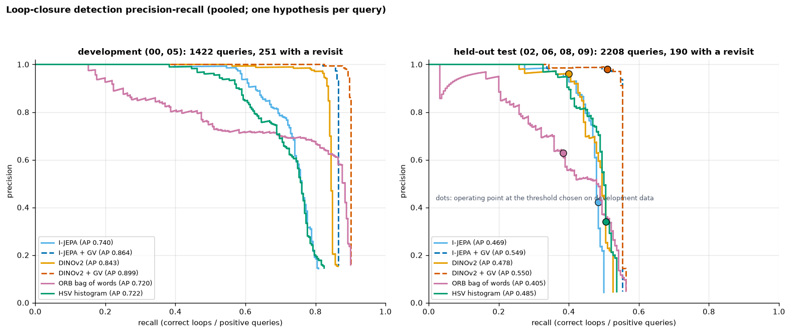
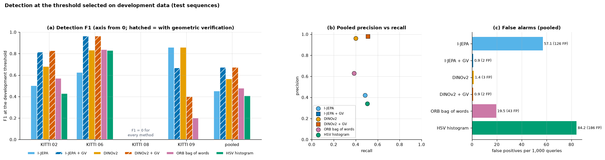

# Results summary

[Back to README](../README.md)

The numbers here are the held-out Phase 6 evaluation. The full protocol, every table and the figures are in [Phase 6](phase6_evaluation.md).

**Protocol.**
* KITTI Odometry, left colour camera, every 5th frame.
* Choices were made on the development sequences 00 and 05 only:
  * the preprocessing variant;
  * the detection threshold;
  * the ORB vocabulary.
* The test sequences 02, 06, 08 and 09 were evaluated once. Pooled, they give 2,208 queries, 190 of which have a true revisit (within 5 m and at least 100 frames older).
* Ground-truth poses were used only for labels.

**Devices.**
* I-JEPA ViT-H/14 and DINOv2 ViT-B/14 descriptors: GPU (GTX 1650 Ti, FP32).
* HSV, ORB bag of words, FAISS retrieval and geometric verification: CPU (Ryzen 7 4800H).

## Headline table (pooled test)

| Method | R@1 | mAP | Precision | Recall | **F1** | False loops per 1,000 queries | End-to-end per query |
|---|---|---|---|---|---|---|---|
| I-JEPA | 0.500 | 0.466 | 0.422 | 0.484 | 0.451 | 57.1 | 798 ms (GPU encoder) |
| I-JEPA + GV | 0.500 | 0.466 | **0.980** | **0.511** | **0.671** | **0.9** | 2122 ms (GPU + CPU GV) |
| DINOv2 | 0.526 | **0.521** | 0.962 | 0.400 | 0.565 | 1.4 | 112 ms (GPU encoder) |
| DINOv2 + GV | 0.526 | **0.521** | **0.980** | **0.511** | **0.671** | **0.9** | 1393 ms (GPU + CPU GV) |
| ORB bag of words | **0.563** | 0.496 | 0.629 | 0.384 | 0.477 | 19.5 | 10.5 ms (CPU) |
| HSV histogram | 0.537 | 0.507 | 0.340 | 0.505 | 0.407 | 84.2 | 1.9 ms (CPU) |

GV is geometric verification: ORB matching, then essential-matrix RANSAC on the top-5 candidates.

## What the measurements support

1. **Geometric verification makes a usable loop detector.** With GV, I-JEPA's false loops drop from 126 to 2. DINOv2 + GV finds 21 more correct loops than DINOv2 alone (paired McNemar p = 3 × 10⁻⁴).
2. **With GV, I-JEPA and DINOv2 are indistinguishable on this test set.** Each has 97 correct loops and 2 wrong ones. They disagree on 4 of the 190 positive queries, 2 each way. DINOv2 gets there with an encoder 7× faster that uses 5× less GPU memory.
3. **Without GV, I-JEPA is the weakest neural retriever.** Its development cosine threshold does not transfer, giving precision 0.42 on test. At rank 1, the classical ORB bag of words beats it (13 vs 1 discordant queries, p = 0.002).
4. **Nothing here shows I-JEPA outperforming DINOv2 or the classical baselines.**

## Benchmark v2 (second held-out run)

v2 widened the development-stage choices: pooling, short causal frame averaging, and DINOv3. It then evaluated the test set once more. The results are in [Benchmark v2](benchmark_v2.md).

| | Phase 6 F1 | v2 F1 |
|---|---|---|
| DINOv2 (no verification) | 0.565 | **0.678** (+25 / −2 correct loops, p = 6 × 10⁻⁶) |
| DINOv2 + GV | 0.671 | 0.655 |
| DINOv3 ViT-B/16 + GV | — | 0.669 |
| I-JEPA + GV | 0.671 | 0.667 |

* **The retrieval-only detectors improved.** Most notably, DINOv2 alone now matches the verified detectors at a fraction of the cost.
* **The verified detectors are unchanged.** KITTI 08 still caps every method.
* **DINOv3 vs DINOv2:** p = 0.25, so no detectable difference.

## Where every method fails

* **KITTI 08**: all 69 of its revisits are driven in the opposite direction, and every method scores F1 = 0. 08 holds 36 % of the test revisits. As a secondary analysis, excluding 08 brings both GV methods to F1 0.882.
* **Crossing revisits** in 02, where an earlier path is crossed at a different heading, are mostly missed.
* **The remaining false loops are near misses.** Both GV methods' false loops link frames 5–8 m apart on the same street.

## Limitations

* Small test set (190 revisit queries), and consecutive queries are correlated.
* One camera, one frame stride and one 5 m radius.
* No pose-graph back-end, so no trajectory-error evaluation.
* Verification latency was measured with 6 worker processes reading from a slow `/mnt/e` drive.

See [Phase 6: limitations](phase6_evaluation.md#limitations).

## Figures

